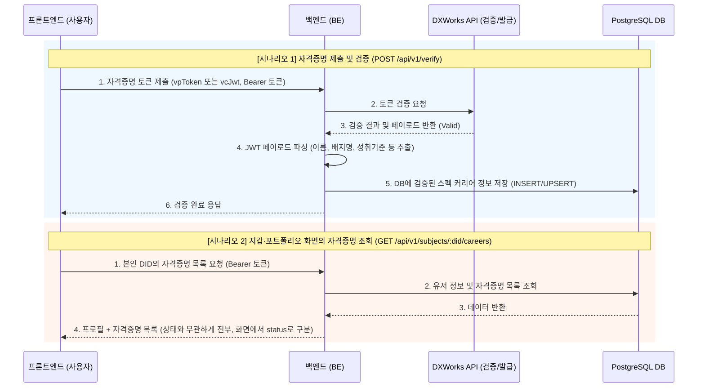
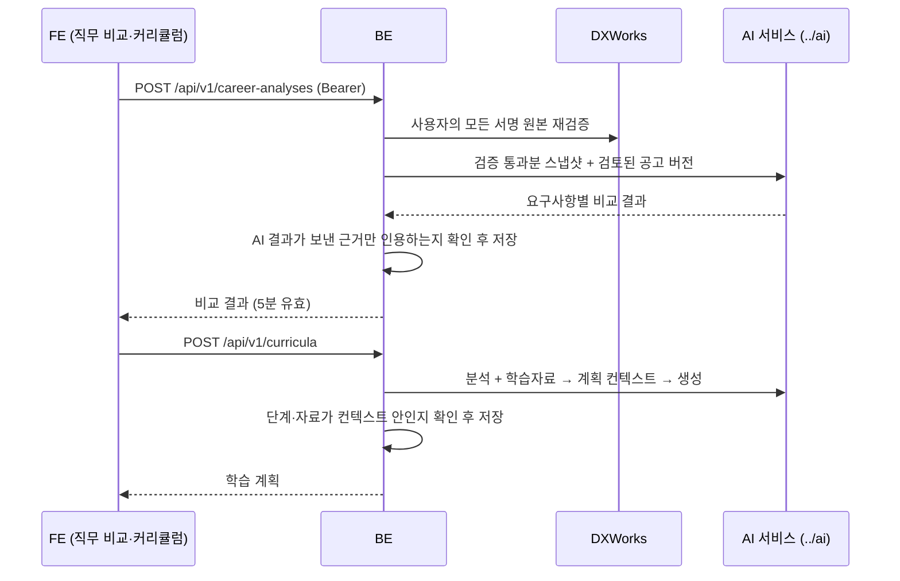

# BE 파트 - VC 검증 및 AI 데이터 서빙 백엔드 서버

본 프로젝트의 프론트엔드에서 제출한 자격증명(VC)을 DXWorks API를 통해 검증하고 그 결과를 DB에 저장하는 **BFF(Backend For Frontend) 서버**이자 기록의 원본(system of record)입니다. 직무 비교·커리큘럼 때는 자격증명을 다시 검증해 통과한 근거만 AI 서비스(`../ai`)로 보냅니다(AI는 BE를 호출하지 않습니다).

## 1. 아키텍처 흐름도 (Flowchart)



> AI 서비스(`../ai`)는 BE를 호출하지 않습니다. 직무 비교·커리큘럼 요청 때 BE가 재검증을 통과한 근거만 AI로 보냅니다(아래 "🧭 직무 비교 · 커리큘럼" 참고).

## 2. 원클릭 개발 환경 구축 (Docker 기반 권장 ⭐️)

로컬에 파이썬(Python)이나 PostgreSQL을 직접 설치할 필요가 없습니다. Docker Desktop만 켜져 있다면, **단 두 줄의 명령어**로 파이썬 패키지 설치, DB 세팅, 440여 개 테스트 데이터 시딩, FastAPI 서버 실행까지 모든 환경이 자동으로 한 번에 구축됩니다.

### 🚀 최초 1회 실행 방법
```bash
# 1. BE 디렉터리 이동 및 환경변수 예시 복사
cd BE
cp -n .env.example .env

# 2. 도커로 전체 환경 자동 빌드 및 백그라운드 실행
docker compose up --build -d
```
> **⚠️ 주의 (API 키 설정):** 
> 실제 발급/검증 테스트(Step 1, Step 2)를 수행하려면 `.env` 파일의 `DXWORKS_API_HOST`, `DXWORKS_API_KEY`, `DXWORKS_BADGE_TEMPLATE_ID`를 채워야 합니다. (더미 조회 테스트는 키 없이도 즉시 가능합니다.)
>
> **🔒 협력사 자료 취급:** 이 값들과 협력사에서 받은 문서·예제 코드는 **비공개 자료**입니다. 공개 저장소(코드, 문서, 이슈, PR 본문, 커밋 메시지)에 그대로 옮기지 말고 `.env`와 팀 내부 채널로만 주고받으세요. 협력사 API 형식은 `app/integrations/dxworks.py`에서만 다룹니다.

> **💡 이 명령어 하나로 자동 완료되는 항목들:**
> 1. **Python 3.11 런타임 & 의존성(버전 고정 `requirements.txt`)** 도커 컨테이너 내 자동 설치 (로컬 파이썬 버전 충돌 0%)
> 2. **PostgreSQL 16 + pgvector** 컨테이너 자동 구동
> 3. **440여 개 논문 테스트 데이터(`03_seed_data.sql`)** DB에 자동 시딩
> 4. **DB 마이그레이션**: 한 번 실행하고 끝나는 `migrate` 서비스가 아직 적용하지 않은 `DB/migrations/` 파일을 적용하고, 성공해야 백엔드가 뜹니다 (아래 "🗄️ DB 마이그레이션").
> 5. **FastAPI 백엔드 서버(포트 3000)** 자동 실행
> 6. **핫 리로드(Hot Reload)** 연동: 로컬 소스 코드(`BE/`)를 수정하고 저장하면 컨테이너 내부 서버가 즉시 자동 반영됩니다. (`docker-compose.yml`이 `--reload`와 소스 바인드 마운트로 켭니다. `Dockerfile` 기본 실행은 리로더 없는 운영용입니다.)

---

## 3. 컨테이너 관리 명령어

```bash
# 실행 상태 확인
docker compose ps

# 백엔드 서버 실시간 로그 확인
docker compose logs -f backend

# 마이그레이션 결과 확인 (이번에 적용한 파일 목록)
docker compose logs migrate

# 서버 및 DB 일시 종료 (데이터는 보존됨)
docker compose down

# DB 및 데이터 완전 초기화 (초기 시드 상태로 깨끗하게 리셋할 때)
docker compose down -v
docker compose up -d
```
* **API 문서 (Swagger UI):** [http://localhost:3000/docs](http://localhost:3000/docs)
* **헬스 체크:** [http://localhost:3000/health](http://localhost:3000/health)

<details>
<summary><b>(선택) 도커 대신 로컬 파이썬 환경에서 직접 띄우고 싶을 때</b></summary>

로컬 IDE 디버거 등을 위해 호스트에서 직접 실행하려는 경우:
1. DB만 도커로 켬: `docker compose up -d postgres`
2. 의존성 설치: `pip install -r requirements.txt` (Mac/Linux는 `python3 -m pip install -r requirements.txt`)
3. 마이그레이션 적용: `python -m app.migrate` (`.env`의 `DB_*`로 접속해 아직 적용하지 않은 파일만 적용합니다)
4. 서버 실행: `python -m uvicorn main:app --reload --port 3000`

`python main.py`로 띄우면 코드 변경 자동 반영(reload)은 `UVICORN_RELOAD=1`일 때만 켜집니다.
</details>

### 🔄 기존 환경을 쓰고 있다면 (업데이트 후)
새 패키지가 추가된 버전(v0.4.0의 `PyJWT`·`cryptography`, v0.7.0의 `rfc8785`와 AI 컨테이너 `ai` 등)은 이미지를 다시 빌드해야 합니다.
다시 빌드하지 않으면 핫 리로드 중인 서버가 `ModuleNotFoundError`로 멈춥니다.
```bash
docker compose up -d --build
```
새 DB 컬럼·테이블(`credentials.raw_token`, `holder_keys`, `shares`, 직무 비교 테이블, 로그아웃용 `users.token_version`(09)·모의 발급 기록 `mock_issuances`(10) 등)은 이 명령이 띄우는 `migrate` 서비스가 기존 볼륨에도 자동으로 적용합니다(아래 "🗄️ DB 마이그레이션"). 마이그레이션 파일을 `psql`로 하나씩 실행할 필요가 없습니다. 09가 없는 DB에서는 로그인·가입과 토큰이 필요한 모든 요청이, 10이 없는 DB에서는 모의 발급이 500이므로 BE만 따로 띄울 때도 먼저 `python -m app.migrate`를 실행합니다.
(DB를 통째로 새로 만들어도 되면 `docker compose down -v && docker compose up -d --build`. 기존 DB 데이터는 모두 지워집니다)
예전에 복사한 `.env`에 `AUTH_REQUIRED=false` 줄이 있으면 지웁니다. 이제 인증을 끄는 설정은 없고(아래 "🔐 인증"), 남아 있으면 시작 로그에 경고만 남습니다.

### 🗄️ DB 마이그레이션 (`python -m app.migrate`, 로컬·CI·AWS 공통)
- **실행:** `BE/`에서 `python -m app.migrate`. 앱과 같은 `DB_HOST`·`DB_PORT`·`DB_USER`·`DB_PASSWORD`·`DB_NAME`으로 접속하고 `PGSSLMODE` 같은 libpq 환경변수와 `DB_CONNECT_TIMEOUT`(기본 10초)도 그대로 적용됩니다. `.env`가 있으면 읽되 이미 있는 환경변수가 우선하고, DB가 막 뜨는 중이면 최대 60초 기다립니다.
- **동작:**
  - 빈 DB(`users` 표 없음): `DB/schema/schema_PostgreSQL.sql` → `DB/schema/schema_pgvector.sql` → (`--seed`일 때만) `DB/seeds/03_seed_data.sql`을 한 트랜잭션으로 적용합니다. `--seed`는 이미 만들어진 DB에서는 무시됩니다.
  - 그다음 `DB/migrations/NN_*.sql` 중 원장 `public.schema_migrations`(filename, checksum, applied_at)에 없는 파일을 번호 순으로, 파일마다 원장 기록과 함께 한 트랜잭션으로 적용합니다. 실패하면 그 파일만 롤백됩니다.
  - 원장 없이 만들어진 기존 DB(Compose initdb·수동 `psql`)는 마이그레이션을 모두 다시 적용하고 기록합니다(모두 여러 번 실행해도 안전).
  - 여러 개가 동시에 실행돼도(ECS 태스크 등) DB별 advisory lock으로 하나씩 실행합니다.
  - 실행기 연결의 `search_path`는 고정합니다. 기본 스키마·마이그레이션 파일을 실행하는 연결은 `public`(`pg_catalog`는 늘 먼저 찾음)이고, 실행기 자신의 SQL(`DB_APP_ROLE` 검사·원장 읽기·시드 해시 확인·`GRANT`/`REVOKE`)을 실행하는 advisory lock 연결은 `pg_catalog`만 찾으므로 `public`에 심은 함수·연산자는 인자 형이 정확히 맞아도(예: `public.=(oid, regclass)`) 부르지 않습니다(임시 스키마는 함수·연산자를 찾을 때 쓰지 않음). DB·역할에 건 `search_path` 설정(`ALTER DATABASE/ROLE ... SET`)이나 마이그레이션 계정 이름의 스키마(`"$user"`)는 실행기가 쓰지 않습니다.
- **운영 검사(`APP_ENV`):** 앱과 같이 `.env`를 읽은 뒤의 `APP_ENV`를 보고(비우면 `development`), `development`가 아니면 운영으로 검사합니다. 로컬 Compose(`migrate` 서비스에 `APP_ENV=development`를 넣음)·로컬 `.env`·CI는 예전과 같습니다.
  - `--seed`는 DB에 접속하기 전에 거부합니다.
  - 적용을 마친 뒤 `users`에 04 마이그레이션의 시드 테스트 비밀번호 해시를 그대로 쓰는 계정이 있으면 실패합니다(시드·개발 DB 데이터가 운영 DB에 들어간 경우. 해시 값은 로그에 남기지 않습니다). 이미 적용한 마이그레이션은 남고, 그 계정을 지운 뒤 다시 실행하면 통과합니다.
  - `DB_PASSWORD`가 없거나 비었거나 로컬 기본값 `password`면 접속하지 않습니다(앱의 DB 연결도 같은 규칙). `APP_ENV`가 잘못된 값(예: `prod`)이어도 실패합니다.
- **서비스 계정 권한(`DB_APP_ROLE`, 선택·운영 RDS용):** 마이그레이션 태스크에 `DB_APP_ROLE=<BE 서비스 계정>`을 주면 적용을 마친 뒤(advisory lock 안에서) 한 트랜잭션으로 먼저 `public`의 모든 테이블·시퀀스에서 그 계정의 권한을 모두 거두고(예전에 그 계정에 준 `GRANT ALL`의 `TRUNCATE` 등은 남지 않음. 이 회수는 그 계정 자신의 권한만 바꾸므로 `TRIGGER`·`REFERENCES`·원장 쓰기 권한은 그 계정·속한 역할·`PUBLIC` 어디에 있든 아래 검사가 먼저 거부), 그 계정에 DB `CONNECT`, `public` 스키마 `USAGE`, `public`의 모든 테이블 `SELECT`·`INSERT`·`UPDATE`·`DELETE`, 모든 시퀀스 `USAGE`·`SELECT`를 주고, 원장 `public.schema_migrations`의 권한은 모두 뺍니다(로그: `서비스 계정 권한 적용: <역할> (앱 테이블 DML만)`). 실행할 때마다 다시 주므로 나중에 생긴 테이블도 들어갑니다. 비워 두면 아무것도 하지 않습니다(로컬·CI는 넣지 않음).
  그 계정은 advisory lock을 잡은 직후(기본 스키마·마이그레이션 SQL을 하나라도 실행하기 전)와 권한을 주기 직전에 검사합니다. 처음 검사에 걸리면 아무것도 적용하지 않고(빈 DB는 빈 채로 남음), 어느 검사든 걸리면 권한을 주지 않고 실패합니다. 아래에서 "속한 역할"은 권한을 상속하지 않는 `NOINHERIT`·`GRANT ... WITH INHERIT FALSE` 소속도 포함합니다(`SET ROLE`로 그 역할이 될 수 있음).
  - 역할이 없거나 특권 계정(그 역할이나 그 역할이 속한 역할의 슈퍼유저·`CREATEROLE`·`CREATEDB`·`REPLICATION`·`BYPASSRLS` 속성, 마이그레이션 계정 자신이나 그 소속, `rds_superuser`·`pg_read_all_data`·`pg_write_all_data`·`pg_read_server_files`·`pg_write_server_files`·`pg_execute_server_program` 소속)이면 실패합니다. 특권 속성이 있는 소속 역할은 `마이그레이션 실패:` 줄에 이름이 나옵니다(큰따옴표로 감쌈).
  - 그 역할이나 그 역할이 속한 역할이 `public` 스키마나 DB에 객체를 만들 수 있어도 실패합니다: CREATE 권한(`PUBLIC`에 준 CREATE 포함)이나 DB·`public` 스키마의 소유(소유자는 거둔 CREATE를 스스로 다시 줄 수 있으므로 CREATE를 모두 거둬도 거부. 새로 만든 PostgreSQL 15 이상 DB에서는 DB 소유자가 `pg_database_owner`로 `public` 스키마도 소유하며 DB 소유로 알려 줌). `마이그레이션 실패:` 줄이 걸린 검사(`public 스키마`·`DB "<DB 이름>"`), 그 권한·소유를 가진 소속 역할과 그대로 실행할 수 있는 GRANT·ALTER ... OWNER·REVOKE 문(이름은 큰따옴표로 감쌈)을 실행할 순서대로 알려 주므로, 마이그레이션 계정으로 차례대로 실행한 뒤 다시 실행합니다.
    - 소유가 먼저입니다(소유자에게서 CREATE를 먼저 거두면 새 소유자도 그 CREATE를 받지 못함): DB는 `ALTER DATABASE "<DB 이름>" OWNER TO "<마이그레이션 계정>";`, `public` 스키마는 `ALTER SCHEMA public OWNER TO pg_database_owner;`(PostgreSQL 14 이하는 `OWNER TO "<마이그레이션 계정>"`). 마이그레이션 계정이 슈퍼유저가 아니면(RDS 마스터 사용자) 맨 앞에 지금 소유자의 권한을 받는 `GRANT "<지금 소유자>" TO "<마이그레이션 계정>" WITH INHERIT TRUE;`(PostgreSQL 15 이하는 `WITH INHERIT TRUE` 없이)가 나옵니다(다 고친 뒤 그 소속을 다시 거두는 방법은 루트 README "AWS 배포 체크리스트"의 "DB 마이그레이션").
    - 지금 소유자 몫의 CREATE를 이미 거뒀으면 ALTER 문 뒤에 새 소유자에게 CREATE를 다시 주는 GRANT 문이 `(지금 소유자 몫의 CREATE를 거둔 상태라 새 소유자에게 다시 줌)`과 함께 붙습니다: `public` 스키마는 `GRANT CREATE ON SCHEMA public TO pg_database_owner;`(PostgreSQL 14 이하는 `TO "<마이그레이션 계정>"`. DB 소유자가 `pg_database_owner`로 `public` 스키마를 소유했으면 ALTER DATABASE 뒤), DB는 아직 없는 확장(`pgcrypto`·`vector`)을 만들어야 하거나 `public` 스키마의 소유자도 바꿀 때만 `GRANT CREATE ON DATABASE "<DB 이름>" TO "<마이그레이션 계정>";`.
    - 그다음 CREATE 회수: `public` 스키마는 `REVOKE CREATE ON SCHEMA public FROM PUBLIC;`(PostgreSQL 14 이하에서 만들었거나 그 버전에서 업그레이드·복원한 DB는 기본으로 모든 역할(`PUBLIC`)이 `public` 스키마에 CREATE 권한을 가짐)과 그 역할에 따로 준 CREATE 회수, DB는 `REVOKE CREATE ON DATABASE "<DB 이름>" FROM PUBLIC;`과 그 역할에 준 CREATE 회수. CREATE를 받은 소속 역할은 이름과 `REVOKE CREATE ON SCHEMA public FROM "<그 역할>";`·`REVOKE CREATE ON DATABASE "<DB 이름>" FROM "<그 역할>";`이 나옵니다.
    - 소속을 거두는 문(`REVOKE "<소속 역할>" FROM "<DB_APP_ROLE>"`)은 알려 주지 않습니다. 위 문들은 소속을 그대로 두므로 `DB_APP_ROLE`이 그 소속 역할로 `public`에 만들어 둔 객체를 다음 실행에서 아래 소유 객체 검사가 알려 줍니다. 소속도 거두려면 마이그레이션이 성공한 뒤에 거둡니다(먼저 거두면 `public`에 CREATE 권한도 소유도 없는 그 역할의 객체는 이 검사가 보지 못함. 루트 README "AWS 배포 체크리스트"의 조회 ①은 보여 줌).
  - 그 역할이나 그 역할이 속한 역할, 기본 제공 역할(OID 16384 미만, 부트스트랩 슈퍼유저 제외. 예: `pg_database_owner`·`pg_monitor`), `public` 스키마에 CREATE 권한이 있거나 DB·`public` 스키마를 소유한 다른 역할(부트스트랩 슈퍼유저(OID 10)·마이그레이션 계정 제외. 예: 소속을 거둔 예전 소속 역할)이 `public` 스키마에 객체(함수·연산자·타입·테이블·뷰·시퀀스·연산자 클래스·텍스트 검색 설정·확장 등)를 소유해도 실패합니다. CREATE를 거두기 전에 만든 객체도 남아, 마이그레이션 계정·앱이 이름으로 찾아 부르면 부른 계정의 권한으로 실행되기 때문입니다. 소유자는 카탈로그마다 소유자 열로 봅니다(기본 제공 역할의 소유는 `pg_shdepend`에 남지 않음). 그 역할이 DB 소유자일 때 `pg_database_owner`에게 넘긴 객체도 위 `ALTER DATABASE` 문으로 DB 소유자를 바꾼 다음 실행에서 이 검사에 걸립니다. `마이그레이션 실패:` 줄(`DB_APP_ROLE이나 그 역할이 속한 역할, 기본 제공 역할(pg_database_owner·pg_monitor 등), public 스키마에 CREATE 권한이 있거나 DB·public 스키마를 소유한 다른 역할이 public 스키마에 객체를 소유합니다: …`)이 객체를 `['function public.lower(character varying)', …]`처럼 10개까지 알려 주므로(더 있으면 `외 N개`) 마이그레이션 계정으로 하나씩 확인해, 예상하지 못한 객체는 `DROP`하고 앱에 필요한 객체는 `ALTER <종류> <이름> OWNER TO "<마이그레이션 계정>"`으로 소유자를 바꾼 뒤 다시 실행합니다. 그래서 `DB_APP_ROLE`을 줄 때는 DB와 `public`의 테이블을 소유한 계정(운영은 마스터 사용자)으로 마이그레이션합니다. 다른 관리 계정(예: 전용 역할이 소유한 DB에 슈퍼유저)으로 실행하면 그 소유 역할의 테이블 등이 이 검사에 걸립니다.
  - 그 역할이나 그 역할이 속한 역할(또는 `PUBLIC`)이 `public` 스키마의 테이블·뷰·외부 테이블 하나에라도 `TRIGGER` 권한이 있어도(예: 예전에 준 `GRANT ALL`) 실패합니다. 마이그레이션이 바꾸는 테이블에 트리거를 걸어 임시 스키마(`pg_temp`)의 함수 같은 것을 마이그레이션 계정의 권한으로 실행하게 할 수 있기 때문입니다. `마이그레이션 실패:` 줄이 그 권한을 받은 역할마다 `REVOKE TRIGGER ON ALL TABLES IN SCHEMA public FROM "<그 역할>";`(`PUBLIC`이면 `FROM PUBLIC;`)을 알려 줍니다. 그 권한이 있던 동안 만든 트리거는 권한을 거둔 뒤에도 남으므로 같은 줄이 `public` 스키마 테이블의 트리거(시스템 내부 트리거 제외)도 `['trigger <이름> on public.<테이블>', …]`처럼 10개까지(더 있으면 `외 N개`, 없으면 `없음`) 알려 줍니다. 마이그레이션 계정으로 확인해 예상하지 못한 트리거는 `DROP TRIGGER <이름> ON public.<테이블>;`로 지웁니다(이 앱의 스키마·마이그레이션은 트리거를 만들지 않음).
  - `public` 스키마 테이블의 트리거(시스템이 만든 내부 트리거 제외)에 WHEN 조건이 있거나, 그 트리거가 임시 스키마(`pg_temp_N`)의 함수나 위 소유 객체 검사와 같은 역할(그 역할·그 역할이 속한 역할·기본 제공 역할·`public` 스키마에 CREATE 권한이 있거나 DB·`public` 스키마를 소유한 다른 역할)이 소유한 함수를 불러도 실패합니다. WHEN 조건은 어떤 함수·연산자든 부를 수 있고 트리거 함수가 불리지 않아도 그 테이블을 바꾸는 마이그레이션 계정의 권한으로 실행되므로 트리거 함수와 관계없이 거부합니다(이 앱의 마이그레이션은 WHEN 조건이 있는 트리거를 만들지 않음). `마이그레이션 실패:` 줄이 트리거를 `trigger <이름> on public.<테이블> → function <함수>`(WHEN 조건이 있으면 `trigger <이름> on public.<테이블> (WHEN 조건) → function <함수>`)처럼 10개까지 알려 주므로 마이그레이션 계정으로 확인해 예상하지 못한 트리거는 `DROP TRIGGER <이름> ON public.<테이블>;`로 지운 뒤 다시 실행합니다(임시 스키마의 함수를 부르는 트리거는 그 함수를 만든 세션이 끝나면 함께 지워짐).
  - 그 역할이나 그 역할이 속한 역할(또는 `PUBLIC`)이 `public` 스키마의 테이블 하나에라도 `REFERENCES` 권한이 있어도(열 단위 권한 포함. 예: 예전에 준 `GRANT ALL`) 실패합니다. 외래 키 검사는 참조되는 테이블의 소유자(마이그레이션 계정)의 권한으로 실행되므로, 그 역할이 자기 스키마의 테이블에서 `public` 테이블을 참조하는 외래 키를 걸고 그 열에 자기가 만든 암시적 캐스트 같은 함수를 쓰면 마이그레이션과 관계없이 행을 넣을 때마다 그 함수를 마이그레이션 계정의 권한으로 실행하게 할 수 있기 때문입니다. `마이그레이션 실패:` 줄이 그 권한을 받은 역할마다 `REVOKE REFERENCES ON ALL TABLES IN SCHEMA public FROM "<그 역할>";`(`PUBLIC`이면 `FROM PUBLIC;`. 열 단위 권한도 함께 거둠)을 알려 줍니다. 그 권한이 있던 동안 만든 외래 키는 권한을 거둔 뒤에도 남으므로 같은 줄이 `public` 스키마 밖의 테이블에서 `public` 테이블을 참조하는 외래 키도 `['constraint <이름> on <스키마>.<테이블>', …]`처럼 10개까지(더 있으면 `외 N개`, 없으면 `없음`) 알려 줍니다. 마이그레이션 계정으로 확인해 예상하지 못한 외래 키는 `ALTER TABLE <스키마>.<테이블> DROP CONSTRAINT <이름>;`으로 지웁니다(이 앱의 스키마·마이그레이션은 `public` 안의 외래 키만 만듦. REVOKE 뒤의 실행은 이 목록을 다시 알려 주지 않으므로 그 전에 확인하거나 루트 README "AWS 배포 체크리스트"의 조회 ⑤로 봄).
  - 그 역할이나 그 역할이 속한 역할(또는 `PUBLIC`)이 원장 `public.schema_migrations`에 `INSERT`·`UPDATE`(열 단위 권한 포함)·`DELETE`·`TRUNCATE` 권한이 있어도 실패합니다. 아직 적용하지 않은 마이그레이션 파일의 행(체크섬은 저장소에 공개)을 넣어 두면 실행기가 그 파일을 적용한 것으로 보고 건너뛰기 때문입니다. `마이그레이션 실패:` 줄이 그 권한을 받은 역할마다 `REVOKE ALL ON public.schema_migrations FROM "<그 역할>";`(`PUBLIC`이면 `FROM PUBLIC;`)을 알려 줍니다. 그 권한이 있던 동안 넣거나 바꾼 원장 행은 권한을 거둔 뒤에도 남고 실행기는 진짜 행과 구별하지 못하므로, 마이그레이션 계정으로 원장의 행이 실제로 적용한 마이그레이션과 맞는지 확인합니다(맞지 않는 행을 지우고 다시 실행하면 그 파일을 적용함).
  - 그 역할이나 그 역할이 속한 역할이 이 DB의 스키마를 하나라도 소유해도 실패합니다(예: 예전 DB CREATE 권한으로 만든 스키마. `public` 스키마·DB의 소유는 위 CREATE 검사가 먼저 거부). 그 안에 둔 타입·캐스트·함수를 위 외래 키 검사 등으로 마이그레이션 계정의 권한으로 실행하게 할 수 있고, 마이그레이션 계정 이름의 스키마는 그 계정으로 직접 접속한 대화형 세션이 `search_path`의 `"$user"`로 `public`보다 먼저 찾기 때문입니다. `마이그레이션 실패:` 줄이 스키마를 `['"<스키마>" (소유자 "<역할>")', …]`처럼 10개까지(더 있으면 `외 N개`) 알려 주고 스키마마다 `DROP SCHEMA "<스키마>" CASCADE; 또는 ALTER SCHEMA "<스키마>" OWNER TO "<마이그레이션 계정>";`을 알려 줍니다(마이그레이션 계정이 슈퍼유저가 아니면 그 앞에 지금 소유자의 권한을 받는 `GRANT "<소유자>" TO "<마이그레이션 계정>" WITH INHERIT TRUE;`(PostgreSQL 15 이하는 `WITH INHERIT TRUE` 없이)가 나옴. 다 고친 뒤 그 소속을 다시 거두는 방법은 위 CREATE 항목과 같음). 마이그레이션 계정으로 그 안의 객체를 확인한 뒤 둘 중 하나를 실행합니다. `DROP SCHEMA ... CASCADE`는 다른 스키마에서 그 안의 객체를 쓰는 것(예: 그 스키마의 타입을 쓰는 `public` 테이블의 열)도 함께 지우고, `ALTER SCHEMA ... OWNER TO`는 그 안 객체의 소유자를 바꾸지 않으므로 남긴 객체 중 예상하지 못한 것(`public` 테이블을 참조하는 외래 키가 있는 테이블, 함수·캐스트 등)은 따로 지웁니다.
- **종료 코드:** 성공 0. 적용한 뒤 SQL이 바뀐 파일(체크섬 불일치)·SQL 오류·접속 실패·시드 파일 없이 빈 DB에 `--seed`, 위 운영 검사·`DB_APP_ROLE` 검사 실패면 1이고, 로그에 `마이그레이션 실패: <이유>` 줄이 남습니다(SQL 오류는 그 아래에 `HINT:`·`DETAIL:` 같은 줄이 이어질 수 있음).
- **Compose:** `migrate` 서비스(`vc-migrate`)가 `docker compose up` 때마다 `python -m app.migrate --seed`를 한 번 실행하고, `backend`는 이것이 성공한 뒤에 뜹니다. 실패하면 `docker compose up`이 "migrate ... didn't complete successfully" 오류로 멈추므로 `docker compose logs migrate`를 봅니다. 직접 실행은 `docker compose run --rm migrate`.
  새 볼륨은 지금처럼 postgres initdb가 같은 파일(스키마·시드·04~)을 먼저 실행하고, `migrate`가 그 DB를 넘겨받아 기록합니다.
- **마이그레이션을 추가할 때:**
  - 적용된 파일의 SQL은 고치지 않고 다음 번호 파일(예: `09_add_example_table.sql`, 파일 이름은 영문·숫자·`_`만)로 추가합니다.
  - 줄 전체가 `--` 주석인 줄·빈 줄·줄 끝 공백·CRLF·BOM 차이는 체크섬에 영향이 없습니다. SQL 줄 끝의 `--` 주석이나 `/* */` 주석은 SQL로 계산되므로 적용된 파일에서는 고치지 않습니다.
  - 파일 하나가 한 트랜잭션으로 실행되므로 `BEGIN`/`COMMIT`이나 `CREATE INDEX CONCURRENTLY`는 쓰지 않습니다.
  - 여러 번 실행해도 안전하게 씁니다(`IF NOT EXISTS` 등). 새 Compose 볼륨에서는 initdb와 `migrate`가 같은 파일을 차례로 실행합니다.
  - `docker-compose.yml`의 initdb 목록에도 두 자리 번호 이름으로 마운트합니다 (`tests/test_migrate.py`가 실행기와 순서가 같은지 검사).
- **운영(RDS):** `--seed`를 쓰지 않습니다(`APP_ENV=production`이면 거부하고, 운영 이미지에는 시드 파일도 없습니다). 시드 계정이 든 개발 DB 덤프를 운영 DB에 넣지 않습니다. 마이그레이션은 마스터 사용자로, BE 서비스는 `DB_APP_ROLE`로 권한을 받은 별도 계정으로 접속합니다. 배포 절차는 루트 README의 "AWS 배포 체크리스트".

### 🐳 운영 이미지 · 실행 환경(`APP_ENV`) · 의존성
- **`Dockerfile`은 운영 이미지입니다:** `python:3.11.15-slim-bookworm` 기반, 비루트(uid/gid 10001), 리로더 없는 uvicorn 한 프로세스(`uvicorn main:app --host 0.0.0.0 --port 3000`), `/health` HEALTHCHECK, `APP_ENV=production`. 이미지에는 `main.py`, `app/`, `DB/schema`, `DB/migrations`, `requirements.txt`만 들어갑니다(`.env`·`.venv`·tests·시드·csv 제외).
- **로컬 Compose는 같은 이미지를 개발용으로 덮어씁니다:** `command`로 `--reload`, `user: root`, 소스 바인드 마운트(`./:/app`), `APP_ENV=development`. 그래서 핫 리로드와 `docker compose exec backend python generate_test_data.py`는 예전처럼 동작합니다. 포트(DB·BE·AI)는 이 PC(`127.0.0.1`)에서만 엽니다. Postgres는 `pgvector/pgvector:0.8.7-pg16-bookworm`(예전 `pg16` 태그와 같은 이미지)입니다. `docker-compose.yml`은 개발 전용이니 운영 배포에 쓰지 않고, 공개된 비밀번호의 시드 계정과 기본 비밀번호 DB가 함께 뜨므로 공개 호스트(EC2·데모 서버 등)에서도 띄우지 않습니다.
- **`APP_ENV`:** `development`(비우면 이 값) | `production`, 그 밖의 값이면 서버가 시작하지 않습니다.
  - `production`: 아래 중 하나라도 해당하면 시작을 거부합니다(오류에는 변수 이름만 나오고 값은 나오지 않습니다).
    - `JWT_SECRET`이 없거나 32바이트 미만이거나, 이 저장소에 공개된 테스트 값(`tests/`)이거나, 서로 다른 바이트가 8개 미만인 자리표시 값(`x` 반복 등)
    - `HOLDER_KEY_ENCRYPTION_KEY`가 없거나, 공개된 테스트 키이거나 서로 다른 바이트가 8개 미만인 키(`0x01` 반복, 모두 0 등. base64 표기가 달라도 같은 키로 봄)
    - `SERVICE_API_KEY`를 넣었는데 32바이트 미만이거나 위와 같은 테스트·자리표시 값 (비우면 그대로 허용)
    - `JWT_SECRET`·`HOLDER_KEY_ENCRYPTION_KEY`·`SERVICE_API_KEY`·`AI_SERVICE_TOKEN`·`DXWORKS_API_KEY` 중 넣은 두 값이 서로 같음 (협력사로 보내는 `DXWORKS_API_KEY`나 AI 서비스도 가진 `AI_SERVICE_TOKEN`으로 사용자 토큰을 만들거나 홀더 키를 복호화하거나 모든 DID를 읽지 못하게. 앞뒤 공백은 빼고 비교하고 마스터 키는 base64를 풀지 않고 적은 그대로 비교하며, 빈 값은 비교하지 않음. 오류에는 같은 쌍마다 `JWT_SECRET (not the same value as HOLDER_KEY_ENCRYPTION_KEY)`처럼 두 이름만 나오고, 앞의 이름이 바꿀 값)
    - `DB_HOST`·`DB_NAME`·`DB_USER`가 비었거나, `DB_PASSWORD`가 비었거나 로컬 기본값 `password` (운영에서는 DB 접속값을 개발용 기본값으로 대신하지 않음)
  - `development`: 예전처럼 경고만 남기고 임시 JWT 키·임시 DID로 대신합니다.
  - 공통: `JWT_EXPIRES_MINUTES`는 1~1440 정수(비우면 1440), `MOCK_ISSUER_DAILY_LIMIT`은 1 이상 정수(비우면 10)가 아니면 시작하지 않습니다. `MOCK_ISSUER_ENABLED`는 비우면 `development`에서 켜지고 `production`에서 꺼집니다(`production`에서 켜면 시작 로그에 경고 한 줄). 예전 `AUTH_REQUIRED=false`가 남아 있으면 경고만 남기고 무시합니다.
- **요청 본문 상한:** 2 MiB(`main.py`의 `MAX_REQUEST_BODY_BYTES`)입니다. `Content-Length`가 이보다 크면 경로·인증과 관계없이 본문을 읽지 않고 413 텍스트 `Content Too Large`로 답합니다(본문을 받지 않는 API는 처리한 뒤 응답만 413으로 바뀜). `Content-Length` 없는 chunked 전송은 읽은 양이 2 MiB를 넘는 순간 413 `{"detail": "Content Too Large"}`로 끊고, 본문을 받지 않는 API(로그아웃·조회 등)는 본문을 읽지 않으므로 413 없이 그대로 처리합니다. 어느 쪽이든 요청 하나가 읽는 본문은 2 MiB 남짓까지입니다. 가장 큰 정상 요청인 연구자 공고 반입(원문 10만 자 + 인용 50개)도 약 1.8 MiB이고, VC-JWT(`/api/v1/verify`의 `token`)는 256 KiB까지 받습니다.
- **보안 응답 헤더:** 모든 응답(오류·`/health`·`/docs` 포함)에 `Cache-Control: no-store`, `X-Content-Type-Options: nosniff`, `Referrer-Policy: no-referrer`, `X-Frame-Options: DENY`, `Content-Security-Policy: frame-ancestors 'none'`을 붙이고, `APP_ENV=production`에서는 `Strict-Transport-Security: max-age=31536000`도 붙입니다(`main.py`의 `SecurityHeadersMiddleware`. 엔드포인트가 직접 넣은 같은 헤더는 그대로 두고, CORS 사전 요청(OPTIONS) 응답에는 붙지 않음). 브라우저는 HTTPS 응답의 HSTS만 따르므로 로컬 HTTP 개발에는 영향이 없습니다. CSP는 `/docs`(Swagger UI)가 CDN 스크립트를 쓰므로 프레임 금지만 둡니다. FE 쪽 헤더·CSP는 루트 README "AWS 배포 체크리스트".
- **로그:**
  - uvicorn 접근 로그에서는 공유 링크 토큰과 DID를 가립니다(`/api/v1/public/shares/[redacted]`, `/api/v1/subjects/[did]/careers`, 쿼리 문자열은 그대로).
  - 외부 호출마다 전체 URL을 남기는 httpx 로그(INFO)와 접속 호스트·응답 헤더를 남기는 httpcore 로그(DEBUG)는 `LOG_LEVEL=DEBUG`일 때만 나옵니다(그 밖의 값에서는 `NOTSET`을 포함해 둘 다 WARNING 이상만 남김. DXWorks 호스트는 비공개. 운영에서는 `DEBUG`를 쓰지 않음).
  - 경고 줄: `Provider error: …`(협력사 오류·빠진 설정, 한 줄·300자까지), `Public share view rejected: …`(기업용 조회의 검증기 호출 한도 초과, 링크 토큰 대신 공유 ID), `Rejected unstorable text: …`(입력의 NUL·짝 없는 서로게이트를 422로 거절, 예외 클래스 이름만), `Mock issuance token hash not recorded: issuance=<id> error=<예외 클래스>`(협력사가 모의 배지를 발급한 뒤 해시 기록이 DB 오류로 실패, 배지는 돌려줌), `Mock issuance cancel failed; the reservation stays counted: issuance=<id> error=<예외 클래스>`(협력사 오류 뒤 발급 기록을 지우지 못함, 원래 502/503으로 답함). 모의 발급 두 줄에는 발급 기록 ID(`mock_issuances.id`)와 그 DB 작업이 낸 예외의 클래스 이름(예: `OperationalError`)만 남습니다(토큰·DID·예외 메시지 없음. 발급 기록을 지우지 못한 경우의 원래 협력사 오류는 `Provider error` 줄).
- **의존성:** `requirements.in`(사람이 고치는 허용 범위) → `requirements.txt`(테스트한 버전을 `==`로 고정한 생성 파일, 다시 만드는 방법은 파일 머리 주석) → `requirements-dev.txt`(+테스트 도구). AI(`../ai/requirements*.txt`)와 함께 쓰는 패키지는 같은 버전을 유지합니다(공고·자료 내용 해시가 양쪽에서 같아야 합니다).

### 🔑 관리형 지갑 (홀더 키)
- 새로 가입하면 BE가 사용자별 **Ed25519 키**를 만들고, 그 공개키로 **진짜 `did:key`**를 발급합니다.
- 개인키는 `.env`의 `HOLDER_KEY_ENCRYPTION_KEY`(마스터 키)로 AES-256-GCM 암호화해서 `holder_keys` 테이블에 저장합니다. 평문은 DB에 남지 않습니다.
- 기존 사용자(시드 계정 포함)는 원래 DID(`did:key:z6MkMock...`)를 그대로 쓰고 홀더 키가 없습니다. `GET /api/v1/users/me`의 `wallet.custody`가 `managed`면 키가 있고, `none`이면 없습니다.
- 마스터 키를 비워 두면(`APP_ENV=development`에서만) 새 가입자도 임시 DID를 받습니다. `APP_ENV=production`에서는 마스터 키가 없거나 테스트 키·자리표시 키(`0x01` 반복 등)면 서버가 시작하지 않습니다. 마스터 키를 **바꾸거나 잃어버리면 기존 홀더 키를 복호화할 수 없으니** 팀 내부에서 안전하게 보관하세요.
- **공유 기준:** 각자 로컬 DB는 각자 키를 새로 만듭니다. 같은 DB(공용 개발 서버·운영 서버)를 쓰는 사람끼리만 같은 키가 필요하고, 운영 키는 최소 인원만 보관합니다. 메신저에 평문으로 보내지 마세요.
- **시드 덤프 주의:** 운영 DB·공용 개발 서버처럼 실제 사람이 쓴 DB는 `pg_dump`로 떠서 커밋하지 않습니다. 덤프에는 이메일·이름·DID, bcrypt 비밀번호 해시, 서명된 VC-JWT(`credentials.raw_token`), 직무 비교·포트폴리오·모의 발급 기록이 그대로 들어가 공개 저장소 기록에 남습니다.
  - 시드(`DB/seeds/03_seed_data.sql`)를 다시 만들어야 하면 가상 데이터만 든 임시 DB에서 뜹니다. 시드는 마이그레이션(04~)보다 먼저 기본 스키마에 들어가므로 기본 스키마만 적용한 DB여야 합니다(`migrate --seed`처럼 마이그레이션까지 적용한 DB의 덤프는 `users.token_version`(09) 같은 컬럼 때문에 불러와지지 않음).
  - 순서: 빈 임시 DB에 `DB/schema`의 두 파일(`schema_PostgreSQL.sql` → `schema_pgvector.sql`)만 `psql`로 적용 → `DB_NAME=<임시 DB> python generate_test_data.py`로 채움 → 비밀번호 해시·서명된 VC가 덤프에 들어가지 않게 `UPDATE users SET password_hash = NULL; UPDATE credentials SET raw_token = NULL;`(불러올 때 04가 시드 계정에 공개된 시드 비밀번호를 다시 넣으므로 운영 마이그레이션의 시드 계정 검사도 그대로 걸림) → `pg_dump --data-only --inserts --exclude-table=holder_keys --exclude-table=shares --exclude-table=mock_issuances --exclude-table=schema_migrations <임시 DB> > DB/seeds/03_seed_data.sql`. 새 시드는 빈 DB에 `python -m app.migrate --seed`로 불러와 확인하고, 임시 DB는 지웁니다.

### ✅ 실행 시점 재검증 · 포트폴리오 · 선택 공개 (v0.6.0)
- **재검증:** `POST /api/v1/credentials/{record_id}/reverify` — 저장된 서명 원본을 지금 다시 검증해 상태(폐기·만료)를 갱신합니다.
- **근거 조회:** `GET /api/v1/subjects/{did}/evidence?mode=strict|labeled` — DB 상태를 믿지 않고 요청 시점에 다시 검증한 뒤 **서명 원본 안의 본문**으로 근거를 줍니다 (논문 RAG-VC). 서명 원본이 없는 시드 데이터는 `no_signed_original`로 제외됩니다.
- **포트폴리오 (VC_ONLY):** `POST /api/v1/portfolios` — 자격증명 ID와 `source: "VC_ONLY"`만 받고, 자유 텍스트 필드가 있으면 422. 다시 검증을 통과한 자격증명만 본문에 들어갑니다. 지금은 템플릿 작성기이고, AI 연동 시 작성기만 바꿉니다. 제목·희망 직무는 본문 머리말에 한 줄로 들어가므로 앞뒤 공백·줄바꿈은 잘라 내고, 안쪽에 줄바꿈·탭 같은 제어 문자나 U+2028·U+2029가 있으면 422(`must be a single line without control characters`)입니다(생성·`PATCH` 모두). 이 검사가 생기기 전에 만든 포트폴리오 중 제목·희망 직무나 사용자 이름에 줄바꿈 같은 제어 문자가 있던 것은 `PATCH`로 제목·희망 직무를 바꿔도 예전 본문(끼어든 줄 포함)이 남으므로 지우고 다시 만듭니다(새로 만든 DB에는 해당 없음).
- **선택 공개:** `POST /api/v1/shares`로 고른 자격증명만 공유 링크를 만들고(토큰은 한 번만 표시, DB에는 해시만), 기업은 `GET /api/v1/public/shares/{token}`으로 로그인 없이 봅니다. 열 때 다시 검증하고, 기업이 직접 검증할 수 있게 서명 원본도 함께 줍니다.
  - 로그인 없는 조회라 검증기 호출 양을 묶습니다: 같은 서명 원본은 BE 프로세스(태스크)마다 60초 동안 검증기에 다시 묻지 않고 그때 응답을 다시 씁니다(`credentials[].verified_at`이 실제로 검증한 시각이라 최대 60초 전일 수 있고, 폐기가 링크에 최대 60초 늦게 보임. 만료는 매번 지금 시각으로 판단). 검증기 오류는 담지 않아 다음 조회에서 다시 묻습니다.
  - 새로 부르는 검증기 호출은 태스크마다 분당 300번까지입니다(토큰 버킷, `app/services/public_view_gate.py`의 상수라 환경변수는 없음). 모자라면 검증기를 부르지 않고 503 `Share verification is busy. Try again later.` + `Retry-After`(초)로 답하고, BE 로그에 `Public share view rejected` 경고를 남깁니다. 자격증명 50개짜리 링크도 한 번에 50번이라 보통 사용에서는 닿지 않습니다.
  - 조회 결과는 학생 지갑(DB 사본)의 `status`·`raw_data`·검증 기록에 저장하지 않습니다(열람 수 `view_count`·`last_viewed_at`만 올라감). 지갑 상태는 학생 본인의 재검증·근거 조회·포트폴리오 생성·직무 비교·`/verify` 때 갱신됩니다.
  - 링크 토큰은 아직 URL 경로(`/api/v1/public/shares/<token>`)에 들어갑니다. BE 접근 로그에서는 가리지만 CloudFront·ALB 접근 로그(켰다면)와 브라우저 기록에는 남습니다(토큰을 경로에서 빼는 변경은 하지 않음).
- **발급·검증 오류 응답:** DXWorks 오류는 502 `{"detail": "Credential service error", "code": "PROVIDER_ERROR"}`, 설정 누락·사용 불가(`DXWORKS_API_HOST`·`DXWORKS_API_KEY`·`DXWORKS_BADGE_TEMPLATE_ID`)는 503 `{"detail": "Credential service is not configured", "code": "PROVIDER_NOT_CONFIGURED"}`만 돌려줍니다. 협력사 오류 코드·메시지와 빠진 설정 이름은 BE 로그 `Provider error: … (upstream=…)` 한 줄에만 남습니다(줄바꿈 등 제어 문자는 공백, 300자까지).
- **DXWorks 접속:** `DXWORKS_API_HOST`는 `https://` 주소여야 합니다. `http://`는 `localhost`·`127.0.0.1`·`[::1]`(로컬 테스트 서버)만 허용하고, 그 밖(스킴 없음 포함)이면 아무것도 보내지 않고 503 `PROVIDER_NOT_CONFIGURED`입니다(근거 조회·공유 링크 보기에서는 그 자격증명이 `unverifiable`). DXWorks 호출은 `HTTP_PROXY`·`HTTPS_PROXY`·`ALL_PROXY`·`NO_PROXY`·macOS 시스템 프록시와 `SSL_CERT_FILE`·`SSL_CERT_DIR`을 쓰지 않고, 리디렉션을 따라가지 않습니다. 2xx 응답만 결과로 읽습니다. 3xx(본문과 관계없이)와, 2xx인데 본문을 해석할 수 없는 응답(JSON이 아니거나 JSON 객체가 아니거나 너무 깊게 중첩됨)은 오류입니다: 배지·신원 검증(`POST /api/v1/verify`), 재검증, 모의 발급은 502이고, 근거 조회·공유 링크 보기·포트폴리오 생성·직무 비교에서는 장애로 보지 않고 그 자격증명만 `verifier_error`(`unverifiable`)로 처리합니다. 5xx·408·429는 본문과 관계없이 아래 "검증기(DXWorks) 장애"입니다.
- **검증기(DXWorks) 장애:** 결과를 저장하는 포트폴리오 생성과 직무 비교(`POST /api/v1/career-analyses`)는 재검증 중 검증기 장애가 하나라도 나면 아무것도 저장하지 않고 503(설정 누락)·502(연결 실패·시간 초과·5xx·408·429 등)로 답합니다. 특정 자격증명만 거절(그 밖의 4xx)되면 그 자격증명만 빼고 진행합니다. 근거 조회와 공개 링크 보기는 예전처럼 그 자격증명을 `unverifiable`(`verifier_error`)로 표시합니다.
- 자세한 요청·응답은 `openapi.yaml` 참고.

### 🧭 직무 비교 · 커리큘럼 (v0.7.0, AI 서비스 연동)
계산은 같은 저장소의 AI 서비스(`../ai`, [실행 안내](../ai/README.md))가 하고, BE는 근거·저장·권한을 맡습니다.



- **AI는 VC 서명 원본을 받지 않습니다.** 검증 판단은 기존 DXWorks 어댑터(`app/integrations/dxworks.py`)와 `app/domain/credential.py`가 그대로 하고, 통과한 자격증명의 본문만 AI로 보냅니다.
- **공고·학습자료 반입 (연구자):** `.env`의 `RESEARCHER_USER_IDS`에 사용자 UUID를 넣은 계정만 `POST /api/v1/research/job-postings`, `POST /api/v1/research/learning-resources`를 쓸 수 있습니다.
  반입 응답에는 저장한 버전 전체가 나가지만, 사용자 조회 응답(`GET /api/v1/job-postings/{posting_id}`, `GET /api/v1/learning-resources`, 커리큘럼 `steps[].resource`)에서는 반입한 연구자 ID(`reviewed_by`)와 `review_note`·`rights_basis`·`raw_text`를 뺍니다(저장된 버전·내용 해시·AI 계약은 그대로).
  요구사항마다 원문 인용과 위치(start/end)가 필요하고, AI가 "또는" 조건 보존 등 주석 규칙을 검사합니다. `dataset_kind=real`이고 수집 7일 이내인 공고만 비교에 쓰입니다(이용 허가된 공고만 반입하세요).
  원문·인용이 NFKC 정규화로 원래 길이의 2배 + 64자를 넘게 늘어나면(예: U+FDFA 같은 호환 문자) 미리보기·반입이 422 `TEXT_EXPANDS_TOO_MUCH_WHEN_NORMALIZED`이고 저장하지 않습니다. 이미 저장된 버전이 이 규칙에 걸리면 그 공고·자료를 쓰는 비교·검색·커리큘럼이 409(`Job source integrity check failed`·`Learning source integrity check failed`)이므로 고쳐서 다시 반입합니다.
- **사용자:** `GET /api/v1/job-postings` → `POST /api/v1/career-analyses` → `POST /api/v1/curricula` (모두 로그인 토큰 필수). 커리큘럼은 동기 생성이며 템플릿은 즉시, LLM 모드는 `CURRICULUM_LLM_USER_IDS` 계정 + 동의 시 최대 90초입니다.
- **판정:** 요구사항별 `supported` / `partially_supported` / `not_evidenced`(근거 없음 ≠ 역량 없음) / `unknown`(판단 보류). 검증을 통과하지 못한 자격증명이 있으면 근거에서 빼고 판단을 보류합니다. 검증은 통과했지만 매핑 규칙이 없는 자격증명은 경고(`UNMAPPED_CREDENTIALS_REQUIRE_CURATED_RULE_REVIEW`)만 더하고 판단을 보류하지 않습니다.
- **AI 연결 설정:** `.env`의 `AI_SERVICE_TOKEN`(32바이트 이상, `JWT_SECRET`·`HOLDER_KEY_ENCRYPTION_KEY`·`SERVICE_API_KEY`·`DXWORKS_API_KEY`와 다른 값)을 정하면 `docker compose up --build`가 BE·AI 컨테이너에 같은 값을 넣고 BE는 `http://ai:8100`으로 접속합니다.
  BE를 로컬에서 실행하면 기본 `AI_SERVICE_URL=http://127.0.0.1:8100`입니다. AI가 꺼져 있으면 이 API들만 503이고 나머지 기능은 그대로 동작합니다.
  AI 연동 오류 응답에는 `detail`(그대로) 외에 기계용 `code`가 붙고(예: `AI_SERVICE_UNAVAILABLE`, `AI_CONTRACT_MISMATCH`, 목록은 `openapi.yaml`의 `ErrorResponse`), BE 로그(`vc-be`)에는 오류마다 `AI service error: method=… path=… status=… code=… upstream=…` 경고가 한 줄 남습니다(본문·토큰 제외).
- **공유 형식:** `app/ai_contract/`는 `ai/src/career/contracts/`의 바이트 단위 사본입니다. 직접 고치지 말고 `ai/`에서 `python scripts/sync_contract_to_be.py`로 갱신합니다(CI가 차이를 검사). 계약이 바뀌면 BE와 AI를 함께 배포합니다(계약 ID가 다르면 이 API들이 502).
- **저장:** 08 마이그레이션의 `job_postings`·`job_posting_versions`·`learning_resources`·`learning_resource_versions`·`career_analyses`·`curricula`. 공고·자료는 버전을 덮어쓰지 않고, 분석에는 사용한 재검증 스냅샷을 함께 저장합니다. 모델 원문 출력은 저장하지 않습니다.
- **학습자료 선수 조건 점검 (이번 업데이트 1회, 연구자가 학습자료를 반입한 DB만):** AI가 선수 조건 인용에 "either"·"중 한 가지"가 있어도 '하나만 고르는 조건'으로 보고 거절합니다. 이런 인용이 든 최신 학습자료 버전이 이미 저장돼 있으면 새 AI에서 커리큘럼 생성 등이 409 `LEARNING_SOURCE_INVALID`로 실패하므로, 새 AI를 배포하기 전에 아래 읽기 전용 조회로 확인합니다. 결과가 있으면 그 자료를 선수 조건 주석 없이(`prerequisite_annotations: []`, `prerequisites_reviewed: true`) 같은 `source`·`external_id`로 다시 반입합니다("neither"는 잘못 걸린 것이니 무시). 새로 만든 DB·시드만 있는 DB는 해당 없습니다.
  ```sql
  SELECT r.source, r.external_id, v.id AS version_id, a->>'skill_id' AS skill_id, a->>'quote' AS quote
  FROM learning_resources r
  JOIN learning_resource_versions v ON v.id = r.latest_version_id AND v.resource_id = r.id
  CROSS JOIN LATERAL jsonb_array_elements(v.payload->'resource'->'prerequisite_annotations') a
  WHERE lower(normalize(a->>'quote', NFKC)) ~ '(either|중[[:space:]]*한[[:space:]]*가지)';
  ```

### 🔐 인증 (JWT)
- 회원가입/로그인 응답의 `access_token`을 이후 요청에 `Authorization: Bearer <access_token>` 헤더로 보냅니다.
- **인증은 항상 켜져 있습니다(전환 기간 없음):** 토큰도 서비스 키도 없는 요청은 `APP_ENV`와 관계없이 `401 Authentication required`(`WWW-Authenticate: Bearer`)입니다. `Bearer`가 아닌 `Authorization`(예: Basic)도 토큰 없음으로 봅니다. 토큰 없이 부를 수 있는 것은 회원가입·로그인·`/health`·기업용 공유 링크 조회(`GET /api/v1/public/shares/{token}`)와 API 문서(`/docs`·`/redoc`·`/openapi.json`)뿐입니다. 예전 `AUTH_REQUIRED` 설정은 없어졌고, `.env`에 `AUTH_REQUIRED=false`가 남아 있어도 인증은 꺼지지 않습니다(시작 로그에 경고만 남김).
- 로그인 사용자는 **본인 DID의 데이터만** 조회·검증·발급할 수 있습니다 (남의 DID면 403).
- (선택·현재 미사용) `SERVICE_API_KEY`를 정하면 `X-Service-Key: <SERVICE_API_KEY>` 헤더로 **모든 DID**의 `careers`·`evidence`를 읽을 수 있습니다(`POST /api/v1/verify`는 403, 그 밖의 API는 401). 저장소의 AI 서비스는 BE를 호출하지 않으므로(BE→AI 단방향) 지금은 쓰는 곳이 없습니다. 필요한 내부 서비스가 생기기 전에는 비워 두세요(비우면 이 헤더는 401). `APP_ENV=production`에서 넣으면 32바이트 이상의 새 임의 값이어야 하고 `JWT_SECRET`·`HOLDER_KEY_ENCRYPTION_KEY`·`AI_SERVICE_TOKEN`·`DXWORKS_API_KEY`와도 달라야 합니다(같으면 시작하지 않음).
- **로그아웃:** `POST /api/v1/users/logout`(사용자 토큰 필요, 204, 본문 없음)은 그 계정에 발급한 토큰을 **모두** 무효로 만듭니다(다른 탭·브라우저·기기 포함, 이후 `401 Invalid token`). 다시 쓰려면 새로 로그인합니다. 토큰의 `ver` 클레임을 `users.token_version`(마이그레이션 09)과 비교하므로 사용자 토큰 요청마다 DB 조회가 한 번 더 있습니다. `ver`가 없는 예전 토큰은 0으로 봐서 배포 때 로그인 상태가 유지됩니다. 계정이 없어진 토큰(DB 초기화 등)도 `401 Invalid token`입니다(예전에는 `/users/me`·`careers`가 404).
- **로그인 실패 제한:** 같은 이메일(앞뒤 공백·대소문자 무시)로 15분 안에 10번 실패하면, 가장 오래된 실패가 15분을 지날 때까지 그 이메일의 로그인은 비밀번호가 맞아도 `429 Too many attempts. Try again later.`(`Retry-After` 헤더, 초, 최대 900)이고 비밀번호를 확인하지 않습니다. 로그인에 성공하면 다시 셉니다. 가입하지 않은 이메일도 똑같이 세므로 429로 가입 여부가 드러나지 않고, 형식 오류(422)는 세지 않습니다. DB 오류로 계정을 조회하지 못한 시도(500 `Internal server error`)는 실패로 셉니다. 기록은 BE 프로세스(ECS 태스크)마다 메모리에만 있어 재시작하면 지워집니다. IP별 제한은 없으므로 운영에서는 AWS WAF 속도 기반 규칙을 둡니다(루트 README "AWS 배포 체크리스트").
  - 이메일은 DB 조회(`lower(email)`)처럼 앞뒤 공백을 떼고 글자마다 소문자로 접어서 셉니다(PostgreSQL 기본(libc) 정렬의 `lower()`와 같게 `İ`(U+0130) → `i`, 어말을 포함한 모든 `Σ` → `σ`). 그래서 DB가 같은 이메일로 보는 표기(예: `kİm@…`와 `kim@…`. 이런 글자는 API를 직접 부를 때만 쓸 수 있고 FE 입력 검사는 받지 않음)는 같은 기록을 씁니다: 표기를 섞어 실패해도 함께 세고, 잠기면 가입 여부와 관계없이 어느 표기든 429(`Retry-After`)이며, 그 표기로 로그인에 성공하면 기록이 지워집니다.
  - Compose·CI의 DB 이미지(`pgvector/pgvector:0.8.7-pg16-bookworm`, glibc 2.36)의 `lower()`는 모든 글자를 이 기록의 키와 똑같이 접는 것을 확인했습니다.
  - 예외(DB 정렬이 이와 다르게 접을 때만, 예: ICU 정렬, 또는 BE 파이썬(3.11, 유니코드 14)보다 새 유니코드 대소문자 표를 쓰는 libc): DB가 다른 기록을 쓰는 표기로 계정을 찾으면 그 표기대로 따로 세고(로그인에 성공해도 그 표기의 기록은 지우지 않음) 찾은 계정의 이메일로도 셉니다. 그 계정이 잠겼으면 429 대신 같은 `401 Invalid email or password`입니다(비밀번호는 확인하지 않고 `Retry-After`도 없음). 이런 표기로 실패하면 가입된 이메일일 때만 계정 이메일에도 세므로, 섞어 보내면 429로 가입 여부가 드러날 수 있습니다(가입 API의 400으로도 알 수 있는 정보).
- **bcrypt:** 가입·로그인의 bcrypt는 BE 프로세스마다 최대 4개까지만 동시에 돌아(전용 제한기) 로그인·가입이 몰려도 다른 API와 `/health`가 밀리지 않습니다. 없는 이메일·비밀번호 없는 사용자와 72바이트를 넘는 비밀번호도 같은 비용의 bcrypt 비교를 한 번 하므로, 응답 시간으로 가입 여부를 구분할 수 없습니다. DB 오류로 계정 조회가 실패한 로그인도 같은 bcrypt 비교를 한 번 한 뒤 500으로 답합니다(비용 없는 요청을 몰아 보내 잠긴 실패 기록을 밀어내지 못하게).
- `JWT_SECRET`은 32바이트 이상의 임의 문자열로 설정하세요. 비우면(`APP_ENV=development`에서만) 프로세스마다 임시 키를 만들어 서버가 재시작될 때마다 기존 토큰이 무효가 되고, `APP_ENV=production`(Docker 이미지 기본값)에서는 서버가 시작하지 않습니다(`tests/`의 테스트 값·자리표시 값도 거부). 서버가 여러 개(ECS 태스크·uvicorn 워커)면 모두 같은 값을 써야 서로의 토큰을 받아들입니다.
- `JWT_EXPIRES_MINUTES`(토큰 수명, 분, 기본 1440)는 1~1440 정수만 받습니다(그 밖이면 서버가 시작하지 않음).

### 🧪 테스트
DXWorks는 가짜 응답으로 대체하고, 실제 PostgreSQL(pgvector)에 테스트 전용 DB를 만들어 배포와 같은 마이그레이션 실행기(`app.migrate`, 시드 포함)로 스키마 → 시드 → 마이그레이션을 적용한 뒤 검증합니다. 개발 DB(`vc-postgres`)는 건드리지 않습니다.
```bash
# 테스트용 DB 컨테이너 (최초 1회, 포트 55432. 기본 비밀번호이므로 이 PC(127.0.0.1)에서만 연다)
docker run -d --name vc-be-test -e POSTGRES_PASSWORD=password -p 127.0.0.1:55432:5432 pgvector/pgvector:0.8.7-pg16-bookworm

pip install -r requirements-dev.txt
python -m pytest -q
```
`tests/test_career.py`는 같은 저장소의 AI 앱(`../ai`)을 프로세스 안에 띄워 실제 HTTP 형식으로 BE↔AI 연동(검증 → 비교 → 커리큘럼, 장애·잘못된 AI 응답 차단)을 검사합니다. AI 서버를 따로 띄울 필요는 없습니다.
GitHub Actions(`tests.yml`의 `BE (pytest)`)에서도 PR마다 같은 테스트가 돕니다. `tests/test_ci_workflows.py`는 저장소의 `.github/` 워크플로 보안 규칙(읽기 전용 토큰, 커밋 SHA로 고정한 액션, `persist-credentials: false`, Strix 비밀값 범위, FE `dist` 검사 단계, Dependabot 설정)을 검사합니다(`.github/`가 없으면 건너뜀).


## 4. API 시나리오 및 Postman 연동 테스트

포스트맨(Postman) 등에서 아래 순서대로 호출하며 메인 시나리오를 테스트할 수 있습니다.

### [Step 0] 웹 기반 유저 회원가입 및 로그인 (DID 자동 부여)
지갑 앱 없이 프론트엔드에서 회원가입하고 DID를 발급받아 세션에 저장하는 용도입니다.

**회원가입**
- **Method:** `POST`
- **URL:** `http://localhost:3000/api/v1/users/register`
- **Body (JSON):**
  ```json
  {
    "name": "홍길동",
    "email": "hong@test.com",
    "password": "password1234"
  }
  ```

**로그인**
- **Method:** `POST`
- **URL:** `http://localhost:3000/api/v1/users/login`
- **Body (JSON):**
  ```json
  {
    "email": "hong@test.com",
    "password": "password1234"
  }
  ```
> **비밀번호:** 회원가입 시 8자 이상(최대 72바이트)이어야 하며 bcrypt 해시로 저장됩니다. 로그인 시 이메일이 없거나 비밀번호가 틀리면(비밀번호가 없는 사용자 포함) 똑같이 `401 Invalid email or password`가 반환되고, 응답 시간으로도 구분되지 않습니다. 같은 이메일로 15분 안에 10번 틀리면 `429 Too many attempts. Try again later.`입니다(위 "🔐 인증"). 반면 회원가입은 화면 안내("이미 가입된 이메일입니다")를 위해 이미 가입된 이메일에 `400 Email already registered`를 주므로 가입 여부는 이 응답으로 알 수 있습니다(의도된 동작. 운영에서는 WAF 요청 수 제한으로 대량 확인을 막습니다). 이름(100자)·이메일(255자)은 한 줄 텍스트라 안쪽에 줄바꿈·탭 같은 제어 문자가 있으면 422입니다(앞뒤 공백·줄바꿈은 잘라 냄). 시드 테스트 계정(`user001@example.com` ~ `user045@example.com`)의 비밀번호는 모두 `test1234`입니다.
>
> **기존 환경을 쓰고 있다면:** `bcrypt` 패키지가 추가되어 이미지를 다시 빌드해야 하고, DB에 비밀번호 컬럼(04 마이그레이션)이 없으면 회원가입/로그인이 500 에러를 냅니다. 아래 명령을 한 번 실행하면 이미지를 다시 빌드하고, `migrate` 서비스가 04를 포함해 아직 적용하지 않은 마이그레이션을 적용합니다. (DB를 통째로 새로 만들어도 되면 `docker compose down -v` 후 `docker compose up -d --build`)
> ```bash
> docker compose up -d --build
> ```

> **Tip:** 응답의 `data.did`가 이 계정의 DID입니다. `.env`에 `HOLDER_KEY_ENCRYPTION_KEY`를 설정했으면 BE가 만든 Ed25519 키의 실제 `did:key:z6Mk...`이고, 비워 두었거나 시드 계정이면 홀더 키 없는 임시 DID(`did:key:z6MkMock...`)입니다(위 "🔑 관리형 지갑" 참고). 이후 Step 1~3에서 이 DID를 사용하세요.
>
> **토큰:** Step 1~3은 모두 로그인 토큰이 있어야 호출됩니다(없으면 `401 Authentication required`). 응답의 `access_token`을 Postman의 Authorization 탭(Bearer Token)에 넣습니다. curl이면 셸 변수에 담아 `-H "Authorization: Bearer $TOKEN"`으로 보냅니다(이메일·비밀번호는 실제 값으로).
> ```bash
> TOKEN=$(curl -s -X POST http://localhost:3000/api/v1/users/login -H 'Content-Type: application/json' -d '{"email":"hong@test.com","password":"password1234"}' | python3 -c "import sys, json; print(json.load(sys.stdin)['access_token'])")
> ```
> 다 쓴 뒤 `curl -s -X POST http://localhost:3000/api/v1/users/logout -H "Authorization: Bearer $TOKEN"`(204)을 부르면 그 계정의 토큰이 모두 무효가 됩니다(같은 계정으로 FE에 로그인한 탭도 다음 요청에서 로그아웃됨).

### [Step 1] 논문 테스트용 임시 발급 서버 (Mock Issuer)
- **Method:** `POST`
- **URL:** `http://localhost:3000/api/mock-issuer/issue`
- **인증:** 본인 토큰(`Authorization: Bearer`)이 필요합니다(없거나 서비스 키면 401).
- **Body (JSON):**
  ```json
  {
    "holderDid": "Step 0에서 가입/로그인으로 발급받은 DID 입력"
  }
  ```
  `templateId`를 생략하면 `.env`의 `DXWORKS_BADGE_TEMPLATE_ID`를 씁니다. 다른 템플릿은 `.env`의 `MOCK_ISSUER_TEMPLATE_IDS`(쉼표 구분)에 넣은 것만 `"templateId": "<템플릿 ID>"`로 고를 수 있습니다(그 밖에는 협력사 API를 부르지 않고 403 `Template not allowed`).
  ```bash
  curl -s -X POST http://localhost:3000/api/mock-issuer/issue -H "Authorization: Bearer $TOKEN" -H 'Content-Type: application/json' -d '{"holderDid":"<Step 0의 DID>"}'
  ```
- **결과:** DXWorks 발급 API를 찔러서 생성된 서명된 JWT 문자열이 리턴됩니다. (이 값을 변수로 저장하세요.) BE는 발급 기록(사용자·템플릿 ID·JWT의 SHA-256)만 `mock_issuances` 테이블에 남깁니다. 협력사가 발급한 뒤 해시 기록이 DB 오류로 실패해도 배지는 그대로 돌려주며, 그 기록은 해시 없이(`token_sha256` NULL) 한도에 남고 흔적은 BE 로그의 `Mock issuance token hash not recorded: issuance=<id> error=<예외 클래스>` 경고뿐입니다.
- **제한:** 회사 API 키로 발급하므로 `holderDid`는 **로그인한 본인 DID**여야 하고(아니면 403 `Forbidden: can only issue to your own DID`), 사용자별 최근 24시간 `MOCK_ISSUER_DAILY_LIMIT`건(기본 10)까지 발급합니다(넘으면 협력사 API를 부르지 않고 429 `Mock issuance limit reached; try again later`, 실패한 발급은 세지 않음. 그 기록을 지우는 DB 작업까지 실패하면 502/503은 그대로 돌려주되 그 자리는 한도에 남음). `MOCK_ISSUER_ENABLED`를 비우면 `APP_ENV=development`에서만 켜지고, 꺼져 있으면 404 `Mock issuer is disabled`입니다. `templateId`를 비웠는데 `DXWORKS_BADGE_TEMPLATE_ID`도 없으면 503 `PROVIDER_NOT_CONFIGURED`입니다.

### [Step 2] 발급받은 배지를 검증하고 DB에 저장하기
- **Method:** `POST`
- **URL:** `http://localhost:3000/api/v1/verify`
- **인증:** 본인 토큰(`Authorization: Bearer`)이 필요합니다(없으면 401, 서비스 키는 403).
- **Body (JSON):**
  ```json
  {
    "type": "badge",
    "token": "Step 1에서 받은 긴 JWT 문자열"
  }
  ```
  ```bash
  curl -s -X POST http://localhost:3000/api/v1/verify -H "Authorization: Bearer $TOKEN" -H 'Content-Type: application/json' -d '{"type":"badge","token":"<Step 1의 vcJwt>"}'
  ```
- **결과:** 검증기가 발급자 서명과 신뢰를 확인한 배지만 **`credentials` 테이블**에 저장됩니다.
  - 서명된 원본 JWT(`raw_token`)와 점검 항목 8개(`verification_checks`: 서명·발급자 신뢰·폐기·만료·수신자 등)를 함께 저장합니다. 논문의 "실행 시점 재검증"에 쓰기 위한 원본입니다.
  - 폐기·만료된 배지는 서명과 발급자 신뢰가 확인된 경우에만 `status`(revoked/expired)와 함께 저장되며, 이때 응답은 `success: false`입니다.
  - 서명이나 발급자 신뢰를 확인하지 못한 배지(`invalid` 등)와 해석할 수 없는 토큰은 저장하지 않습니다(`success: false`, 메시지 `Badge verification failed.`, `record_id: null`). 위조 토큰이 남의 자격증명을 덮어쓰거나 자격증명 ID를 선점하지 못하게 하려는 것이라, 이때는 DB를 보지 않고 이미 저장된 레코드도 바꾸지 않습니다.
  - 저장할 배지의 수신자 DID(`credentialSubject.id`)가 토큰의 본인 DID여야 합니다(아니면 403 `Forbidden: credential was issued to a different DID`, 가입하지 않은 DID도 403). 예전처럼 임시 사용자를 자동으로 만들지 않습니다. 같은 자격증명이 이미 다른 사용자에게 있으면 409입니다.
  - `token`은 256 KiB까지 받고, NUL이 있으면 검증기를 부르지 않고 422입니다.
  - `type: "identity"`(FE는 쓰지 않음)는 결과만 돌려주며, 검증기가 알려 준 VP 홀더 DID가 토큰의 본인 DID와 같아야 합니다. 다르거나 홀더 DID가 없으면 403 `Forbidden: presentation holder is not you`이고 클레임을 돌려주지 않습니다.

### [Step 3] 저장된 자격증명 목록 조회하기 (FE 대시보드·포트폴리오 빌더가 쓰는 API)
- **Method:** `GET`
- **URL:** `http://localhost:3000/api/v1/subjects/{Step 0에서 발급받은 DID}/careers`
- **인증:** 본인 토큰(`Authorization: Bearer`)이 필요합니다(없으면 401, 남의 DID면 403). (`X-Service-Key`는 위 "🔐 인증" 참고. 지금 쓰는 서비스는 없습니다.)
  ```bash
  curl -s http://localhost:3000/api/v1/subjects/<Step 0의 DID>/careers -H "Authorization: Bearer $TOKEN"
  ```
- **결과:** 이 사용자의 자격증명을 `issued_at` 최신순으로 모두 돌려줍니다. 키 이름(`verified_credentials`)과 달리 폐기·만료 등 모든 `status`가 포함되므로 화면에서 `status`로 구분합니다.
  ```json
  {
    "user_profile": {
      "id": "3f2b9c1e-6a7d-4e1f-9b2a-1c3d5e7f9a0b",
      "did": "did:key:z6Mk...",
      "email": "hong@test.com",
      "name": "홍길동"
    },
    "verified_credentials": [
      {
        "record_id": "7c9e6679-7425-40de-944b-e07fc1f90ae7",
        "issuer": "예시대학교",
        "achievement_name": "테스트 수료 배지",
        "status": "verified",
        "issued_at": "2026-10-04T12:00:00+00:00",
        "raw_data": { ... }
      }
    ]
  }
  ```
  `record_id`는 `urn:uuid:` 접두어 없는 UUID입니다(VC `id`가 UUID면 `urn:uuid:` 접두어를 뗀 그 값, 그 밖의 ID는 결정적 UUIDv5). `issued_at`은 DB 세션 시간대(기본 UTC) 기준 ISO 8601이고 소수 초는 0이 아닐 때만 붙습니다(예: 시드 `2026-07-18T12:52:33.471997+00:00`). `raw_data`는 검증 때 저장한 VC 본문입니다.


## 5. [논문 테스트용] 대량의 더미 데이터 생성 스크립트

> **💡 참고:** 현재 도커 최초 실행 시 `03_seed_data.sql`에 의해 **45명의 유저와 440여 개의 배지 데이터가 이미 DB에 자동 탑재**되어 있습니다. 이 시드 계정(`user001@example.com` ~ `user045@example.com`)에 무작위 배지를 더 넣고 싶을 때만 아래 명령어를 실행하세요(이미 있는 계정은 이름·DID·비밀번호를 그대로 두고 배지만 더하며, 실행할 때마다 쌓입니다. 시드 상태로 되돌리려면 `docker compose down -v` 후 `docker compose up -d`). 무작위 유저는 DB에 아직 없는 이메일만 새로 만듭니다(예: 위 "시드 덤프 주의"의 기본 스키마만 적용한 임시 DB).

```bash
# 1) 도커 컨테이너를 통해 실행하는 경우 (로컬 파이썬 불필요, 권장 ⭐️)
docker compose exec backend python generate_test_data.py

# 2) 로컬 파이썬 환경에서 직접 실행하는 경우
python3 generate_test_data.py  # 또는 python generate_test_data.py
```
- **로컬·개발 전용:** 공개된 비밀번호(`test1234`)로 계정을 만드는 스크립트라 `APP_ENV`가 `development`(또는 빈 값)일 때만 실행됩니다. 그 밖의 값(예: `production`)이면 DB에 접속하지 않고 `에러 발생: …` 한 줄을 남기고 종료 코드 1로 끝납니다. Compose의 `backend`와 `.env.example`을 복사한 `.env`는 `development`라 위 두 명령은 이 검사에 걸리지 않습니다.
- **동작 방식:** 이 스크립트는 실제 발급/검증 서버(DXWorks API)를 거치지 않습니다! 수백 번의 통신을 하면 네트워크 시간이 너무 오래 걸리기 때문에, "이미 검증이 끝난 완벽한 데이터"로 위장(Mocking)하여 PostgreSQL DB에 직접(Direct Insert) 밀어 넣습니다.
- **결과:** 
  1. `user001@example.com` ~ `user045@example.com` 중 DB에 없는 이메일만 `users` 테이블에 무작위 이름·DID의 가상 유저로 만듭니다(빈 DB면 45명). 이미 있는 계정(기본 Compose 시드 DB에서는 45명 모두)은 그대로 쓰고, 완료 줄에 `새로 만듦 N명, 이미 있던 계정 M명`이 나옵니다.
  2. `credentials` 테이블에 인당 5~15개씩 랜덤 분배된 약 400~500여 개의 배지(토익, 부트캠프, 수상 내역 등 20종)가 꽂힙니다(실행할 때마다 더해짐).
  3. `BE` 폴더 안에 **`test_users_did_list.csv`** 파일이 생성됩니다. 
     - ⚠️ **주의:** 스크립트가 끝까지 성공할 때마다 기존 CSV 파일은 **방금 배지를 넣은 45개 계정의 실제 이름·DID와 이번에 넣은 배지 개수로 덮어쓰기** 됩니다(새 CSV는 같은 폴더의 임시 파일 `test_users_did_list.csv.<8자리>.tmp`에 먼저 쓰고 마지막에 이름을 바꿉니다. 기존 CSV의 권한 비트는 그대로 두고, root로 실행하면(Compose의 `backend`) 소유자·그룹도 그대로 두므로 Linux 호스트에서도 기존 CSV가 root 소유로 바뀌지 않습니다. `test_users_did_list.csv`가 심볼릭 링크면 링크는 그대로 두고 링크가 가리키는 파일을 바꿉니다(임시 파일은 그 파일과 같은 폴더의 `<그 파일 이름>.<8자리>.tmp`). 실패하면 기존 CSV는 그대로이고, 실패하거나 Ctrl+C·종료 신호(SIGTERM, 터미널을 닫을 때의 SIGHUP)로 중단해도 임시 파일은 지웁니다(그 정리 중에 다시 받은 Ctrl+C·SIGTERM·SIGHUP은 정리를 끝낼 때까지 미루므로 두 번 중단해도 남지 않음. `nohup`으로 띄운 실행의 SIGHUP처럼 무시하도록 물려받은 신호는 그대로 무시하고 끝까지 실행). `kill -9`·전원 차단이나 `docker compose exec`로 실행하는 중에 컨테이너를 멈춤(`docker stop`은 컨테이너의 첫 프로세스에만 SIGTERM을 보내고 `exec`로 띄운 프로세스는 강제 종료)처럼 강제로 끝나면 임시 파일이 남을 수 있는데, `test_users_did_list.csv.*.tmp`는 git이 무시하므로(`BE/.gitignore`) 지우면 됩니다). 항상 가장 최근에 만들어진 CSV 파일의 DID를 복사해서 **Step 3 API 테스트**에 활용하시면 됩니다. Step 3은 그 DID 주인의 토큰이 필요하므로 CSV의 이메일과 시드 비밀번호(`test1234`)로 로그인해 받은 토큰을 씁니다(새로 만든 계정과 시드 계정의 비밀번호. 다른 비밀번호로 이미 있던 계정은 그 비밀번호 그대로).
- **실패하면:** stderr에 `에러 발생: <오류 내용>`을 남기고 종료 코드 1로 끝납니다(오류 내용은 그대로 남기므로 DB 오류는 `LINE 1: …`·`CONTEXT: …` 같은 줄이 이어져 여러 줄일 수 있음).
  - 유저·배지 INSERT와 CSV 임시 파일 쓰기가 한 트랜잭션이라, 커밋 전에 실패하면(DB 작업 중 오류, CSV가 있는 폴더(심볼릭 링크면 링크가 가리키는 파일의 폴더)에 쓰기 권한이 없거나 디스크가 꽉 차 CSV를 쓰지 못함 등) DB에 아무것도 남기지 않고 CSV도 그대로입니다. 커밋 전에 Ctrl+C·SIGTERM·SIGHUP으로 중단해도 같습니다(SIGTERM·SIGHUP이면 stderr에 `에러 발생: SIGTERM 신호를 받아 중단했습니다.`(또는 `SIGHUP`) 한 줄을 남기고 종료 코드 1, Ctrl+C면 Python traceback이 남음. `완료!` 줄 없이 이 한 줄이나 traceback만 남았으면 커밋 전에 멈춘 것이라 DB에는 아무것도 남지 않음. 커밋을 시작한 뒤의 중단은 이 줄을 남기지 않음).
  - 현재 폴더의 `test_users_did_list.csv`가 폴더면 DB에 접속하기 전에 멈춥니다(DB는 그대로).
  - 커밋한 뒤 마지막 이름 바꾸기만 실패하면(예: Windows에서 CSV를 엑셀로 열어 둠) **DB 변경(유저·배지)은 이미 커밋되어 남고** CSV만 저장하지 못합니다. 이때 메시지는 `에러 발생: DB 변경(새로 만든 유저 N명, 배지 M개)은 이미 커밋되어 그대로 남지만 CSV 파일(test_users_did_list.csv)은 저장하지 못했습니다: <이유>`이고, 기존 CSV는 그대로입니다. CSV를 닫고 다시 실행하면 새 CSV가 생기지만 배지도 또 더해집니다. 커밋을 시작한 뒤 받은 Ctrl+C·SIGTERM·SIGHUP은 COMMIT과 DB 연결 닫기가 끝날 때까지 미뤘다가 처리하므로, 이름을 바꾸기 전이면 같은 메시지(`<이유>`는 `중단되었습니다(Ctrl+C 또는 종료 신호)`)와 종료 코드 1입니다(커밋한 뒤 연결을 닫다가 난 오류도 같은 메시지이고 `<이유>`는 그 오류). 이 메시지를 남기는 동안이나 마지막 정리(임시 파일 삭제·연결 닫기) 중에 받은 Ctrl+C·SIGTERM·SIGHUP은 정리를 끝낼 때까지 미루므로, 남는 줄은 처음 이유의 이 메시지 한 줄(종료 코드 1)이고 임시 파일도 지웁니다. 이름을 바꾼 뒤에 중단되거나(마지막 정리 중 포함) 완료 메시지를 출력하지 못하면 더 남기는 줄 없이 종료 코드 1이고, DB 변경과 새 CSV는 모두 저장되어 있습니다(`완료!` 줄은 없을 수 있음). COMMIT이 끝나지 않고 멈춰 있으면(원격 DB와 연결이 끊김 등) Ctrl+C·SIGTERM·SIGHUP으로는 멈추지 않으므로 `Ctrl+\`(SIGQUIT)나 `kill -9`로 끝내고, 커밋됐는지는 DB에서 확인합니다.
> **Note:** 논문 작성이 모두 끝나고 DB를 완전히 빈 통으로 초기화하고 싶다면 `docker compose down -v`를 치시면 됩니다.
