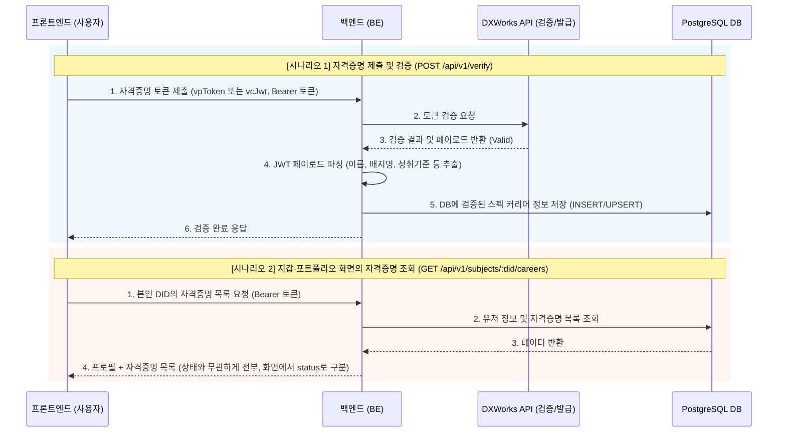
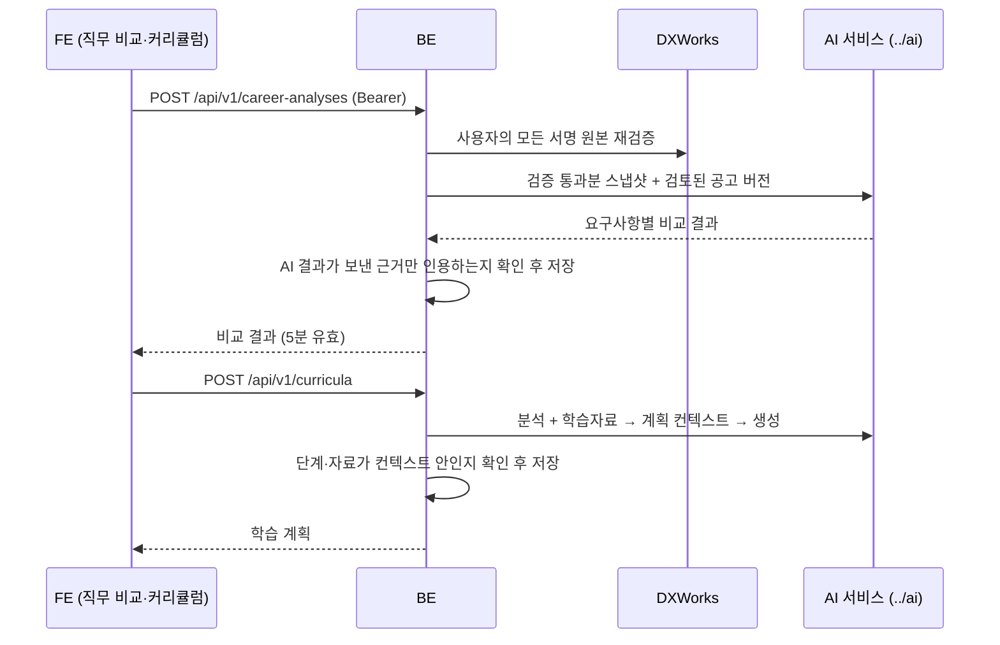

# BE 파트 - VC 검증 및 AI 데이터 서빙 백엔드 서버

본 프로젝트의 프론트엔드에서 제출한 자격증명(VC)을 DXWorks API를 통해 검증하고 그 결과를 DB에 저장하는 **BFF(Backend For Frontend) 서버**이자 기록의 원본(system of record)입니다. 직무 비교·커리큘럼 때는 자격증명을 다시 검증해 통과한 근거만 AI 서비스(`../ai`)로 보냅니다(AI는 BE를 호출하지 않습니다).

## 1. 아키텍처 흐름도 (Flowchart)



> AI 서비스(`../ai`)는 BE를 호출하지 않습니다. 직무 비교·커리큘럼 요청 때 BE가 재검증을 통과한 근거만 AI로 보냅니다(아래 "🧭 직무 비교 · 커리큘럼" 참고).

## 2. 원클릭 개발 환경 구축 (Docker 기반 권장 ⭐️)

로컬에 파이썬(Python)이나 PostgreSQL을 직접 설치할 필요가 없습니다. Docker Desktop만 켜져 있다면, **단 두 줄의 명령어**로 파이썬 패키지 설치, DB 세팅, 440여 개 테스트 데이터 시딩, FastAPI 서버 실행까지 모든 환경이 자동으로 한 번에 구축됩니다.

### 🚀 최초 1회 실행 방법
```bash
# 1. BE 디렉터리 이동 및 환경변수 예시 복사
cd BE
cp -n .env.example .env

# 2. 도커로 전체 환경 자동 빌드 및 백그라운드 실행
docker compose up --build -d
```
> **⚠️ 주의 (API 키 설정):** 
> 실제 발급/검증 테스트(Step 1, Step 2)를 수행하려면 `.env` 파일의 `DXWORKS_API_HOST`, `DXWORKS_API_KEY`, `DXWORKS_BADGE_TEMPLATE_ID`를 채워야 합니다. (더미 조회 테스트는 키 없이도 즉시 가능합니다.) 협력사 전달본의 `API_BASE_URL` → `DXWORKS_API_HOST`, `API_KEY` → `DXWORKS_API_KEY`이고, 템플릿 ID는 전달본 안내서의 준비된 "OB3 배지" 템플릿 ID입니다. `TENANT_CODE`는 BE가 쓰지 않습니다.
>
> **🔒 협력사 자료 취급:** 이 값들과 협력사에서 받은 문서·예제 코드는 **비공개 자료**입니다. 공개 저장소(코드, 문서, 이슈, PR 본문, 커밋 메시지)에 그대로 옮기지 말고 `.env`와 팀 내부 채널로만 주고받으세요. 협력사 API 형식은 `app/integrations/dxworks.py`에서만 다룹니다.

> **💡 이 명령어 하나로 자동 완료되는 항목들:**
> 1. **Python 3.11 런타임 & 의존성(버전 고정 `requirements.txt`)** 도커 컨테이너 내 자동 설치 (로컬 파이썬 버전 충돌 0%)
> 2. **PostgreSQL 16** 컨테이너 자동 구동 (이미지는 `pgvector/pgvector:0.8.7-pg16-bookworm` 그대로지만 앱은 DB 확장을 쓰지 않음)
> 3. **440여 개 논문 테스트 데이터(`03_seed_data.sql`)** DB에 자동 시딩
> 4. **DB 마이그레이션**: 한 번 실행하고 끝나는 `migrate` 서비스가 아직 적용하지 않은 `DB/migrations/` 파일을 적용하고, 성공해야 백엔드가 뜹니다 (아래 "🗄️ DB 마이그레이션").
> 5. **FastAPI 백엔드 서버(포트 3000)** 자동 실행
> 6. **핫 리로드(Hot Reload)** 연동: 로컬 소스 코드(`BE/`)를 수정하고 저장하면 컨테이너 내부 서버가 즉시 자동 반영됩니다. (`docker-compose.yml`이 `--reload`와 소스 바인드 마운트로 켭니다. `Dockerfile` 기본 실행은 리로더 없는 운영용입니다.)

---

## 3. 컨테이너 관리 명령어

```bash
# 실행 상태 확인
docker compose ps

# 백엔드 서버 실시간 로그 확인
docker compose logs -f backend

# 마이그레이션 결과 확인 (이번에 적용한 파일 목록)
docker compose logs migrate

# 서버 및 DB 일시 종료 (데이터는 보존됨)
docker compose down

# DB 및 데이터 완전 초기화 (초기 시드 상태로 깨끗하게 리셋할 때)
docker compose down -v
docker compose up -d
```
* **API 문서 (Swagger UI):** [http://localhost:3000/docs](http://localhost:3000/docs) (`APP_ENV=development`에서만. `production`에서는 `/docs`·`/redoc`·`/openapi.json`이 404이며 계약은 `openapi.yaml`로 봅니다)
* **헬스 체크:** [http://localhost:3000/health](http://localhost:3000/health)

<details>
<summary><b>(선택) 도커 대신 로컬 파이썬 환경에서 직접 띄우고 싶을 때</b></summary>

로컬 IDE 디버거 등을 위해 호스트에서 직접 실행하려는 경우:
1. DB만 도커로 켬: `docker compose up -d postgres`
2. 의존성 설치: `pip install -r requirements.txt` (Mac/Linux는 `python3 -m pip install -r requirements.txt`)
3. 마이그레이션 적용: `python -m app.migrate` (`.env`의 `DB_*`로 접속해 아직 적용하지 않은 파일만 적용합니다)
4. 서버 실행: `python -m uvicorn main:app --reload --port 3000`

`python main.py`로 띄우면 코드 변경 자동 반영(reload)은 `UVICORN_RELOAD=1`일 때만 켜집니다.
</details>

### 🔄 기존 환경을 쓰고 있다면 (업데이트 후)
새 패키지가 추가된 버전(v0.4.0의 `PyJWT`·`cryptography`, v0.7.0의 `rfc8785`와 AI 컨테이너 `ai` 등)은 이미지를 다시 빌드해야 합니다.
다시 빌드하지 않으면 핫 리로드 중인 서버가 `ModuleNotFoundError`로 멈춥니다.
```bash
docker compose up -d --build
```
새 DB 컬럼·테이블(`credentials.raw_token`, `holder_keys`, `shares`, 직무 비교 테이블, 로그아웃용 `users.token_version`(09), 모의 발급 기록 `mock_issuances`(10), 소셜 로그인 연동 `oauth_accounts`(11), 시장 통계 `market_postings`·`market_snapshots`(12), 이메일 유일 인덱스와 쓰지 않는 표 정리(13) 등)은 이 명령이 띄우는 `migrate` 서비스가 기존 볼륨에도 자동으로 적용합니다(아래 "🗄️ DB 마이그레이션"). 마이그레이션 파일을 `psql`로 하나씩 실행할 필요가 없습니다. 09가 없는 DB에서는 로그인·가입과 토큰이 필요한 모든 요청이, 10이 없는 DB에서는 모의 발급이, 11이 없는 DB에서는 OAuth 로그인·내 정보 조회가, 12가 없는 DB에서는 시장 통계 조회가 500이므로 BE만 따로 띄울 때도 먼저 `python -m app.migrate`를 실행합니다.
(DB를 통째로 새로 만들어도 되면 `docker compose down -v && docker compose up -d --build`. 기존 DB 데이터는 모두 지워집니다)
예전에 복사한 `.env`에 `AUTH_REQUIRED=false` 줄이 있으면 지웁니다. 이제 인증을 끄는 설정은 없고(아래 "🔐 인증"), 남아 있으면 시작 로그에 경고만 남습니다.
예전에 복사한 `.env`에는 `GITHUB_*`·`NAVER_*`·`OAUTH_TIMEOUT_SECONDS` 줄이 없을 수 있습니다. GitHub·네이버 로그인을 쓸 때만 `.env.example`에서 그 줄을 옮겨 ID·시크릿을 채웁니다(없으면 그 로그인 버튼만 503이고 나머지는 그대로. 예전 `GOOGLE_OAUTH_TIMEOUT_SECONDS`는 `OAUTH_TIMEOUT_SECONDS`가 없을 때 그대로 읽음). 지금은 쓰지 않는 예전 소셜 로그인 설정은 BE가 읽지 않습니다. 그 ID·시크릿 줄에 값이 남아 있으면 시작 로그에 `… 설정은 더 이상 쓰지 않습니다 …` 경고만 한 줄 남기므로(값은 로그에 남기지 않음), 경고에 나온 이름으로 시작하는 줄을 모두 지웁니다(값이 빈 줄과 콜백 주소 줄은 경고 없이 무시됨).

### 🗄️ DB 마이그레이션 (`python -m app.migrate`, 로컬·CI·AWS 공통)
- **실행:** `BE/`에서 `python -m app.migrate`. 앱과 같은 `DB_HOST`·`DB_PORT`·`DB_USER`·`DB_PASSWORD`·`DB_NAME`으로 접속하고, DB TLS(`PGSSLMODE`·`PGSSLROOTCERT`)도 앱과 같은 규칙입니다(`PGSSLMODE`는 앞뒤 공백을 떼고, `PGSSLMODE=`처럼 비워 둔 줄은 넣지 않은 것으로 봄. 아래 "`APP_ENV`"). 그 밖의 libpq 환경변수와 `DB_CONNECT_TIMEOUT`(기본 10초)도 그대로 적용됩니다. `.env`가 있으면 읽되 이미 있는 환경변수가 우선하고, DB가 막 뜨는 중이면 최대 60초 기다립니다.
- **동작:**
  - 빈 DB(`users` 표 없음): `DB/schema/schema_PostgreSQL.sql` → (`--seed`일 때만) `DB/seeds/03_seed_data.sql`을 한 트랜잭션으로 적용합니다. `--seed`는 이미 만들어진 DB에서는 무시됩니다.
  - 기본 스키마와 마이그레이션은 DB 확장을 만들지 않습니다(기본 키의 `gen_random_uuid()`는 PostgreSQL 13부터 기본 제공 함수). 그래서 마이그레이션 계정에 확장을 만들 권한이 필요 없고, 새로 만든 DB에는 `plpgsql`만 있습니다. 예전 버전이 만들어 둔 `pgcrypto`·`vector`는 지우지 않고 그대로 둡니다(쓰는 코드는 없음).
  - 그다음 `DB/migrations/NN_*.sql` 중 원장 `public.schema_migrations`(filename, checksum, applied_at)에 없는 파일을 번호 순으로, 파일마다 원장 기록과 함께 한 트랜잭션으로 적용합니다. 실패하면 그 파일만 롤백됩니다.
  - 원장 없이 만들어진 기존 DB(Compose initdb·수동 `psql`)는 마이그레이션을 모두 다시 적용하고 기록합니다(모두 여러 번 실행해도 안전).
  - 여러 개가 동시에 실행돼도(ECS 태스크 등) DB별 advisory lock으로 하나씩 실행합니다.
  - 실행기 연결의 `search_path`는 고정합니다. 기본 스키마·마이그레이션 파일을 실행하는 연결은 `public`(`pg_catalog`는 늘 먼저 찾음)이고, 실행기 자신의 SQL(`DB_APP_ROLE` 검사·원장 읽기·시드 해시 확인·`GRANT`/`REVOKE`)을 실행하는 advisory lock 연결은 `pg_catalog`만 찾으므로 `public`에 심은 함수·연산자는 인자 형이 정확히 맞아도(예: `public.=(oid, regclass)`) 부르지 않습니다(임시 스키마는 함수·연산자를 찾을 때 쓰지 않음). DB·역할에 건 `search_path` 설정(`ALTER DATABASE/ROLE ... SET`)이나 마이그레이션 계정 이름의 스키마(`"$user"`)는 실행기가 쓰지 않습니다.
- **마이그레이션 목록 (`DB/migrations/`, 04~13):**

  | 파일 | 내용 |
  |---|---|
  | `04_users_password_hash.sql` | `users.password_hash`, 시드 계정의 테스트 비밀번호 |
  | `05_credentials_raw_token.sql` | `credentials.raw_token`(서명 원본)·`last_verified_at` |
  | `06_holder_keys.sql` | 관리형 지갑의 홀더 키 `holder_keys` |
  | `07_shares.sql` | 선택 공개 링크 `shares` |
  | `08_career_curriculum.sql` | 공고·학습자료(버전)·직무 비교·커리큘럼 표 |
  | `09_users_token_version.sql` | 로그아웃용 `users.token_version` |
  | `10_mock_issuances.sql` | 모의 발급 기록 `mock_issuances` |
  | `11_oauth_accounts.sql` | 소셜 로그인 연동 `oauth_accounts`(`provider`는 `google`·`github`·`naver`. `VARCHAR(50)`이고 CHECK가 없어 GitHub·네이버에도 새 마이그레이션이 필요 없음. 지금은 로그인 경로가 없는 예전 제공자의 연동 행이 개발 DB에 남아 있으면 지우지 않고 그대로 두며, 로그인·연동 확인에 쓰지 않고 FE 배지도 그 이름을 무시함). 파일 머리 주석은 예전 내용입니다(적용된 파일이라 고치지 않음): "이메일이 같으면 같은 계정에 연동"은 이제 아래 "🌐 소셜 로그인"의 계정 규칙(비밀번호 계정은 409, 이메일이 확인된 경우만 연동)을 따르고, 기존 볼륨에 `psql`로 직접 실행하라는 안내 대신 `python -m app.migrate`가 적용합니다 |
  | `12_market_statistics.sql` | 시장 통계 `market_postings`·`market_snapshots` |
  | `13_email_unique_drop_unused_tables.sql` | 아래 |

  13이 하는 일:
  - `users`에 대소문자를 구분하지 않는 이메일 유일 인덱스 `users_email_lower_key`(`lower(email)`)를 만듭니다. 로그인과 소셜 로그인 연동이 `lower(email)`로 계정을 찾으므로 "이메일 하나에 계정 하나"를 DB가 보장하고, 그 조회가 이 인덱스를 탑니다.
  - 대소문자만 다른 이메일의 계정이 이미 있으면 인덱스를 만들지 않고 멈춥니다(13 전체가 롤백, 종료 코드 1). 로그에는 `대소문자만 다른 이메일을 쓰는 계정이 있어 users_email_lower_key 인덱스를 만들 수 없습니다 (겹치는 이메일 N개)`와 찾는 조회가 든 `HINT:` 줄(`SELECT lower(email), count(*) FROM users GROUP BY 1 HAVING count(*) > 1;`)이 남고 이메일 주소는 남지 않습니다. 이메일마다 계정을 하나만 남긴 뒤 다시 실행합니다.
  - `users_subject_did_key`와 같은 열의 중복 인덱스 `idx_users_did`를 지웁니다.
  - 어떤 코드도 읽거나 쓰지 않는 표 `student_credential_embeddings`·`user_skills`를 지웁니다(그 표에 직접 넣어 둔 행이 있으면 함께 없어짐). 확장은 지우지 않습니다(`DROP EXTENSION` 없음).
- **운영 검사(`APP_ENV`):** 앱과 같이 `.env`를 읽은 뒤의 `APP_ENV`를 보고(비우면 `development`), `development`가 아니면 운영으로 검사합니다. 로컬 Compose(`migrate` 서비스에 `APP_ENV=development`를 넣음)·로컬 `.env`·CI는 예전과 같습니다.
  - `--seed`는 DB에 접속하기 전에 거부합니다.
  - 적용을 마친 뒤 `users`에 04 마이그레이션의 시드 테스트 비밀번호 해시를 그대로 쓰는 계정이 있으면 실패합니다(시드·개발 DB 데이터가 운영 DB에 들어간 경우. 해시 값은 로그에 남기지 않습니다). 이미 적용한 마이그레이션은 남고, 그 계정을 지운 뒤 다시 실행하면 통과합니다.
  - `DB_PASSWORD`가 없거나 비었거나 로컬 기본값 `password`면 접속하지 않습니다(앱의 DB 연결도 같은 규칙). `APP_ENV`가 잘못된 값(예: `prod`)이어도 실패합니다.
  - `PGSSLMODE`가 `verify-full`·`verify-ca`가 아니거나 `PGSSLROOTCERT`가 읽을 수 있는 파일이 아니어도 접속하지 않습니다(앱과 같은 규칙, 아래 "`APP_ENV`"). 이런 설정 오류는 60초 접속 대기 없이 바로 `마이그레이션 실패: APP_ENV=production requires PGSSLMODE (verify-full or verify-ca in production), PGSSLROOTCERT (readable CA bundle file)` 같은 한 줄과 종료 코드 1로 끝납니다. `DB_PASSWORD`와 TLS가 함께 틀렸으면 `DB_PASSWORD`를 먼저 알리고, 고친 뒤 다시 실행하면 TLS 이름을 알립니다.
- **서비스 계정 권한(`DB_APP_ROLE`, 선택·운영 RDS용):** 마이그레이션 태스크에 `DB_APP_ROLE=<BE 서비스 계정>`을 주면 적용을 마친 뒤(advisory lock 안에서) 한 트랜잭션으로 먼저 `public`의 모든 테이블·시퀀스에서 그 계정의 권한을 모두 거두고(예전에 그 계정에 준 `GRANT ALL`의 `TRUNCATE` 등은 남지 않음. 이 회수는 그 계정 자신의 권한만 바꾸므로 `TRIGGER`·`REFERENCES`·원장 쓰기 권한은 그 계정·속한 역할·`PUBLIC` 어디에 있든 아래 검사가 먼저 거부), 그 계정에 DB `CONNECT`, `public` 스키마 `USAGE`, `public`의 모든 테이블 `SELECT`·`INSERT`·`UPDATE`·`DELETE`, 모든 시퀀스 `USAGE`·`SELECT`를 주고, 원장 `public.schema_migrations`의 권한은 모두 뺍니다(로그: `서비스 계정 권한 적용: <역할> (앱 테이블 DML만)`). 실행할 때마다 다시 주므로 나중에 생긴 테이블도 들어갑니다. 비워 두면 아무것도 하지 않습니다(로컬·CI는 넣지 않음).
  그 계정은 advisory lock을 잡은 직후(기본 스키마·마이그레이션 SQL을 하나라도 실행하기 전)와 권한을 주기 직전에 검사합니다. 처음 검사에 걸리면 아무것도 적용하지 않고(빈 DB는 빈 채로 남음), 어느 검사든 걸리면 권한을 주지 않고 실패합니다. 아래에서 "속한 역할"은 권한을 상속하지 않는 `NOINHERIT`·`GRANT ... WITH INHERIT FALSE` 소속도 포함합니다(`SET ROLE`로 그 역할이 될 수 있음).
  - 역할이 없거나 특권 계정(그 역할이나 그 역할이 속한 역할의 슈퍼유저·`CREATEROLE`·`CREATEDB`·`REPLICATION`·`BYPASSRLS` 속성, 마이그레이션 계정 자신이나 그 소속, `rds_superuser`·`pg_read_all_data`·`pg_write_all_data`·`pg_read_server_files`·`pg_write_server_files`·`pg_execute_server_program` 소속)이면 실패합니다. 특권 속성이 있는 소속 역할은 `마이그레이션 실패:` 줄에 이름이 나옵니다(큰따옴표로 감쌈).
  - 그 역할이나 그 역할이 속한 역할이 `public` 스키마나 DB에 객체를 만들 수 있어도 실패합니다: CREATE 권한(`PUBLIC`에 준 CREATE 포함)이나 DB·`public` 스키마의 소유(소유자는 거둔 CREATE를 스스로 다시 줄 수 있으므로 CREATE를 모두 거둬도 거부. 새로 만든 PostgreSQL 15 이상 DB에서는 DB 소유자가 `pg_database_owner`로 `public` 스키마도 소유하며 DB 소유로 알려 줌). `마이그레이션 실패:` 줄이 걸린 검사(`public 스키마`·`DB "<DB 이름>"`), 그 권한·소유를 가진 소속 역할과 그대로 실행할 수 있는 GRANT·ALTER ... OWNER·REVOKE 문(이름은 큰따옴표로 감쌈)을 실행할 순서대로 알려 주므로, 마이그레이션 계정으로 차례대로 실행한 뒤 다시 실행합니다.
    - 소유가 먼저입니다(소유자에게서 CREATE를 먼저 거두면 새 소유자도 그 CREATE를 받지 못함): DB는 `ALTER DATABASE "<DB 이름>" OWNER TO "<마이그레이션 계정>";`, `public` 스키마는 `ALTER SCHEMA public OWNER TO pg_database_owner;`(PostgreSQL 14 이하는 `OWNER TO "<마이그레이션 계정>"`). 마이그레이션 계정이 슈퍼유저가 아니면(RDS 마스터 사용자) 맨 앞에 지금 소유자의 권한을 받는 `GRANT "<지금 소유자>" TO "<마이그레이션 계정>" WITH INHERIT TRUE;`(PostgreSQL 15 이하는 `WITH INHERIT TRUE` 없이)가 나옵니다(다 고친 뒤 그 소속을 다시 거두는 방법은 루트 README "AWS 배포 체크리스트"의 "DB 마이그레이션").
    - 지금 소유자 몫의 CREATE를 이미 거뒀으면 ALTER 문 뒤에 새 소유자에게 CREATE를 다시 주는 GRANT 문이 `(지금 소유자 몫의 CREATE를 거둔 상태라 새 소유자에게 다시 줌)`과 함께 붙습니다: `public` 스키마는 `GRANT CREATE ON SCHEMA public TO pg_database_owner;`(PostgreSQL 14 이하는 `TO "<마이그레이션 계정>"`. DB 소유자가 `pg_database_owner`로 `public` 스키마를 소유했으면 ALTER DATABASE 뒤), DB는 `public` 스키마의 소유자도 함께 바꿀 때만 `GRANT CREATE ON DATABASE "<DB 이름>" TO "<마이그레이션 계정>";`(기본 스키마가 확장을 만들지 않으므로 그 밖에는 DB CREATE가 필요 없음).
    - 그다음 CREATE 회수: `public` 스키마는 `REVOKE CREATE ON SCHEMA public FROM PUBLIC;`(PostgreSQL 14 이하에서 만들었거나 그 버전에서 업그레이드·복원한 DB는 기본으로 모든 역할(`PUBLIC`)이 `public` 스키마에 CREATE 권한을 가짐)과 그 역할에 따로 준 CREATE 회수, DB는 `REVOKE CREATE ON DATABASE "<DB 이름>" FROM PUBLIC;`과 그 역할에 준 CREATE 회수. CREATE를 받은 소속 역할은 이름과 `REVOKE CREATE ON SCHEMA public FROM "<그 역할>";`·`REVOKE CREATE ON DATABASE "<DB 이름>" FROM "<그 역할>";`이 나옵니다.
    - 소속을 거두는 문(`REVOKE "<소속 역할>" FROM "<DB_APP_ROLE>"`)은 알려 주지 않습니다. 위 문들은 소속을 그대로 두므로 `DB_APP_ROLE`이 그 소속 역할로 `public`에 만들어 둔 객체를 다음 실행에서 아래 소유 객체 검사가 알려 줍니다. 소속도 거두려면 마이그레이션이 성공한 뒤에 거둡니다(먼저 거두면 `public`에 CREATE 권한도 소유도 없는 그 역할의 객체는 이 검사가 보지 못함. 루트 README "AWS 배포 체크리스트"의 조회 ①은 보여 줌).
  - 그 역할이나 그 역할이 속한 역할, 기본 제공 역할(OID 16384 미만, 부트스트랩 슈퍼유저 제외. 예: `pg_database_owner`·`pg_monitor`), `public` 스키마에 CREATE 권한이 있거나 DB·`public` 스키마를 소유한 다른 역할(부트스트랩 슈퍼유저(OID 10)·마이그레이션 계정 제외. 예: 소속을 거둔 예전 소속 역할)이 `public` 스키마에 객체(함수·연산자·타입·테이블·뷰·시퀀스·연산자 클래스·텍스트 검색 설정·확장 등)를 소유해도 실패합니다. CREATE를 거두기 전에 만든 객체도 남아, 마이그레이션 계정·앱이 이름으로 찾아 부르면 부른 계정의 권한으로 실행되기 때문입니다. 소유자는 카탈로그마다 소유자 열로 봅니다(기본 제공 역할의 소유는 `pg_shdepend`에 남지 않음). 그 역할이 DB 소유자일 때 `pg_database_owner`에게 넘긴 객체도 위 `ALTER DATABASE` 문으로 DB 소유자를 바꾼 다음 실행에서 이 검사에 걸립니다. `마이그레이션 실패:` 줄(`DB_APP_ROLE이나 그 역할이 속한 역할, 기본 제공 역할(pg_database_owner·pg_monitor 등), public 스키마에 CREATE 권한이 있거나 DB·public 스키마를 소유한 다른 역할이 public 스키마에 객체를 소유합니다: …`)이 객체를 `['function public.lower(character varying)', …]`처럼 10개까지 알려 주므로(더 있으면 `외 N개`) 마이그레이션 계정으로 하나씩 확인해, 예상하지 못한 객체는 `DROP`하고 앱에 필요한 객체는 `ALTER <종류> <이름> OWNER TO "<마이그레이션 계정>"`으로 소유자를 바꾼 뒤 다시 실행합니다. 그래서 `DB_APP_ROLE`을 줄 때는 DB와 `public`의 테이블을 소유한 계정(운영은 마스터 사용자)으로 마이그레이션합니다. 다른 관리 계정(예: 전용 역할이 소유한 DB에 슈퍼유저)으로 실행하면 그 소유 역할의 테이블 등이 이 검사에 걸립니다.
  - 그 역할이나 그 역할이 속한 역할(또는 `PUBLIC`)이 `public` 스키마의 테이블·뷰·외부 테이블 하나에라도 `TRIGGER` 권한이 있어도(예: 예전에 준 `GRANT ALL`) 실패합니다. 마이그레이션이 바꾸는 테이블에 트리거를 걸어 임시 스키마(`pg_temp`)의 함수 같은 것을 마이그레이션 계정의 권한으로 실행하게 할 수 있기 때문입니다. `마이그레이션 실패:` 줄이 그 권한을 받은 역할마다 `REVOKE TRIGGER ON ALL TABLES IN SCHEMA public FROM "<그 역할>";`(`PUBLIC`이면 `FROM PUBLIC;`)을 알려 줍니다. 그 권한이 있던 동안 만든 트리거는 권한을 거둔 뒤에도 남으므로 같은 줄이 `public` 스키마 테이블의 트리거(시스템 내부 트리거 제외)도 `['trigger <이름> on public.<테이블>', …]`처럼 10개까지(더 있으면 `외 N개`, 없으면 `없음`) 알려 줍니다. 마이그레이션 계정으로 확인해 예상하지 못한 트리거는 `DROP TRIGGER <이름> ON public.<테이블>;`로 지웁니다(이 앱의 스키마·마이그레이션은 트리거를 만들지 않음).
  - `public` 스키마 테이블의 트리거(시스템이 만든 내부 트리거 제외)에 WHEN 조건이 있거나, 그 트리거가 임시 스키마(`pg_temp_N`)의 함수나 위 소유 객체 검사와 같은 역할(그 역할·그 역할이 속한 역할·기본 제공 역할·`public` 스키마에 CREATE 권한이 있거나 DB·`public` 스키마를 소유한 다른 역할)이 소유한 함수를 불러도 실패합니다. WHEN 조건은 어떤 함수·연산자든 부를 수 있고 트리거 함수가 불리지 않아도 그 테이블을 바꾸는 마이그레이션 계정의 권한으로 실행되므로 트리거 함수와 관계없이 거부합니다(이 앱의 마이그레이션은 WHEN 조건이 있는 트리거를 만들지 않음). `마이그레이션 실패:` 줄이 트리거를 `trigger <이름> on public.<테이블> → function <함수>`(WHEN 조건이 있으면 `trigger <이름> on public.<테이블> (WHEN 조건) → function <함수>`)처럼 10개까지 알려 주므로 마이그레이션 계정으로 확인해 예상하지 못한 트리거는 `DROP TRIGGER <이름> ON public.<테이블>;`로 지운 뒤 다시 실행합니다(임시 스키마의 함수를 부르는 트리거는 그 함수를 만든 세션이 끝나면 함께 지워짐).
  - 그 역할이나 그 역할이 속한 역할(또는 `PUBLIC`)이 `public` 스키마의 테이블 하나에라도 `REFERENCES` 권한이 있어도(열 단위 권한 포함. 예: 예전에 준 `GRANT ALL`) 실패합니다. 외래 키 검사는 참조되는 테이블의 소유자(마이그레이션 계정)의 권한으로 실행되므로, 그 역할이 자기 스키마의 테이블에서 `public` 테이블을 참조하는 외래 키를 걸고 그 열에 자기가 만든 암시적 캐스트 같은 함수를 쓰면 마이그레이션과 관계없이 행을 넣을 때마다 그 함수를 마이그레이션 계정의 권한으로 실행하게 할 수 있기 때문입니다. `마이그레이션 실패:` 줄이 그 권한을 받은 역할마다 `REVOKE REFERENCES ON ALL TABLES IN SCHEMA public FROM "<그 역할>";`(`PUBLIC`이면 `FROM PUBLIC;`. 열 단위 권한도 함께 거둠)을 알려 줍니다. 그 권한이 있던 동안 만든 외래 키는 권한을 거둔 뒤에도 남으므로 같은 줄이 `public` 스키마 밖의 테이블에서 `public` 테이블을 참조하는 외래 키도 `['constraint <이름> on <스키마>.<테이블>', …]`처럼 10개까지(더 있으면 `외 N개`, 없으면 `없음`) 알려 줍니다. 마이그레이션 계정으로 확인해 예상하지 못한 외래 키는 `ALTER TABLE <스키마>.<테이블> DROP CONSTRAINT <이름>;`으로 지웁니다(이 앱의 스키마·마이그레이션은 `public` 안의 외래 키만 만듦. REVOKE 뒤의 실행은 이 목록을 다시 알려 주지 않으므로 그 전에 확인하거나 루트 README "AWS 배포 체크리스트"의 조회 ⑤로 봄).
  - 그 역할이나 그 역할이 속한 역할(또는 `PUBLIC`)이 원장 `public.schema_migrations`에 `INSERT`·`UPDATE`(열 단위 권한 포함)·`DELETE`·`TRUNCATE` 권한이 있어도 실패합니다. 아직 적용하지 않은 마이그레이션 파일의 행(체크섬은 저장소에 공개)을 넣어 두면 실행기가 그 파일을 적용한 것으로 보고 건너뛰기 때문입니다. `마이그레이션 실패:` 줄이 그 권한을 받은 역할마다 `REVOKE ALL ON public.schema_migrations FROM "<그 역할>";`(`PUBLIC`이면 `FROM PUBLIC;`)을 알려 줍니다. 그 권한이 있던 동안 넣거나 바꾼 원장 행은 권한을 거둔 뒤에도 남고 실행기는 진짜 행과 구별하지 못하므로, 마이그레이션 계정으로 원장의 행이 실제로 적용한 마이그레이션과 맞는지 확인합니다(맞지 않는 행을 지우고 다시 실행하면 그 파일을 적용함).
  - 그 역할이나 그 역할이 속한 역할이 이 DB의 스키마를 하나라도 소유해도 실패합니다(예: 예전 DB CREATE 권한으로 만든 스키마. `public` 스키마·DB의 소유는 위 CREATE 검사가 먼저 거부). 그 안에 둔 타입·캐스트·함수를 위 외래 키 검사 등으로 마이그레이션 계정의 권한으로 실행하게 할 수 있고, 마이그레이션 계정 이름의 스키마는 그 계정으로 직접 접속한 대화형 세션이 `search_path`의 `"$user"`로 `public`보다 먼저 찾기 때문입니다. `마이그레이션 실패:` 줄이 스키마를 `['"<스키마>" (소유자 "<역할>")', …]`처럼 10개까지(더 있으면 `외 N개`) 알려 주고 스키마마다 `DROP SCHEMA "<스키마>" CASCADE; 또는 ALTER SCHEMA "<스키마>" OWNER TO "<마이그레이션 계정>";`을 알려 줍니다(마이그레이션 계정이 슈퍼유저가 아니면 그 앞에 지금 소유자의 권한을 받는 `GRANT "<소유자>" TO "<마이그레이션 계정>" WITH INHERIT TRUE;`(PostgreSQL 15 이하는 `WITH INHERIT TRUE` 없이)가 나옴. 다 고친 뒤 그 소속을 다시 거두는 방법은 위 CREATE 항목과 같음). 마이그레이션 계정으로 그 안의 객체를 확인한 뒤 둘 중 하나를 실행합니다. `DROP SCHEMA ... CASCADE`는 다른 스키마에서 그 안의 객체를 쓰는 것(예: 그 스키마의 타입을 쓰는 `public` 테이블의 열)도 함께 지우고, `ALTER SCHEMA ... OWNER TO`는 그 안 객체의 소유자를 바꾸지 않으므로 남긴 객체 중 예상하지 못한 것(`public` 테이블을 참조하는 외래 키가 있는 테이블, 함수·캐스트 등)은 따로 지웁니다.
- **종료 코드:** 성공 0. 적용한 뒤 SQL이 바뀐 파일(체크섬 불일치)·SQL 오류·접속 실패·시드 파일 없이 빈 DB에 `--seed`, 위 운영 검사·`DB_APP_ROLE` 검사 실패면 1이고, 로그에 `마이그레이션 실패: <이유>` 줄이 남습니다(SQL 오류는 그 아래에 `HINT:`·`DETAIL:` 같은 줄이 이어질 수 있음).
- **Compose:** `migrate` 서비스(`vc-migrate`)가 `docker compose up` 때마다 `python -m app.migrate --seed`를 한 번 실행하고, `backend`는 이것이 성공한 뒤에 뜹니다. 실패하면 `docker compose up`이 "migrate ... didn't complete successfully" 오류로 멈추므로 `docker compose logs migrate`를 봅니다. 직접 실행은 `docker compose run --rm migrate`.
  새 볼륨은 지금처럼 postgres initdb가 같은 파일(스키마·시드·04~)을 먼저 실행하고, `migrate`가 그 DB를 넘겨받아 기록합니다.
- **마이그레이션을 추가할 때:**
  - 적용된 파일의 SQL은 고치지 않고 다음 번호 파일(예: `14_add_example_table.sql`, 파일 이름은 영문·숫자·`_`만)로 추가합니다.
  - 줄 전체가 `--` 주석인 줄·빈 줄·줄 끝 공백·CRLF·BOM 차이는 체크섬에 영향이 없습니다. SQL 줄 끝의 `--` 주석이나 `/* */` 주석은 SQL로 계산되므로 적용된 파일에서는 고치지 않습니다.
  - 파일 하나가 한 트랜잭션으로 실행되므로 `BEGIN`/`COMMIT`이나 `CREATE INDEX CONCURRENTLY`는 쓰지 않습니다.
  - 여러 번 실행해도 안전하게 씁니다(`IF NOT EXISTS` 등). 새 Compose 볼륨에서는 initdb와 `migrate`가 같은 파일을 차례로 실행합니다.
  - `docker-compose.yml`의 initdb 목록에도 두 자리 번호 이름으로 마운트합니다 (`tests/test_migrate.py`가 실행기와 순서가 같은지 검사).
- **운영(RDS):** `--seed`를 쓰지 않습니다(`APP_ENV=production`이면 거부하고, 운영 이미지에는 시드 파일도 없습니다). 시드 계정이 든 개발 DB 덤프를 운영 DB에 넣지 않습니다. 마이그레이션은 마스터 사용자로, BE 서비스는 `DB_APP_ROLE`로 권한을 받은 별도 계정으로 접속합니다. 배포 절차는 루트 README의 "AWS 배포 체크리스트"와 [deploy/README.md](../deploy/README.md)(도메인 없는 CloudFront 구성의 순서, 마이그레이션 작업 정의 템플릿 [deploy/ecs/be-migrate.taskdef.json](../deploy/ecs/be-migrate.taskdef.json)).

### 🐳 운영 이미지 · 실행 환경(`APP_ENV`) · 의존성
- **`Dockerfile`은 운영 이미지입니다:** `python:3.11.15-slim-bookworm` 기반, 비루트(uid/gid 10001), 리로더 없는 uvicorn 한 프로세스(`uvicorn main:app --host 0.0.0.0 --port 3000`), `/health` HEALTHCHECK, `APP_ENV=production`. 이미지에는 `main.py`, `app/`, `DB/schema`, `DB/migrations`, `certs/`(RDS CA 묶음 `rds-global-bundle.pem`, 출처·SHA-256·갱신 방법은 [certs/README.md](certs/README.md)), `requirements.txt`만 들어갑니다(`.env`·`.venv`·tests·시드·csv 제외). `PGSSLROOTCERT=/app/certs/rds-global-bundle.pem`이 이미지 기본값이고 `PGSSLMODE`는 넣지 않습니다(로컬 Compose의 Postgres는 TLS가 없음. 운영 작업 정의가 `verify-full`을 넣음). BE 서비스·마이그레이션·시장 통계 태스크가 이 이미지를 그대로 쓰므로 CA 묶음을 넣는 파생 이미지는 만들지 않습니다. Fargate(x86_64)용은 Apple Silicon에서도 `docker build --platform linux/amd64 -t <ECR 주소>/vc-be:<커밋> .`로 빌드합니다(루트 README "AWS 배포 체크리스트").
- **로컬 Compose는 같은 이미지를 개발용으로 덮어씁니다:** `command`로 `--reload`, `user: root`, 소스 바인드 마운트(`./:/app`), `APP_ENV=development`. 그래서 핫 리로드와 `docker compose exec backend python generate_test_data.py`는 예전처럼 동작합니다. 포트(DB·BE·AI)는 이 PC(`127.0.0.1`)에서만 엽니다. Postgres는 `pgvector/pgvector:0.8.7-pg16-bookworm`(예전 `pg16` 태그와 같은 이미지)입니다. 이미지 태그는 그대로 두지만 앱과 마이그레이션은 `vector`·`pgcrypto` 확장을 쓰지 않습니다(일부 마이그레이션 테스트만 예전 DB를 재현하려고 두 확장을 만듦). `docker-compose.yml`은 개발 전용이니 운영 배포에 쓰지 않고, 공개된 비밀번호의 시드 계정과 기본 비밀번호 DB가 함께 뜨므로 공개 호스트(EC2·데모 서버 등)에서도 띄우지 않습니다.
- **`APP_ENV`:** `development`(비우면 이 값) | `production`, 그 밖의 값이면 서버가 시작하지 않습니다.
  - `production`: 아래 중 하나라도 해당하면 시작을 거부합니다(오류에는 변수 이름만 나오고 값은 나오지 않습니다). uvicorn이 `main`을 불러올 때(`uvicorn main:app`, `import main`) 검사하고, 거부하면 traceback 없이 stderr에 `APP_ENV=production requires …; set the same values on every task/worker (e.g. AWS Secrets Manager or SSM)` 한 줄만 남기고 종료 코드 1로 끝납니다(포트를 열지 않음). 아래 숫자 범위 오류(`… must be …`)와 `APP_ENV` 오타(`APP_ENV must be one of: …`)도 같은 한 줄입니다.
    - `JWT_SECRET`이 없거나 32바이트 미만이거나, 이 저장소에 공개된 테스트 값(`tests/`)이거나, 서로 다른 바이트가 8개 미만인 자리표시 값(`x` 반복 등)
    - `HOLDER_KEY_ENCRYPTION_KEY`가 없거나, 공개된 테스트 키이거나 서로 다른 바이트가 8개 미만인 키(`0x01` 반복, 모두 0 등. base64 표기가 달라도 같은 키로 봄)
    - `SERVICE_API_KEY`를 넣었는데 32바이트 미만이거나 위와 같은 테스트·자리표시 값 (비우면 그대로 허용)
    - `JWT_SECRET`·`HOLDER_KEY_ENCRYPTION_KEY`·`SERVICE_API_KEY`·`AI_SERVICE_TOKEN`·`DXWORKS_API_KEY`·`GOOGLE_CLIENT_SECRET`·`GITHUB_CLIENT_SECRET`·`NAVER_CLIENT_SECRET` 중 넣은 두 값이 서로 같음 (협력사로 보내는 `DXWORKS_API_KEY`, 각 소셜 로그인 제공자로 보내는 `*_CLIENT_SECRET`, AI 서비스도 가진 `AI_SERVICE_TOKEN`으로 사용자 토큰을 만들거나 홀더 키를 복호화하거나 모든 DID를 읽지 못하게. 앞뒤 공백은 빼고 비교하고 마스터 키는 base64를 풀지 않고 적은 그대로 비교하며, 빈 값은 비교하지 않음. 오류에는 같은 쌍마다 `JWT_SECRET (not the same value as HOLDER_KEY_ENCRYPTION_KEY)`처럼 두 이름만 나오고, 앞의 이름이 바꿀 값. 비교 순서는 `DXWORKS_API_KEY`, `GOOGLE_CLIENT_SECRET`, `GITHUB_CLIENT_SECRET`, `NAVER_CLIENT_SECRET`, `HOLDER_KEY_ENCRYPTION_KEY`, `JWT_SECRET`, `SERVICE_API_KEY`, `AI_SERVICE_TOKEN`이고 둘 중 뒤쪽 이름이 앞에 나옴)
    - `DB_HOST`·`DB_NAME`·`DB_USER`가 비었거나, `DB_PASSWORD`가 비었거나 로컬 기본값 `password` (운영에서는 DB 접속값을 개발용 기본값으로 대신하지 않음)
    - `PGSSLMODE`가 `verify-full`·`verify-ca`가 아님(없음·빈 값·`require`·`prefer` 등. 앞뒤 공백만 떼고 대소문자는 그대로 비교: libpq는 `VERIFY-FULL`을 받지 않음): `PGSSLMODE (verify-full or verify-ca in production)`. `PGSSLROOTCERT`가 읽을 수 있는 파일이 아님(빈 값·공백만·앞뒤 공백이나 줄바꿈이 붙은 경로·없는 파일·디렉터리. libpq가 읽는 그대로 봄): `PGSSLROOTCERT (readable CA bundle file)`. RDS for PostgreSQL 15 이상은 `rds.force_ssl=1`이 기본이라 TLS 없이 접속하지는 않지만, libpq 기본값 `prefer`와 `require`는 서버 인증서와 호스트 이름을 확인하지 않습니다. DB 연결을 만들 때마다(`app/services/database.py`의 `get_db_connection`, `app/core/config.py`의 `db_tls_options`) 같은 규칙으로 다시 막으므로 마이그레이션 실행기와 시장 통계 배치도 접속하지 않습니다
    - `GOOGLE_CLIENT_ID`·`GOOGLE_CLIENT_SECRET` 중 하나만 넣었거나, 둘을 넣었는데 `GOOGLE_REDIRECT_URI`가 비었거나, 허용하는 콜백 주소(`GOOGLE_REDIRECT_URI`·`GOOGLE_ALLOWED_REDIRECT_URIS`) 중에 `https://`가 아닌 것이 있음 (주소로 읽어서 봄: 스킴은 대소문자를 가리지 않고, `https://`뿐이거나 `https:///path`처럼 호스트가 없는 값도 거부. 둘 다 비우면 Google 로그인 없이 시작)
    - GitHub·네이버도 같은 규칙: `GITHUB_CLIENT_ID`·`GITHUB_CLIENT_SECRET`(`NAVER_*`도 같음) 중 하나만 넣었거나, 둘을 넣었는데 `GITHUB_REDIRECT_URI`가 비었거나 `https://` 주소(호스트 있음)가 아님. 오류 문구는 `GITHUB_CLIENT_ID and GITHUB_CLIENT_SECRET (set both, or leave both empty)`, `GITHUB_REDIRECT_URI (set explicitly when GitHub OAuth is configured)`, `GITHUB_REDIRECT_URI (https:// address only)`(네이버는 `NAVER_`·`Naver`)
    - `CORS_ORIGINS`에 `scheme://host[:port]` 꼴이 아닌 항목이 있음 (`*`, `null`, 경로·끝의 `/`·쿼리·사용자 정보가 붙은 값 등)
  - `production`에서 달라지는 동작: API 문서(`/docs`·`/redoc`·`/openapi.json`)를 만들지 않고(404), BE 단독 테스트용 `GET /api/v1/users/oauth/{google,github,naver}/callback`은 404이며, `CORS_ORIGINS`·`GOOGLE_REDIRECT_URI`·`GITHUB_REDIRECT_URI`·`NAVER_REDIRECT_URI`가 없을 때 로컬 주소 기본값을 대신 쓰지 않고(다른 출처 허용 없음·콜백 주소 없음), `MOCK_ISSUER_ENABLED`를 비우면 모의 발급이 꺼지고, 모든 응답에 HSTS 헤더가 붙고, 요청을 받기 전에 DB 자체 점검을 합니다(아래 "운영 시작 DB 점검").
  - `development`: 예전처럼 경고만 남기고 임시 JWT 키·임시 DID로 대신합니다.
  - 공통(`APP_ENV`와 관계없음. 비우면 기본값이고, 숫자·주소 설정은 값이 틀리면 변수 이름을 알리고 시작하지 않음):

    | 변수 | 기본값 | 받는 값 · 뜻 |
    |---|---|---|
    | `JWT_EXPIRES_MINUTES` | 1440 | 1~1440 정수. 액세스 토큰 수명(분) |
    | `MOCK_ISSUER_DAILY_LIMIT` | 10 | 1 이상 정수. 모의 발급의 사용자별 24시간 한도 |
    | `MOCK_ISSUER_GLOBAL_DAILY_LIMIT` | 200 | 1 이상 정수. 모의 발급의 모든 사용자를 합친 24시간 한도 |
    | `IDENTITY_VERIFICATION_ENABLED` | `false` | `true`(`1`·`yes`·`on`도 같음)일 때만 `POST /api/v1/verify`의 `type: identity`(신원 VP 검증)를 받음. 꺼져 있으면 400 `Identity verification is disabled` |
    | `DB_MAX_CONNECTIONS` | 20 | 2 이상 정수. 프로세스 하나가 동시에 여는 앱 DB 연결 수의 상한 (아래 "DB 연결 상한") |
    | `AI_MAX_CONCURRENCY` | 4 | 1 이상 정수. 프로세스 하나가 AI 서비스로 동시에 보내는 공고·학습자료 묶음 요청 수의 상한 (아래 "🧭 직무 비교 · 커리큘럼") |
    | `DXWORKS_TIMEOUT_SECONDS` | 15 | 1~120(초). DXWorks 호출의 연결·읽기 한 번마다의 제한. 교환(연결·전송·본문 수신. 연결 재시도까지 포함)은 이 값의 2배까지이고, 그 전에 동시 호출 자리를 기다리는 시간도 2배까지라 호출 한 번은 최악의 경우 4배까지 걸림 (아래 "DXWorks 응답 한도") |
    | `OAUTH_TIMEOUT_SECONDS` | 10 | 1~120(초). Google·GitHub·네이버 호출(토큰 교환·사용자 정보)의 제한 시간. 없거나 비어 있으면 예전 이름 `GOOGLE_OAUTH_TIMEOUT_SECONDS`를 읽고, 오류 문구에는 실제로 읽은 이름이 나옴 |
    | `GOOGLE_REDIRECT_URI`, `GITHUB_REDIRECT_URI`, `NAVER_REDIRECT_URI` | `development`는 `http://localhost:5173/auth/<제공자>/callback`, `production`은 없음 | FE 콜백 주소. 기본값은 변수가 **없을 때만** 쓰고 빈 값(`GITHUB_REDIRECT_URI=`)이면 콜백 주소 없음(그 제공자의 버튼이 503 `<Label> OAuth redirect_uri is not configured`). GitHub·네이버는 이 주소 하나만 받고, Google은 `GOOGLE_ALLOWED_REDIRECT_URIS`(쉼표 구분)를 더 받음 (아래 "🌐 소셜 로그인") |
    | `AI_TIMEOUT_SECONDS`, `AI_GENERATION_TIMEOUT_SECONDS` | 30, 90 | 1~600(초). AI 일반 호출, 생성 호출(LLM 커리큘럼·시장 통계 계산) 제한 시간 |
    | `AI_SERVICE_URL`, `AI_SERVICE_ALLOW_HTTP` | `http://127.0.0.1:8100`, `false` | AI 서비스 주소. `http://`는 루프백(`localhost`·`127.0.0.1`·`::1`)이거나 `AI_SERVICE_ALLOW_HTTP=true`(Docker 내부망, ECS Service Connect. Service Connect의 TLS 선택은 [deploy/README.md](../deploy/README.md) ⑥)일 때만 받고, 그 밖의 주소나 32바이트 미만의 `AI_SERVICE_TOKEN`이면 AI 기능 요청이 503 `AI_SERVICE_NOT_CONFIGURED`(시작은 함). Compose는 `http://ai:8100`·`true`를 넣음 |
    | `DB_CONNECT_TIMEOUT` | 10 | DB 연결 대기(초). 비우면 `PGCONNECT_TIMEOUT`, 그것도 없으면 10 |
    | `PGSSLMODE`, `PGSSLROOTCERT` | `PGSSLMODE` 없음(libpq 기본 `prefer`), `PGSSLROOTCERT`는 운영 이미지에서 `/app/certs/rds-global-bundle.pem`(그 밖에는 libpq 기본) | 원격 DB(RDS)는 `verify-full`(권장)이나 `verify-ca`와 RDS CA 묶음(`require`·`prefer`는 인증서를 확인하지 않아 가짜 서버를 막지 못함). `production`은 이 규칙이 아니면 시작·접속하지 않음(위). CA 묶음은 이미지에 들어 있으므로 운영 작업 정의에는 `PGSSLMODE=verify-full`만 넣음([certs/README.md](certs/README.md), 루트 README "AWS 배포 체크리스트"). `PGSSLMODE=`처럼 비워 둔 줄(공백만 있는 값 포함)은 없는 것으로 보고 libpq 기본값 `prefer`를 씀(예전에는 모든 DB 호출이 `invalid sslmode value: ""`로 실패). 로컬 Compose·테스트 DB에는 넣지 않음 |
    | `DXWORKS_API_HOST` | (없음) | 넣었으면 `https://` 주소(`http://`는 루프백만)이고 사용자 정보(`user:pw@`)·쿼리·프래그먼트·공백이 없어야 하며, 포트를 적었다면 1~65535여야 함. 비우면 DXWorks를 쓰는 기능만 503 |
    | `DXWORKS_API_KEY` | (없음) | ASCII 문자만. 비우면 발급·신원 검증만 503(배지 검증에는 키를 보내지 않음) |
    | `LOG_LEVEL` | `INFO` | 빈 값도 `INFO`. `verbose` 같은 없는 수준 이름이면 서버와 마이그레이션 실행기는 시작할 때 traceback으로 실패하고, 시장 통계 배치는 traceback 없이 오류 한 줄(`error: LOG_LEVEL은 DEBUG, INFO, WARNING, ERROR, CRITICAL 중 하나여야 합니다 (비우면 INFO)`)을 남기고 종료 코드 2로 끝남. 서버·마이그레이션 실행기·시장 통계 배치가 같은 값을 따름. `WARNING` 이상이면 감사 로그(`vc-be.audit`)가 남지 않음 |
    | `DB_PORT` | 5432 | 빈 값도 5432(숫자가 아닌 값은 접속할 때마다 실패) |

    `MOCK_ISSUER_ENABLED`는 비우면 `development`에서 켜지고 `production`에서 꺼집니다(`production`에서 켜면 시작 로그에 경고 한 줄). 예전 `AUTH_REQUIRED=false`가 남아 있으면 경고만 남기고 무시합니다. 숫자 설정의 오류 문구는 `DB_MAX_CONNECTIONS must be an integer >= 2`, `DXWORKS_TIMEOUT_SECONDS must be a number between 1 and 120` 같은 꼴입니다.
- **요청 본문 상한:** 경로에 따라 네 가지입니다(`main.py`의 `body_limit`). FastAPI는 인증·권한 확인(의존성)보다 먼저 본문을 끝까지 읽어 JSON으로 풀고 그 확인을 통과한 요청의 본문 형식을 검사하므로, 기본 상한을 작게 두고 큰 본문이 필요한 경로만 올립니다.

  | 상한 | 대상 | 가장 큰 정상 본문 |
  |---|---|---|
  | 16 KiB (`MAX_PUBLIC_AUTH_BODY_BYTES`) | 토큰 없이 부르는 `POST /api/v1/users/login`·`/api/v1/users/register`·`/api/v1/users/oauth/{google,github,naver}/callback` | 약 6.3 KB (소셜 로그인 콜백) |
  | 64 KiB (`MAX_DEFAULT_BODY_BYTES`) | 아래 두 줄에 없는 모든 경로·메서드 (기본값) | 약 35 KB (커리큘럼 요청, 대안 선택 200개) |
  | 320 KiB (`MAX_VERIFY_BODY_BYTES`) | `POST /api/v1/verify` | 약 262 KB (`token` 256 KiB) |
  | 2 MiB (`MAX_REQUEST_BODY_BYTES`) | `POST /api/v1/research/job-postings/preview`·`/api/v1/research/job-postings`·`/api/v1/research/learning-resources` | 약 1.75 MiB (공고 반입: 원문 10만 자 + 인용 50개, 한글을 `\u`로 이스케이프한 경우) |

  - `Content-Length`가 그 경로의 상한보다 크면 인증과 관계없이 본문을 읽지 않고 413 텍스트 `Content Too Large`로 답합니다(본문을 받지 않는 API는 처리한 뒤 응답만 413으로 바뀜). `Content-Length` 없는 chunked 전송은 읽은 양이 상한을 넘는 순간 413 `{"detail": "Content Too Large"}`로 끊고, 본문을 받지 않는 API(로그아웃·조회 등)는 본문을 읽지 않으므로 413 없이 그대로 처리합니다. 응답 형식은 네 상한 모두 같습니다.
  - 기본 상한을 둔 이유: 모르는 키를 금지한 모델(공유 링크·포트폴리오·직무 비교·커리큘럼)에 모르는 키 13만 개(1.8 MB)를 보내면 요청마다 이벤트 루프를 0.2초씩 잡고 프로세스 메모리가 1.2 GiB까지 늘었습니다. 지금은 그 본문이 검사 전에 413이고 메모리가 늘지 않습니다.
  - 경로는 라우터와 같은 규칙으로 봅니다(uvicorn을 `--root-path`로 띄워도 같은 상한). 줄바꿈으로 끝나는 경로(`/api/v1/users/login%0A` 등)는 라우터에 넘기지 않고 404 `{"detail": "Not Found"}`로 답합니다: 라우터의 경로 식은 끝의 줄바꿈 하나를 무시해 같은 API에 닿는데, 위 목록과는 글자 그대로 비교하므로 그대로 두면 기본 상한을 받습니다(로그인 16 KiB 대신 64 KiB). 그 밖의 제어 문자가 든 경로는 지금처럼 라우터가 정합니다(DID 경로의 NUL은 422).
  - 본문을 받는 라우트를 새로 만들면 `tests/test_app_security.py`의 본문 라우트 목록 테스트가 알려 주므로, 가장 큰 정상 본문을 재서 64 KiB를 넘을 때만 큰 목록에 넣습니다.
  - 연구자 반입 세 경로는 본문 형식 검사보다 먼저 연구자인지 확인합니다(`app/api/career.py`의 `researcher` 의존성). 연구자가 아닌 로그인 계정이 이 세 경로에 보낸 본문은 형식 검사 없이 403 `Researcher permission required`로 끝나므로, 2 MiB 가까운 본문으로도 위와 같은 부하를 줄 수 없습니다(모르는 키 13만 개짜리 1.8 MB 본문 100번: 모두 403, 요청마다 약 0.02초, 프로세스 메모리 78 MiB → 약 110~120 MiB. 예전에는 모두 422에 약 1.27 GiB). 연구자가 아닌 계정은 본문이 틀려도 422가 아니라 403을 받고, 연구자의 요청은 그대로입니다.
- **요청 검증 실패(422):** 본문은 `{"detail": [{"type", "loc", "msg"}, …]}`입니다. FastAPI 기본 형식에서 받은 값(`input`)과 `ctx`를 뺀 것으로, 보낸 값을 되돌려 주지 않습니다. 오류는 앞에서부터 20개까지만 싣고, `loc`에 들어가는 키 이름이 64자를 넘으면 `<long key>`로 바꾸며, 본문은 항상 ASCII입니다(한글 등은 `\uXXXX`). FE는 `loc`·`msg`만 읽습니다.
- **API 문서·경로:** `/docs`·`/redoc`·`/openapi.json`은 `APP_ENV=development`에서만 제공하고 `production`에서는 404입니다. 끝에 `/`가 붙은 경로(예: `/api/v1/portfolios/`, `/health/`)는 리디렉션하지 않고 404입니다(리디렉션 `Location`은 요청의 `Host` 헤더로 만들어져 CloudFront 뒤에서는 ALB 주소가 `http://`로 드러나기 때문. FE는 끝에 `/`가 붙은 경로를 부르지 않음).
- **CORS:** `CORS_ORIGINS`(쉼표 구분)에 넣은 출처만 허용하고 쿠키 자격증명은 쓰지 않습니다. 변수가 없으면 `development`는 FE 개발 서버 주소(`http://localhost:5173`, `http://127.0.0.1:5173`)를 쓰고, `production`은 없거나 비어 있으면 다른 출처를 하나도 허용하지 않습니다(FE와 API가 같은 출처인 구성). `production`에서 `scheme://host[:port]` 꼴이 아닌 항목(`*`, `null`, 경로·끝의 `/`가 붙은 값 등)이 있으면 시작하지 않습니다.
- **DB 연결 상한·시간 제한 (앱 요청):** 앱은 DB를 `app/services/database.py`의 `app_db_connection()`으로만 씁니다. 연결 풀은 아니고 호출마다 새 연결을 열고 닫되, 프로세스가 동시에 여는 수를 `DB_MAX_CONNECTIONS`개(기본 20)로 묶습니다.
  - 자리가 없으면 5초 기다린 뒤 연결을 열지 않고 503 `{"detail": "Service is busy. Try again later."}` + `Retry-After: 5`로 답합니다.
  - 앱 세션에는 접속할 때 `statement_timeout=15s`, `lock_timeout=5s`(advisory lock 대기 포함), `idle_in_transaction_session_timeout=30s`가 걸립니다(`PGOPTIONS` 환경변수가 있으면 그 뒤에 이어 붙이므로 이 세 값이 우선). 문장·잠금 제한에 걸린 요청도 같은 503입니다.
  - 세 경우 모두 로그(`vc-be`)에 `Database busy: method=… path=… reason=DatabaseBusy|QueryCanceled|LockNotAvailable` 경고가 한 줄 남고 traceback은 남지 않습니다.
  - DB 접속 자체가 실패한 요청(DB 중단, DB 쪽 연결 수 초과 `too many connections`)과 `idle_in_transaction_session_timeout`으로 끊긴 세션의 요청은 503이 아니라 500(`Unhandled error`)입니다. 그래서 DB의 `max_connections`는 프로세스 수 × `DB_MAX_CONNECTIONS`보다 넉넉해야 합니다(루트 README "AWS 배포 체크리스트").
  - 마이그레이션 실행기(`python -m app.migrate`)와 `generate_test_data.py`는 이 상한과 시간 제한을 받지 않습니다. 시장 통계 배치(`python -m app.jobs.market`)는 앱과 같은 접근자를 써서 받습니다.
  - `/health`는 DB를 쓰지 않고 이벤트 루프에서 바로 답합니다(`async` 엔드포인트라 워커 스레드를 쓰지 않음). DB 자리·잠금을 기다리는 요청이 워커 스레드를 모두 잡고 있어도(각 최대 5초) 상태 확인은 함께 밀리지 않습니다.
- **운영 시작 DB 점검 (`app/services/db_startup_check.py`):** `/health`가 DB를 보지 않으므로 DB 주소·계정·비밀번호·TLS·마이그레이션·권한이 틀린 태스크도 상태 확인을 통과해 DB를 쓰는 요청만 모두 500이 될 수 있습니다. 그래서 `APP_ENV=production`에서는 요청을 받기 전(ASGI lifespan startup) 한 번, 요청과 같은 접근자(`app_db_connection`: 같은 계정·TLS·세션 시간 제한)로 `SELECT 1`과 `SELECT 1 FROM users LIMIT 1`을 실행합니다.
  - DB 오류(연결 자리 부족 포함)면 5초마다 다시 시도하고, 시도마다 `WARNING:vc-be:DB startup check: attempt N failed (<종류>: <요약>); retrying in 5s` 한 줄을 남깁니다. 약 30초 안에 통과하지 못하면 `DB startup check failed: <종류>: <요약>` 한 줄을 남기고 시작을 거부해, uvicorn이 `Application startup failed. Exiting.`과 함께 종료 코드 3으로 끝납니다(ECS 배포 회로 차단기가 롤백). 시도마다 `DB_CONNECT_TIMEOUT`(기본 10초)도 걸리고, 30초·5초는 코드에 고정된 값입니다(환경변수로 바꾸지 않음). DB 포트가 닫혀 있으면 약 25초 뒤에 끝납니다.
  - 요약은 정해 둔 문구만 씁니다(libpq 원문에 있는 DB 호스트·사용자 이름·DB 이름·인증서 경로는 싣지 않음). 예: `OperationalError: connection refused (check DB_HOST and DB_PORT)`, `OperationalError: server certificate does not match the host name (set DB_HOST to the RDS endpoint name, not an IP or CNAME)`, `OperationalError: password authentication failed (check DB_USER and DB_PASSWORD)`, `UndefinedTable: table users not found (run the migration task first)`, `InsufficientPrivilege: permission denied on table users (run the migration task with DB_APP_ROLE set to this DB_USER)`. 전체 표와 고치는 방법은 [deploy/README.md](../deploy/README.md) "문제 해결".
  - 설정 오류(`RuntimeError`, `ValueError`)는 다시 시도하지 않습니다. 새 공개 경로(`/ready` 등)는 만들지 않았습니다(인증 없이 요청마다 DB 연결을 여는 경로는 연결 고갈 위험). `/health`는 그대로 DB를 보지 않으므로, 떠 있는 태스크의 DB가 나중에 끊기는 것은 로그(`Unhandled error`, `Database busy`)로 봅니다.
  - development·테스트에서는 하지 않습니다(production 앱을 띄우는 테스트는 `tests/conftest.py`의 `production_env` 픽스처가 끕니다. 환경변수로는 끄지 않음).
- **보안 응답 헤더:** 모든 응답(오류·`/health` 포함)에 `Cache-Control: no-store`, `X-Content-Type-Options: nosniff`, `Referrer-Policy: no-referrer`, `X-Frame-Options: DENY`, `Content-Security-Policy: frame-ancestors 'none'`을 붙이고, `APP_ENV=production`에서는 `Strict-Transport-Security: max-age=31536000`도 붙입니다(`main.py`의 `SecurityHeadersMiddleware`. 엔드포인트가 직접 넣은 같은 헤더는 그대로 두고, CORS 사전 요청(OPTIONS) 응답에는 붙지 않음). 브라우저는 HTTPS 응답의 HSTS만 따르므로 로컬 HTTP 개발에는 영향이 없습니다. CSP는 `development`에서 제공하는 `/docs`(Swagger UI)가 CDN 스크립트를 쓰므로 프레임 금지만 둡니다. FE 쪽 헤더·CSP는 루트 README "AWS 배포 체크리스트".
- **로그:**
  - uvicorn 접근 로그에서는 공유 링크 토큰과 DID를 가리고(`/api/v1/public/shares/[redacted]`, `/api/v1/subjects/[did]/careers`), 소셜 로그인 콜백 경로의 쿼리(인가 코드·`state`·`code_verifier`)를 통째로 가립니다(`…/google/callback?[redacted]`, `github`·`naver`도 같음. BE의 GET 콜백과 BE로 잘못 들어온 FE 콜백 `/auth/<p>/callback?…` 모두). 그 밖의 쿼리 문자열은 그대로입니다.
  - 외부 호출마다 전체 URL을 남기는 httpx 로그(INFO)와 접속 호스트·응답 헤더를 남기는 httpcore 로그(DEBUG)는 `LOG_LEVEL=DEBUG`일 때만 나옵니다(그 밖의 값에서는 `NOTSET`을 포함해 둘 다 WARNING 이상만 남김. DXWorks 호스트는 비공개. 운영에서는 `DEBUG`를 쓰지 않음).
  - 경고 줄: `Provider error: …`(협력사 오류·빠진 설정, 한 줄·300자까지), `Public share view rejected: …`(기업용 조회의 검증기 호출 한도 초과, 링크 토큰 대신 공유 ID), `Rejected unstorable text: …`(입력의 NUL·짝 없는 서로게이트를 422로 거절, 예외 클래스 이름만), `Mock issuance token hash not recorded: issuance=<id> error=<예외 클래스>`(협력사가 모의 배지를 발급한 뒤 해시 기록이 DB 오류로 실패, 배지는 돌려줌), `Mock issuance cancel failed; the reservation stays counted: issuance=<id> error=<예외 클래스>`(협력사 오류 뒤 발급 기록을 지우지 못함, 원래 502/503으로 답함), `Mock issuance outcome unknown; the reservation stays counted: issuance=<id>`(요청이 협력사에 닿았을 수 있는데 결과를 모르는 실패라 발급 기록을 한도에 남김, 502로 답함). 모의 발급 줄에는 발급 기록 ID(`mock_issuances.id`)와 그 DB 작업이 낸 예외의 클래스 이름(예: `OperationalError`)만 남습니다(토큰·DID·예외 메시지 없음. 원래 협력사 오류는 `Provider error` 줄).
  - 그 밖의 경고 줄: `Database busy: method=… path=… reason=…`(위 "DB 연결 상한"), `Credential re-verification failed: record=… upstream=… unavailable=…: …`(재검증 중 실제로 부른 검증기 호출이 실패), `AI service error: …`(AI 연동 오류), `Market snapshot integrity check failed: role=<직무> row=<행 ID>`(저장된 시장 통계가 해시·형식 검사에 실패해 409로 답함), `Google OAuth token request rejected: error=<redirect_uri_mismatch|invalid_request>`(Google이 토큰 요청을 설정 문제로 거절. 응답은 400이므로 Google Cloud Console의 리디렉션 URI와 `GOOGLE_REDIRECT_URI`를 확인), `Naver OAuth token request rejected: error=<invalid_request|unauthorized_client>`(네이버 Client ID·Secret·Callback URL 확인). 이 두 줄의 응답은 400 `Invalid or expired OAuth authorization code`입니다. `GitHub OAuth token request rejected: error=<오류 코드>`(GitHub이 토큰 요청을 거절. 코드가 `redirect_uri_mismatch`·`invalid_grant`면 응답은 400 `Invalid or expired OAuth authorization code`이고 OAuth App의 Authorization callback URL과 `GITHUB_REDIRECT_URI`를 확인, `incorrect_client_credentials` 등 그 밖의 코드이거나 HTTP 상태가 3xx·5xx면 응답은 502 `GitHub OAuth error`이고 `GITHUB_CLIENT_ID`·`GITHUB_CLIENT_SECRET`을 확인. 2xx·4xx 응답의 흔한 `bad_verification_code`(만료·재사용된 코드, 400)와 `unverified_user_email`(400 `OAuth email is not verified`)은 남기지 않고, 코드 모양(영문·숫자·`_.-` 40자까지)이 아닌 값은 `?`로 남김).
  - **감사 로그 (`vc-be.audit`, INFO, 한 줄. 이메일·DID·토큰·이름 없음):** 기본 형식에서는 `INFO:vc-be.audit:event=…`로 나오고, `LOG_LEVEL`이 `WARNING` 이상이면 남지 않습니다.
    - `event=verifier_calls user=<사용자 UUID|service|anonymous> route=<경로 이름> calls=<n> failed=<m>`: 검증기(DXWorks)를 실제로 부른 요청마다 한 줄(`calls`는 부른 수, `failed`는 그중 실패한 수). `route`는 `verify_badge`·`verify_identity`·`reverify`·`evidence`·`portfolio_create`·`career_analysis`·`share_view`이고, `user`는 로그인 사용자의 UUID, 서비스 키는 `service`, 기업용 조회는 `anonymous`입니다.
    - `event=verifier_budget_denied user=<사용자 UUID|service> route=<경로 이름> retry_after=<초>`: 검증기 호출 한도로 429를 돌려준 요청마다. 배지 검증의 거절 창(토큰이 거절된 검증 10분에 10번, 아래 "DXWorks 호출 양 제한")이 막은 요청은 `route=verify_rejected`입니다.
    - `event=verify_shape_refused user=<사용자 UUID>`: `POST /api/v1/verify`의 배지 `token`이 모양 검사에 걸려 검증기로 보내지 않은 요청마다(토큰·길이 없음. 검증기를 부르지 않았으므로 `event=verifier_calls` 줄은 없음).
    - `event=login_locked key=<12자리 hex> retry_after=<초>`: 로그인 실패 제한으로 잠긴 이메일에 온 시도마다(`key`는 접은 이메일의 SHA-256 앞 12자리라 같은 이메일은 같은 값).
    - `event=oauth_login outcome=<created|linked|login|refused_password_account|refused_unverified_link> user=<사용자 UUID> provider=<google|github|naver>`: 소셜 로그인 결과마다. `created`는 새 가입, `linked`는 비밀번호 없는 기존 계정에 연동, `login`은 이미 연동된 계정으로 로그인, `refused_password_account`는 비밀번호 계정이라 연동을 거절(409), `refused_unverified_link`는 이메일이 양쪽에서 확인되지 않아(네이버 로그인, 또는 네이버로 만든 계정) 연동을 거절(409)한 경우이고 두 거절의 `user`는 그 기존 계정입니다. 줄 끝의 `provider=`는 Google 줄에도 붙습니다(예전 Google 줄 전체와 글자 그대로 맞추던 지표 필터는 고침. 앞부분으로 찾는 필터는 그대로 맞음).
    - `event=oauth_exchange_denied retry_after=<초> provider=<google|github|naver>`: 그 제공자의 토큰 교환 한도(프로세스마다 제공자별 분당 300번)로 429를 돌려준 콜백마다(사용자 정보 없음. 누가 몰아 보내는 동안에는 그 제공자의 다른 사용자 로그인도 함께 429가 되므로 지표 필터로 알 수 있게 남김).
    - CloudWatch Logs 지표 필터 예는 루트 README "AWS 배포 체크리스트"의 "상태 확인·로그".
- **의존성:** `requirements.in`(사람이 고치는 허용 범위) → `requirements.txt`(테스트한 버전을 `==`로 고정한 생성 파일, 다시 만드는 방법은 파일 머리 주석) → `requirements-dev.txt`(+테스트 도구). AI(`../ai/requirements*.txt`)와 함께 쓰는 패키지는 같은 버전을 유지합니다(공고·자료 내용 해시가 양쪽에서 같아야 합니다).

### 🔑 관리형 지갑 (홀더 키)
- 새로 가입하면 BE가 사용자별 **Ed25519 키**를 만들고, 그 공개키로 **진짜 `did:key`**를 발급합니다.
- 개인키는 `.env`의 `HOLDER_KEY_ENCRYPTION_KEY`(마스터 키)로 AES-256-GCM 암호화해서 `holder_keys` 테이블에 저장합니다. 평문은 DB에 남지 않습니다.
- 기존 사용자(시드 계정 포함)는 원래 DID(`did:key:z6MkMock...`)를 그대로 쓰고 홀더 키가 없습니다. `GET /api/v1/users/me`의 `wallet.custody`가 `managed`면 키가 있고, `none`이면 없습니다.
- 마스터 키를 비워 두면(`APP_ENV=development`에서만) 새 가입자도 임시 DID를 받습니다. `APP_ENV=production`에서는 마스터 키가 없거나 테스트 키·자리표시 키(`0x01` 반복 등)면 서버가 시작하지 않습니다. 마스터 키를 **바꾸거나 잃어버리면 기존 홀더 키를 복호화할 수 없으니** 팀 내부에서 안전하게 보관하세요.
- **공유 기준:** 각자 로컬 DB는 각자 키를 새로 만듭니다. 같은 DB(공용 개발 서버·운영 서버)를 쓰는 사람끼리만 같은 키가 필요하고, 운영 키는 최소 인원만 보관합니다. 메신저에 평문으로 보내지 마세요.
- **시드 덤프 주의:** 운영 DB·공용 개발 서버처럼 실제 사람이 쓴 DB는 `pg_dump`로 떠서 커밋하지 않습니다. 덤프에는 이메일·이름·DID, bcrypt 비밀번호 해시, 서명된 VC-JWT(`credentials.raw_token`), 직무 비교·포트폴리오·모의 발급 기록이 그대로 들어가 공개 저장소 기록에 남습니다.
  - 시드(`DB/seeds/03_seed_data.sql`)를 다시 만들어야 하면 가상 데이터만 든 임시 DB에서 뜹니다. 시드는 마이그레이션(04~)보다 먼저 기본 스키마에 들어가므로 기본 스키마만 적용한 DB여야 합니다(`migrate --seed`처럼 마이그레이션까지 적용한 DB의 덤프는 `users.token_version`(09) 같은 컬럼 때문에 불러와지지 않음).
  - 순서: 빈 임시 DB에 `DB/schema/schema_PostgreSQL.sql`만 `psql`로 적용 → `DB_NAME=<임시 DB> python generate_test_data.py`로 채움 → 비밀번호 해시·서명된 VC가 덤프에 들어가지 않게 `UPDATE users SET password_hash = NULL; UPDATE credentials SET raw_token = NULL;`(불러올 때 04가 시드 계정에 공개된 시드 비밀번호를 다시 넣으므로 운영 마이그레이션의 시드 계정 검사도 그대로 걸림) → `pg_dump --data-only --inserts --exclude-table=holder_keys --exclude-table=shares --exclude-table=mock_issuances --exclude-table=schema_migrations <임시 DB> > DB/seeds/03_seed_data.sql`. 새 시드는 빈 DB에 `python -m app.migrate --seed`로 불러와 확인하고, 임시 DB는 지웁니다.

### ✅ 실행 시점 재검증 · 포트폴리오 · 선택 공개 (v0.6.0)
- **재검증:** `POST /api/v1/credentials/{record_id}/reverify` — 저장된 서명 원본을 지금 다시 검증해 상태(폐기·만료)를 갱신합니다. 검증기가 이 서명 원본 하나만 확인하지 못한 경우(400·404·422 같은 거절, 형식이 틀린 2xx)는 근거 조회·포트폴리오와 같은 분류로 200 `success: false`, `message: "Re-verification failed: verifier_error"`, `data.status: "unverifiable"`로 답하고 저장된 상태는 바꾸지 않습니다(예전에는 502여서 FE의 일괄 재검증이 그 항목에서 멈췄음). 502/503은 아래 "검증기(DXWorks) 장애"일 때만입니다.
- **근거 조회:** `GET /api/v1/subjects/{did}/evidence?mode=strict|labeled` — DB 상태를 믿지 않고 요청 시점에 다시 검증한 뒤 **서명 원본 안의 본문**으로 근거를 줍니다 (논문 RAG-VC). 서명 원본이 없는 시드 데이터는 `no_signed_original`로 제외됩니다.
- **포트폴리오 (VC_ONLY):** `POST /api/v1/portfolios` — 자격증명 ID와 `source: "VC_ONLY"`만 받고, 자유 텍스트 필드가 있으면 422. 다시 검증을 통과한 자격증명만 본문에 들어갑니다. 지금은 템플릿 작성기이고, AI 연동 시 작성기만 바꿉니다. 제목·희망 직무는 본문 머리말에 한 줄로 들어가므로 앞뒤 공백·줄바꿈은 잘라 내고, 안쪽에 줄바꿈·탭 같은 제어 문자나 U+2028·U+2029가 있으면 422(`must be a single line without control characters`)입니다(생성·`PATCH` 모두). 이 검사가 생기기 전에 만든 포트폴리오 중 제목·희망 직무나 사용자 이름에 줄바꿈 같은 제어 문자가 있던 것은 `PATCH`로 제목·희망 직무를 바꿔도 예전 본문(끼어든 줄 포함)이 남으므로 지우고 다시 만듭니다(새로 만든 DB에는 해당 없음).
  - 포트폴리오는 사용자마다 100개까지입니다. 이미 100개면 검증기를 부르지 않고 409 `Portfolio limit reached.`로 답합니다(동시 요청도 사용자별 advisory lock으로 넘지 못함. 지우면 다시 만들 수 있음). 목록(`GET /api/v1/portfolios`)은 최근에 고친 것부터 200개까지 요약만 돌려줍니다.
- **선택 공개:** `POST /api/v1/shares`로 고른 자격증명만 공유 링크를 만들고(토큰은 한 번만 표시, DB에는 해시만), 기업은 `GET /api/v1/public/shares/{token}`으로 로그인 없이 봅니다. 열 때 다시 검증하고, 기업이 직접 검증할 수 있게 서명 원본도 함께 줍니다.
  - 유효한(철회·만료되지 않은) 링크는 사용자마다 100개까지입니다. 이미 100개면 409 `Share link limit reached. Revoke unused links first.`이고, 철회하거나 만료되면 다시 만들 수 있습니다. 목록(`GET /api/v1/shares`)은 최근에 만든 것부터 200개까지이며, 200개를 넘으면 유효한 링크를 먼저 골라 아직 열리는 링크가 목록에서 빠지지 않게 합니다. 철회·만료된 링크의 행은 지우지 않습니다.
  - 로그인 없는 조회라 검증기 호출 양을 묶습니다: 같은 서명 원본은 BE 프로세스(태스크)마다 60초 동안 검증기에 다시 묻지 않고 그때 응답을 다시 씁니다(`credentials[].verified_at`이 실제로 검증한 시각이라 최대 60초 전일 수 있고, 폐기가 링크에 최대 60초 늦게 보임. 만료는 매번 지금 시각으로 판단). 검증기 오류는 담지 않아 다음 조회에서 다시 묻습니다.
  - 다른 조회가 같은 서명 원본을 지금 검증기에 묻고 있으면(응답 전) 다시 부르지 않고 그 응답을 함께 기다립니다. 같은 링크를 동시에 여러 번 열어도 검증기 호출은 원본마다 한 번이고, 먼저 묻던 조회가 실패하거나 끊기면 기다리던 조회도 그 자격증명을 `unverifiable`로 보여 줍니다. 기다리는 시간은 `DXWORKS_TIMEOUT_SECONDS`의 4배(어댑터의 호출 한 번 상한: 자리 대기 2배 + 교환 2배)까지이고, 넘으면 같은 `unverifiable`입니다.
  - 새로 부르는 검증기 호출은 태스크마다 분당 300번까지입니다(토큰 버킷, `app/services/public_view_gate.py`의 상수라 환경변수는 없음). 모자라면 검증기를 부르지 않고 503 `Share verification is busy. Try again later.` + `Retry-After`(초)로 답하고, BE 로그에 `Public share view rejected` 경고를 남깁니다. 자격증명 50개짜리 링크도 한 번에 50번이라 보통 사용에서는 닿지 않습니다.
  - 조회 결과는 학생 지갑(DB 사본)의 `status`·`raw_data`·검증 기록에 저장하지 않습니다(열람 수 `view_count`·`last_viewed_at`만 올라감). 지갑 상태는 학생 본인의 재검증·근거 조회·포트폴리오 생성·직무 비교·`/verify` 때 갱신됩니다.
  - 링크 토큰은 아직 URL 경로(`/api/v1/public/shares/<token>`)에 들어갑니다. BE 접근 로그에서는 가리지만 CloudFront·ALB 접근 로그(켰다면)와 브라우저 기록에는 남습니다(토큰을 경로에서 빼는 변경은 하지 않음).
- **발급·검증 오류 응답:** DXWorks 오류는 502 `{"detail": "Credential service error", "code": "PROVIDER_ERROR"}`, 설정 누락·사용 불가(`DXWORKS_API_HOST`·`DXWORKS_API_KEY`·`DXWORKS_BADGE_TEMPLATE_ID`)는 503 `{"detail": "Credential service is not configured", "code": "PROVIDER_NOT_CONFIGURED"}`만 돌려줍니다. 협력사 오류 코드·메시지와 빠진 설정 이름은 BE 로그 `Provider error: … (upstream=…)` 한 줄에만 남습니다(줄바꿈 등 제어 문자는 공백, 300자까지).
- **DXWorks 접속:** `DXWORKS_API_HOST`는 `https://` 주소여야 합니다. `http://`는 `localhost`·`127.0.0.1`·`[::1]`(로컬 테스트 서버)만 허용합니다. 넣은 값이 이 규칙에 맞지 않거나(스킴 없음 포함) 사용자 정보·쿼리·프래그먼트·공백이 있거나 포트가 1~65535 밖이면 서버가 시작하지 않고, 비워 두면 아무것도 보내지 않고 503 `PROVIDER_NOT_CONFIGURED`입니다(근거 조회·공유 링크 보기에서는 그 자격증명이 `unverifiable`). DXWorks 호출은 `HTTP_PROXY`·`HTTPS_PROXY`·`ALL_PROXY`·`NO_PROXY`·macOS 시스템 프록시와 `SSL_CERT_FILE`·`SSL_CERT_DIR`을 쓰지 않고, 리디렉션을 따라가지 않습니다. 2xx 응답만 결과로 읽습니다. 3xx(본문과 관계없이)와, 2xx인데 결과로 쓸 수 없는 응답(JSON이 아니거나 JSON 객체가 아니거나 너무 깊게 중첩됨, NaN·Infinity·범위를 넘는 숫자, 배지 검증 응답의 `valid`가 참·거짓이 아님)은 오류입니다: 배지·신원 검증(`POST /api/v1/verify`)과 모의 발급은 502입니다. 판정이 아닌 응답을 거절(`invalid`)로 읽어 저장된 `verified`를 덮어쓰지 않으려는 것입니다. 재검증(하나)·근거 조회·공유 링크 보기·포트폴리오 생성·직무 비교에서는 형식이 틀린 2xx와 특정 서명 원본에 대한 거절(400·404·422 등)을 그 자격증명만의 문제로 보고 `verifier_error`(`unverifiable`)로 처리하고(재검증은 200 `success: false`), 3xx를 포함한 그 밖의 실패는 아래 "검증기(DXWorks) 장애"입니다.
- **DXWorks 응답 한도:**
  - 압축: `Accept-Encoding: identity`로 압축하지 않은 응답을 요청합니다. 그래도 `Content-Encoding`이 `gzip`·`x-gzip`·`deflate` 하나인 응답은 BE가 직접 풀되, 전송된 바이트와 풀어낸 바이트를 각각 1 MiB까지만 받습니다(`app/integrations/capped_body.py`. 작은 압축 본문이 수백 MiB로 풀리지 않게 남은 상한만큼만 풂). 풀 수 없거나 중간에 끊긴 압축 본문은 JSON이 아닌 응답으로 처리합니다. 그 밖의 값(`br`·`zstd`, `gzip, gzip`처럼 겹친 압축, 모르는 이름)은 본문을 읽지 않고 오류로 끝냅니다(로그 `DXWorks가 요청하지 않은 압축 응답을 반환했습니다`).
  - 크기·시간: 본문은 1 MiB까지만 읽습니다(선언된 `Content-Length`가 넘으면 읽지 않음). 교환(연결·전송·본문 수신)은 `DXWORKS_TIMEOUT_SECONDS`의 2배를 넘지 못합니다. 연결 자체가 안 된 경우에만 한 번 다시 시도하는데, 두 시도가 이 상한 하나를 함께 쓰므로 남은 시간에 시도 한 번(`DXWORKS_TIMEOUT_SECONDS`)이 온전히 들어갈 때만 다시 합니다(바로 거절된 연결·DNS 실패는 다시 하고, 연결 시간 초과까지 간 실패는 다시 하지 않음). 그 전에 동시 호출 자리(아래 16개)를 기다리는 시간도 2배까지이므로, 호출 한 번은 최악의 경우 자리 대기 2배 + 교환 2배만큼 걸립니다(기본 15초면 60초).
  - 이 한도에 걸린 호출은 검증기 오류입니다: 배지 검증(`/verify`)과 모의 발급은 502이고, 재검증·근거 조회 등에서는 시간 초과·연결 실패면 검증기 장애로, 2xx 응답의 압축·크기 문제면 그 자격증명의 `verifier_error`로 처리합니다. 로그는 `Provider error: DXWorks가 요청하지 않은 압축 응답을 반환했습니다`·`DXWorks 응답 본문이 너무 큽니다`·`DXWorks 연결 실패: 전체 제한 시간 초과`입니다. 주소를 만들거나 연결을 시작하는 단계에서 httpx 오류가 아닌 예외가 나도 500이 아니라 다른 연결 실패와 같은 502입니다(그런 예외를 내던 범위 밖의 포트는 서버가 시작할 때 먼저 거부).
  - 실제 협력사 서버의 응답(압축 여부, 발급 토큰의 형식)은 아직 확인하지 못했으므로 첫 스테이징 연결에서 확인합니다(루트 README "배포 후 확인").
  - 로그에 남기기 전에 가리는 것: 협력사 오류 문구에 우리가 보낸 API 키·서명 원본·VP·홀더 DID가 되돌아와 있으면 `[redacted]`로 바꿉니다(앞 16자 이상이 같은 잘린 값 포함). 보낸 값과 글자가 같지 않은 것도 모양으로 한 번 더 가립니다: `did:<method>:<id>`(대소문자 무시), `eyJ`로 시작하는 JWT 모양 문자열, 32자 이상 이어진 base64url 문자열 가운데 숫자가 하나라도 든 것(토큰에서 꺼낸 DID나 페이로드 조각을 되돌려 준 경우. 키·서명·해시가 여기에 걸림). 협력사가 문구에 넣은 UUID·추적 ID·요청 ID도 이 모양(숫자가 섞인 32자 이상)이면 함께 가려지므로, 그런 ID는 로그에 남지 않습니다(`[redacted]`로 보임). 글자와 `_`·`-`로만 된 값은 길어도 그대로 둡니다: 오류 코드·슬러그(`CREDENTIAL_STATUS_LIST_VERIFICATION_FAILED`, `issuer_did_document_resolution_timeout_exceeded` 등)를 운영자가 읽을 수 있게 하기 위해서입니다. 그래서 협력사가 되돌려 준 조각이 보낸 값과 글자가 다르고(가운데만 자른 것, 대소문자를 바꾼 것 등) 숫자가 하나도 없으면 가려지지 않고 로그에 남을 수 있습니다(보낸 값 그대로이거나 앞 16자 이상이 같은 값은 숫자와 관계없이 항상 가림). 협력사의 오류 코드와 문구에 같은 규칙을 씁니다.
- **DXWorks 호출 양 제한 (로그인 사용자·서비스 키, `app/services/verifier_budget.py`):** 가입은 누구나 할 수 있으므로, 계정 하나가 회사 이름(IP·API 키)으로 협력사에 대량 호출을 보내지 못하게 부르기 전에 묶습니다.
  - 대상: `POST /api/v1/verify`(1번), 재검증(1번), 근거 조회·포트폴리오 생성·직무 비교(대상 자격증명 중 서명 원본이 있는 수만큼). 필요한 몫을 호출 전에 한꺼번에 가져가고, 모자라면 검증기를 한 번도 부르지 않고 429 `{"detail": "Too many verification requests. Try again later."}` + `Retry-After`(초)로 답합니다(아무것도 저장하지 않음).
  - 한도(토큰 버킷, 코드의 상수라 환경변수 없음): 호출자마다 분당 120번과 시간당 1,200번(사용자 id별. 서비스 키는 `service` 하나를 함께 씀), 프로세스 전체로 분당 600번. 세 몫이 모두 있어야 받고, 하나라도 모자라면 아무것도 가져가지 않습니다. `Retry-After`는 모자란 몫들이 다시 찰 때까지의 시간 가운데 가장 긴 값입니다(그동안 다른 요청이 몫을 쓰지 않았다면 그만큼 기다린 뒤 같은 요청이 받아들여짐). 한 요청이 버킷 크기보다 많이 필요해도(자격증명이 아주 많은 사용자) 몫이 가득 차 있으면 받아 주고 잔액을 음수로 두어 다음 요청이 그만큼 늦어집니다.
  - 시간당 한도는 계정 하나가 분당 한도를 끝없이 채워 쓰지 못하게 하려는 것입니다. 가득 찬 시간 몫(1,200번)을 분당 120번씩 쓰면 12분쯤에 바닥나고, 그 뒤로는 분당 20번(1,200 ÷ 60)만 부를 수 있습니다. 그래서 프로세스 몫(분당 600번)을 계속 비워 두려면 계정이 6개가 아니라 30개쯤 필요합니다(처음 10여 분은 6개로도 가능). 시간당 1,200번은 몫이 다시 차는 속도이므로, 가득 찬 몫으로 시작하는 계정(새로 가입했거나 한 시간쯤 쉰 계정)의 첫 한 시간은 1,200 + 1,200번까지입니다. 새로 가입한 계정도 저마다 가득 찬 몫을 가져오고 BE는 가입 수를 제한하지 않으므로, 가입 경로의 IP별 WAF 규칙(루트 README "AWS 배포 체크리스트")도 이 보호의 일부입니다. 자격증명 50개인 사용자가 포트폴리오 생성·직무 비교·근거 조회·일괄 재검증을 한 번씩 해도 200번이라 보통 사용에는 닿지 않습니다.
  - 배지 검증(`POST /api/v1/verify`의 `type: badge`)에는 한도가 하나 더 있습니다(거절 창): 검증기까지 가서 그 토큰이 거절된 요청은 호출자마다 10분에 10번까지입니다(코드의 상수). 모양만 맞춘 쓰레기 토큰을 분당 한도만큼 협력사로 흘려보내지 못하게 하려는 것입니다.
    - 창이 차면 호출 몫을 쓰지 않고 검증기도 부르지 않은 채 같은 429 + `Retry-After`(가장 오래된 기록이 창을 벗어날 때까지의 초)로 답하고, 감사 로그에는 `event=verifier_budget_denied … route=verify_rejected`로 남습니다.
    - 창에 남는 요청(그 토큰이 거절된 것): 저장하지 않는 `success: false`(해석할 수 없는 원본, 수신자를 알 수 없는 배지, 검증기가 발급자 서명·신뢰를 확인하지 못한 토큰), 그 토큰 하나에 대한 검증기 오류(502), 다른 DID에 발급된 배지(403), 다른 사용자가 등록한 배지(409). 검증기에 묻는 동안 끊기거나 검증기 오류가 아닌 예외로 끝난 요청도 남습니다(답을 모르는 요청: 요청을 끊는 것으로 창을 피하지 못하게).
    - 남지 않는 요청: 통과한 검증, 저장된 배지(폐기·만료 상태로 저장돼 `success: false`여도 이 사용자의 진짜 배지), 검증기 장애(502/503), 호출 몫 부족(429), 검증기를 부르기 전에 끝난 요청(모양 검사에 걸린 토큰 포함), 검증기가 답한 뒤 BE 쪽 문제로 끝난 요청(DB가 바빠 503, 그 밖의 서버 오류 500, 저장 단계에서 끊긴 요청). 예: DB가 바쁜 동안 유효한 배지 검증이 503으로 12번 끝나도 그다음 검증은 받습니다.
    - 부르기 전에 자리를 잡고 요청이 끝날 때 위 규칙대로 돌려주므로 동시에 몰아 보내도 넘지 못합니다(한 계정이 거절될 토큰 100개를 동시에 보내면 검증기에는 10번만 감). 같은 이유로 한 계정의 배지 검증이 동시에 10개 넘게 진행 중이면 11번째부터는 통과할 토큰이어도 429입니다(FE는 한 번에 하나씩 보냄). 통과하는 검증은 연달아 몇 번을 해도 창에 남지 않습니다.
  - 검증기로 보내기 전에 `token`의 모양을 봅니다(`/verify`만. 저장된 서명 원본의 재검증에는 적용하지 않음). 서명·내용은 보지 않습니다(검증기가 맡음).
    - compact JWS: ASCII뿐이고, 점으로 나뉜 비어 있지 않은 base64url 조각이 정확히 셋이어야 합니다. 조각 끝의 base64 패딩 `=`는 조각마다 둘까지 받습니다.
    - 머리말(첫 조각): UTF-8 JSON 객체이고 같은 키가 두 번 나오지 않아야 하며, `alg`가 `[A-Za-z0-9_-]` 1~32자의 문자열이고 `none`(대소문자 무시)이 아니어야 합니다.
    - SD-JWT(`<jws>~<disclosure>~…~[<kb-jwt>]`)도 받습니다: 첫 부분이 위 규칙을 지키고, 공개 항목(disclosure)은 비어 있지 않은 base64url 문자열(패딩 없음)이며, 마지막 `~` 뒤는 비어 있거나 조각 셋의 키 바인딩 JWT여야 합니다.
    - 받지 않는 예: ASCII가 아닌 문자, 안쪽의 공백·줄바꿈, `+`·`/`가 든 조각, 조각이 셋이 아닌 값, `=`가 셋 이상이거나 조각 가운데 있는 값, 마지막 `~`가 없는 SD-JWT, 빈 공개 항목(`~~`), UTF-16·UTF-32로 쓴 머리말, `alg`가 없거나 문자열이 아니거나 공백 등 다른 문자가 섞인 값.
    - 걸리면 검증기를 부르지 않고(호출 몫도 쓰지 않음) 배지는 200 `success: false`·`Badge verification failed.`, 신원은 422 `Invalid token format`입니다. 배지는 감사 로그에 `event=verify_shape_refused user=<사용자 UUID>` 한 줄이 남습니다(토큰·길이 없음). 실제 DXWorks가 발급한 토큰이 이 검사를 통과하는지는 실제 서버로 확인하지 못했으므로 서비스를 열기 전에 한 번 확인합니다(루트 README "배포 후 확인").
  - 동시에 협력사로 나가는 요청은 프로세스마다 16개까지입니다(배지 검증·VP 검증·발급 공통). 자리를 `DXWORKS_TIMEOUT_SECONDS`의 2배까지 기다리고, 그래도 없으면 보내지 않고 502입니다(로그 `DXWorks 호출 대기 시간 초과 (동시 호출 상한)`). 요청 하나 안에서는 자격증명을 5개씩 동시에 재검증합니다.
  - 기업용 조회(공유 링크)는 이 한도가 아니라 위의 자기 한도(분당 300번, 503)를 쓰고 두 번 세지 않습니다. 모의 발급은 아래 Step 1의 발급 한도를 씁니다.
  - 이 한도들은 모두 프로세스(ECS 태스크) 메모리에 있어 태스크마다 따로 세고 재시작하면 지워지며, 클라이언트 IP로는 나누지 않습니다. IP별 제한은 AWS WAF 속도 기반 규칙이 맡습니다(루트 README "AWS 배포 체크리스트"). 검증기를 부른 요청과 한도로 거절한 요청은 감사 로그(`vc-be.audit`)에 남습니다.
- **검증기(DXWorks) 장애:** 설정 누락, 응답 없는 실패(연결 실패·시간 초과 등), 5xx, 408, 429, 401, 403, 모든 3xx를 장애로 봅니다(401·403·3xx는 서명 원본 하나에 대한 답이 아니라 API 키·IP 차단, 옮겨진 주소처럼 우리 호출 전체가 거절된 상태). 결과를 저장하는 포트폴리오 생성과 직무 비교(`POST /api/v1/career-analyses`)는 재검증 중 검증기 장애가 하나라도 나면 아무것도 저장하지 않고 503(설정 누락)·502(그 밖)로 답합니다. 서명 원본이 둘 이상인데 하나도 빠짐없이 검증기 오류로 끝난 경우도 장애로 보고 502입니다(협력사가 호출을 통째로 거절하는 상태를 "검증된 자격증명 없음"으로 저장하지 않음). 특정 자격증명만 거절(400·404·422 등)되면 그 자격증명만 빼고 진행합니다. 근거 조회와 공개 링크 보기는 예전처럼 그 자격증명을 `unverifiable`(`verifier_error`)로 표시합니다. 어느 API든 장애가 한 번 확인되면 그 요청에서 아직 시작하지 않은 자격증명은 검증기를 부르지 않고 같은 사유(`verifier_error`)로 처리합니다.
- 자세한 요청·응답은 `openapi.yaml` 참고.

### 🧭 직무 비교 · 커리큘럼 (v0.7.0, AI 서비스 연동)
계산은 같은 저장소의 AI 서비스(`../ai`, [실행 안내](../ai/README.md))가 하고, BE는 근거·저장·권한을 맡습니다.



- **AI는 VC 서명 원본을 받지 않습니다.** 검증 판단은 기존 DXWorks 어댑터(`app/integrations/dxworks.py`)와 `app/domain/credential.py`가 그대로 하고, 통과한 자격증명의 본문만 AI로 보냅니다.
- **공고·학습자료 반입 (연구자):** `.env`의 `RESEARCHER_USER_IDS`에 사용자 UUID를 넣은 계정만 `POST /api/v1/research/job-postings`, `POST /api/v1/research/learning-resources`를 쓸 수 있습니다(미리보기 `POST /api/v1/research/job-postings/preview`도 같음). 연구자인지는 본문 형식 검사보다 먼저 확인하므로, 연구자가 아닌 계정은 본문이 틀려도 422가 아니라 403 `Researcher permission required`입니다.
  반입 응답에는 저장한 버전 전체가 나가지만, 사용자 조회 응답(`GET /api/v1/job-postings/{posting_id}`, `GET /api/v1/learning-resources`, 커리큘럼 `steps[].resource`)에서는 반입한 연구자 ID(`reviewed_by`)와 `review_note`·`rights_basis`·`raw_text`를 뺍니다(저장된 버전·내용 해시·AI 계약은 그대로).
  요구사항마다 원문 인용과 위치(start/end)가 필요하고, AI가 "또는" 조건 보존 등 주석 규칙을 검사합니다. `dataset_kind=real`이고 수집 7일 이내인 공고만 비교에 쓰입니다(이용 허가된 공고만 반입하세요).
  원문·인용이 NFKC 정규화로 원래 길이의 2배 + 64자를 넘게 늘어나면(예: U+FDFA 같은 호환 문자) 미리보기·반입이 422 `TEXT_EXPANDS_TOO_MUCH_WHEN_NORMALIZED`이고 저장하지 않습니다. 이미 저장된 버전이 이 규칙에 걸리면 그 공고·자료를 쓰는 비교·검색·커리큘럼이 409(`Job source integrity check failed`·`Learning source integrity check failed`)이므로 고쳐서 다시 반입합니다.
- **사용자:** `GET /api/v1/job-postings` → `POST /api/v1/career-analyses` → `POST /api/v1/curricula` (모두 로그인 토큰 필수). 커리큘럼은 동기 생성이며 템플릿은 즉시, LLM 모드는 `CURRICULUM_LLM_USER_IDS` 계정 + 동의 시 최대 90초입니다.
- **판정:** 요구사항별 `supported` / `partially_supported` / `not_evidenced`(근거 없음 ≠ 역량 없음) / `unknown`(판단 보류). 검증을 통과하지 못한 자격증명이 있으면 근거에서 빼고 판단을 보류합니다. 검증은 통과했지만 매핑 규칙이 없는 자격증명은 경고(`UNMAPPED_CREDENTIALS_REQUIRE_CURATED_RULE_REVIEW`)만 더하고 판단을 보류하지 않습니다.
- **AI 연결 설정:** `.env`의 `AI_SERVICE_TOKEN`(32바이트 이상, `JWT_SECRET`·`HOLDER_KEY_ENCRYPTION_KEY`·`SERVICE_API_KEY`·`DXWORKS_API_KEY`·`*_CLIENT_SECRET`과 다른 값)을 정하면 `docker compose up --build`가 BE·AI 컨테이너에 같은 값을 넣고 BE는 `http://ai:8100`으로 접속합니다.
  BE를 로컬에서 실행하면 기본 `AI_SERVICE_URL=http://127.0.0.1:8100`입니다. AI가 꺼져 있으면 이 API들만 503이고 나머지 기능은 그대로 동작합니다.
  AI 연동 오류 응답에는 `detail`(그대로) 외에 기계용 `code`가 붙고(예: `AI_SERVICE_UNAVAILABLE`, `AI_CONTRACT_MISMATCH`, 목록은 `openapi.yaml`의 `ErrorResponse`), BE 로그(`vc-be`)에는 오류마다 `AI service error: method=… path=… status=… code=… upstream=…` 경고가 한 줄 남습니다(본문·토큰 제외).
  직무 비교는 AI 설정이 없거나 없는 공고를 가리키는 요청을 DXWorks 호출 전에 끝냅니다. 자격증명을 재검증하기 전에 차례로 확인하고 걸리면 거기서 끝납니다(DXWorks 호출 0번): AI 설정(`AI_SERVICE_URL`·`AI_SERVICE_TOKEN`)이 없으면 503 `AI_SERVICE_NOT_CONFIGURED`, `target_posting_id`의 공고가 없으면 404 `Job posting not found`. AI 묶음 요청 자리(아래)는 재검증을 마친 뒤, 공고 묶음을 읽기 전에 잡아 AI의 비교 호출이 끝날 때까지 쥡니다. 자리를 쥔 채 DXWorks를 기다리면 협력사가 느리거나 멈춘 동안 직무 비교 몇 건이 자리를 모두 잡아 공고 목록·학습자료 검색·커리큘럼까지 503이 되기 때문입니다. 그 대신 자리를 얻지 못해 503 `AI_SERVICE_BUSY`로 끝난 직무 비교는 그 요청의 DXWorks 호출을 이미 쓴 뒤입니다(그 양은 호출자별 검증기 호출 몫에 묶임).
- **AI 동시 호출 상한 (`AI_MAX_CONCURRENCY`, 기본 4):** 검토된 공고·학습자료 전체를 실어 보내는 요청(공고 목록 `GET /api/v1/job-postings`, 직무 비교 `POST /api/v1/career-analyses`, 학습자료 검색 `GET /api/v1/learning-resources`, 커리큘럼의 계획 컨텍스트 단계 `POST /api/v1/curricula`)은 BE 프로세스마다 동시에 이 수까지만 AI로 보냅니다. 자리가 10초 안에 나지 않으면 AI를 부르지 않고 503 `{"detail": "AI service is busy. Try again later.", "code": "AI_SERVICE_BUSY"}` + `Retry-After: 5`로 답합니다. 네 API 모두 공고·학습자료 묶음을 DB에서 읽기 전에 자리를 먼저 잡으므로, 자리를 기다리는 요청은 묶음을 메모리에 올려 두지 않습니다. 자리를 쥔 채로는 DXWorks를 부르지 않습니다(직무 비교는 재검증을 마친 뒤에 자리를 잡음). 커리큘럼 생성 단계(LLM은 최대 90초)와 기술 카탈로그·반입 검사·미리보기 호출, 시장 통계 배치는 이 상한에 들어가지 않습니다. 상한은 프로세스 전체에 하나라 사용자별로 나누지 않습니다.
- **공유 형식:** `app/ai_contract/`는 `ai/src/career/contracts/`의 바이트 단위 사본입니다. 직접 고치지 말고 `ai/`에서 `python scripts/sync_contract_to_be.py`로 갱신합니다(CI가 차이를 검사). 계약이 바뀌면 BE와 AI를 함께 배포합니다(계약 ID가 다르면 이 API들이 502).
- **저장:** 08 마이그레이션의 `job_postings`·`job_posting_versions`·`learning_resources`·`learning_resource_versions`·`career_analyses`·`curricula`. 공고·자료는 버전을 덮어쓰지 않고, 분석에는 사용한 재검증 스냅샷을 함께 저장합니다. 모델 원문 출력은 저장하지 않습니다.
- **학습자료 선수 조건 점검 (이번 업데이트 1회, 연구자가 학습자료를 반입한 DB만):** AI가 선수 조건 인용에 "either"·"중 한 가지"가 있어도 '하나만 고르는 조건'으로 보고 거절합니다. 이런 인용이 든 최신 학습자료 버전이 이미 저장돼 있으면 새 AI에서 커리큘럼 생성 등이 409 `LEARNING_SOURCE_INVALID`로 실패하므로, 새 AI를 배포하기 전에 아래 읽기 전용 조회로 확인합니다. 결과가 있으면 그 자료를 선수 조건 주석 없이(`prerequisite_annotations: []`, `prerequisites_reviewed: true`) 같은 `source`·`external_id`로 다시 반입합니다("neither"는 잘못 걸린 것이니 무시). 새로 만든 DB·시드만 있는 DB는 해당 없습니다.
  ```sql
  SELECT r.source, r.external_id, v.id AS version_id, a->>'skill_id' AS skill_id, a->>'quote' AS quote
  FROM learning_resources r
  JOIN learning_resource_versions v ON v.id = r.latest_version_id AND v.resource_id = r.id
  CROSS JOIN LATERAL jsonb_array_elements(v.payload->'resource'->'prerequisite_annotations') a
  WHERE lower(normalize(a->>'quote', NFKC)) ~ '(either|중[[:space:]]*한[[:space:]]*가지)';
  ```
- **결합 문자 점검 (이번 업데이트 1회, 연구자가 공고·학습자료를 반입한 DB만):** 새 AI는 텍스트를 정규화하기 전에 결합 문자(악센트처럼 앞 글자에 붙는 문자)가 30개 넘게 이어진 구간을 30개에서 자릅니다. 실제 문장에는 없는 형태지만, 그런 구간이 든 원문·인용이 이미 저장돼 있으면 잘린 뒤의 기술 판정이 반입 때와 달라질 수 있고, 그러면 그 버전이 재검사에 걸려 그 공고가 들어가는 공고 목록·직무 비교가 통째로 409 `Job source integrity check failed`(학습자료는 `Learning source integrity check failed`)가 됩니다. 새 AI를 배포하기 전에 저장소를 받은 PC에서 아래를 한 번 실행합니다(`BE/`에서. `DB_*` 환경변수나 `BE/.env`의 DB에 접속해 읽기만 함). 아무것도 나오지 않으면 할 일이 없고, 나온 버전(표 이름과 버전 ID)이 그 공고·자료의 최신 버전이면 원문을 고쳐 같은 `source`·`external_id`로 다시 반입합니다.
  ```bash
  PYTHONPATH=../ai python - <<'EOF'
  import json
  from dotenv import load_dotenv
  load_dotenv(".env")
  from app.services.database import get_db_connection
  from src.career.skill_catalog import _LONG_COMBINING_RUN
  with get_db_connection() as conn, conn.cursor() as cur:
      for table in ("job_posting_versions", "learning_resource_versions"):
          cur.execute(f"SELECT id, payload FROM {table}")
          for row in cur:
              if _LONG_COMBINING_RUN.search(json.dumps(row["payload"], ensure_ascii=False)):
                  print(table, row["id"])
  EOF
  ```

### 📊 직무별 채용 시장 통계 (공고 수집 → AI 집계)

커리큘럼 우선순위에 쓸 근거로, 직무별로 채용 공고가 어떤 역량을 얼마나 요구하는지 집계합니다. 지금 다루는 직무는
빅데이터 개발자(`bigdata_engineer`), 개인정보보호 전문가(`privacy_specialist`), 백엔드 개발자(`backend_developer`),
프런트엔드 개발자(`frontend_developer`), 인프라 개발자(`infra_engineer`) 5개입니다.

* **흐름:** 배치가 공개 공고 상세 페이지를 읽어 `market_postings`에 저장 → 직무별 공고 묶음을 AI 서비스(`POST /v1/market/snapshots`)에 보내 통계 계산 → BE가 직무·건수·해시를 다시 확인하고 `market_snapshots`에 저장 → `GET /api/v1/market/snapshots`·`/api/v1/market/snapshots/{role_id}`(로그인 필요)로 조회. FE는 직무 비교 화면 위쪽에 "직무별 요구 역량 통계" 카드로 보여 줍니다.
* **배치 명령** (`BE/`에서 실행):
  ```bash
  python -m app.jobs.market collect --role backend_developer --ids-file ids.txt   # 공고 번호(쉼표·줄바꿈 구분) 수집
  python -m app.jobs.market snapshot                # 공고가 있는 모든 직무의 통계 계산·저장
  python -m app.jobs.market export --out ../ai/data/market_snapshots   # 직무별 최신 통계를 JSON으로 (원문 없음)
  python -m app.jobs.market import --dir ../ai/data/market_snapshots   # 수집 없이 통계만 넣기 (다른 DB·팀원 환경)
  ```
  - **환경변수:** 모든 명령이 앱과 같은 `DB_*`로 접속하고 `BE/.env`가 있으면 읽습니다(이미 있는 환경변수가 우선). `collect`·`export`·`import`는 `DB_*`만 있으면 됩니다. `snapshot`은 AI 서비스 클라이언트가 앱 설정을 거치므로 `AI_SERVICE_URL`·`AI_SERVICE_TOKEN`도 필요하고, `APP_ENV=production`이면 서버와 같은 운영 비밀값(`JWT_SECRET`·`HOLDER_KEY_ENCRYPTION_KEY` 등)이 있어야 시작합니다. 로그 수준은 서버처럼 `LOG_LEVEL`을 따릅니다(비우면 INFO. `WARNING` 이상이면 결과 줄 `가져온 통계: …`·`수집 결과 …`가 나오지 않음). DB는 앱과 같은 접근자를 쓰므로 문장 15초·잠금 5초 제한을 받습니다.
  - **종료 코드:** 0은 성공입니다. 1은 아무 일도 하지 못한 경우로 `실패: <이유>` 한 줄이 남습니다(traceback 없음, 500자까지): `import`할 폴더가 없거나 `*.json`이 없음, `collect`가 출처에 막혔거나(403·429) 한 건도 읽지 못함, `snapshot`으로 통계를 만든 직무가 없음, DB 접속·쿼리 실패, AI 서비스 오류, 설정 오류. 2는 명령 인자나 `LOG_LEVEL` 값이 틀린 경우입니다(argparse의 사용법과 오류 한 줄만 남기고 아무것도 하지 않음. 예: `LOG_LEVEL=verbose`).
  - **`import`가 받지 않는 파일:** 형식이 틀리거나 해시를 다시 계산한 값이 파일의 `content_hash`와 다른 파일, 기준 시각(`as_of`)이 지금보다 5분 넘게 미래인 파일(최신 통계는 `as_of`가 가장 늦은 행이라, 먼 미래 값이 들어가면 그 뒤의 통계가 보이지 않음), 직무·기술 이름·버전·출처 이름이 80자를 넘거나 경고가 20개 또는 각 200자를 넘는 파일, 건수(표본 수·중복 수·회사 수, 기술·기술 쌍마다의 공고 수)가 음수이거나 DB 정수 범위(2,147,483,647)를 넘는 파일. 폴더의 파일을 모두 검사한 뒤 넣으므로 이 검사에서 하나라도 걸리면 아무것도 넣지 않습니다. "모두 아니면 전무"는 이 검사까지입니다: 검사를 통과한 뒤의 저장은 파일마다 따로 커밋하므로, 저장하는 중에 DB 오류(접속 끊김 등)가 나면 그 앞의 파일은 이미 들어가 있습니다(다시 실행하면 이미 들어간 같은 내용은 건너뜀). 해시는 열쇠 없는 SHA-256이라 실수로 깨진 파일만 걸러 냅니다(파일을 고친 사람은 해시도 다시 계산할 수 있음). 로그의 `가져온 통계: {'backend_developer': True, …}`에서 `False`는 같은 내용이 이미 있어 넣지 않은 직무입니다.
  - **조회:** 저장된 통계가 형식·해시 검사를 통과하지 못하면 조회 API가 409 `Market snapshot integrity check failed`이고 로그에 직무와 행 ID가 남습니다. 목록은 이 빌드가 아는 5개 직무의 행만 읽습니다.
* **수집 원칙** (`app/integrations/job_sources.py`): 지금 출처는 점핏 공개 공고 상세 페이지(`/position/<번호>`) 하나입니다. **이 코드는 robots.txt를 읽거나 따져 보지 않습니다.** 이 주소 형태 하나를 어댑터를 만들 때 사람이 출처의 robots.txt와 대조해 확인했을 뿐이므로, 수집을 돌리기 전마다 사람이 다시 확인해야 합니다. 요청은 정해 둔 호스트의 HTTPS 주소로만 보내고(주소는 숫자 공고 번호로만 만들고 리디렉션은 따라가지 않음), 1.5초 간격(최소 1초)으로 읽으며, 403·429를 받으면 바로 멈춥니다. 압축하지 않은 응답을 청하고, 한 건을 읽는 전체 시간(30초, 데이터를 받을 때마다 확인)과 크기(1.5MB)에 상한을 둡니다(넘으면 그 공고만 건너뜀). 그래도 `gzip`·`x-gzip`·`deflate`로 온 응답은 전송된 크기와 풀어낸 크기를 각각 1.5MB까지만 받으며 직접 풀고(DXWorks 어댑터와 같은 `capped_body.py`), 그 밖의 압축 방식(`br`·`zstd`, 겹친 압축 등)이나 풀 수 없는 본문은 그 공고만 건너뜁니다. 30초 상한은 본문 데이터가 올 때만 재므로, 응답 머리말을 아주 천천히 보내는 서버에는 이 상한이 걸리지 않습니다(읽기 한 번마다의 15초 제한만 걸림). 목록·검색 API는 부르지 않으므로 **공고 번호는 사람이 공개 목록 화면에서 모아 넘깁니다.** 24시간 안에 수집한 공고는 다시 요청하지 않습니다. 저장하는 것은 통계에 필요한 구간(기술스택·주요업무·자격요건·우대사항)과 회사·제목·경력·마감일뿐이고, 이메일·전화번호는 구간뿐 아니라 제목·회사·기술스택 항목에서도 가립니다.
  - 가리기 전에 글을 고릅니다(저장되는 글도 그렇게 고른 글): NFKC로 바꿔 전각 숫자·`＠` 표기를 잡고, 줄표(U+2010~U+2015, U+2212. 예: `010–1234–5678`)는 `-`로 바꾸고, 보이지 않는 서식 문자(유니코드 Cf: 폭 없는 공백 등)는 뺍니다.
  - 가리는 전화번호 표기: `0`으로 시작하는 지역·휴대·안심 번호(`02`, `010`, `0507`), `+82`, 괄호 지역번호, 구분자 양옆 공백(`010 - 1234 - 5678`), 구분자 없이 빈칸 한두 칸(`010  1234  5678`). `0`으로 시작하는 국번은 두세 자리(`02`, `031`, `010`, `070`)와 네 자리 안심번호 `050N`(`0507-1234-5678`, `0504-123-4567`)만 받습니다. `0`으로 시작하는 네 자리를 모두 받으면 연락처가 아닌 번호(`과제 0678 2023 2024`, `문서번호 0549-2027-5578`, `교대 0830 0430 1200`)까지 가리기 때문입니다.
  - 번호는 두 줄에 걸쳐 잡지 않고, 줄 맨 앞의 목록 번호(`03. `, `03) `)는 지역번호로 보지 않습니다. 날짜·목록 표기(`04.2025 - 2021`, `03. 2025 2025 수상`)를 번호로 가리지 않기 위해서입니다.
  - 가리지 않는 것: 대표번호(`1588-…`), `(at)`로 풀어 쓴 주소, `/`·`_`·`~`로 나눈 번호, 빈칸 세 칸 이상으로 띄운 번호, `@` 앞이 한글인 주소. 위 규칙 때문에 다음 연락처 표기도 가리지 않습니다: 점 뒤에 빈칸을 두면서 다른 구분자와 섞어 쓴 번호(`010. 1234 5678`, `02. 123 4567`, `010. 1234-5678`, `010- 1234.5678`, `010 - 1234 . 5678`), 줄 맨 앞에서 `02)`·`02.`와 빈칸으로 시작하는 번호(`02) 2263 7017`, `02) 22637017`, `02. 2263. 7017`. 목록 번호로 봄. 줄 맨 앞이어도 `02) 2263-7017`처럼 하이픈으로 이은 번호는 가림), 두 줄에 걸친 번호(`010-1234-`에서 줄이 바뀐 것).
* **권리:** 수집 원문은 `rights_basis=research_authorization`(연구 목적)으로 DB에만 두고 API·저장소에 내보내지 않습니다. 저장소에는 집계 결과(`ai/data/market_snapshots/*.json`)만 둡니다. 서비스로 공개하기 전에는 출처 약관을 확인하거나 공식 API(고용24 등)로 바꿔야 합니다.
* **통계 식** (`ai/src/market/statistics.py`): 공고 하나에서 한 기술은 한 번만 세고 가장 강한 자리를 그 공고의 수준으로 삼습니다(자격요건 1.0 > 기술스택 0.7 > 우대사항 0.5 > 업무 언급 0.3). 중요도는 이 가중치를 회사당 공고 가중 합 3 이하로 줄여 평균한 값입니다. 언급률에는 Wilson 95% 구간이 붙고, 표본이 30건 미만이면 `SMALL_SAMPLE_STATISTICS_ARE_INDICATIVE_ONLY` 경고가 붙습니다.
* **개인정보보호 전문가**는 출처에 딱 맞는 분류가 없어 정보보안 분류·"개인정보" 검색 결과 가운데 제목이 개인정보·컴플라이언스 직무이거나 업무·자격요건이 개인정보를 두 번 이상 다루는 공고만 남깁니다(`app/jobs/market.py`의 `ROLE_FILTERS`).

### 🔐 인증 (JWT)
- 회원가입/로그인 응답의 `access_token`을 이후 요청에 `Authorization: Bearer <access_token>` 헤더로 보냅니다.
- **인증은 항상 켜져 있습니다(전환 기간 없음):** 토큰도 서비스 키도 없는 요청은 `APP_ENV`와 관계없이 `401 Authentication required`(`WWW-Authenticate: Bearer`)입니다. `Bearer`가 아닌 `Authorization`(예: Basic)도 토큰 없음으로 봅니다. 토큰 없이 부를 수 있는 것은 회원가입·로그인·소셜 로그인(`/api/v1/users/oauth/{google,github,naver}/*`)·`/health`·기업용 공유 링크 조회(`GET /api/v1/public/shares/{token}`)와, `APP_ENV=development`에서만 제공하는 API 문서(`/docs`·`/redoc`·`/openapi.json`)뿐입니다. 예전 `AUTH_REQUIRED` 설정은 없어졌고, `.env`에 `AUTH_REQUIRED=false`가 남아 있어도 인증은 꺼지지 않습니다(시작 로그에 경고만 남김).
- 로그인 사용자는 **본인 DID의 데이터만** 조회·검증·발급할 수 있습니다 (남의 DID면 403).
- (선택·현재 미사용) `SERVICE_API_KEY`를 정하면 `X-Service-Key: <SERVICE_API_KEY>` 헤더로 **모든 DID**의 `careers`·`evidence`를 읽을 수 있습니다(`POST /api/v1/verify`는 403, 그 밖의 API는 401). 저장소의 AI 서비스는 BE를 호출하지 않으므로(BE→AI 단방향) 지금은 쓰는 곳이 없습니다. 필요한 내부 서비스가 생기기 전에는 비워 두세요(비우면 이 헤더는 401). `APP_ENV=production`에서 넣으면 32바이트 이상의 새 임의 값이어야 하고 `JWT_SECRET`·`HOLDER_KEY_ENCRYPTION_KEY`·`AI_SERVICE_TOKEN`·`DXWORKS_API_KEY`·`GOOGLE_CLIENT_SECRET`·`GITHUB_CLIENT_SECRET`·`NAVER_CLIENT_SECRET`과도 달라야 합니다(같으면 시작하지 않음).
- **로그아웃:** `POST /api/v1/users/logout`(사용자 토큰 필요, 204, 본문 없음)은 그 계정에 발급한 토큰을 **모두** 무효로 만듭니다(다른 탭·브라우저·기기 포함, 이후 `401 Invalid token`). 다시 쓰려면 새로 로그인합니다. 토큰의 `ver` 클레임을 `users.token_version`(마이그레이션 09)과 비교하므로 사용자 토큰 요청마다 DB 조회가 한 번 더 있습니다. `ver`가 없는 예전 토큰은 0으로 봐서 배포 때 로그인 상태가 유지됩니다. 계정이 없어진 토큰(DB 초기화 등)도 `401 Invalid token`입니다(예전에는 `/users/me`·`careers`가 404).
- **로그인 실패 제한:** 같은 이메일(앞뒤 공백·대소문자 무시)로 15분 안에 10번 실패하면, 가장 오래된 실패가 15분을 지날 때까지 그 이메일의 로그인은 비밀번호가 맞아도 `429 Too many attempts. Try again later.`(`Retry-After` 헤더, 초, 최대 900)이고 비밀번호를 확인하지 않습니다. 로그인에 성공하면 다시 셉니다. 가입하지 않은 이메일도 똑같이 세므로 429로 가입 여부가 드러나지 않고, 형식 오류(422)는 세지 않습니다. DB가 바빠 계정을 조회하지 못하고 503 `Service is busy. Try again later.`로 답한 시도(연결 자리를 얻지 못함, 문장·잠금 시간 제한)는 세지 않습니다: 비밀번호를 확인한 적이 없고 응답이 잠시 뒤 다시 하라고 안내하므로, 세면 안내대로 다시 시도한 사용자가 맞는 비밀번호로도 15분 동안 잠깁니다. 시도는 계정을 조회하기 전에 기록하고 답할 때 위 규칙대로 돌려주므로, 처리 중인 시도도 답이 나갈 때까지는 실패로 셉니다: DB가 바빠 응답이 늦는 동안 같은 이메일로 동시에 들어온 11번째부터의 로그인은 잠긴 것이 없어도 429입니다(먼저 온 시도들이 503으로 끝나면 풀림). 그 밖의 DB 오류로 조회하지 못한 시도(500 `Internal server error`)는 실패로 셉니다. 기록은 BE 프로세스(ECS 태스크)마다 메모리에만 있어 재시작하면 지워집니다. IP별 제한은 없으므로 운영에서는 AWS WAF 속도 기반 규칙을 둡니다(루트 README "AWS 배포 체크리스트"). 잠긴 이메일에 온 시도마다 감사 로그 `event=login_locked key=<접은 이메일 SHA-256의 앞 12자리> retry_after=<초>`가 한 줄 남습니다(이메일 원문 없음. 아래 예외 동작으로 401을 돌려준 경우 포함). 소셜 로그인(Google·GitHub·네이버)으로만 가입한 계정(비밀번호 없음)의 이메일도 똑같이 세고, 비밀번호 로그인은 늘 같은 401입니다.
  - 이메일은 DB 조회(`lower(email)`)처럼 앞뒤 공백을 떼고 글자마다 소문자로 접어서 셉니다(PostgreSQL 기본(libc) 정렬의 `lower()`와 같게 `İ`(U+0130) → `i`, 어말을 포함한 모든 `Σ` → `σ`). 그래서 DB가 같은 이메일로 보는 표기(예: `kİm@…`와 `kim@…`. 이런 글자는 API를 직접 부를 때만 쓸 수 있고 FE 입력 검사는 받지 않음)는 같은 기록을 씁니다: 표기를 섞어 실패해도 함께 세고, 잠기면 가입 여부와 관계없이 어느 표기든 429(`Retry-After`)이며, 그 표기로 로그인에 성공하면 기록이 지워집니다.
  - Compose·CI의 DB 이미지(`pgvector/pgvector:0.8.7-pg16-bookworm`, glibc 2.36)의 `lower()`는 모든 글자를 이 기록의 키와 똑같이 접는 것을 확인했습니다.
  - 예외(DB 정렬이 이와 다르게 접을 때만, 예: ICU 정렬, 또는 BE 파이썬(3.11, 유니코드 14)보다 새 유니코드 대소문자 표를 쓰는 libc): DB가 다른 기록을 쓰는 표기로 계정을 찾으면 그 표기대로 따로 세고(로그인에 성공해도 그 표기의 기록은 지우지 않음) 찾은 계정의 이메일로도 셉니다. 그 계정이 잠겼으면 429 대신 같은 `401 Invalid email or password`입니다(비밀번호는 확인하지 않고 `Retry-After`도 없음). 이런 표기로 실패하면 가입된 이메일일 때만 계정 이메일에도 세므로, 섞어 보내면 429로 가입 여부가 드러날 수 있습니다(가입 API의 400으로도 알 수 있는 정보).
- **bcrypt:** 가입·로그인의 bcrypt는 BE 프로세스마다 최대 4개까지만 동시에 돌아(전용 제한기) 로그인·가입이 몰려도 다른 API와 `/health`가 밀리지 않습니다. 없는 이메일·비밀번호 없는 사용자와 72바이트를 넘는 비밀번호도 같은 비용의 bcrypt 비교를 한 번 하므로, 응답 시간으로 가입 여부를 구분할 수 없습니다. DB 오류로 계정 조회가 실패한 로그인도 같은 bcrypt 비교를 한 번 한 뒤 그 오류대로(500, DB가 바쁜 경우는 503) 답합니다(비용 없는 요청을 몰아 보내 잠긴 실패 기록을 밀어내지 못하게).
- `JWT_SECRET`은 32바이트 이상의 임의 문자열로 설정하세요. 비우면(`APP_ENV=development`에서만) 프로세스마다 임시 키를 만들어 서버가 재시작될 때마다 기존 토큰이 무효가 되고, `APP_ENV=production`(Docker 이미지 기본값)에서는 서버가 시작하지 않습니다(`tests/`의 테스트 값·자리표시 값도 거부). 서버가 여러 개(ECS 태스크·uvicorn 워커)면 모두 같은 값을 써야 서로의 토큰을 받아들입니다.
- `JWT_EXPIRES_MINUTES`(토큰 수명, 분, 기본 1440)는 1~1440 정수만 받습니다(그 밖이면 서버가 시작하지 않음).

### 🌐 소셜 로그인 (Google·GitHub·네이버 OAuth 2.0)
- **경로:** 제공자마다 고정 경로 세 개를 둡니다(`<p>`는 `google`·`github`·`naver`. `/{provider}` 경로 변수는 쓰지 않음). 모두 토큰 없이 부르고, 요청·응답 형식은 세 제공자가 같습니다(`openapi.yaml`).
  - `GET /api/v1/users/oauth/<p>/authorize`: 인가 주소와 서명된 `state`(10분 유효)
  - `POST /api/v1/users/oauth/<p>/callback`: FE 콜백 화면이 `code`·`state`를 보내 로그인·가입을 마침
  - `GET /api/v1/users/oauth/<p>/callback`: BE 단독 테스트용. `APP_ENV=production`에서는 404입니다(`code`·`state`가 URL에 실려 접근 로그에 남는 경로. BE 접근 로그는 이 쿼리를 `[redacted]`로 가림)
- **키 설정 (`BE/.env`, 비공개):** `GOOGLE_*`·`GITHUB_*`·`NAVER_*`의 ID·시크릿은 공개 저장소(Git, 이슈, PR)에 올리지 말고 팀 내부 비공개 채널로 전달받아 `BE/.env`에만 입력하세요. FE에는 넣지 않습니다. 설정 변경 후에는 `docker compose up -d`로 `backend` 컨테이너를 다시 올려야 반영됩니다.
  - 제공자마다 ID·시크릿 중 하나라도 비어 있으면 그 제공자의 엔드포인트만 503 `{"detail": "<Google|GitHub|Naver> OAuth is not configured", "code": "PROVIDER_NOT_CONFIGURED"}`입니다(다른 기능과 다른 제공자는 그대로).
  - 콜백 주소(FE 주소): Google은 `GOOGLE_REDIRECT_URI`와 추가 허용 목록 `GOOGLE_ALLOWED_REDIRECT_URIS`(콤마 구분), GitHub·네이버는 `GITHUB_REDIRECT_URI`·`NAVER_REDIRECT_URI` 하나만 받습니다. 콜백 주소를 하나도 설정하지 않았으면(빈 값, 또는 운영에서 넣지 않음) 요청의 `redirect_uri`와 관계없이 503 `<Label> OAuth redirect_uri is not configured`이고(FE는 "<제공자> 로그인을 지금 사용할 수 없습니다"), 설정한 주소와 글자 그대로 같지 않으면 400 `Invalid redirect_uri`, `redirect_uri` 없이 불렀는데 기본 주소가 없으면 503입니다. 예시 파일 값은 `http://localhost:5173/auth/<p>/callback`이고, 변수가 아예 없을 때 이 값을 대신 쓰는 것은 `development`뿐입니다(빈 값으로 두면 콜백 주소 없음).
  - `OAUTH_TIMEOUT_SECONDS`(기본 10, 1~120초)는 세 제공자가 함께 씁니다. 없거나 비어 있으면 예전 이름 `GOOGLE_OAUTH_TIMEOUT_SECONDS`를 읽습니다.
- **운영(`APP_ENV=production`):** 쓰는 제공자마다 ID·시크릿을 함께 넣고 콜백 주소에 FE의 `https://` 주소(`https://<FE 도메인>/auth/<p>/callback`)를 명시합니다(쓰지 않는 제공자는 둘 다 비움). 하나만 넣었거나, 콜백 주소가 비었거나 `https://`가 아니거나, `*_CLIENT_SECRET`이 다른 비밀값과 같으면 시작하지 않습니다(위 "`APP_ENV`"). 운영용 앱·클라이언트 설정은 루트 README "AWS 배포 체크리스트". 자기 도메인 없이 CloudFront 기본 주소(`https://dXXXX.cloudfront.net`)로 배포하면 그 주소는 배포판을 만든 뒤에야 알 수 있으므로, 소셜 로그인 변수 없이 먼저 배포하고 주소가 나온 뒤 콘솔 등록과 `*_REDIRECT_URI`를 넣어 BE만 다시 배포합니다(Google은 테스트 상태로 두고 네이버 검수는 미확인, [deploy/README.md](../deploy/README.md) ⑪).
- **제공자 콘솔 설정:**
  - Google Cloud Console: 승인된 JavaScript 원본 `http://localhost:5173`, 승인된 리디렉션 URI `http://localhost:5173/auth/google/callback`(BE 단독 테스트 시 `http://localhost:3000/api/v1/users/oauth/google/callback`을 추가하고 `GOOGLE_ALLOWED_REDIRECT_URIS`에도 넣음). OAuth 동의 화면이 `테스트(Testing)` 상태일 때는 로그인 테스트할 팀원 Gmail 계정을 **테스트 사용자(Test users)** 에 등록해야 합니다.
  - GitHub (OAuth App, GitHub App 아님): GitHub **Settings > Developer settings > OAuth Apps > New OAuth App**에서 Application name을 정하고 **Homepage URL** `http://localhost:5173`, **Authorization callback URL** `http://localhost:5173/auth/github/callback`(스킴·호스트·포트·경로까지 `GITHUB_REDIRECT_URI`와 글자 그대로 같게)을 넣어 등록합니다. 앱 화면의 **Client ID**를 `GITHUB_CLIENT_ID`에 넣고, **Generate a new client secret**으로 만든 값을 `GITHUB_CLIENT_SECRET`에 넣습니다(시크릿은 만들 때 한 번만 보임).
    - 콜백 주소는 와일드카드 일치(wildcard matching)를 끄고 정확히 일치로 둡니다. 운영 콜백(`https://<FE 도메인>/auth/github/callback`)은 같은 앱에 콜백 주소로 추가하거나(앱 하나에 10개까지) 운영용 OAuth App을 따로 만듭니다. "Enable Device Flow"는 켜지 않습니다.
    - **Expire user access tokens**는 켜 둡니다(새 앱의 기본값. 액세스 토큰이 8시간 뒤 만료되며, BE는 refresh token을 쓰지 않음).
    - 조직(organization)이 소유한 앱은 그 조직의 구성원만 로그인될 수 있으므로, 외부 사용자가 쓸 앱은 개인 계정 소유로 만드는 편이 안전합니다(개인 소유 OAuth App의 규칙은 GitHub 문서에 명시되지 않음).
    - BE는 인가 요청에 `scope=user:email`과 PKCE(`code_challenge`, S256)를 싣고 `allow_signup`·`prompt`·`login`은 싣지 않습니다. 이메일은 `GET https://api.github.com/user/emails`에서 **기본(primary) 이메일**만 쓰고, 그 이메일이 GitHub에서 인증(verified)돼 있어야 합니다. `GET /user`의 `email`(공개 프로필 이메일일 수 있음)은 쓰지 않습니다. 사용자가 승인 화면에서 이메일 권한을 빼면(목록 조회 403·404) 400 `OAuth email is required`입니다.
    - GitHub 쪽 오류와 응답: 토큰 오류 `bad_verification_code`(만료·재사용된 코드)·`redirect_uri_mismatch`·`invalid_grant`는 400 `Invalid or expired OAuth authorization code`, `unverified_user_email`(기본 이메일 미인증)은 400 `OAuth email is not verified`, `incorrect_client_credentials`(Client ID·secret 틀림)는 502 `GitHub OAuth error`와 경고 `GitHub OAuth token request rejected: error=incorrect_client_credentials`입니다(아래 "입력 한도와 호출 제한"). 인가 단계의 `access_denied`(사용자가 취소)·`redirect_uri_mismatch`(보낸 콜백 주소가 앱에 등록한 주소와 다름)·`application_suspended`는 GitHub이 `error` 쿼리로 등록된 콜백 주소에 돌려보내므로, FE는 BE를 부르지 않고 제목 "GitHub 로그인이 취소되었습니다."로 보여 줍니다(`access_denied`가 아니면 본문은 "GitHub 인증을 완료하지 못했습니다. 다시 시도해주세요."이니, 취소하지 않았는데 이 화면이면 OAuth App의 callback URL·상태를 확인).
  - 네이버 개발자센터: 애플리케이션을 등록해 **Client ID**를 `NAVER_CLIENT_ID`, **Client Secret**을 `NAVER_CLIENT_SECRET`에 넣고, 사용 API "네이버 로그인"의 제공 정보에 **이메일 주소**를 넣고, 서비스 URL `http://localhost:5173`과 네이버 로그인 Callback URL `http://localhost:5173/auth/naver/callback`(`NAVER_REDIRECT_URI`와 같게)을 등록합니다. 검수 전(개발 중 상태)에는 애플리케이션 관리자와 멤버관리에 등록한 네이버 아이디만 로그인할 수 있으므로, 공개 전에 검수를 요청합니다. 사용자가 이메일 제공을 거절하면 400 `OAuth email is required`입니다.
  - BE 단독 테스트(GET 콜백)를 GitHub·네이버로 하려면 콜백 주소를 하나만 받으므로 `GITHUB_REDIRECT_URI`·`NAVER_REDIRECT_URI`를 그 BE 주소(`http://localhost:3000/api/v1/users/oauth/<p>/callback`)로 바꾸고 GitHub OAuth App의 callback URL·네이버 Callback URL에도 등록합니다(그동안 FE 버튼은 400 `Invalid redirect_uri`).
- **계정 규칙** (Google·GitHub·네이버 공통. 계정은 이메일 하나에 하나):
  - 이메일이 없으면(동의 거절, GitHub 이메일 권한 거절·기본 이메일 없음 등) 400 `OAuth email is required`입니다. Google·GitHub는 제공자가 인증한 이메일만 받고(Google `email_verified=true`, GitHub 기본 이메일의 `verified=true`) 아니면 400 `OAuth email is not verified`입니다(GitHub이 토큰 단계에서 `unverified_user_email`로 거절해도 같음). 네이버는 인증 여부를 알리지 않고 사용자가 바꿀 수 있는 연락처 이메일이라 막지 않되 항상 **인증되지 않은 이메일**로 봅니다.
  - 이 제공자 계정(Google `sub`, GitHub 사용자 `id`(숫자), 네이버 `response.id`)이 이미 연동된 계정이 있으면 그 계정으로 로그인합니다(제공자 쪽 이메일이 바뀌어도 같은 계정이고 `users.email`은 바꾸지 않음). 단, 위 이메일 검사가 먼저라 연동된 사용자도 이메일 제공 동의(GitHub은 이메일 권한)를 철회하면 400 `OAuth email is required`, Google·GitHub이 이메일을 인증되지 않았다고 알리면 400 `OAuth email is not verified`입니다.
  - 같은 이메일(대소문자 무시)의 계정이 없으면 비밀번호 없는 계정으로 가입시키고 관리형 `did:key`(마스터 키가 없으면 임시 DID)를 발급합니다(네이버도 가입은 됨).
  - 같은 이메일의 계정이 있으면 차례로:
    1. 그 계정에 같은 제공자의 다른 계정이 이미 연동되어 있으면 409 `User is already linked to another account for this provider`입니다. 같은 제공자 계정의 로그인이 동시에 들어와(예: 두 탭) 한쪽이 먼저 연동을 마친 경우는 다른 계정이 아니므로 409가 아니라 그 계정의 로그인으로 처리합니다.
    2. 그 계정에 **비밀번호가 있으면 붙이지 않고** 409 `This email is registered with a password. Log in with your email and password.`입니다. 가입은 이메일 소유를 확인하지 않으므로, 남의 주소로 먼저 가입해 둔 계정에 그 주소의 주인이 소셜 로그인으로 들어가는 것(그 계정의 비밀번호와 세션은 먼저 가입한 사람 것)을 막기 위해서입니다. 비밀번호 계정에 소셜 로그인을 나중에 붙이는 기능은 없습니다(이 규칙 이전에 연동된 계정은 두 방법 모두 로그인됨).
    3. 비밀번호 없는 계정에는 **양쪽 이메일이 모두 확인됐을 때만** 연동합니다: 이번 로그인의 이메일이 인증됐고(Google·GitHub) 그 계정에 같은 이메일(대소문자 무시)의 Google 또는 GitHub 연동이 있어야 합니다. 아니면 409 `This email is already used by another sign-in method. Log in with that method.`입니다. 쉽게 말해 Google·GitHub 계정끼리는 같은 이메일이면 서로 연동되고, 네이버 로그인은 같은 이메일의 기존 계정에 붙지 않으며, 네이버로 만든 계정에는 Google·GitHub도 붙지 않습니다(네이버 이메일은 남의 주소일 수 있으므로). 지금은 로그인 경로가 없는 예전 제공자의 연동 행은 이 확인에 쓰지 않습니다. Google만 있던 때에는 비밀번호 없는 계정이 모두 Google 연동 계정이었으므로 Google끼리의 동작은 같습니다.
  - 로그인 결과마다 감사 로그 `event=oauth_login outcome=created|linked|login|refused_password_account|refused_unverified_link user=<사용자 UUID> provider=<p>`가 남습니다(위 "로그").
- **입력 한도와 호출 제한:**
  - `code`·`state`·`redirect_uri`는 2,048자까지이고 `code_verifier`는 RFC 7636 형식(`[A-Za-z0-9._~-]` 43~128자. 비어 있으면 없는 것으로 봄)이어야 합니다. 아니면 제공자로 보내지 않고 422입니다. `authorize`의 `code_challenge`는 S256 값(base64url 43자)이 아니면 400 `Invalid code_challenge`입니다. 콜백 `POST` 본문은 16 KiB까지입니다.
  - PKCE(S256): FE는 세 제공자 모두에 `code_challenge`·`code_verifier`를 보냅니다. BE는 Google·GitHub에는 그대로 싣고(GitHub은 2025-07-14부터 S256만 지원, 인가 요청에 `code_challenge`를 실었으면 토큰 요청의 `code_verifier`가 필수), 네이버에는 싣지 않습니다(기존 OAuth 2.0 엔드포인트 문서에 없음). BE가 PKCE를 필수로 요구하지는 않습니다.
  - `state`의 서명·만료·제공자와 `redirect_uri` 일치를 확인한 요청만 제공자의 토큰 엔드포인트로 갑니다. 그 호출은 BE 프로세스(태스크)마다 **제공자별로** 분당 300번까지이고(모든 사용자가 함께 쓰는 한도, 코드의 상수. 한 제공자에 몰아 보내도 다른 제공자는 막히지 않음) 넘으면 제공자를 부르지 않고 429 `Too many attempts. Try again later.` + `Retry-After`이며, 거절한 콜백마다 감사 로그 `event=oauth_exchange_denied retry_after=<초> provider=<p>`가 한 줄 남습니다. IP별 제한은 AWS WAF가 맡습니다.
  - 제공자 호출은 프록시 환경변수·`SSL_CERT_FILE`을 쓰지 않고 리디렉션을 따라가지 않으며 2xx만 결과로 읽습니다. 토큰 요청의 값(`client_secret`·인가 코드)은 주소가 아니라 본문(`application/x-www-form-urlencoded`)에만 싣습니다. 제공자 쪽 실패(연결 실패·시간 초과, 2xx가 아닌 응답, 해석할 수 없는 본문, 쓸 수 있는 `access_token` 없음, 식별자·이메일이 문자열이 아니거나 255자를 넘거나 한 줄이 아님, GitHub `id`가 1~2^63-1의 JSON 정수가 아님, GitHub 이메일 목록이 JSON 배열이 아님, 네이버 `resultcode`가 `"00"`이 아님, 이메일에 보이지 않는 서식 문자(U+200B 등)나 소문자로 바꾸면 ASCII가 되는 문자(켈빈 기호 U+212A 등)가 있음)는 502 `{"detail": "<Google|GitHub|Naver> OAuth error", "code": "PROVIDER_ERROR"}`이고 원인은 로그 `Provider error` 줄에만 남습니다(토큰 오류는 오류 코드와 HTTP 상태만 남기고 제공자의 `error_description` 문구는 남기지 않음). GitHub·네이버는 HTTP 200에 `error`를 담아 답할 수 있어 상태 코드와 관계없이 `error`가 있으면 오류로 봅니다(GitHub은 함께 온 `access_token`도 쓰지 않음).
  - 만료됐거나 이미 쓴 인가 코드는 400 `Invalid or expired OAuth authorization code`입니다(Google `invalid_grant`·`invalid_request`·`redirect_uri_mismatch`, GitHub `bad_verification_code`·`redirect_uri_mismatch`·`invalid_grant`(2xx·4xx 응답일 때), 네이버 `invalid_request`·`unauthorized_client`·`invalid_grant`). GitHub `unverified_user_email`은 400 `OAuth email is not verified`이고, 그 밖의 토큰 오류(GitHub `incorrect_client_credentials` 등)는 502입니다. 사용자 정보 조회가 401이면(GitHub은 `/user`·`/user/emails` 어느 쪽이든) 400 `Invalid OAuth access token`입니다. 프로필 이름은 한 줄로 정리해 저장합니다(제어 문자·줄 구분자는 공백으로, 100자까지. Google `name`, GitHub `name`→`login`, 네이버 `name`→`nickname` 순으로 쓰고 없으면 이메일의 `@` 앞부분).
  - GitHub 호출의 세부: 토큰 요청(`POST https://github.com/login/oauth/access_token`)은 `Accept: application/json` 헤더를 붙여 JSON으로 받고(없으면 GitHub이 form 형식으로 답함) 본문에 `client_id`·`client_secret`·`code`·`redirect_uri`·`code_verifier`를 싣습니다. 사용자 정보는 같은 HTTP 클라이언트로 `GET https://api.github.com/user`와 `GET https://api.github.com/user/emails?per_page=100`을 차례로 부르고, 두 요청 모두 `Authorization: Bearer <토큰>`, `Accept: application/vnd.github+json`, `X-GitHub-Api-Version: 2022-11-28`, `User-Agent: vc-career-agent-be`를 보냅니다. `id`를 쓸 수 없으면 이메일 목록은 부르지 않습니다. `/user`가 401이 아닌 2xx 밖의 응답(403 레이트 리밋 포함)이면 502, `/user/emails`가 403·404면 400 `OAuth email is required`(레이트 리밋으로 인한 403도 같은 400), 그 밖의 2xx가 아닌 응답은 502입니다. 목록에서 `primary`가 JSON `true`인 첫 항목만 고르고(다른 인증된 이메일은 쓰지 않음), 첫 100개 안에 없으면 이메일 없음(400)으로 봅니다. `users.noreply.github.com` 주소도 기본·인증 이메일이면 그대로 씁니다. GitHub 액세스 토큰은 이 두 요청에만 쓰고 저장·로그하지 않으며 폐기 API를 부르지 않습니다.
- **FE 연동 흐름** (자세한 스펙은 `openapi.yaml` 참고):
  1. 로그인 버튼 클릭 시 `GET /api/v1/users/oauth/<p>/authorize` 호출(FE는 자기 콜백 주소 `redirect_uri`와 PKCE `code_challenge`(S256)를 함께 보냄) → 응답의 `state`를 보관하고 `authorization_url`로 이동
  2. 제공자 로그인 후 `/auth/<p>/callback?code=...&state=...`로 돌아오면 `state` 일치 확인 후 `POST /api/v1/users/oauth/<p>/callback`에 `{ code, state, redirect_uri, code_verifier }` 전송
  3. 응답은 기존 `POST /api/v1/users/login`과 동일한 `AuthResponse` (`data`, `access_token`) 형식입니다. `message`는 가입이면 `<Label> OAuth 회원가입 및 로그인 완료`, 연동이면 `기존 계정에 <Label> 계정 연동 및 로그인 성공`, 그 밖에는 `<Label> OAuth 로그인 성공`이며(`<Label>`은 `Google`·`GitHub`·`Naver`) FE가 `회원가입`·`연동` 포함 여부로 환영 안내를 고릅니다.
- **알아 둘 것:** 네이버로 만든 계정의 이메일은 그 사람이 소유하지 않은 주소일 수 있습니다(네이버가 인증하지 않음). 그런 계정은 다른 방법과 연동되지 않고, 그 주소의 진짜 주인은 409 안내(`This email is already used by another sign-in method. …`)를 받습니다. Google 계정의 이메일이 바뀐 뒤에는 그 계정의 Google 연동 이메일이 계정 이메일과 달라져 같은 이메일의 GitHub 로그인이 연동되지 않고 409가 됩니다(잘못 붙는 일은 없음. GitHub 쪽 기본 이메일이 바뀐 경우도 같음). 네이버는 PKCE를 쓰지 않으므로 콜백 주소의 `code`·`state`가 새면(CloudFront 접근 로그 등) 코드가 만료되기 전에는 그 값으로 로그인을 마칠 수 있습니다(루트 README "AWS 배포 체크리스트"의 로그 항목). 네이버 이메일은 사용자가 정하는 값이라, 아무 주소나 넣어 보면 그 주소의 가입 방법을 409 문구로 알 수 있습니다. GitHub: 받은 액세스 토큰을 폐기하지 않고 버리기만 하므로(새 OAuth App은 8시간 뒤 만료, 'Expire user access tokens'를 켜 둠) 그 시간 동안은 GitHub 쪽에 남습니다. 이메일 목록은 첫 100개만 보고(그 안에 기본 이메일이 없으면 400), `users.noreply.github.com` 주소도 기본·인증 이메일이면 계정 이메일로 씁니다. 사용자가 승인 화면에서 범위를 줄였을 때와 레이트 리밋의 403을 구분하지 않아 둘 다 400 `OAuth email is required`입니다. GitHub·네이버의 실제 응답(로컬 콜백 주소 허용, 오류 본문·상태 코드, 승인 화면)은 실제 서버로 확인하지 못했습니다(테스트는 가짜 제공자만 씀. GitHub은 OAuth App을 만들고 키를 넣은 뒤 따로 확인). GitHub의 인증(verified) 표시는 한 번 인증한 기록이라, 예전에 그 주소를 쓰던 사람의 GitHub 계정이 같은 이메일의 Google 계정에 연동될 수 있습니다(루트 README "하지 않은 것").

### 🧪 테스트
DXWorks·Google·GitHub·네이버는 가짜 응답(`httpx.MockTransport`·가짜 제공자)으로 대체하고(외부로 나가는 요청 없음), 실제 PostgreSQL에 테스트 전용 DB를 만들어 배포와 같은 마이그레이션 실행기(`app.migrate`, 시드 포함)로 스키마 → 시드 → 마이그레이션을 적용한 뒤 검증합니다. 개발 DB(`vc-postgres`)는 건드리지 않습니다. 앱은 DB 확장을 쓰지 않지만, 예전 버전이 `pgcrypto`·`vector`를 만들어 둔 DB의 업그레이드를 재현하는 마이그레이션 테스트가 두 확장을 만들므로 테스트 DB는 Compose와 같은 pgvector 이미지를 씁니다.
```bash
# 테스트용 DB 컨테이너 (최초 1회, 포트 55432. 기본 비밀번호이므로 이 PC(127.0.0.1)에서만 연다)
docker run -d --name vc-be-test -e POSTGRES_PASSWORD=password -p 127.0.0.1:55432:5432 pgvector/pgvector:0.8.7-pg16-bookworm

pip install -r requirements-dev.txt
python -m pytest -q
```
`tests/test_career.py`는 같은 저장소의 AI 앱(`../ai`)을 프로세스 안에 띄워 실제 HTTP 형식으로 BE↔AI 연동(검증 → 비교 → 커리큘럼, 장애·잘못된 AI 응답 차단)을 검사합니다. AI 서버를 따로 띄울 필요는 없습니다.
GitHub Actions(`tests.yml`의 `BE (pytest)`)에서도 PR마다 같은 테스트가 돕니다. `tests.yml`의 job은 모두 `timeout-minutes: 20`이라, 테스트가 멈추면(예: DB 잠금을 끝없이 기다리는 회귀) GitHub 기본 제한(6시간)까지 도는 대신 20분에 실패로 끝납니다. `tests/test_ci_workflows.py`는 저장소의 `.github/` 워크플로 보안 규칙(읽기 전용 토큰, 커밋 SHA로 고정한 액션, `persist-credentials: false`, Strix 비밀값 범위, FE `dist` 검사 단계, Dependabot 설정)을 검사합니다(`.github/`가 없으면 건너뜀).


## 4. API 시나리오 및 Postman 연동 테스트

포스트맨(Postman) 등에서 아래 순서대로 호출하며 메인 시나리오를 테스트할 수 있습니다.

### [Step 0] 웹 기반 유저 회원가입 및 로그인 (DID 자동 부여)
지갑 앱 없이 프론트엔드에서 회원가입하고 DID를 발급받아 세션에 저장하는 용도입니다.

**회원가입**
- **Method:** `POST`
- **URL:** `http://localhost:3000/api/v1/users/register`
- **Body (JSON):**
  ```json
  {
    "name": "홍길동",
    "email": "hong@test.com",
    "password": "password1234"
  }
  ```

**로그인**
- **Method:** `POST`
- **URL:** `http://localhost:3000/api/v1/users/login`
- **Body (JSON):**
  ```json
  {
    "email": "hong@test.com",
    "password": "password1234"
  }
  ```
> **비밀번호:** 회원가입 시 8자 이상(최대 72바이트)이어야 하며 bcrypt 해시로 저장됩니다. 로그인 시 이메일이 없거나 비밀번호가 틀리면(비밀번호가 없는 사용자 포함) 똑같이 `401 Invalid email or password`가 반환되고, 응답 시간으로도 구분되지 않습니다. 같은 이메일로 15분 안에 10번 틀리면 `429 Too many attempts. Try again later.`입니다(위 "🔐 인증"). 반면 회원가입은 화면 안내("이미 가입된 이메일입니다")를 위해 이미 가입된 이메일에 `400 Email already registered`를 주므로 가입 여부는 이 응답으로 알 수 있습니다(의도된 동작. 운영에서는 WAF 요청 수 제한으로 대량 확인을 막습니다). 이름(100자)·이메일(255자)은 한 줄 텍스트라 안쪽에 줄바꿈·탭 같은 제어 문자가 있으면 422입니다(앞뒤 공백·줄바꿈은 잘라 냄). 시드 테스트 계정(`user001@example.com` ~ `user045@example.com`)의 비밀번호는 모두 `test1234`입니다.
>
> **기존 환경을 쓰고 있다면:** `bcrypt` 패키지가 추가되어 이미지를 다시 빌드해야 하고, DB에 비밀번호 컬럼(04 마이그레이션)이 없으면 회원가입/로그인이 500 에러를 냅니다. 아래 명령을 한 번 실행하면 이미지를 다시 빌드하고, `migrate` 서비스가 04를 포함해 아직 적용하지 않은 마이그레이션을 적용합니다. (DB를 통째로 새로 만들어도 되면 `docker compose down -v` 후 `docker compose up -d --build`)
> ```bash
> docker compose up -d --build
> ```

> **Tip:** 응답의 `data.did`가 이 계정의 DID입니다. `.env`에 `HOLDER_KEY_ENCRYPTION_KEY`를 설정했으면 BE가 만든 Ed25519 키의 실제 `did:key:z6Mk...`이고, 비워 두었거나 시드 계정이면 홀더 키 없는 임시 DID(`did:key:z6MkMock...`)입니다(위 "🔑 관리형 지갑" 참고). 이후 Step 1~3에서 이 DID를 사용하세요.
>
> **토큰:** Step 1~3은 모두 로그인 토큰이 있어야 호출됩니다(없으면 `401 Authentication required`). 응답의 `access_token`을 Postman의 Authorization 탭(Bearer Token)에 넣습니다. curl이면 셸 변수에 담아 `-H "Authorization: Bearer $TOKEN"`으로 보냅니다(이메일·비밀번호는 실제 값으로).
> ```bash
> TOKEN=$(curl -s -X POST http://localhost:3000/api/v1/users/login -H 'Content-Type: application/json' -d '{"email":"hong@test.com","password":"password1234"}' | python3 -c "import sys, json; print(json.load(sys.stdin)['access_token'])")
> ```
> 다 쓴 뒤 `curl -s -X POST http://localhost:3000/api/v1/users/logout -H "Authorization: Bearer $TOKEN"`(204)을 부르면 그 계정의 토큰이 모두 무효가 됩니다(같은 계정으로 FE에 로그인한 탭도 다음 요청에서 로그아웃됨).

### [Step 1] 논문 테스트용 임시 발급 서버 (Mock Issuer)
- **Method:** `POST`
- **URL:** `http://localhost:3000/api/mock-issuer/issue`
- **인증:** 본인 토큰(`Authorization: Bearer`)이 필요합니다(없거나 서비스 키면 401).
- **Body (JSON):**
  ```json
  {
    "holderDid": "Step 0에서 가입/로그인으로 발급받은 DID 입력"
  }
  ```
  `templateId`를 생략하면 `.env`의 `DXWORKS_BADGE_TEMPLATE_ID`를 씁니다. 다른 템플릿은 `.env`의 `MOCK_ISSUER_TEMPLATE_IDS`(쉼표 구분)에 넣은 것만 `"templateId": "<템플릿 ID>"`로 고를 수 있습니다(그 밖에는 협력사 API를 부르지 않고 403 `Template not allowed`).
  ```bash
  curl -s -X POST http://localhost:3000/api/mock-issuer/issue -H "Authorization: Bearer $TOKEN" -H 'Content-Type: application/json' -d '{"holderDid":"<Step 0의 DID>"}'
  ```
- **결과:** DXWorks 발급 API를 찔러서 생성된 서명된 JWT 문자열이 리턴됩니다. (이 값을 변수로 저장하세요.) BE는 발급 기록(사용자·템플릿 ID·JWT의 SHA-256)만 `mock_issuances` 테이블에 남깁니다. 협력사가 발급한 뒤 해시 기록이 DB 오류로 실패해도 배지는 그대로 돌려주며, 그 기록은 해시 없이(`token_sha256` NULL) 남아 사용자별 한도에는 24시간, 전체 한도에는 진행 중 창(아래, 10분) 동안만 세고 흔적은 BE 로그의 `Mock issuance token hash not recorded: issuance=<id> error=<예외 클래스>` 경고뿐입니다.
- **제한:** 회사 API 키로 발급하므로 `holderDid`는 **로그인한 본인 DID**여야 하고(아니면 403 `Forbidden: can only issue to your own DID`), 사용자별 최근 24시간 `MOCK_ISSUER_DAILY_LIMIT`건(기본 10), 모든 사용자를 합쳐 최근 24시간 `MOCK_ISSUER_GLOBAL_DAILY_LIMIT`건(기본 200)까지 발급합니다(넘으면 협력사 API를 부르지 않고 429. 발급 전에 DB에 자리를 잡으므로 동시 요청·여러 태스크에서도 넘지 않음).
  - 429의 `detail`은 세 가지입니다. 사용자 자신의 한도(사용자별 발급 한도, 아래 사용자별 시도 한도)는 `Mock issuance limit reached; try again later`, 전체 한도(모든 사용자를 합친 발급 한도(DB), 그리고 아래 실패 차단기의 창이 진행 중인 요청만으로 찼을 때)는 `Mock issuance service limit reached; try again later.`(`Retry-After` 없음), 협력사 실패가 이어져 발급을 잠시 멈춘 동안(아래 실패 차단기. 창에 실패로 끝난 발급이 하나라도 있을 때만)은 `Mock issuance is paused after repeated failures. Try again shortly.` + `Retry-After`입니다. FE는 둘째 문구를 "전체 모의 발급 한도(24시간)에 도달했습니다…"로 보여 주어 발급을 적게 한 사용자가 자기 한도를 넘은 것으로 읽지 않게 하고, 셋째 문구는 "발급 서버 오류가 이어져 모의 발급을 잠시 멈췄습니다. 1분쯤 뒤에 다시 시도해주세요."로 보여 줍니다. 사용자별·전체 발급 한도가 함께 찼으면 첫째 문구입니다.
  - 협력사가 거절·실패로 답했거나 요청이 닿지 않은 발급(5xx·4xx·3xx 응답, 연결 실패, 설정 누락)은 이 두 한도에 세지 않습니다(그 기록을 지우는 DB 작업까지 실패하면 502/503은 그대로 돌려주되 그 자리는 해시 없는 기록으로 남아 아래 결과를 모르는 실패와 같이 셈).
  - 요청이 협력사에 닿았을 수 있는데 결과를 모르는 실패(응답 대기 중 시간 초과·끊김, `jwt`가 없거나 읽을 수 없는 2xx)는 배지가 이미 발급됐을 수 있으므로 자리를 지우지 않고 한도에 셉니다(502로 답하고 로그에 `Mock issuance outcome unknown; the reservation stays counted: issuance=<id>`). 해시가 없는 이 기록은 그 사용자의 한도에는 24시간 동안 세고(그 사용자의 하루 발급 하나를 씀), 전체 한도에는 아래 진행 중 창 동안만 셉니다.
  - 전체 한도가 세는 것(`DatabaseService.reserve_mock_issuance`): 최근 24시간의 성공한 발급(해시가 기록된 것)과, 상태와 관계없이 최근 10분(진행 중 창, `app/services/database.py`의 `MOCK_ISSUANCE_PENDING_SECONDS`) 안에 만든 기록(아직 협력사를 부르는 중인 요청, 결과를 모르는 실패, 해시를 기록하지 못한 발급, 지우지 못한 실패 기록)입니다. 진행 중 창은 발급 요청 하나가 걸릴 수 있는 가장 긴 시간(동시 호출 자리 대기와 교환 각각 `DXWORKS_TIMEOUT_SECONDS`의 2배, 설정 상한 120초에서도 8분)보다 깁니다. 그래서 응답 대기 시간 초과로 이어진 장애가 전체 한도를 채워도 협력사가 돌아온 뒤 24시간을 기다리지 않고, 길어야 진행 중 창(10분)에 탐침 간격(1분)을 더한 만큼 지나면 다시 발급됩니다. 받아들인 결과: 해시를 기록하지 못한 배지와 결과를 모르는 실패는 진행 중 창이 지나면 전체 한도에 세지 않습니다. 결과를 모르는 실패의 양은 아래 실패 차단기와 사용자별 시도 한도가 묶고, 해시를 기록하지 못한 배지(협력사 발급 뒤 DB 기록 실패, 로그 `Mock issuance token hash not recorded`)는 차단기가 성공으로 보므로 사용자별 하루 발급 한도(`MOCK_ISSUER_DAILY_LIMIT`) × 계정 수만 묶습니다.
  - 이와 별도로 협력사 호출을 시도한 요청은 실패해도 사용자별 24시간 `max(30, 3 × MOCK_ISSUER_DAILY_LIMIT)`번까지만 받습니다(기본 설정이면 30번. BE 프로세스마다 메모리에서 세고 재시작하면 지워짐. 넘으면 사용자 한도 문구의 429). 협력사가 실패하거나 우리를 제한하는 동안 한 계정이 회사 API 키로 끝없이 다시 부르지 못하게 하려는 것입니다. 성공한 발급도 시도로 세므로 한도를 발급 한도의 3배 이상으로 두어, `MOCK_ISSUER_DAILY_LIMIT`을 30보다 크게 올린 설정을 이 한도가 가리지 않습니다. DB 한도로 거절된 요청·DB 오류·설정 누락(503)은 이 시도 수에 세지 않습니다.
  - 태스크 전체의 실패 차단기(`app/services/verifier_budget.py`의 `FailureBreaker`, BE 프로세스마다 메모리에 하나): 협력사 호출을 시도했는데 성공하지 못한 발급(협력사의 거절·5xx, 연결 실패, 결과를 모르는 실패)을 모든 사용자를 합쳐 24시간 동안 셉니다. 사용자별 시도 한도는 계정 수만큼 곱해지므로, 협력사가 실패하는 동안 여러 계정이 회사 API 키로 부르는 양을 합쳐서 묶습니다. 부르기 전에 자리를 잡고, 발급에 성공했거나 아무것도 보내지 않은 요청(DB 한도 거절, DB 오류, 설정 누락)만 자리를 돌려줍니다.
    - 실패(와 진행 중인 요청의 자리)가 `MOCK_ISSUER_GLOBAL_DAILY_LIMIT`번(기본 200) 쌓이고 그 가운데 실패로 끝난 발급이 하나라도 있으면 발급을 멈춥니다. 멈춘 동안에는 60초에 한 건만 협력사로 보내 보고(탐침. 코드의 상수), 그 밖의 요청은 협력사를 부르지 않고 429 `Mock issuance is paused after repeated failures. Try again shortly.` + `Retry-After`(다음 탐침을 보낼 수 있을 때까지의 초, 1~60)로 답합니다(사용자별 시도로도 세지 않음).
    - 자리는 협력사를 부르기 전에 잡으므로 창에는 진행 중인 요청도 듭니다. 창이 찼는데 실패로 끝난 발급이 하나도 없으면(한도만큼의 요청이 한꺼번에 진행 중: 한도를 작게 둔 시연에 몰린 요청 등) 멈춘 것이 아니므로 탐침도 보내지 않고 전체 한도 문구 `Mock issuance service limit reached; try again later.`(`Retry-After` 없음)로 답합니다(남은 몫을 진행 중인 요청들이 잡고 있음. 사용자별 시도로 세지 않음).
    - 탐침이 성공하면 실패 기록을 모두 지워 바로 다시 엽니다: 협력사가 돌아오면 재시작이나 24시간을 기다리지 않고 모두가 다시 발급합니다(응답 대기 시간 초과로 이어진 장애였다면 결과를 모르는 실패가 전체 한도를 채우고 있어, 위 진행 중 창이 지날 때까지는 탐침도 DB 전체 한도에 막힘: 협력사가 돌아온 뒤 길어야 10분에 탐침 간격 1분쯤). 탐침이 실패하면 다음 탐침은 60초 뒤이고, DB 한도 거절·설정 누락처럼 협력사에 가지 못하고 끝난 탐침은 기회를 쓰지 않습니다(다음 요청이 탐침이 됨). 실패 기록은 24시간이 지나면 저절로 빠집니다.
    - 그래서 협력사가 계속 실패하는 동안 프로세스 하나가 회사 API 키로 보내는 실패한 발급 요청은 한도만큼, 그 뒤로는 분당 한 번입니다(예: 협력사가 503으로 답하는 한 시간 동안 40개 계정이 계속 다시 시도해도 협력사로는 200 + 60번쯤만 나감). 탐침이 성공하면 실패 기록을 모두 지우므로, 분당 한 건쯤만 통과시키는 협력사(우리를 제한하는 경우)나 허용 템플릿 가운데 발급되는 것과 협력사가 거절하는 것을 번갈아 보내는 계정들 앞에서는 성공할 때마다 다시 한도만큼 실패를 받습니다. 그때 실패한 발급 요청의 양은 차단기가 아니라 사용자별 시도 한도(기본 하루 30번) × 계정 수가 묶고, 해시까지 기록된 성공한 발급은 DB 발급 한도가 그대로 묶습니다(루트 README "하지 않은 것").
  - `MOCK_ISSUER_ENABLED`를 비우면 `APP_ENV=development`에서만 켜지고, 꺼져 있으면 404 `Mock issuer is disabled`입니다. `templateId`를 비웠는데 `DXWORKS_BADGE_TEMPLATE_ID`도 없으면 503 `PROVIDER_NOT_CONFIGURED`입니다.

### [Step 2] 발급받은 배지를 검증하고 DB에 저장하기
- **Method:** `POST`
- **URL:** `http://localhost:3000/api/v1/verify`
- **인증:** 본인 토큰(`Authorization: Bearer`)이 필요합니다(없으면 401, 서비스 키는 403).
- **Body (JSON):**
  ```json
  {
    "type": "badge",
    "token": "Step 1에서 받은 긴 JWT 문자열"
  }
  ```
  ```bash
  curl -s -X POST http://localhost:3000/api/v1/verify -H "Authorization: Bearer $TOKEN" -H 'Content-Type: application/json' -d '{"type":"badge","token":"<Step 1의 vcJwt>"}'
  ```
- **결과:** 검증기가 발급자 서명과 신뢰를 확인한 배지만 **`credentials` 테이블**에 저장됩니다.
  - 서명된 원본 JWT(`raw_token`)와 점검 항목 8개(`verification_checks`: 서명·발급자 신뢰·폐기·만료·수신자 등)를 함께 저장합니다. 논문의 "실행 시점 재검증"에 쓰기 위한 원본입니다.
  - 폐기·만료된 배지는 서명과 발급자 신뢰가 확인된 경우에만 `status`(revoked/expired)와 함께 저장되며, 이때 응답은 `success: false`입니다.
  - 서명이나 발급자 신뢰를 확인하지 못한 배지(`invalid` 등)와 해석할 수 없는 토큰은 저장하지 않습니다(`success: false`, 메시지 `Badge verification failed.`, `record_id: null`). 위조 토큰이 남의 자격증명을 덮어쓰거나 자격증명 ID를 선점하지 못하게 하려는 것이라, 이때는 DB를 보지 않고 이미 저장된 레코드도 바꾸지 않습니다.
  - 저장할 배지의 수신자 DID(`credentialSubject.id`)가 토큰의 본인 DID여야 합니다(아니면 403 `Forbidden: credential was issued to a different DID`, 가입하지 않은 DID도 403). 예전처럼 임시 사용자를 자동으로 만들지 않습니다. 같은 자격증명이 이미 다른 사용자에게 있으면 409입니다.
  - `token`은 256 KiB까지 받고, NUL이 있으면 검증기를 부르지 않고 422입니다. JWT(compact JWS) 모양이 아닌 값(점으로 나뉜 base64url 조각 셋이 아니거나 `alg`가 `none`인 값 등. 조각 끝의 `=` 패딩과 SD-JWT 형식은 받음)도 검증기를 부르지 않고 같은 `success: false`·`Badge verification failed.`·`record_id: null`로 답하고, 감사 로그에 `event=verify_shape_refused` 한 줄을 남깁니다(받는 모양은 위 "DXWorks 호출 양 제한").
  - 검증기를 부르는 요청은 호출 몫 1을 씁니다. 몫이 모자라면(계정마다 분당 120번·시간당 1,200번, 프로세스 전체로 분당 600번) 검증기를 부르지 않고 429 `Too many verification requests. Try again later.` + `Retry-After`입니다. 검증기까지 가서 토큰이 거절된 배지 검증이 그 계정에서 10분에 10번을 넘어도 같은 429입니다(폐기·만료 상태로 저장된 배지는 세지 않음. 위 "DXWorks 호출 양 제한").
  - `type: "identity"`(신원 VP 검증. FE는 쓰지 않음)는 **기본으로 꺼져 있습니다**: `IDENTITY_VERIFICATION_ENABLED=true`가 아니면 검증기를 부르지 않고 400 `Identity verification is disabled`입니다(사용자가 보낸 값에 회사 API 키를 붙여 DXWorks로 보내는 호출이라 쓰는 화면이 생기기 전에는 끔). 켜면 결과만 돌려주며, `token`이 JWT 모양이 아니면 422 `Invalid token format`, 검증기가 알려 준 VP 홀더 DID가 토큰의 본인 DID와 같아야 합니다. 다르거나 홀더 DID가 없으면 403 `Forbidden: presentation holder is not you`이고 클레임을 돌려주지 않습니다.

### [Step 3] 저장된 자격증명 목록 조회하기 (FE 대시보드·포트폴리오 빌더가 쓰는 API)
- **Method:** `GET`
- **URL:** `http://localhost:3000/api/v1/subjects/{Step 0에서 발급받은 DID}/careers`
- **인증:** 본인 토큰(`Authorization: Bearer`)이 필요합니다(없으면 401, 남의 DID면 403). (`X-Service-Key`는 위 "🔐 인증" 참고. 지금 쓰는 서비스는 없습니다.)
  ```bash
  curl -s http://localhost:3000/api/v1/subjects/<Step 0의 DID>/careers -H "Authorization: Bearer $TOKEN"
  ```
- **결과:** 이 사용자의 자격증명을 `issued_at` 최신순으로 모두 돌려줍니다. 키 이름(`verified_credentials`)과 달리 폐기·만료 등 모든 `status`가 포함되므로 화면에서 `status`로 구분합니다.
  ```json
  {
    "user_profile": {
      "id": "3f2b9c1e-6a7d-4e1f-9b2a-1c3d5e7f9a0b",
      "did": "did:key:z6Mk...",
      "email": "hong@test.com",
      "name": "홍길동"
    },
    "verified_credentials": [
      {
        "record_id": "7c9e6679-7425-40de-944b-e07fc1f90ae7",
        "issuer": "예시대학교",
        "achievement_name": "테스트 수료 배지",
        "status": "verified",
        "issued_at": "2026-10-04T12:00:00+00:00",
        "raw_data": { ... }
      }
    ]
  }
  ```
  `record_id`는 `urn:uuid:` 접두어 없는 UUID입니다(VC `id`가 UUID면 `urn:uuid:` 접두어를 뗀 그 값, 그 밖의 ID는 결정적 UUIDv5). `issued_at`은 DB 세션 시간대(기본 UTC) 기준 ISO 8601이고 소수 초는 0이 아닐 때만 붙습니다(예: 시드 `2026-07-18T12:52:33.471997+00:00`). `raw_data`는 검증 때 저장한 VC 본문입니다.


## 5. [논문 테스트용] 대량의 더미 데이터 생성 스크립트

> **💡 참고:** 현재 도커 최초 실행 시 `03_seed_data.sql`에 의해 **45명의 유저와 440여 개의 배지 데이터가 이미 DB에 자동 탑재**되어 있습니다. 이 시드 계정(`user001@example.com` ~ `user045@example.com`)에 무작위 배지를 더 넣고 싶을 때만 아래 명령어를 실행하세요(이미 있는 계정은 이름·DID·비밀번호를 그대로 두고 배지만 더하며, 실행할 때마다 쌓입니다. 시드 상태로 되돌리려면 `docker compose down -v` 후 `docker compose up -d`). 무작위 유저는 DB에 아직 없는 이메일만 새로 만듭니다(예: 위 "시드 덤프 주의"의 기본 스키마만 적용한 임시 DB).

```bash
# 1) 도커 컨테이너를 통해 실행하는 경우 (로컬 파이썬 불필요, 권장 ⭐️)
docker compose exec backend python generate_test_data.py

# 2) 로컬 파이썬 환경에서 직접 실행하는 경우
python3 generate_test_data.py  # 또는 python generate_test_data.py
```
- **로컬·개발 전용:** 공개된 비밀번호(`test1234`)로 계정을 만드는 스크립트라 `APP_ENV`가 `development`(또는 빈 값)일 때만 실행됩니다. 그 밖의 값(예: `production`)이면 DB에 접속하지 않고 `에러 발생: …` 한 줄을 남기고 종료 코드 1로 끝납니다. Compose의 `backend`와 `.env.example`을 복사한 `.env`는 `development`라 위 두 명령은 이 검사에 걸리지 않습니다.
- **동작 방식:** 이 스크립트는 실제 발급/검증 서버(DXWorks API)를 거치지 않습니다! 수백 번의 통신을 하면 네트워크 시간이 너무 오래 걸리기 때문에, "이미 검증이 끝난 완벽한 데이터"로 위장(Mocking)하여 PostgreSQL DB에 직접(Direct Insert) 밀어 넣습니다.
- **결과:** 
  1. `user001@example.com` ~ `user045@example.com` 중 DB에 없는 이메일만 `users` 테이블에 무작위 이름·DID의 가상 유저로 만듭니다(빈 DB면 45명). 이미 있는 계정(기본 Compose 시드 DB에서는 45명 모두)은 그대로 쓰고, 완료 줄에 `새로 만듦 N명, 이미 있던 계정 M명`이 나옵니다.
  2. `credentials` 테이블에 인당 5~15개씩 랜덤 분배된 약 400~500여 개의 배지(토익, 부트캠프, 수상 내역 등 20종)가 꽂힙니다(실행할 때마다 더해짐).
  3. `BE` 폴더 안에 **`test_users_did_list.csv`** 파일이 생성됩니다. 
     - ⚠️ **주의:** 스크립트가 끝까지 성공할 때마다 기존 CSV 파일은 **방금 배지를 넣은 45개 계정의 실제 이름·DID와 이번에 넣은 배지 개수로 덮어쓰기** 됩니다(새 CSV는 같은 폴더의 임시 파일 `test_users_did_list.csv.<8자리>.tmp`에 먼저 쓰고 마지막에 이름을 바꿉니다. 기존 CSV의 권한 비트는 그대로 두고, root로 실행하면(Compose의 `backend`) 소유자·그룹도 그대로 두므로 Linux 호스트에서도 기존 CSV가 root 소유로 바뀌지 않습니다. `test_users_did_list.csv`가 심볼릭 링크면 링크는 그대로 두고 링크가 가리키는 파일을 바꿉니다(임시 파일은 그 파일과 같은 폴더의 `<그 파일 이름>.<8자리>.tmp`). 실패하면 기존 CSV는 그대로이고, 실패하거나 Ctrl+C·종료 신호(SIGTERM, 터미널을 닫을 때의 SIGHUP)로 중단해도 임시 파일은 지웁니다(그 정리 중에 다시 받은 Ctrl+C·SIGTERM·SIGHUP은 정리를 끝낼 때까지 미루므로 두 번 중단해도 남지 않음. `nohup`으로 띄운 실행의 SIGHUP처럼 무시하도록 물려받은 신호는 그대로 무시하고 끝까지 실행). `kill -9`·전원 차단이나 `docker compose exec`로 실행하는 중에 컨테이너를 멈춤(`docker stop`은 컨테이너의 첫 프로세스에만 SIGTERM을 보내고 `exec`로 띄운 프로세스는 강제 종료)처럼 강제로 끝나면 임시 파일이 남을 수 있는데, `test_users_did_list.csv.*.tmp`는 git이 무시하므로(`BE/.gitignore`) 지우면 됩니다). 항상 가장 최근에 만들어진 CSV 파일의 DID를 복사해서 **Step 3 API 테스트**에 활용하시면 됩니다. Step 3은 그 DID 주인의 토큰이 필요하므로 CSV의 이메일과 시드 비밀번호(`test1234`)로 로그인해 받은 토큰을 씁니다(새로 만든 계정과 시드 계정의 비밀번호. 다른 비밀번호로 이미 있던 계정은 그 비밀번호 그대로).
- **실패하면:** stderr에 `에러 발생: <오류 내용>`을 남기고 종료 코드 1로 끝납니다(오류 내용은 그대로 남기므로 DB 오류는 `LINE 1: …`·`CONTEXT: …` 같은 줄이 이어져 여러 줄일 수 있음).
  - 유저·배지 INSERT와 CSV 임시 파일 쓰기가 한 트랜잭션이라, 커밋 전에 실패하면(DB 작업 중 오류, CSV가 있는 폴더(심볼릭 링크면 링크가 가리키는 파일의 폴더)에 쓰기 권한이 없거나 디스크가 꽉 차 CSV를 쓰지 못함 등) DB에 아무것도 남기지 않고 CSV도 그대로입니다. 커밋 전에 Ctrl+C·SIGTERM·SIGHUP으로 중단해도 같습니다(SIGTERM·SIGHUP이면 stderr에 `에러 발생: SIGTERM 신호를 받아 중단했습니다.`(또는 `SIGHUP`) 한 줄을 남기고 종료 코드 1, Ctrl+C면 Python traceback이 남음. `완료!` 줄 없이 이 한 줄이나 traceback만 남았으면 커밋 전에 멈춘 것이라 DB에는 아무것도 남지 않음. 커밋을 시작한 뒤의 중단은 이 줄을 남기지 않음).
  - 현재 폴더의 `test_users_did_list.csv`가 폴더면 DB에 접속하기 전에 멈춥니다(DB는 그대로).
  - 커밋한 뒤 마지막 이름 바꾸기만 실패하면(예: Windows에서 CSV를 엑셀로 열어 둠) **DB 변경(유저·배지)은 이미 커밋되어 남고** CSV만 저장하지 못합니다. 이때 메시지는 `에러 발생: DB 변경(새로 만든 유저 N명, 배지 M개)은 이미 커밋되어 그대로 남지만 CSV 파일(test_users_did_list.csv)은 저장하지 못했습니다: <이유>`이고, 기존 CSV는 그대로입니다. CSV를 닫고 다시 실행하면 새 CSV가 생기지만 배지도 또 더해집니다. 커밋을 시작한 뒤 받은 Ctrl+C·SIGTERM·SIGHUP은 COMMIT과 DB 연결 닫기가 끝날 때까지 미뤘다가 처리하므로, 이름을 바꾸기 전이면 같은 메시지(`<이유>`는 `중단되었습니다(Ctrl+C 또는 종료 신호)`)와 종료 코드 1입니다(커밋한 뒤 연결을 닫다가 난 오류도 같은 메시지이고 `<이유>`는 그 오류). 이 메시지를 남기는 동안이나 마지막 정리(임시 파일 삭제·연결 닫기) 중에 받은 Ctrl+C·SIGTERM·SIGHUP은 정리를 끝낼 때까지 미루므로, 남는 줄은 처음 이유의 이 메시지 한 줄(종료 코드 1)이고 임시 파일도 지웁니다. 이름을 바꾼 뒤에 중단되거나(마지막 정리 중 포함) 완료 메시지를 출력하지 못하면 더 남기는 줄 없이 종료 코드 1이고, DB 변경과 새 CSV는 모두 저장되어 있습니다(`완료!` 줄은 없을 수 있음). COMMIT이 끝나지 않고 멈춰 있으면(원격 DB와 연결이 끊김 등) Ctrl+C·SIGTERM·SIGHUP으로는 멈추지 않으므로 `Ctrl+\`(SIGQUIT)나 `kill -9`로 끝내고, 커밋됐는지는 DB에서 확인합니다.
> **Note:** 논문 작성이 모두 끝나고 DB를 완전히 빈 통으로 초기화하고 싶다면 `docker compose down -v`를 치시면 됩니다.
