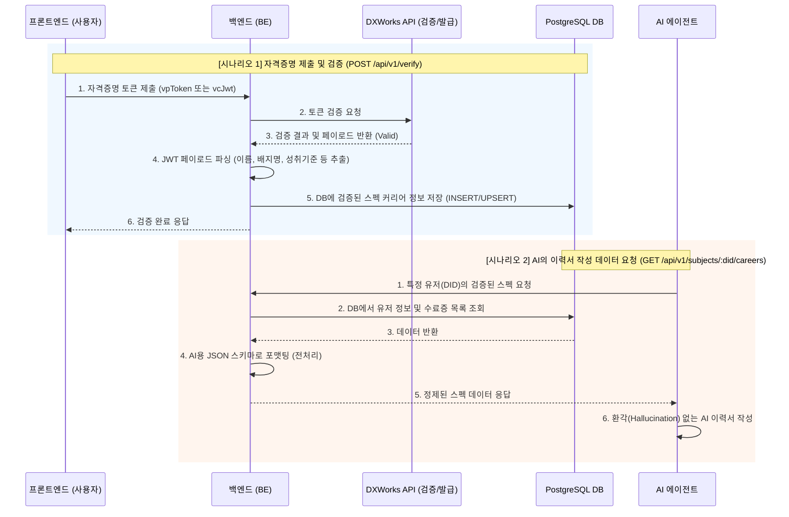

# BE 파트 - VC 검증 및 AI 데이터 서빙 백엔드 서버

본 프로젝트의 프론트엔드에서 제출한 자격증명(VC)을 DXWorks API를 통해 검증하고, 그 결과를 DB에 저장한 뒤, AI 에이전트가 이해할 수 있는 정제된 형태(JSON)로 제공하는 **BFF(Backend For Frontend) 서버**입니다.

## 1. 아키텍처 흐름도 (Flowchart)



## 2. 원클릭 개발 환경 구축 (Docker 기반 권장 ⭐️)

로컬에 파이썬(Python)이나 PostgreSQL을 직접 설치할 필요가 없습니다. Docker Desktop만 켜져 있다면, **단 두 줄의 명령어**로 파이썬 패키지 설치, DB 세팅, 440여 개 테스트 데이터 시딩, FastAPI 서버 실행까지 모든 환경이 자동으로 한 번에 구축됩니다.

### 🚀 최초 1회 실행 방법
```bash
# 1. BE 디렉터리 이동 및 환경변수 예시 복사
cd BE
cp -n .env.example .env

# 2. 도커로 전체 환경 자동 빌드 및 백그라운드 실행
docker compose up --build -d
```
> **⚠️ 주의 (API 키 설정):** 
> 실제 발급/검증 테스트(Step 1, Step 2)를 수행하려면 `.env` 파일의 `DXWORKS_API_HOST`, `DXWORKS_API_KEY`, `DXWORKS_BADGE_TEMPLATE_ID`를 채워야 합니다. (더미 조회 테스트는 키 없이도 즉시 가능합니다.)
>
> **🔒 협력사 자료 취급:** 이 값들과 협력사에서 받은 문서·예제 코드는 **비공개 자료**입니다. 공개 저장소(코드, 문서, 이슈, PR 본문, 커밋 메시지)에 그대로 옮기지 말고 `.env`와 팀 내부 채널로만 주고받으세요. 협력사 API 형식은 `app/integrations/dxworks.py`에서만 다룹니다.

> **💡 이 명령어 하나로 자동 완료되는 항목들:**
> 1. **Python 3.11 런타임 & 의존성(`requirements.txt`)** 도커 컨테이너 내 자동 설치 (로컬 파이썬 버전 충돌 0%)
> 2. **PostgreSQL 16 + pgvector** 컨테이너 자동 구동
> 3. **440여 개 논문 테스트 데이터(`03_seed_data.sql`)** DB에 자동 시딩
> 4. **FastAPI 백엔드 서버(포트 3000)** 자동 실행
> 5. **핫 리로드(Hot Reload)** 연동: 로컬 소스 코드(`BE/`)를 수정하고 저장하면 컨테이너 내부 서버가 즉시 자동 반영됩니다.

---

## 3. 컨테이너 관리 명령어

```bash
# 실행 상태 확인
docker compose ps

# 백엔드 서버 실시간 로그 확인
docker compose logs -f backend

# 서버 및 DB 일시 종료 (데이터는 보존됨)
docker compose down

# DB 및 데이터 완전 초기화 (초기 시드 상태로 깨끗하게 리셋할 때)
docker compose down -v
docker compose up -d
```
* **API 문서 (Swagger UI):** [http://localhost:3000/docs](http://localhost:3000/docs)
* **헬스 체크:** [http://localhost:3000/health](http://localhost:3000/health)

<details>
<summary><b>(선택) 도커 대신 로컬 파이썬 환경에서 직접 띄우고 싶을 때</b></summary>

로컬 IDE 디버거 등을 위해 호스트에서 직접 실행하려는 경우:
1. DB만 도커로 켬: `docker compose up -d postgres`
2. 의존성 설치: `pip install -r requirements.txt` (Mac/Linux는 `python3 -m pip install -r requirements.txt`)
3. 서버 실행: `python -m uvicorn main:app --reload --port 3000`
</details>

### 🔄 기존 환경을 쓰고 있다면 (v0.4.0 업데이트 후 1회)
`PyJWT`·`cryptography` 패키지와 DB 컬럼·테이블(`credentials.raw_token`, `holder_keys` 등)이 추가되었습니다. 아래 두 명령을 한 번 실행하세요.
이미지를 다시 빌드하지 않으면 핫 리로드 중인 서버가 `ModuleNotFoundError: jwt`로 멈춥니다.
```bash
docker compose up -d --build
docker compose exec -T postgres psql -U postgres -d vc_career_agent < DB/migrations/05_credentials_raw_token.sql
docker compose exec -T postgres psql -U postgres -d vc_career_agent < DB/migrations/06_holder_keys.sql
docker compose exec -T postgres psql -U postgres -d vc_career_agent < DB/migrations/07_shares.sql
docker compose exec -T postgres psql -U postgres -d vc_career_agent < DB/migrations/08_oauth_accounts.sql
```
(DB를 통째로 새로 만들어도 되면 `docker compose down -v && docker compose up -d --build`)

### 🔑 관리형 지갑 (홀더 키)
- 새로 가입하면 BE가 사용자별 **Ed25519 키**를 만들고, 그 공개키로 **진짜 `did:key`**를 발급합니다.
- 개인키는 `.env`의 `HOLDER_KEY_ENCRYPTION_KEY`(마스터 키)로 AES-256-GCM 암호화해서 `holder_keys` 테이블에 저장합니다. 평문은 DB에 남지 않습니다.
- 기존 사용자(시드 계정 포함)는 원래 DID(`did:key:z6MkMock...`)를 그대로 쓰고 홀더 키가 없습니다. `GET /api/v1/users/me`의 `wallet.custody`가 `managed`면 키가 있고, `none`이면 없습니다.
- 마스터 키를 비워 두면 새 가입자도 임시 DID를 받습니다. 마스터 키를 **바꾸거나 잃어버리면 기존 홀더 키를 복호화할 수 없으니** 팀 내부에서 안전하게 보관하세요.
- **공유 기준:** 각자 로컬 DB는 각자 키를 새로 만듭니다. 같은 DB(공용 개발 서버·운영 서버)를 쓰는 사람끼리만 같은 키가 필요하고, 운영 키는 최소 인원만 보관합니다. 메신저에 평문으로 보내지 마세요.
- **시드 덤프 주의:** DB를 `pg_dump`로 떠서 시드로 커밋할 때는 `--exclude-table=holder_keys --exclude-table=shares`를 붙여 암호화된 키와 공유 링크가 공개 저장소에 올라가지 않게 하세요.

### ✅ 실행 시점 재검증 · 포트폴리오 · 선택 공개 (v0.6.0)
- **재검증:** `POST /api/v1/credentials/{record_id}/reverify` — 저장된 서명 원본을 지금 다시 검증해 상태(폐기·만료)를 갱신합니다.
- **근거 조회 (AI·FE용):** `GET /api/v1/subjects/{did}/evidence?mode=strict|labeled` — DB 상태를 믿지 않고 요청 시점에 다시 검증한 뒤 **서명 원본 안의 본문**으로 근거를 줍니다 (논문 RAG-VC). 서명 원본이 없는 시드 데이터는 `no_signed_original`로 제외됩니다.
- **포트폴리오 (VC_ONLY):** `POST /api/v1/portfolios` — 자격증명 ID와 `source: "VC_ONLY"`만 받고, 자유 텍스트 필드가 있으면 422. 다시 검증을 통과한 자격증명만 본문에 들어갑니다. 지금은 템플릿 작성기이고, AI 연동 시 작성기만 바꿉니다.
- **선택 공개:** `POST /api/v1/shares`로 고른 자격증명만 공유 링크를 만들고(토큰은 한 번만 표시, DB에는 해시만), 기업은 `GET /api/v1/public/shares/{token}`으로 로그인 없이 봅니다. 열 때마다 다시 검증하고, 기업이 직접 검증할 수 있게 서명 원본도 함께 줍니다.
- 자세한 요청·응답은 `openapi.yaml` 참고.

### 🔐 인증 (JWT)
- 회원가입/로그인 응답의 `access_token`을 이후 요청에 `Authorization: Bearer <access_token>` 헤더로 보냅니다.
- 로그인 사용자는 **본인 DID의 데이터만** 조회·검증·발급할 수 있습니다 (남의 DID면 403).
- AI 등 내부 서비스는 `X-Service-Key: <SERVICE_API_KEY>` 헤더로 `careers` 조회만 할 수 있습니다.
- **전환 기간:** `.env`의 `AUTH_REQUIRED=false`(기본값)이면 토큰 없는 요청도 받습니다. FE·AI가 토큰을 보내도록 바뀌면 `true`로 바꿉니다.
- 운영에서는 `.env`에 `JWT_SECRET`을 반드시 설정하세요. 비우면 서버가 재시작될 때마다 기존 토큰이 무효가 됩니다.
- **Google OAuth 2.0:** `.env`에 `GOOGLE_CLIENT_ID`, `GOOGLE_CLIENT_SECRET`, `GOOGLE_REDIRECT_URI`를 설정하면 `GET /api/v1/users/oauth/google/authorize`와 `GET|POST /api/v1/users/oauth/google/callback`으로 소셜 로그인·자동 가입(관리형 `did:key` 발급)·기존 이메일 계정 자동 연동이 동작합니다.

### 🧪 테스트
DXWorks는 가짜 응답으로 대체하고, 실제 PostgreSQL(pgvector)에 테스트 전용 DB를 만들어 스키마 → 시드 → 마이그레이션 순서로 적용한 뒤 검증합니다. 개발 DB(`vc-postgres`)는 건드리지 않습니다.
```bash
# 테스트용 DB 컨테이너 (최초 1회, 포트 55432)
docker run -d --name vc-be-test -e POSTGRES_PASSWORD=password -p 55432:5432 pgvector/pgvector:pg16

pip install -r requirements-dev.txt
python -m pytest -q
```
GitHub Actions(`tests.yml`의 `BE (pytest)`)에서도 PR마다 같은 테스트가 돕니다.


## 4. API 시나리오 및 Postman 연동 테스트

포스트맨(Postman) 등에서 아래 순서대로 호출하며 메인 시나리오를 테스트할 수 있습니다.

### [Step 0] 웹 기반 유저 회원가입 및 로그인 (DID 자동 부여)
지갑 앱 없이 프론트엔드에서 회원가입하고 DID를 발급받아 세션에 저장하는 용도입니다.

**회원가입**
- **Method:** `POST`
- **URL:** `http://localhost:3000/api/v1/users/register`
- **Body (JSON):**
  ```json
  {
    "name": "홍길동",
    "email": "hong@test.com",
    "password": "password1234"
  }
  ```

**로그인**
- **Method:** `POST`
- **URL:** `http://localhost:3000/api/v1/users/login`
- **Body (JSON):**
  ```json
  {
    "email": "hong@test.com",
    "password": "password1234"
  }
  ```
> **비밀번호:** 회원가입 시 8자 이상(최대 72바이트)이어야 하며 bcrypt 해시로 저장됩니다. 로그인 시 이메일이 없거나 비밀번호가 틀리면 똑같이 `401 Invalid email or password`가 반환됩니다. 시드 테스트 계정(`user001@example.com` ~ `user045@example.com`)의 비밀번호는 모두 `test1234`입니다.
>
> **기존 환경을 쓰고 있다면:** `bcrypt` 패키지가 추가되어 이미지를 다시 빌드해야 하고, DB에 비밀번호 컬럼이 없으면 회원가입/로그인이 500 에러를 냅니다. 아래 두 명령을 한 번 실행하세요. (DB를 통째로 새로 만들어도 되면 마이그레이션 대신 `docker compose down -v` 후 `docker compose up -d --build`)
> ```bash
> docker compose up -d --build
> docker compose exec -T postgres psql -U postgres -d vc_career_agent < DB/migrations/04_users_password_hash.sql
> ```

> **Tip:** 위 API를 호출하면 응답 결과의 `data.did` 항목에 가짜 DID(예: `did:key:z6MkMock...`)가 반환됩니다. 이후 Step 1~3에서 이 DID를 사용하세요.
>
> **토큰:** 응답의 `access_token`을 Postman의 Authorization 탭(Bearer Token)에 넣으면 Step 1~3을 본인 권한으로 호출합니다.

### [Step 1] 논문 테스트용 임시 발급 서버 (Mock Issuer)
- **Method:** `POST`
- **URL:** `http://localhost:3000/api/mock-issuer/issue`
- **Body (JSON):**
  ```json
  {
    "holderDid": "Step 0에서 가입/로그인으로 발급받은 DID 입력"
  }
  ```
  `templateId`를 생략하면 `.env`의 `DXWORKS_BADGE_TEMPLATE_ID`를 씁니다. 다른 템플릿을 쓰려면 `"templateId": "<템플릿 ID>"`를 추가합니다.
- **결과:** DXWorks 발급 API를 찔러서 생성된 서명된 JWT 문자열이 리턴됩니다. (이 값을 변수로 저장하세요.)
- **제한:** 회사 API 키로 발급하므로 **가입된 DID에만** 발급합니다(아니면 404). 토큰을 보냈다면 본인 DID여야 합니다(아니면 403).

### [Step 2] 발급받은 배지를 검증하고 DB에 저장하기
- **Method:** `POST`
- **URL:** `http://localhost:3000/api/v1/verify`
- **Body (JSON):**
  ```json
  {
    "type": "badge",
    "token": "Step 1에서 받은 긴 JWT 문자열"
  }
  ```
- **결과:** 검증 결과가 **`credentials` 테이블**에 저장됩니다.
  - 서명된 원본 JWT(`raw_token`)와 점검 항목 8개(`verification_checks`: 서명·발급자 신뢰·폐기·만료·수신자 등)를 함께 저장합니다. 논문의 "실행 시점 재검증"에 쓰기 위한 원본입니다.
  - 폐기·만료된 배지도 `status`(revoked/expired)와 함께 저장되며, 이때 응답은 `success: false`입니다.
  - 배지의 수신자 DID가 가입된 사용자여야 합니다. 예전처럼 임시 사용자를 자동으로 만들지 않습니다.

### [Step 3] AI가 이력서 작성을 위해 유저 스펙 조회하기
- **Method:** `GET`
- **URL:** `http://localhost:3000/api/v1/subjects/{Step 0에서 발급받은 DID}/careers`
- **인증:** 본인 토큰(`Authorization: Bearer`) 또는 AI 서비스 키(`X-Service-Key`). 전환 기간(`AUTH_REQUIRED=false`)에는 없어도 됩니다.
- **결과:** 방금 저장된 데이터가 DB 작업자의 새로운 스키마 규격에 맞게 정제되어 출력됩니다.
  ```json
  {
    "user_profile": {
      "id": "uuid...",
      "did": "did:key:...",
      "email": "hong@test.com",
      "name": "홍길동"
    },
    "verified_credentials": [
      {
        "record_id": "urn:uuid:...",
        "issuer": "예시대학교",
        "achievement_name": "테스트 수료 배지",
        "status": "verified",
        "issued_at": "2026-10-04T12:00:00.000Z",
        "raw_data": { ... }
      }
    ]
  }
  ```


## 5. [논문 테스트용] 대량의 더미 데이터 생성 스크립트

> **💡 참고:** 현재 도커 최초 실행 시 `03_seed_data.sql`에 의해 **45명의 유저와 440여 개의 배지 데이터가 이미 DB에 자동 탑재**되어 있습니다. 새로운 무작위 데이터로 다시 생성하고 싶을 때만 아래 명령어를 실행하세요.

```bash
# 1) 도커 컨테이너를 통해 실행하는 경우 (로컬 파이썬 불필요, 권장 ⭐️)
docker compose exec backend python generate_test_data.py

# 2) 로컬 파이썬 환경에서 직접 실행하는 경우
python3 generate_test_data.py  # 또는 python generate_test_data.py
```
- **동작 방식:** 이 스크립트는 실제 발급/검증 서버(DXWorks API)를 거치지 않습니다! 수백 번의 통신을 하면 네트워크 시간이 너무 오래 걸리기 때문에, "이미 검증이 끝난 완벽한 데이터"로 위장(Mocking)하여 PostgreSQL DB에 직접(Direct Insert) 밀어 넣습니다.
- **결과:** 
  1. `users` 테이블에 45명의 가상 유저가 무작위 생성됩니다.
  2. `credentials` 테이블에 인당 5~15개씩 랜덤 분배된 약 400~500여 개의 배지(토익, 부트캠프, 수상 내역 등 20종)가 꽂힙니다.
  3. `BE` 폴더 안에 **`test_users_did_list.csv`** 파일이 생성됩니다. 
     - ⚠️ **주의:** 스크립트를 실행할 때마다 기존 CSV 파일은 지워지고, **방금 DB에 새롭게 들어간 최신 유저 정보로 덮어쓰기** 됩니다. 항상 가장 최근에 만들어진 CSV 파일의 DID를 복사해서 **Step 3 API 테스트**에 활용하시면 됩니다.
> **Note:** 논문 작성이 모두 끝나고 DB를 완전히 빈 통으로 초기화하고 싶다면 `docker compose down -v`를 치시면 됩니다.
