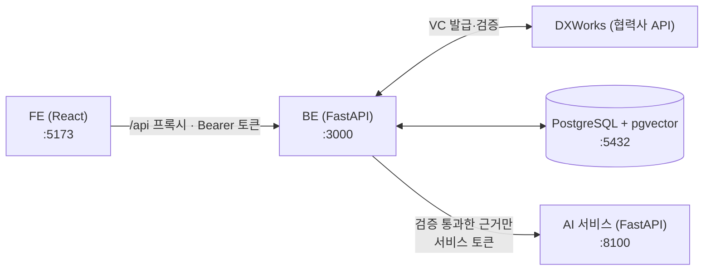

# VC_AI_Career_agent
[종합설계프로젝트1] 디지털 배지 및 자격증명 기반 초개인화 AI 커리어 에이전트 지갑 개발 과제

| 폴더 | 내용 | 안내 |
|---|---|---|
| `BE/` | VC 검증·저장·인증 백엔드, AI 연동 (직무 비교·커리큘럼 API) | [BE/README.md](BE/README.md) |
| `FE/` | 사용자 웹 (지갑·발급·직무 비교·커리큘럼) | [FE/README.md](FE/README.md) |
| `research-vc/` | **논문 실험용** VC 검증 코어: fixture 발급기관·테스트 키 기반 파싱·정규화·검증 파이프라인 (실서비스 VC 연동은 `BE/`가 DXWorks BaaS로 담당) | [research-vc/README.md](research-vc/README.md) |
| `ai/` | **AI 서비스**: 검증된 자격증명과 검토된 채용공고의 직무 비교, 커리큘럼 생성 (BE가 호출) | [ai/README.md](ai/README.md) |
| `report/` | 발표·보고 자료 | |

## 서비스 구성



- **BE**: 회원·DID 지갑, VC 발급·검증(DXWorks), 실행 시점 재검증, 포트폴리오·공유 링크, 공고·학습자료 보관, 직무 비교·커리큘럼 API
- **AI**: BE가 보낸 검증된 자격증명과 공고로 직무 요구사항을 비교하고 학습 계획을 계산합니다. DB와 키를 갖지 않습니다.
- **FE**: 지갑, 배지 발급, 직무 비교·커리큘럼 화면

## 서비스 실행 방법

아래 명령은 모두 **저장소 최상위 폴더**(`VC_AI_Career_agent/`)에서 실행합니다. 폴더 이동은 `( … )` 안에서만 하므로 순서대로 붙여 넣어도 됩니다. Windows는 Git Bash 또는 WSL을 쓰세요.

### 1. 준비물

- Docker Desktop (DB·BE·AI를 컨테이너로 실행)
- Node.js 22.12 이상 (FE, Vite 8 요구사항. 20.19 이상도 가능)
- Python 3.11 (테스트나 Docker 없이 실행할 때만)
- DXWorks 접속 정보(`DXWORKS_API_HOST`, `DXWORKS_API_KEY`, `DXWORKS_BADGE_TEMPLATE_ID`): 협력사 비공개 값이라 팀 내부 채널로 받습니다. 없으면 배지 발급·검증과 직무 비교를 할 수 없습니다.

### 2. 환경 변수 설정 (`BE/.env`)

```bash
cp -n BE/.env.example BE/.env
```

아래 명령으로 값을 하나씩 만들어 `BE/.env`의 같은 이름 항목에 붙여 넣습니다. 출력된 값은 공유 저장소에 올리지 마세요.

```bash
python3 -c "import secrets; print('JWT_SECRET=' + secrets.token_urlsafe(48))"
```

```bash
python3 -c "import secrets; print('AI_SERVICE_TOKEN=' + secrets.token_urlsafe(48))"
```

```bash
python3 -c "import base64, os; print('HOLDER_KEY_ENCRYPTION_KEY=' + base64.b64encode(os.urandom(32)).decode())"
```

| 항목 | 설명 |
|---|---|
| `APP_ENV` | 실행 환경. 로컬은 예시 파일 값 `development` 그대로(비워도 같음). `production`(BE Docker 이미지 기본값, Compose는 로컬 서비스에 `development`를 넣음)이면 아래 `JWT_SECRET`·`HOLDER_KEY_ENCRYPTION_KEY`와 `DB_HOST`·`DB_NAME`·`DB_USER`·`DB_PASSWORD`가 없거나 이 저장소의 테스트·예시 값(예: `DB_PASSWORD=password`)일 때, 또는 `JWT_SECRET`·`HOLDER_KEY_ENCRYPTION_KEY`·`SERVICE_API_KEY`·`AI_SERVICE_TOKEN`·`DXWORKS_API_KEY` 중 넣은 두 값이 서로 같을 때 BE가 시작하지 않습니다(아래 "AWS 배포 체크리스트") |
| `DXWORKS_API_HOST`, `DXWORKS_API_KEY`, `DXWORKS_BADGE_TEMPLATE_ID` | 협력사 DXWorks 접속 정보. `DXWORKS_API_HOST`는 `https://` 주소(`http://`는 `localhost`·`127.0.0.1`·`[::1]`만) |
| `JWT_SECRET` | 로그인 토큰 서명 키(32바이트 이상). 비우면(`development`에서만 허용) 재시작할 때마다 로그인이 풀립니다 |
| `HOLDER_KEY_ENCRYPTION_KEY` | 사용자 지갑 키 암호화 키. **한 번 정하면 바꾸거나 잃어버리면 안 됩니다**. 비우면(`development`에서만 허용) 새 가입자가 임시 DID를 받습니다 |
| `AI_SERVICE_TOKEN` | BE와 AI가 같이 쓰는 비밀(32바이트 이상, 위 명령으로 따로 만들어 `JWT_SECRET`·`HOLDER_KEY_ENCRYPTION_KEY`·`SERVICE_API_KEY`·`DXWORKS_API_KEY`와 다른 값). Compose가 AI 컨테이너에도 같은 값을 넣습니다 |
| `MOCK_ISSUER_ENABLED`, `MOCK_ISSUER_TEMPLATE_IDS`, `MOCK_ISSUER_DAILY_LIMIT` | FE **자격증명 발급**(`/issue`) 화면이 쓰는 모의 발급. `MOCK_ISSUER_ENABLED`를 비우면(예시 파일 값) `development`에서는 켜지고 `production`에서는 꺼집니다. 켜져 있어도 로그인한 본인 DID에만, `DXWORKS_BADGE_TEMPLATE_ID`와 `MOCK_ISSUER_TEMPLATE_IDS`(선택, 쉼표 구분)의 템플릿만, 사용자별 24시간 `MOCK_ISSUER_DAILY_LIMIT`건(기본 10)까지 발급합니다 |
| `RESEARCHER_USER_IDS` | 공고·학습자료를 반입할 연구자 계정 UUID (5번에서 채움) |
| `CURRICULUM_LLM_USER_IDS` | 커리큘럼 LLM 모드를 쓸 계정 UUID (선택, 7번) |

로그인 토큰은 설정과 관계없이 항상 필요합니다. 회원가입·로그인·`/health`·기업용 공유 링크 조회 말고는 `Authorization: Bearer <토큰>`이 없으면 401입니다. 예전에 만든 `BE/.env`에 `AUTH_REQUIRED=false` 줄이 남아 있으면 지웁니다(이제 쓰지 않으며, 남아 있으면 BE 시작 로그에 경고만 남습니다).

### 3. DB·BE·AI 실행 (Docker Compose)

```bash
(cd BE && docker compose up --build -d)
```

처음 실행하면 DB 스키마·시드·마이그레이션(04~10)이 자동 적용됩니다. 그 뒤에도 `docker compose up` 때마다 한 번 실행되고 끝나는 `migrate` 서비스(`python -m app.migrate --seed`)가 아직 적용하지 않은 마이그레이션만 적용하고(기록: DB의 `schema_migrations` 표), 성공해야 `backend`가 뜹니다. 상태 확인:

```bash
(cd BE && docker compose ps)
```

```bash
curl http://localhost:3000/health
```

```bash
curl http://localhost:8100/health
```

- BE API 문서: <http://localhost:3000/docs>
- 로그 확인: `(cd BE && docker compose logs -f backend ai)`
- 종료(데이터 유지): `(cd BE && docker compose down)` / DB까지 초기화: `(cd BE && docker compose down -v)`
- 포트(DB 5432·BE 3000·AI 8100)는 이 PC(`127.0.0.1`)에서만 열립니다. DB 기본 비밀번호·시드 계정·모의 발급이 켜진 개발 설정이므로 다른 기기에서 접속하도록 바꾸지 않습니다.

> **이미 DB 볼륨이 있는 경우(이전 버전에서 업그레이드)** 위 `docker compose up --build -d`를 다시 실행하면 `migrate` 서비스가 기존 볼륨에 없는 마이그레이션(이번 버전은 09 `users.token_version`·10 `mock_issuances`)을 자동으로 적용합니다. 새 BE를 붙인 DB에 09가 없으면 로그인·가입과 토큰이 필요한 모든 요청이, 10이 없으면 모의 발급이 500입니다. 결과는 `(cd BE && docker compose logs migrate)`로 보고, 직접 다시 실행하려면:
> ```bash
> (cd BE && docker compose run --rm migrate)
> ```

### 4. FE 실행

새 터미널에서 실행합니다 (개발 서버가 계속 떠 있어야 합니다).

```bash
(cd FE && npm install && npm run dev)
```

브라우저에서 <http://localhost:5173>을 엽니다. `/api` 요청은 개발 서버가 BE(`localhost:3000`)로 넘겨 줍니다.

### 5. 처음 사용하기

**① 사용자: 가입 → 배지 발급·검증**
FE에서 회원가입하면 DID 지갑이 만들어집니다. **자격증명 발급** 화면에서 배지를 발급받고 "검증하고 지갑에 저장하기"를 누릅니다.
모의 발급은 로컬(`APP_ENV=development`)에서 기본으로 켜져 있고 사용자별 24시간 10건까지입니다. 더 필요하면 `BE/.env`의 `MOCK_ISSUER_DAILY_LIMIT`을 올리고 backend를 다시 띄웁니다.
시드 계정(`user001@example.com` ~ `user045@example.com`, 비밀번호 `test1234`)은 화면 확인용입니다. 서명 원본이 없어 직무 비교에서는 근거로 쓰이지 않으므로, 새로 가입해 배지를 받으세요.

**② 연구자 지정**
공고·학습자료를 반입할 계정을 FE에서 가입한 뒤, 그 계정의 UUID를 확인합니다. 로그인 토큰을 셸 변수에 담아 두고(③에서도 씁니다), 이메일·비밀번호는 실제 값으로 바꿉니다.

```bash
TOKEN=$(curl -s -X POST http://localhost:3000/api/v1/users/login -H 'Content-Type: application/json' -d '{"email":"researcher@example.com","password":"<비밀번호>"}' | python3 -c "import sys, json; print(json.load(sys.stdin)['access_token'])")
```

```bash
curl -s http://localhost:3000/api/v1/users/me -H "Authorization: Bearer $TOKEN" | python3 -c "import sys, json; print(json.load(sys.stdin)['data']['id'])"
```

출력된 UUID를 `BE/.env`의 `RESEARCHER_USER_IDS=`에 넣고(여러 명이면 쉼표로 구분) BE를 다시 띄웁니다.

```bash
(cd BE && docker compose up -d --force-recreate backend)
```

**③ 연구자: 공고·학습자료 반입**
요구사항마다 원문 인용(`quote`)과 원문 안의 정확한 위치(`start`, `end`, 글자 수 기준)가 있어야 합니다.
AI가 주석이 원문과 맞는지(예: "또는" 조건을 "그리고"로 바꾸지 않았는지) 검사하고, 틀리면 422로 이유를 알려 줍니다.
비교에는 `dataset_kind: "real"`이고 수집(`captured_at`) 7일 이내·게시 90일 이내인 공고만 쓰이므로, **이용 허가를 받은 실제 공고**를 반입하세요.
아래는 형식 예시입니다(회사·URL은 가상 값). 같은 터미널에서 ②의 `TOKEN`을 그대로 씁니다.

```bash
NOW=$(date -u +%Y-%m-%dT%H:%M:%SZ)
cat > posting.json <<EOF
{
  "source": "manual", "external_id": "example-de-001",
  "source_url": "https://jobs.example.com/example-de-001",
  "company": "예시데이터(주)", "title": "주니어 데이터 엔지니어", "region": "서울", "seniority": "junior",
  "role_id": "data_engineer", "posted_at": "$NOW", "captured_at": "$NOW",
  "dataset_kind": "real", "rights_basis": "permission", "review_note": "게시처 허가를 받아 원문을 그대로 옮김",
  "raw_text": "SQL 평가 통과\nPython 또는 Scala 과정 수료\nSpark 실무 경험\n",
  "requirements": [
    {"key": "r0", "kind": "skill", "importance": "required", "quote": "SQL 평가 통과", "start": 0, "end": 9,
     "skill_ids": ["sql"], "minimum_evidence": "assessment"},
    {"key": "r1", "kind": "skill", "importance": "required", "quote": "Python 또는 Scala 과정 수료", "start": 10, "end": 31,
     "skill_ids": ["python", "scala"], "match": "any", "minimum_evidence": "completion"},
    {"key": "r2", "kind": "skill", "importance": "required", "quote": "Spark 실무 경험", "start": 32, "end": 43,
     "skill_ids": ["spark"]}
  ]
}
EOF
curl -s -X POST http://localhost:3000/api/v1/research/job-postings -H "Authorization: Bearer $TOKEN" -H 'Content-Type: application/json' -d @posting.json
```

```bash
NOW=$(date -u +%Y-%m-%dT%H:%M:%SZ)
cat > resource.json <<EOF
{
  "source": "manual", "external_id": "example-spark-101",
  "source_url": "https://learning.example.com/spark-101",
  "title": "Apache Spark 입문 실습", "provider": "예시 교육기관",
  "raw_text": "Apache Spark 입문 실습\n무료",
  "skill_annotations": [{"skill_id": "spark", "quote": "Apache Spark", "start": 0, "end": 12}],
  "prerequisite_annotations": [], "prerequisites_reviewed": true,
  "level": "beginner", "minimum_study_hours": 4,
  "cost_krw": 0, "cost_annotation": {"quote": "무료", "start": 19, "end": 21},
  "captured_at": "$NOW", "available": true,
  "dataset_kind": "real", "rights_basis": "permission", "review_note": "제공처 허가를 받아 소개 문구를 그대로 옮김"
}
EOF
curl -s -X POST http://localhost:3000/api/v1/research/learning-resources -H "Authorization: Bearer $TOKEN" -H 'Content-Type: application/json' -d @resource.json
```

- 기술 ID: `sql`, `python`, `scala`, `spark`, `kafka`, `airflow`, `etl`, `data_modeling`, `git`, `linux`, `aws`, `docker`
- 원문에서 기술 후보만 먼저 보고 싶으면 `POST /api/v1/research/job-postings/preview`에 `{"raw_text": "..."}`를 보냅니다.
- 학습자료는 수집 30일 이내만 쓰입니다. 같은 `source`·`external_id`로 다시 반입하면 새 버전이 쌓이고 최신 버전이 쓰입니다.
- 각 필드의 규칙은 [BE/openapi.yaml](BE/openapi.yaml)과 <http://localhost:3000/docs>를 참고하세요.

**④ 사용자: 직무 비교 → 학습 계획**
FE의 **직무 비교·커리큘럼** 화면에서 공고를 고르고 "검증하고 비교하기"를 누르면, BE가 모든 자격증명을 지금 다시 검증한 뒤 AI가 요구사항별로 비교합니다.
같은 화면에서 기간·주당 시간·예산을 정해 학습 계획을 만듭니다. 비교 결과는 5분 동안만 계획 생성에 쓸 수 있습니다.

### 6. Docker 없이 실행 (개발·디버깅)

DB만 컨테이너로 띄우고 BE와 AI를 각각 다른 터미널에서 실행합니다. `ai/.env`의 `AI_SERVICE_TOKEN`은 `BE/.env`와 같은 값이어야 합니다.

```bash
(cd BE && docker compose up -d postgres)
```

```bash
(cd BE && python3.11 -m venv .venv && .venv/bin/pip install -r requirements.txt && .venv/bin/python -m app.migrate && .venv/bin/python -m uvicorn main:app --reload --port 3000)
```

`app.migrate`는 `BE/.env`의 DB 접속 정보로 아직 적용하지 않은 마이그레이션만 적용합니다(이전 볼륨 업그레이드 포함, 최신이면 아무것도 하지 않음). `APP_ENV=production`이면 `--seed`를 거부하고, `DB_PASSWORD`가 비었거나 `password`면 접속하지 않으며, 공개된 시드 테스트 비밀번호를 쓰는 계정이 DB에 있으면 실패합니다(운영 절차는 아래 "AWS 배포 체크리스트").

```bash
cp -n ai/.env.example ai/.env
```

```bash
(cd ai && python3.11 -m venv .venv && .venv/bin/pip install -r requirements.txt && .venv/bin/python -m uvicorn src.server.app:app --host 127.0.0.1 --port 8100)
```

로컬 실행 시 BE는 기본값 `AI_SERVICE_URL=http://127.0.0.1:8100`으로 AI에 접속합니다. FE는 4번과 같습니다.

### 7. (선택) 커리큘럼 LLM 모드

기본은 LLM 없이 만드는 템플릿 계획입니다. LLM을 쓰려면 `BE/.env`의 `CURRICULUM_LLM_USER_IDS`에 계정 UUID를 넣고, `ai/.env`에 `CURRICULUM_LLM_ENABLED=true`와 공급자 설정을 넣은 뒤 다시 띄웁니다.

```bash
(cd BE && docker compose up -d --force-recreate backend ai)
```

FE에서 "LLM으로 단계 순서·시간을 배분" 동의를 체크해야 사용됩니다. OpenAI 호환 API와 로컬 Qwen(GPU) 설정은 [ai/README.md](ai/README.md) 6번을 보세요.

### 8. 테스트

BE 테스트는 pgvector가 들어 있는 테스트 전용 DB가 필요합니다(개발 DB는 건드리지 않음).

```bash
docker run -d --name vc-be-test -e POSTGRES_PASSWORD=password -p 127.0.0.1:55432:5432 pgvector/pgvector:0.8.7-pg16-bookworm
```

```bash
(cd BE && python3.11 -m venv .venv && .venv/bin/pip install -r requirements-dev.txt && .venv/bin/python -m pytest -q)
```

```bash
(cd ai && python3.11 -m venv .venv && .venv/bin/pip install -r requirements-dev.txt && .venv/bin/python -m pytest -q && .venv/bin/python scripts/sync_contract_to_be.py --check)
```

```bash
(cd FE && npm run lint && npm run build)
```

`requirements.txt`는 테스트한 버전을 `==`로 고정한 실행용 목록이고, 테스트 도구(pytest)는 `requirements-dev.txt`에 있습니다. 허용 범위는 `requirements.in`에서 고치고, BE·AI가 함께 쓰는 패키지는 같은 버전으로 맞춥니다(다시 만드는 방법은 각 `requirements.txt` 머리 주석).
GitHub Actions(`.github/workflows/tests.yml`)가 PR마다 같은 검사를 실행하고, BE·AI Docker 이미지 빌드와 `BE/docker-compose.yml` 문법도 확인합니다. FE 작업은 빌드한 `dist`에 외부 스크립트(`mcp.figma.com`, 다른 출처의 `<script src>`)나 개발 전용 안내(`localhost:3000`, `AI_SERVICE_TOKEN`·`AI_SERVICE_URL`, `DXWORKS_`, `ai_contract`)가 있으면 실패합니다.
두 워크플로(`tests.yml`, Strix 보안 스캔 `main.yml`)는 읽기 전용 `GITHUB_TOKEN`(`permissions: contents: read`)으로 돌고, 체크아웃은 토큰을 git 설정에 남기지 않습니다(`persist-credentials: false`). 액션은 태그 대신 커밋 SHA와 버전 주석(`# vX.Y.Z`)으로 고정하고, `.github/dependabot.yml`이 매주 새 릴리스를 확인해 하나로 묶은 갱신 PR을 엽니다. Strix는 PyPI의 `strix-agent==1.7.0`으로 설치하므로 버전은 `main.yml`의 그 줄에서 올립니다. 비밀값(`STRIX_LLM`, `LLM_API_KEY`)은 Strix 실행 단계에만 넘깁니다. 이 규칙들은 BE 테스트 `tests/test_ci_workflows.py`가 검사합니다.
`ai/src/career/contracts/`(BE와 AI가 주고받는 형식)를 바꿨다면 `ai/`에서 `python scripts/sync_contract_to_be.py`로 BE 사본을 갱신하고 BE와 AI를 함께 다시 띄웁니다.

### 9. 문제 해결

| 증상 | 확인할 것 |
|---|---|
| FE에 "BE 서버에 연결할 수 없습니다" | BE가 3000번에서 실행 중인지 (`curl http://localhost:3000/health`) |
| FE에 "AI 서버에 연결할 수 없습니다" | AI가 실행 중인지 (`curl http://localhost:8100/health`), BE의 `AI_SERVICE_URL` |
| "BE에 AI 서버 주소·토큰이 설정되지 않았습니다" | `BE/.env`의 `AI_SERVICE_TOKEN`이 비었거나 32바이트 미만 |
| "AI_SERVICE_TOKEN이 서로 다릅니다" | Docker 없이 실행할 때 `BE/.env`와 `ai/.env`의 토큰이 다름 |
| 발급·검증이 502/503 ("배지 발급·검증 서비스에서 오류가 발생했습니다" / "…지금 사용할 수 없습니다") | `DXWORKS_*` 값. 응답에는 `code`(`PROVIDER_ERROR`/`PROVIDER_NOT_CONFIGURED`)만 있고, 협력사 오류·빠진 설정 이름은 BE 로그의 `Provider error:` 줄에 있습니다. `DXWORKS_API_HOST`가 `https://` 주소인지(`http://`는 `localhost`·`127.0.0.1`·`[::1]`만, 그 밖이면 호출하지 않고 503) |
| 운영 빌드 화면에 "잠시 후 다시 시도해주세요…"·"서버에서 일시적인 오류가 발생했습니다" | 운영 빌드(`npm run build`)는 서버 주소·설정 이름 같은 운영자용 안내를 보여 주지 않습니다(이 표의 안내 문구 일부는 `npm run dev`에서만). BE 로그의 `Provider error:`·`AI service error:` 줄과 브라우저 네트워크 탭의 응답 `code`를 확인 |
| API가 401 `Authentication required` (curl·Postman) | 토큰 없이 부름. 회원가입·로그인·`/health`·공유 링크 조회 말고는 `-H "Authorization: Bearer $TOKEN"`이 필요합니다(5번 ②의 `TOKEN`). `AUTH_REQUIRED=false`로는 끌 수 없습니다 |
| BE 시작 로그에 `AUTH_REQUIRED=false 설정은 더 이상 쓰지 않습니다` | 예전 `BE/.env`의 `AUTH_REQUIRED` 줄을 지움 (인증은 항상 켜져 있음) |
| 로그인이 "시도가 너무 많습니다" (429 `Too many attempts. Try again later.`) | 같은 이메일로 15분 안에 10번 틀림 → 응답의 `Retry-After`(초) 뒤에 다시 시도. 로그인에 성공하면 다시 세고, BE 프로세스마다 메모리에서 세므로 로컬은 BE를 다시 시작해도 지워짐. 운영에서 가입도 429면 WAF의 IP별 속도 제한(아래 "AWS 배포 체크리스트". FE는 WAF·로드밸런서의 429도 본문과 관계없이 같은 문구로 보여 줌) |
| 발급 화면에 "이 서버에서는 모의 발급을 사용할 수 없습니다" (404 `Mock issuer is disabled`) | `MOCK_ISSUER_ENABLED`가 꺼짐. 비워 두면 `APP_ENV=production`(Docker 이미지 기본값)에서는 꺼지므로 시연 배포는 `MOCK_ISSUER_ENABLED=true`를 넣음 |
| 발급이 403 `Template not allowed` 또는 429 `Mock issuance limit reached; try again later` | 발급 화면의 Template ID를 비우거나 그 ID를 `BE/.env`의 `MOCK_ISSUER_TEMPLATE_IDS`에 추가 / 사용자별 24시간 한도 `MOCK_ISSUER_DAILY_LIMIT`(기본 10)을 넘음 (실패한 발급은 세지 않음. 그 기록을 지우는 DB 작업까지 실패한 경우만 남음) → 로컬은 값을 올리고 backend 재시작 |
| 발급·검증이 403 `Forbidden: can only issue to your own DID` / `Forbidden: credential was issued to a different DID` | `holderDid`나 배지의 수신자 DID가 로그인한 계정의 DID와 다름(다른 계정 DID로 발급했거나 다른 계정의 배지를 검증함) → 지금 로그인한 계정의 DID로 다시 발급해 검증 |
| 공유 링크 조회가 503 `Share verification is busy. Try again later.` | 그 BE 태스크의 기업용 조회 검증기 호출 한도(분당 300번, 최근 60초 안에 확인한 원본은 세지 않음)를 넘음 → 응답의 `Retry-After`(초) 뒤에 다시 열기 |
| 요청이 413 `Content Too Large` | 요청 본문이 2 MiB를 넘음 (공고 반입 원문은 10만 자, VC 토큰은 256 KiB까지) |
| 422 `must be a single line without control characters` / `must not contain NUL or unpaired surrogate characters` / `Input should be a valid string, unable to parse raw data as a unicode string` | 이름·이메일·포트폴리오 제목·희망 직무 안에 줄바꿈·탭 같은 제어 문자가 있거나, 입력에 NUL(`\u0000`, 두 번째 메시지)·짝 없는 서로게이트(예: JSON `\ud800`, 세 번째 메시지)가 있음 → 지우고 다시 보냄 |
| 직무 비교 화면에 공고가 없음 | 연구자 반입 공고가 없거나, `dataset_kind`가 `real`이 아니거나, 수집 7일·게시 90일이 지남 |
| 공고 반입이 403 | 그 계정 UUID가 `RESEARCHER_USER_IDS`에 없음 (넣은 뒤 backend 재시작) |
| 공고 반입이 422 | 응답 `detail`의 규칙 코드 (예: `ANNOTATED_SKILL_NOT_MENTIONED_IN_QUOTE`), `start`/`end` 위치. `TEXT_EXPANDS_TOO_MUCH_WHEN_NORMALIZED`면 원문·인용에 NFKC 정규화로 크게 늘어나는 호환 문자(예: U+FDFA)가 많음 → 풀어 쓴 문자로 고쳐 다시 반입 |
| 로그인 화면에 "로그인 시간이 만료되었습니다" | 토큰 만료(BE `JWT_EXPIRES_MINUTES`, 기본 1440분), 같은 계정이 다른 브라우저·기기에서 로그아웃함, DB를 초기화해 계정이 없어짐, 이전 버전에서 로그인해 토큰이 없음, 또는 `BE/.env`의 `JWT_SECRET`이 빈 채로 BE가 재시작됨 → 다시 로그인 (`JWT_SECRET` 설정) |
| 학습 계획 생성이 409 | 비교 결과 5분이 지남 → 다시 비교 |
| BE가 시작하지 않음 `APP_ENV=production requires ...` | `APP_ENV=production`(Docker 이미지 기본값)인데 오류에 나온 값이 없거나 쓸 수 없음: `JWT_SECRET`(32바이트 이상, 저장소의 테스트·자리표시 값 아님)·`HOLDER_KEY_ENCRYPTION_KEY`(테스트 키 아님)·`SERVICE_API_KEY`(비우거나 32바이트 이상 임의 값)·`DB_HOST`·`DB_NAME`·`DB_USER`(빈 값 아님)·`DB_PASSWORD`(빈 값·`password`가 아닌 값) → 2번 명령으로 새로 만든 값을 넣거나, 로컬이면 `APP_ENV=development`. `<이름> (not the same value as <다른 이름>)`은 `JWT_SECRET`·`HOLDER_KEY_ENCRYPTION_KEY`·`SERVICE_API_KEY`·`AI_SERVICE_TOKEN`·`DXWORKS_API_KEY` 중 두 값이 같음(같은 쌍마다 하나씩 나옴) → 앞쪽 변수를 2번 명령으로 새로 만듦(`AI_SERVICE_TOKEN`은 BE와 AI에 같은 새 값, `SERVICE_API_KEY`는 비워도 됨. `JWT_SECRET`을 바꾸면 모든 사용자가 한 번 로그아웃됨. 협력사가 발급한 `DXWORKS_API_KEY`는 앞쪽에 나오지 않음. `HOLDER_KEY_ENCRYPTION_KEY`는 `DXWORKS_API_KEY`와 같을 때만 앞쪽인데, 바꾸면 기존 홀더 키를 복호화할 수 없으므로(재암호화 도구 없음) 가입자가 있는 DB면 먼저 팀에서 정함) |
| BE가 시작하지 않음 `JWT_EXPIRES_MINUTES must be ...` / `MOCK_ISSUER_DAILY_LIMIT must be ...` | `JWT_EXPIRES_MINUTES`는 1~1440 정수, `MOCK_ISSUER_DAILY_LIMIT`은 1 이상 정수 (비우면 기본값 1440·10) |
| BE가 시작하지 않음 `APP_ENV must be one of ...` | `APP_ENV` 오타(예: `prod`) → `development` 또는 `production` |
| `docker compose up`이 `migrate` 오류로 멈춤 | `(cd BE && docker compose logs migrate)`. "적용한 뒤 SQL이 바뀐 마이그레이션"이면 적용된 파일을 되돌리고 바꿀 내용은 다음 번호 파일로 추가 ([BE/README.md](BE/README.md) "DB 마이그레이션") |
| 운영 마이그레이션 태스크가 종료 코드 1 (`마이그레이션 실패: ...`) | `--seed`를 줌(운영에서는 거부) / 공개된 시드 테스트 비밀번호를 쓰는 계정이 있음(개발 DB 덤프) / `DB_PASSWORD`가 비었거나 `password` / `DB_APP_ROLE` 역할이 없거나 특권 계정(그 역할이 속한 역할에 슈퍼유저·`CREATEROLE`·`CREATEDB`·`REPLICATION`·`BYPASSRLS` 속성이 있으면 로그 줄에 그 역할 이름이 나옴) / `DB_APP_ROLE`이나 그 역할이 속한 역할(`NOINHERIT`·`WITH INHERIT FALSE` 소속 포함)이 `public` 스키마·DB에 CREATE 권한을 가지거나(PostgreSQL 14 이하에서 만들었거나 업그레이드·복원한 DB, `PUBLIC`에 준 DB CREATE 등) DB·`public` 스키마를 소유함 → 로그 줄이 걸린 검사(`public 스키마`·`DB "<DB 이름>"`), 그 권한·소유를 가진 소속 역할과 함께 알려 주는 GRANT·ALTER ... OWNER·REVOKE 문(예: 마이그레이션 계정이 슈퍼유저가 아니면 맨 앞의 `GRANT "<소유한 역할>" TO "<마이그레이션 계정>" WITH INHERIT TRUE;`, `ALTER DATABASE "<DB 이름>" OWNER TO "<마이그레이션 계정>";`, `ALTER SCHEMA public OWNER TO pg_database_owner;`, 지금 소유자 몫의 CREATE를 거둔 상태면 그 뒤의 `GRANT CREATE ON SCHEMA public TO pg_database_owner;`, `REVOKE CREATE ON SCHEMA public FROM PUBLIC;`, `REVOKE CREATE ON DATABASE "<DB 이름>" FROM "<소속 역할>";`)을 마이그레이션 계정으로 나온 순서대로 실행 / `DB_APP_ROLE`이나 그 역할이 속한 역할, 기본 제공 역할(`pg_database_owner`·`pg_monitor` 등), `public` 스키마에 CREATE 권한이 있거나 DB·`public` 스키마를 소유한 다른 역할(마이그레이션 계정·OID 10 제외)이 `public` 스키마에 객체를 소유함 → 로그 줄의 객체(10개까지)를 마이그레이션 계정으로 확인해 예상하지 못한 것은 `DROP`, 앱에 필요한 것은 `ALTER <종류> <이름> OWNER TO "<마이그레이션 계정>"`(앱 테이블이 나오면 DB·테이블을 소유하지 않은 다른 관리 계정으로 실행한 것이므로 소유한 계정(마스터 사용자)으로 다시 실행) / `DB_APP_ROLE`이나 그 역할이 속한 역할(또는 `PUBLIC`)이 `public` 테이블에 `TRIGGER` 권한이 있음(예전에 준 `GRANT ALL` 등) → 로그 줄의 `REVOKE TRIGGER ON ALL TABLES IN SCHEMA public FROM ...;`을 마이그레이션 계정으로 실행하고, 그 권한으로 만든 트리거는 REVOKE 뒤에도 남으므로 같은 줄에 나온 `public` 테이블의 트리거 중 예상하지 못한 것은 `DROP TRIGGER` / `public` 테이블의 트리거에 WHEN 조건이 있거나 그 트리거가 임시 스키마의 함수나 그 역할들이 소유한 함수를 부름 → 로그 줄의 트리거(10개까지)를 확인해 예상하지 못한 것은 `DROP TRIGGER`(임시 스키마 함수를 부르는 트리거는 그 함수를 만든 세션이 끝나면 없어짐) / `DB_APP_ROLE`이나 그 역할이 속한 역할(또는 `PUBLIC`)이 `public` 테이블에 `REFERENCES` 권한(열 단위 포함)이 있음 → 로그 줄의 `REVOKE REFERENCES ON ALL TABLES IN SCHEMA public FROM ...;`을 마이그레이션 계정으로 실행하고, 그 권한으로 만든 외래 키는 REVOKE 뒤에도 남으므로 같은 줄에 나온 `public` 밖 테이블의 외래 키 중 예상하지 못한 것은 `ALTER TABLE <스키마>.<테이블> DROP CONSTRAINT <이름>;` / 그 역할들(또는 `PUBLIC`)이 원장 `public.schema_migrations`에 `INSERT`·`UPDATE`·`DELETE`·`TRUNCATE` 권한이 있음 → 로그 줄의 `REVOKE ALL ON public.schema_migrations FROM ...;`을 실행하고, 그 권한이 있던 동안 바뀐 원장 행이 남으므로 원장이 실제로 적용한 마이그레이션과 맞는지 확인 / `DB_APP_ROLE`이나 그 역할이 속한 역할이 DB의 스키마를 소유함(예전 DB CREATE 권한으로 만든 것 등) → 그 안의 객체를 확인한 뒤 로그 줄의 `DROP SCHEMA "<스키마>" CASCADE;`나 `ALTER SCHEMA "<스키마>" OWNER TO "<마이그레이션 계정>";`(슈퍼유저가 아니면 그 앞의 `GRANT "<소유자>" TO "<마이그레이션 계정>" WITH INHERIT TRUE;`부터. ALTER SCHEMA는 그 안 객체의 소유자를 바꾸지 않으므로 예상하지 못한 객체는 따로 지움) → 아래 "AWS 배포 체크리스트"의 "DB 마이그레이션"(RDS 마스터 사용자로 소유자를 바꾸는 방법 포함) |
| BE 로그에 `permission denied for table ...` (API 500) | 서비스 계정(`DB_APP_ROLE`)으로 바꾼 뒤 새 이미지의 마이그레이션 태스크를 `DB_APP_ROLE` 없이 실행함 → `DB_APP_ROLE`을 넣어 다시 실행 |
| DB 접속 오류 `root certificate file ... does not exist`·`certificate verify failed`·`does not match host name` | `PGSSLROOTCERT`가 RDS CA 번들 파일을 가리키는지, `DB_HOST`가 RDS 엔드포인트 이름 그대로인지(CNAME·IP 아님) |

## AWS 배포 체크리스트

예시 구성: FE는 S3+CloudFront, BE·AI는 ECS(Fargate) 서비스, DB는 RDS for PostgreSQL 16. `BE/docker-compose.yml`은 로컬 개발 전용(소스 마운트·`--reload`·root·기본 비밀번호 DB)이라 운영에 쓰지 않습니다. 공개된 비밀번호의 시드 계정(`user001@example.com` 등)도 만들므로 EC2 같은 공개 호스트나 데모 서버에서도 띄우지 않습니다.
인증은 설정과 관계없이 항상 켜져 있습니다(토큰 없는 요청은 401, 예전 `AUTH_REQUIRED` 변수는 없어짐). 모의 발급(FE `/issue` 화면)은 운영 이미지(`APP_ENV=production`)에서 기본으로 꺼져 있으므로, 시연 배포에서 쓰려면 아래 `MOCK_ISSUER_ENABLED=true`를 넣습니다.

**이미지**
- [ ] BE·AI 이미지는 같은 커밋으로 만들고(`docker build -t <ECR 주소>/vc-be:<커밋> BE`, `docker build -t <ECR 주소>/vc-ai:<커밋> ai`) 함께 배포합니다. 공유 계약 ID가 다르면 직무 비교 API가 502입니다. 되돌릴 때는 다시 빌드하지 말고 이전 이미지 태그를 배포합니다.
- [ ] 두 이미지는 `python:3.11.15-slim-bookworm` 기반, 비루트(uid/gid 10001), `--reload` 없는 uvicorn 한 프로세스이고, 의존성은 `requirements.txt`의 고정 버전입니다. 서비스 작업 정의에서 명령·사용자를 덮어쓰지 않습니다(마이그레이션 태스크만 명령 덮어쓰기). `UVICORN_*` 환경변수는 uvicorn 실행 옵션으로 읽힙니다. 아래 `UVICORN_TIMEOUT_KEEP_ALIVE` 외에는 넣지 않습니다(특히 `UVICORN_RELOAD`는 운영 이미지에서 리로더를 켭니다). BE 이미지의 Python 버전(3.11, 유니코드 14)과 DB 엔진·libc(RDS 엔진 업그레이드 포함)는 함께 맞춰 올립니다: 한쪽만 올리면 로그인 실패 제한이 이메일을 접는 방식이 DB `lower()`와 달라질 수 있고, 그때는 [BE/README.md](BE/README.md) "로그인 실패 제한"의 예외 동작을 따릅니다.
- [ ] Fargate 기본 플랫폼은 x86_64입니다. Apple Silicon Mac에서 빌드하면 `docker build --platform linux/amd64 ...`로 만들거나 작업 정의의 플랫폼을 ARM64로 맞춥니다.

**BE·AI 환경변수·비밀값** (비밀값은 작업 정의의 `secrets`로 Secrets Manager·SSM Parameter Store에서 넣습니다. `.env`는 이미지에 들어가지 않습니다)
- [ ] `APP_ENV=production`: 이미지 기본값이므로 `development`를 넣지 않습니다. 아래 비밀값이 없거나 이 저장소에 공개된 테스트·예시 값(`BE/tests`·`BE/.env.example`의 값, `x`·`0x01` 반복 같은 자리표시 값)이면, 또는 `DB_HOST`·`DB_NAME`·`DB_USER`가 비었거나 `DB_PASSWORD`가 비었거나 로컬 기본값 `password`면, 또는 `JWT_SECRET`·`HOLDER_KEY_ENCRYPTION_KEY`·`SERVICE_API_KEY`·`AI_SERVICE_TOKEN`·`DXWORKS_API_KEY` 중 넣은 두 값이 서로 같으면 BE가 시작하지 않습니다(오류에는 변수 이름만 나옴. 마이그레이션 태스크도 같은 `DB_PASSWORD` 규칙으로 접속하지 않음). 비밀값은 2번 명령으로 운영용을 새로 만듭니다.
- [ ] `JWT_SECRET`: 32바이트 이상, 모든 태스크·워커가 같은 값. 다르면 태스크끼리 서로의 토큰을 거절해 FE가 계속 로그인 화면으로 돌아갑니다. 바꾸면 모든 사용자가 한 번 로그아웃됩니다.
- [ ] `JWT_EXPIRES_MINUTES`(선택): 토큰 수명(분). 1~1440 정수만 받습니다(기본 1440, 그 밖이면 BE가 시작하지 않음). 로그아웃하지 않고 떠난 세션(공용 PC 등)이 살아 있는 최대 시간이라 짧을수록(예: 480) 안전하지만 다시 로그인하는 일이 잦아집니다. 로그아웃(`POST /api/v1/users/logout`)은 이 값과 관계없이 그 계정의 토큰을 바로 모두 무효로 만듭니다.
- [ ] `HOLDER_KEY_ENCRYPTION_KEY`: 32바이트 base64, 모든 태스크가 같은 값. 바꾸거나 잃어버리면 기존 홀더 키를 복호화할 수 없습니다.
- [ ] `AI_SERVICE_TOKEN`: 32바이트 이상, BE와 AI 서비스에 같은 값. `JWT_SECRET`·`HOLDER_KEY_ENCRYPTION_KEY`·`SERVICE_API_KEY`·`DXWORKS_API_KEY`와는 다른 값으로 따로 만듭니다(같으면 BE가 시작하지 않음).
- [ ] `DXWORKS_API_HOST`(`https://` 주소. 아니면 DXWorks를 호출하지 않고 발급·검증·재검증·포트폴리오 생성·직무 비교가 503 `PROVIDER_NOT_CONFIGURED`), `DXWORKS_API_KEY`, `DXWORKS_BADGE_TEMPLATE_ID`.
- [ ] 모의 발급(FE `/issue` 화면, 가입 후 첫 배지): 시연 배포에서 쓰려면 `MOCK_ISSUER_ENABLED=true`를 넣습니다(없으면 발급 화면이 404 `Mock issuer is disabled`). 켜면 BE 시작 로그에 경고가 한 줄 남고, 로그인한 본인 DID에만, `DXWORKS_BADGE_TEMPLATE_ID`(+ 선택 `MOCK_ISSUER_TEMPLATE_IDS`, 쉼표 구분)의 템플릿만(그 밖은 403 `Template not allowed`), 사용자별 24시간 `MOCK_ISSUER_DAILY_LIMIT`건(기본 10, 넘으면 429)까지 회사 API 키로 발급합니다. 가입은 누구나 할 수 있으므로 이 템플릿에는 시연용 배지만 두고, 실제 자격·이수를 뜻하는 템플릿은 넣지 않습니다.
- [ ] RDS 접속: `DB_HOST`(RDS 엔드포인트 이름 그대로)·`DB_PORT`·`DB_NAME`과 BE 서비스 계정의 `DB_USER`·`DB_PASSWORD`(아래 "DB 마이그레이션"의 `vc_app`, 마스터 사용자가 아님). `DATABASE_URL`은 코드가 읽지 않습니다. 필요하면 `DB_CONNECT_TIMEOUT`(초, 기본 10).
- [ ] RDS TLS: BE 서비스와 마이그레이션 태스크 모두에 `PGSSLMODE=verify-full`과 `PGSSLROOTCERT=<RDS CA 번들 경로>`를 넣어 서버 인증서와 호스트 이름을 확인합니다(`require`는 인증서를 확인하지 않아 가짜 서버를 막지 못함). BE 이미지에는 CA 번들이 없으므로 운영자가 넣습니다: AWS가 공개하는 RDS 전역 CA 번들(<https://truststore.pki.rds.amazonaws.com/global/global-bundle.pem>)을 받아, 예를 들어 BE 이미지에 한 층을 더한 배포용 이미지(`FROM <ECR 주소>/vc-be:<커밋>` 다음 `COPY global-bundle.pem /app/certs/rds-global-bundle.pem`)를 만들고 `PGSSLROOTCERT=/app/certs/rds-global-bundle.pem`으로 가리킵니다. AWS가 새 RDS CA를 발표하면 번들을 다시 받습니다.
- [ ] `CORS_ORIGINS`: FE를 API와 다른 출처에서 서비스하면 FE 출처를 정확히 넣습니다(`https://app.example.com`, 끝에 `/` 없음). 같은 출처에서 `/api/*`를 BE로 넘기면 바꿀 필요가 없습니다.
- [ ] `AI_SERVICE_URL`: BE→AI 요청에는 서비스 토큰과 학생의 검증된 이력(DID·자격명)이 실리므로 태스크 사이 구간도 암호화하고, AI는 공개 로드밸런서에 붙이지 않습니다. AI 태스크 보안 그룹은 BE 태스크 보안 그룹에서 오는 8100번 접속만 허용합니다.
  - ECS Service Connect: AI 서비스의 Service Connect 설정에서 TLS(AWS Private CA)를 켜고 `AI_SERVICE_URL=http://ai:8100`·`AI_SERVICE_ALLOW_HTTP=true`로 둡니다(암호화는 두 태스크의 Service Connect 프록시가 하므로 평문은 BE 태스크 안에만 남음). TLS를 켜지 않은 Service Connect나 다른 내부망 `http://` 주소는 쓰지 않습니다. AWS Private CA 요금이 따로 듭니다.
  - 그 밖(내부 ALB 등): HTTPS 리스너(ACM 인증서) 주소 `https://...`를 넣고 `AI_SERVICE_ALLOW_HTTP`는 넣지 않습니다(기본 false).
- [ ] `SERVICE_API_KEY`는 비워 둡니다(쓰는 서비스가 없고, 넣으면 모든 DID를 읽는 키가 됩니다. 넣는다면 `JWT_SECRET`·`HOLDER_KEY_ENCRYPTION_KEY`·`AI_SERVICE_TOKEN`·`DXWORKS_API_KEY`와 다른 32바이트 이상의 새 임의 값이어야 BE가 시작합니다). `RESEARCHER_USER_IDS`·`CURRICULUM_LLM_USER_IDS`는 필요한 계정 UUID만.
- [ ] `LOG_LEVEL`은 넣지 않거나 `INFO`로 둡니다. `DEBUG`면 외부 호출마다 전체 URL(비공개 DXWorks 호스트 포함)을 남기는 httpx 로그와 접속 호스트·응답 헤더를 남기는 httpcore 로그가 다시 나옵니다.
- [ ] AI 서비스는 `AI_SERVICE_TOKEN`(BE와 같은 값)만 필수입니다. LLM 모드는 [ai/README.md](ai/README.md) 6번의 `CURRICULUM_LLM_*`.

**DB 마이그레이션**
- [ ] RDS에 `DB_NAME` 데이터베이스를 먼저 만들고, 마이그레이션에 쓰는 계정은 `pgcrypto`·`vector` 확장을 만들 수 있어야 합니다(예: 마스터 사용자). 마스터 사용자는 마이그레이션에만 씁니다.
- [ ] 그 DB를 PostgreSQL 14 이하에서 만들었거나 그 버전에서 업그레이드·복원했다면, 마이그레이션 태스크 전에 마스터 사용자로 그 DB에 접속해 `REVOKE CREATE ON SCHEMA public FROM PUBLIC;`을 한 번 실행합니다(14 이하는 기본으로 모든 역할에 `public` 스키마 CREATE 권한을 주고 업그레이드·복원 뒤에도 남아, 그대로면 마이그레이션이 종료 코드 1). 그다음 같은 `psql` 세션에서 아래 조회를 실행해 결과가 없는지 확인합니다. 그 권한으로 다른 역할이 만들어 둔 함수·연산자 등은 CREATE를 거둬도 남는데, 마이그레이션은 `vc_app`과 그 소속 역할, 기본 제공 역할, 그리고 마스터 사용자·OID 10 말고 `public`에 CREATE 권한이 있거나 DB·`public` 스키마를 소유한 역할이 소유한 객체만 거부하기 때문입니다(둘 다 아닌 보통 역할의 객체는 보지 않음). `TRIGGER` 권한도 거둔 뒤에 그 권한으로 만든 트리거가 남는데, 마이그레이션은 WHEN 조건이 있거나 임시 스키마·위 역할들의 함수를 부르는 트리거만 거부합니다. `REFERENCES` 권한도 거둔 뒤에 그 권한으로 만든 외래 키가 남는데, 마이그레이션은 `REFERENCES` 권한이 남아 있을 때만 그 외래 키를 알려 줍니다. 첫 줄의 `SET`은 이 세션이 `pg_catalog`만 찾게 해, `public`이나 마스터 사용자 이름의 스키마에 심어 둔 함수·연산자(예: 결과를 숨기는 `public.<>(oid, regrole)`)가 조회 중에 마스터 사용자 권한으로 불리지 않게 합니다(조회의 비교도 인자 형을 정확히 맞춤). 조회는 ① `public` 스키마에서 마스터 사용자와 부트스트랩 슈퍼유저(OID 10) 말고 다른 역할(`pg_database_owner`·`pg_monitor` 같은 기본 제공 역할 포함)이 소유한 객체, ② 마스터 사용자 이름의 스키마(기본 `search_path`의 `"$user"`라 마스터 사용자가 직접 접속한 세션에서는 `public`보다 먼저 찾음), ③ `public` 테이블에 `TRIGGER`·`REFERENCES` 권한을 받은 역할(`vc_app`이 이미 있으면 그 계정과 그 소속 역할, `PUBLIC` 포함. 열 단위 `REFERENCES`는 둘째 열이 `<테이블> (<열>)`), ④ `public` 테이블의 트리거(시스템 내부 트리거 제외. 이 앱의 스키마·마이그레이션은 트리거를 만들지 않음. 둘째 열은 `<트리거> on public.<테이블> -> <함수>`, 셋째 열은 그 함수의 소유자, WHEN 조건이 있으면 첫째 열이 `trigger (WHEN)`), ⑤ `public` 밖의 테이블에서 `public` 테이블을 참조하는 외래 키(이 앱의 스키마·마이그레이션은 `public` 안의 외래 키만 만듦. 셋째 열은 그 테이블의 소유자), ⑥ `vc_app`(이미 있으면)이나 `vc_app`이 속한 역할이 소유한 스키마(마이그레이션이 거부)를 보여 줍니다. 결과가 있으면 하나씩 확인해 예상하지 못한 객체·스키마는 `DROP`하고, 필요한 객체는 소유자를 마스터 사용자로 바꾸고(슈퍼유저가 아닌 마스터 사용자가 다른 역할의 객체를 지우거나 소유자를 바꿀 때 `must be owner of ...`가 나오면 아래 RDS 항목처럼 먼저 그 역할의 권한을 받음), `TRIGGER`·`REFERENCES` 권한은 `REVOKE TRIGGER ON ALL TABLES IN SCHEMA public FROM "<역할>";`·`REVOKE REFERENCES ON ALL TABLES IN SCHEMA public FROM "<역할>";`(또는 `FROM PUBLIC;`. 열 단위 권한도 함께 거둠)으로 거두고, 예상하지 못한 트리거는 `DROP TRIGGER <이름> ON public.<테이블>;`로, 외래 키는 `ALTER TABLE <스키마>.<테이블> DROP CONSTRAINT <이름>;`으로 지웁니다. ⑥의 스키마는 그 안의 객체를 확인한 뒤 `DROP SCHEMA "<스키마>" CASCADE;`(다른 스키마에서 그 안의 객체를 쓰는 것도 함께 지움)나 `ALTER SCHEMA "<스키마>" OWNER TO "<마스터 사용자>";`(그 안 객체의 소유자는 바뀌지 않으므로 예상하지 못한 객체는 따로 지움)로 정리합니다. 새로 만든 PostgreSQL 15 이상 DB(예: RDS for PostgreSQL 16)는 필요 없습니다.
  ```sql
  SET search_path = pg_catalog;  -- 이 세션은 pg_catalog만 찾음 (public·"$user"에 심은 함수·연산자를 부르지 않음)
  WITH me AS (SELECT r.oid FROM pg_roles r WHERE r.rolname = current_user),
  x (classid, objid, nsp, owner) AS (
    SELECT 'pg_class'::regclass::oid, oid, relnamespace, relowner FROM pg_class WHERE relkind NOT IN ('i', 'I', 't', 'c')
    UNION ALL SELECT 'pg_proc'::regclass::oid, oid, pronamespace, proowner FROM pg_proc
    UNION ALL SELECT 'pg_type'::regclass::oid, t.oid, typnamespace, typowner FROM pg_type t WHERE NOT EXISTS (SELECT 1
      FROM pg_depend d WHERE d.classid = 'pg_type'::regclass::oid AND d.objid = t.oid AND d.deptype = 'i')
    UNION ALL SELECT 'pg_operator'::regclass::oid, oid, oprnamespace, oprowner FROM pg_operator
    UNION ALL SELECT 'pg_collation'::regclass::oid, oid, collnamespace, collowner FROM pg_collation
    UNION ALL SELECT 'pg_conversion'::regclass::oid, oid, connamespace, conowner FROM pg_conversion
    UNION ALL SELECT 'pg_opclass'::regclass::oid, oid, opcnamespace, opcowner FROM pg_opclass
    UNION ALL SELECT 'pg_opfamily'::regclass::oid, oid, opfnamespace, opfowner FROM pg_opfamily
    UNION ALL SELECT 'pg_ts_config'::regclass::oid, oid, cfgnamespace, cfgowner FROM pg_ts_config
    UNION ALL SELECT 'pg_ts_dict'::regclass::oid, oid, dictnamespace, dictowner FROM pg_ts_dict
    UNION ALL SELECT 'pg_statistic_ext'::regclass::oid, oid, stxnamespace, stxowner FROM pg_statistic_ext
    UNION ALL SELECT 'pg_extension'::regclass::oid, oid, extnamespace, extowner FROM pg_extension)
  -- ① public 스키마에서 마스터 사용자·부트스트랩 슈퍼유저(OID 10) 말고 다른 역할(기본 제공 역할 포함)이 소유한 객체
  SELECT i.type, i.identity, x.owner::regrole::text AS role
  FROM x, me, pg_identify_object(x.classid, x.objid, 0) i
  WHERE x.nsp = 'public'::regnamespace::oid AND x.owner <> me.oid AND x.owner <> 10::oid
  -- ② 마스터 사용자 이름의 스키마 (기본 search_path의 "$user"라 public보다 먼저 찾음)
  UNION ALL SELECT 'schema', n.nspname::text, n.nspowner::regrole::text FROM pg_namespace n WHERE n.nspname = current_user
  -- ③ public 테이블에 TRIGGER·REFERENCES 권한을 받은 역할 (vc_app·그 소속 역할·PUBLIC 등. REFERENCES는 열 단위 포함)
  UNION ALL SELECT a.privilege_type || ' privilege', c.oid::regclass::text || l.col,
    CASE WHEN a.grantee = 0::oid THEN 'PUBLIC' ELSE a.grantee::regrole::text END
  FROM pg_class c CROSS JOIN me
  CROSS JOIN LATERAL (SELECT ''::text, c.relacl UNION ALL SELECT ' (' || t.attname::text || ')', t.attacl
    FROM pg_attribute t WHERE t.attrelid = c.oid AND NOT t.attisdropped AND t.attacl IS NOT NULL) l (col, acl)
  CROSS JOIN LATERAL aclexplode(l.acl) a
  WHERE c.relnamespace = 'public'::regnamespace::oid AND a.privilege_type IN ('TRIGGER', 'REFERENCES')
    AND a.grantee <> me.oid
  -- ④ public 테이블의 트리거 (시스템 내부 트리거 제외. TRIGGER 권한을 거둬도 남음. WHEN 조건이 있으면 'trigger (WHEN)')
  UNION ALL SELECT CASE WHEN g.tgqual IS NULL THEN i.type ELSE i.type || ' (WHEN)' END,
    i.identity || ' -> ' || g.tgfoid::regprocedure::text, p.proowner::regrole::text
  FROM pg_trigger g, pg_class c, pg_proc p, pg_identify_object('pg_trigger'::regclass::oid, g.oid, 0) i
  WHERE c.oid = g.tgrelid AND p.oid = g.tgfoid AND c.relnamespace = 'public'::regnamespace::oid AND NOT g.tgisinternal
  -- ⑤ public 밖의 테이블에서 public 테이블을 참조하는 외래 키 (REFERENCES 권한을 거둬도 남음. 셋째 열은 그 테이블의 소유자)
  UNION ALL SELECT i.type, i.identity, c.relowner::regrole::text
  FROM pg_constraint k, pg_class p, pg_class c, pg_identify_object('pg_constraint'::regclass::oid, k.oid, 0) i
  WHERE k.contype = 'f' AND p.oid = k.confrelid AND c.oid = k.conrelid
    AND p.relnamespace = 'public'::regnamespace::oid AND c.relnamespace <> 'public'::regnamespace::oid
  -- ⑥ vc_app(이미 있으면)이나 vc_app이 속한 역할이 소유한 스키마 (마이그레이션이 거부)
  UNION ALL SELECT 'schema (vc_app)', n.nspname::text, n.nspowner::regrole::text
  FROM pg_namespace n, pg_roles r
  WHERE r.rolname = 'vc_app' AND pg_has_role(r.oid, n.nspowner, 'MEMBER'::text)
  ORDER BY 1, 2, 3;
  ```
- [ ] BE 서비스 계정을 한 번 만듭니다: 마스터 사용자로 `psql`에 접속해 `CREATE ROLE vc_app LOGIN;` 후 `\password vc_app`(비밀번호가 셸 기록·로그에 남지 않음). 슈퍼유저·`CREATEROLE`·`CREATEDB`·`rds_superuser` 같은 권한은 주지 않고, DB나 `public` 스키마의 소유자로 만들거나 CREATE 권한을 주지도 않으며, DB·`public` 스키마를 소유하거나 거기에 CREATE 권한이 있는 역할이나 슈퍼유저·`CREATEROLE`·`CREATEDB`·`REPLICATION`·`BYPASSRLS` 속성이 있는 역할의 소속으로 넣지도 않습니다(`NOINHERIT`·`GRANT ... WITH INHERIT FALSE` 소속도 마이그레이션이 거부). `vc_app`으로 `public` 스키마에 객체를 만들어 두지도 않습니다(`vc_app`이나 그 소속 역할, `pg_database_owner`·`pg_monitor` 같은 기본 제공 역할, `public`에 CREATE 권한이 있거나 DB·`public` 스키마를 소유한 다른 역할(마스터 사용자 제외)이 소유한 객체가 있으면 마이그레이션이 거부). 테이블에 `GRANT ALL`이나 `TRIGGER`·`REFERENCES` 권한, 원장 `schema_migrations`에 쓰기 권한도 주지 않습니다(`vc_app`이나 그 소속 역할, `PUBLIC`에 있으면 마이그레이션이 거부하고, 그 권한으로 만든 트리거·외래 키·원장 행은 권한을 거둔 뒤에도 남음. `vc_app` 자신에게 준 그 밖의 DML이 아닌 권한(`TRUNCATE` 등)은 마이그레이션이 실행할 때마다 거둠). `vc_app`이나 그 소속 역할이 소유한 스키마도 두지 않습니다(마이그레이션이 거부). 이 계정의 이름·비밀번호는 별도 Secrets Manager 비밀에 두고 BE 서비스 작업 정의의 `DB_USER`·`DB_PASSWORD`로 넣습니다.
- [ ] 마이그레이션은 서비스와 **다른 작업 정의**(같은 BE 이미지 태그)로 실행합니다(`run-task` 덮어쓰기로는 `secrets`를 바꿀 수 없음): `DB_USER`·`DB_PASSWORD`는 마스터 사용자 비밀(DB와 테이블을 소유한 계정. 다른 관리 계정으로 실행하면 마스터 사용자가 소유한 테이블이 아래 소유 객체 검사에 걸림), `DB_APP_ROLE=vc_app`, 명령 `python -m app.migrate`(**`--seed`는 쓰지 않음**, `APP_ENV=production`이면 거부). 실행기는 끝날 때마다 `public` 테이블·시퀀스에서 `vc_app`의 권한을 모두 거둔 뒤 앱 테이블 SELECT·INSERT·UPDATE·DELETE와 시퀀스 사용 권한만 다시 줍니다(새 테이블 포함, 원장 `schema_migrations` 제외). `vc_app`이 없거나 특권 계정(마이그레이션 계정 자신이나 그 소속, 특권 속성이 있는 역할의 소속 포함)이거나, `vc_app`이나 `vc_app`이 속한 역할이 `public` 스키마·DB에 CREATE 권한이 있거나(`PUBLIC`에 준 CREATE 포함) DB·`public` 스키마나 그 밖의 스키마를 소유하거나 `public` 테이블에 `TRIGGER`·`REFERENCES`(열 단위 포함) 권한이나 원장 `schema_migrations`에 쓰기(`INSERT`·`UPDATE`·`DELETE`·`TRUNCATE`) 권한이 있거나(`PUBLIC`에 준 것 포함), 그 역할들이나 기본 제공 역할(`pg_database_owner`·`pg_monitor` 등), `public`에 CREATE 권한이 있거나 DB·`public` 스키마를 소유한 다른 역할(마스터 사용자 제외)이 `public` 스키마에 객체를 소유하거나, `public` 테이블의 트리거에 WHEN 조건이 있거나 그 트리거가 임시 스키마의 함수나 그 역할들이 소유한 함수를 부르면 종료 코드 1입니다. 이 검사는 마이그레이션 SQL을 하나라도 실행하기 전에 하고 권한을 주기 직전에 다시 하므로, 처음부터 걸리면 아무것도 적용하거나 주지 않습니다. 로그의 `마이그레이션 실패:` 줄이 걸린 검사·소속 역할 이름과 마스터 사용자로 나온 순서대로 실행할 GRANT·ALTER ... OWNER·REVOKE 문(예: `ALTER DATABASE "<DB 이름>" OWNER TO "<마스터 사용자>";`, `REVOKE CREATE ON DATABASE "<DB 이름>" FROM PUBLIC;`, `REVOKE TRIGGER ON ALL TABLES IN SCHEMA public FROM "vc_app";`, `REVOKE REFERENCES ON ALL TABLES IN SCHEMA public FROM "vc_app";`, `REVOKE ALL ON public.schema_migrations FROM "vc_app";`, `DROP SCHEMA "<스키마>" CASCADE; 또는 ALTER SCHEMA "<스키마>" OWNER TO "<마스터 사용자>";`)이나 소유한 객체·스키마·트리거·외래 키 목록(`TRIGGER` 권한으로 걸리면 그 권한으로 만든 트리거가 REVOKE 뒤에도 남으므로 `public` 테이블의 트리거도, `REFERENCES` 권한으로 걸리면 같은 이유로 `public` 밖 테이블에서 `public` 테이블을 참조하는 외래 키도)을 알려 줍니다. 원장 쓰기 권한으로 걸리면 그 권한으로 넣거나 바꾼 원장 행이 남으므로 원장이 실제로 적용한 마이그레이션과 맞는지 확인합니다. 마스터 사용자 비밀은 이 작업 정의에만 연결합니다.
  - 슈퍼유저가 아닌 마스터 사용자는 다른 역할이 소유한 DB·스키마(`public`, `vc_app`이 소유한 스키마 등)의 소유자를 바로 바꾸거나 그 스키마를 지우지 못합니다(`must be owner of database ...`·`must be owner of schema ...`). 그래서 마이그레이션 계정이 슈퍼유저가 아니면 로그 줄이 ALTER ... OWNER·DROP SCHEMA 문보다 먼저 `GRANT "<소유한 역할>" TO "<마스터 사용자>" WITH INHERIT TRUE;`(PostgreSQL 16 기준)를 알려 줍니다. 마스터 사용자가 만든 역할(`vc_app` 등)이 소유자면 마스터 사용자에게 그 역할의 ADMIN 권한이 있어 그대로 실행할 수 있고, 로그의 문을 나온 순서대로 다 실행한 뒤 `REVOKE "<소유한 역할>" FROM "<마스터 사용자>";`로 그 소속을 다시 거둡니다(이 REVOKE는 로그에 나오지 않음. 그 역할을 만들 때 받은 ADMIN 권한은 그대로 남음).
  - 소유자를 바꿀 때 지금 소유자 몫의 CREATE를 이미 거둔 상태면 로그 줄이 ALTER 문 뒤에 새 소유자에게 CREATE를 다시 주는 문도 알려 줍니다: `GRANT CREATE ON SCHEMA public TO pg_database_owner;`(PostgreSQL 14 이하는 `TO "<마스터 사용자>"`), 아직 만들 확장(`pgcrypto`·`vector`)이 있거나 `public` 스키마의 소유자도 바꿀 때는 `GRANT CREATE ON DATABASE "<DB 이름>" TO "<마스터 사용자>";`. 로그 없이 직접 예전 소유자의 CREATE를 먼저 거둔 뒤 소유자를 바꿨다면 새 소유자도 CREATE가 없어 마이그레이션이 `permission denied for schema public`·`permission denied to create extension`으로 실패하므로, 마스터 사용자로 같은 GRANT 문을 실행한 뒤 다시 실행합니다.
- [ ] 서비스를 갱신하기 전에 이 마이그레이션 태스크를 실행합니다. 종료 코드 0을 확인한 뒤 서비스를 갱신하고, 1이면 배포를 멈추고 로그의 `마이그레이션 실패:` 줄을 봅니다. 이번 BE는 09(`users.token_version`)·10(`mock_issuances`)이 적용된 DB가 있어야 로그인·가입·모의 발급이 됩니다. 여러 개가 동시에 실행돼도 하나씩 적용되며, RDS Proxy 같은 풀러가 아니라 DB 엔드포인트로 접속합니다. 마스터 사용자로 운영하던 서비스를 바꿀 때도 같은 순서입니다(`DB_APP_ROLE`을 넣은 마이그레이션 태스크 → 서비스의 `DB_USER`·`DB_PASSWORD`를 `vc_app` 비밀로).
- [ ] 개발·공용 DB를 덤프해 RDS로 옮기지 않습니다. 공개된 시드 테스트 비밀번호(04 마이그레이션의 해시)를 쓰는 계정이 있으면 운영 마이그레이션이 1로 끝납니다(이미 적용한 마이그레이션은 남음). 그 계정은 가상 데이터이므로 확인한 뒤 지우고(`DELETE FROM users WHERE password_hash = '<BE/DB/migrations/04_users_password_hash.sql의 해시>';`, 그 계정의 자격증명·공유 링크 등은 함께 지워짐) 다시 실행합니다.
- [ ] 연구자가 학습자료를 반입한 기존 DB라면 이번 AI를 배포하기 전에 [BE/README.md](BE/README.md)의 "학습자료 선수 조건 점검"을 한 번 실행합니다.

**FE**
- [ ] Node.js 22.12 이상에서 `cd FE && npm ci && npm run build` 후 `dist/`를 S3(비공개, CloudFront OAC)에 올립니다. `VITE_API_BASE_URL`은 빌드 때 번들에 들어갑니다: 비우면 `/api`(같은 출처에서 CloudFront 동작 `/api/*` → BE용 ALB), API가 다른 도메인이면 `/api`까지 넣은 `https://api.example.com/api`.
- [ ] `/api/*` 동작은 캐시하지 않고(`Managed-CachingDisabled`), `Authorization` 헤더를 넘기고(`Managed-AllViewerExceptHostHeader`), 모든 HTTP 메서드를 허용합니다.
- [ ] SPA history fallback: `/dashboard` 같은 경로를 새로고침해도 `/index.html`(200)을 돌려주게 합니다. CloudFront 오류 페이지(403/404 → `/index.html`)는 배포 전체에 적용되므로 API가 다른 도메인일 때만 씁니다. `/api/*`가 같은 배포에 있으면 BE의 403/404 JSON까지 바뀌어 화면의 오류 처리가 깨지므로, 기본(S3) 동작에만 CloudFront Function으로 처리합니다([FE/README.md](FE/README.md) "운영 빌드").
- [ ] 보안 응답 헤더: CloudFront 응답 헤더 정책(사용자 지정)을 하나 만들어 기본(S3) 동작에 연결합니다(`/api/*`에 함께 연결해도 됨). 헤더마다 원본 재정의(Origin override)를 켭니다.
  - `Strict-Transport-Security: max-age=31536000` (모든 하위 도메인이 HTTPS일 때만 `includeSubDomains`, `preload`는 쓰지 않음)
  - `X-Content-Type-Options: nosniff`, `X-Frame-Options: DENY`, `Referrer-Policy: no-referrer` (`X-XSS-Protection`은 넣지 않음)
  - `Content-Security-Policy`(한 줄): `default-src 'self'; script-src 'self'; style-src 'self' https://cdn.jsdelivr.net; font-src 'self' data: https://cdn.jsdelivr.net; img-src 'self' data:; connect-src 'self'; object-src 'none'; base-uri 'none'; form-action 'self'; frame-ancestors 'none'`
  - Pretendard 웹폰트는 아직 jsDelivr CDN에서 받으므로(`FE/index.html`의 `<link>`, 자체 호스팅은 [FE/README.md](FE/README.md) TODO) `style-src`·`font-src`에서 `https://cdn.jsdelivr.net`을 빼면 글꼴이 시스템 글꼴로 바뀝니다. API를 다른 도메인에 두면 `connect-src`에 그 출처를 더합니다(예: `connect-src 'self' https://api.example.com`). FE가 다른 출처의 리소스를 새로 쓰면 이 값도 함께 바꿉니다.
  - 처음에는 같은 값을 사용자 지정 헤더 `Content-Security-Policy-Report-Only`로 넣고 아래 "배포 후 확인"을 한 번 한 뒤(콘솔에 CSP 경고가 없으면) `Content-Security-Policy`로 바꿔도 됩니다.

**HTTPS·네트워크**
- [ ] FE와 API 모두 HTTPS로만 서비스합니다(CloudFront·ALB에 ACM 인증서). HTTPS 페이지는 `http://` API를 부를 수 없고, 평문 HTTP면 비밀번호·토큰이 그대로 오갑니다.
  - CloudFront의 모든 동작(기본 S3, `/api/*`)에서 뷰어 프로토콜 정책을 `Redirect HTTP to HTTPS`로 둡니다(콘솔 기본값 `HTTP and HTTPS`는 평문 요청도 받음). 배포의 최소 TLS 보안 정책은 `TLSv1.2_2021` 이상.
  - CloudFront → BE용 ALB 원본 프로토콜은 `HTTPS only`(ALB 443 리스너에 원본 도메인 이름의 ACM 인증서). `HTTP only`면 CloudFront와 ALB 사이에서 비밀번호·토큰이 평문으로 오갑니다.
  - ALB는 443 리스너만 대상 그룹으로 보냅니다. 80 리스너는 두지 않거나 기본 동작을 `HTTPS:443` 리디렉션(301)으로만 둡니다. S3 정적 웹 사이트 호스팅(HTTP 전용 엔드포인트)은 켜지 않습니다(CloudFront OAC로만 읽음).
  - API를 다른 도메인(ALB 직접)으로 서비스하면 CloudFront 응답 헤더 정책이 API 응답에는 붙지 않습니다. BE가 모든 응답에 `Cache-Control: no-store`·`X-Content-Type-Options`·`X-Frame-Options`·`Content-Security-Policy: frame-ancestors 'none'`·`Referrer-Policy`를, `APP_ENV=production`에서는 `Strict-Transport-Security`도 직접 붙이므로 ALB에는 80 → 443 리디렉션만 둡니다.
- [ ] BE용 ALB는 CloudFront를 거친 요청만 받게 합니다. 아니면 `https://<ALB DNS>`로 바로 보내 아래 WAF 규칙을 건너뜁니다. 권장: ALB를 내부(internal)로 만들고 CloudFront **VPC 원본**으로 연결합니다. 공개 ALB를 쓰면 ① ALB 보안 그룹 인바운드 443을 AWS 관리형 접두사 목록 `com.amazonaws.global.cloudfront.origin-facing`에서만 허용하고(보안 그룹 규칙 할당량을 많이 차지하므로 이것만 두는 전용 보안 그룹), ② CloudFront 원본에 사용자 지정 헤더(예: `X-Origin-Verify`, 값은 Secrets Manager의 긴 무작위 값)를 넣고 ALB 리스너 규칙은 그 헤더가 맞을 때만 BE 대상 그룹으로 보내며 기본 동작은 고정 응답 403으로 둡니다(접두사 목록에는 다른 사람의 CloudFront 배포도 들어 있으므로 ②까지 필요). API를 별도 도메인으로 ALB에서 바로 서비스하면 이 항목 대신 아래 WAF를 ALB에 연결합니다.
- [ ] AWS WAF 웹 ACL을 인터넷에 열린 쪽에 연결합니다: CloudFront면 `CLOUDFRONT` 범위(us-east-1에서 생성), API 도메인이 ALB면 ALB에 `REGIONAL` 범위. IP별 속도 기반 규칙(5분 창, 범위 축소 문 = 메서드 + URI 경로, 텍스트 변환 `URL_DECODE`: BE는 `/api/v1/users/%6Cogin`도 로그인으로 처리함):
  - `POST` `/api/v1/users/login`(경로 정확히 일치) 300회, `POST` `/api/v1/users/register` 100회, (모의 발급을 켰다면) `POST` `/api/mock-issuer/issue` 100회. 차단 동작은 사용자 지정 응답(응답 코드 429)으로 둡니다. 기본 차단 응답은 403이라 FE가 일반 오류("Request failed with status code 403"과 "잠시 후 다시 시도" 안내)로 보여 주고, 429면 본문과 관계없이 BE 로그인 제한의 429와 같은 "시도가 너무 많습니다. 잠시 후 다시 시도해주세요."로 보여 줍니다. 사용자 지정 응답 본문 `{"detail":"Too many attempts. Try again later."}`(JSON)은 선택이며, 넣으면 API를 직접 부르는 클라이언트도 BE 로그인 제한의 429와 같은 본문을 받습니다.
  - `GET` + URI 경로가 `/api/v1/public/shares/`로 시작: 300회.
  - 강의실 하나가 NAT IP 하나로 함께 가입·로그인해도 넘지 않는 값이며, 더 큰 단체 실습이면 올립니다. BE 자체 제한(같은 이메일 15분 10번 실패 → 429, 공유 링크 조회의 검증기 호출 태스크당 분당 300번 → 503, 모의 발급 사용자별 24시간 한도)은 모두 이메일·태스크·사용자 단위이고 IP별 제한은 없으므로 이 WAF가 필요합니다.
  - AWS 관리형 규칙: `AWSManagedRulesAmazonIpReputationList`·`AWSManagedRulesKnownBadInputsRuleSet`. `AWSManagedRulesCommonRuleSet`을 더하면 `SizeRestrictions_BODY`(본문 8KB 초과 차단)를 Count로 바꿉니다(그대로면 공고·학습자료 반입과 큰 VC 토큰 검증이 403). 웹 ACL·규칙마다 월 요금이 붙습니다.
- [ ] 요청 본문 크기: BE가 2 MiB(`BE/main.py`의 `MAX_REQUEST_BODY_BYTES`)를 넘는 본문을 413으로 끊으므로(`Content-Length`로 알리면 읽기 전에, chunked 전송이면 2 MiB 남짓까지만 읽고) 설정할 값은 없습니다(ALB는 본문 크기를 제한하지 않음). WAF·프록시에 본문 크기 규칙을 더한다면 `/api/v1/research/*`(공고 반입 최대 약 1.8 MiB)와 `/api/v1/verify`(VC-JWT 최대 256 KiB)를 막지 않게 합니다.
- [ ] BE는 DXWorks·AI 호출에 `HTTP_PROXY`·`HTTPS_PROXY`·`ALL_PROXY` 같은 프록시 환경변수를 쓰지 않고 리디렉션도 따라가지 않습니다. 프라이빗 서브넷의 BE는 NAT 게이트웨이 같은 VPC 라우팅으로 DXWorks에 나갑니다.
- [ ] ALB 뒤에서는 작업 정의에 `FORWARDED_ALLOW_IPS`(VPC CIDR, 예: `10.0.0.0/16`)를 넣어 uvicorn이 ALB의 `X-Forwarded-*` 헤더를 믿게 합니다(기본은 127.0.0.1만, 프록시 헤더 처리는 기본으로 켜져 있음). 지금 BE는 클라이언트 IP를 쓰지 않으므로(로그인 실패 제한도 IP가 아니라 이메일별) 접근 로그에만 영향이 있습니다.
- [ ] 시간 제한: LLM 커리큘럼은 BE가 AI를 최대 90초(`AI_GENERATION_TIMEOUT_SECONDS`) 기다리고 FE는 120초까지 기다립니다. ALB 유휴 제한 시간을 120초 이상(기본 60초)으로 올리고, CloudFront `/api/*`의 원본 응답 제한 시간(기본 30초, 60초 초과는 할당량 증가 요청)도 확인합니다. uvicorn keep-alive(기본 5초)는 ALB 유휴 제한보다 길게 둡니다(예: ALB 120초면 `UVICORN_TIMEOUT_KEEP_ALIVE=130`). AI를 ECS Service Connect로 연결하고 포트 매핑 `appProtocol`을 HTTP로 두면 요청별 제한 시간(`perRequestTimeoutSeconds`) 기본값이 15초라 LLM 커리큘럼 호출이 끊기므로(503 "AI service temporarily unavailable"), AI 서비스의 Service Connect 설정에서 120초 이상으로 올립니다.

**상태 확인·로그**
- [ ] `/health`(인증 없음, DB는 확인하지 않음): BE 3000번, AI 8100번. ECS는 Dockerfile의 `HEALTHCHECK`를 쓰지 않으므로 작업 정의 `healthCheck`에 같은 명령을 넣습니다(이미지에 curl이 없음): `python -c "import urllib.request as r; r.build_opener(r.ProxyHandler({})).open('http://127.0.0.1:3000/health', timeout=4)"`(AI는 8100. 프록시 환경변수를 타지 않도록 `ProxyHandler({})`를 씀). ALB 대상 그룹 상태 확인 경로도 `/health`.
- [ ] 로그는 stdout(`PYTHONUNBUFFERED=1`)으로 나오므로 `awslogs` 로그 드라이버로 CloudWatch Logs에 보냅니다. 로그 그룹마다 보존 기간을 정합니다(기본값은 만료 없음, 예: 30~90일). BE는 `LOG_LEVEL`로 수준을 정합니다. 지표 필터 예: `AI service error`, `Credential re-verification failed`, `Provider error`, `Public share view rejected`, `Rejected unstorable text`(경고), `Unhandled error`(오류). 협력사 오류 코드·메시지와 빠진 설정 이름은 응답에 싣지 않고 `Provider error` 줄(한 줄, 300자까지)에만 남습니다.
- [ ] BE 접근 로그는 공유 링크 토큰과 DID를 가립니다(`/api/v1/public/shares/[redacted]`, `/api/v1/subjects/[did]/...`). 공유 링크 토큰은 아직 URL 경로에 들어가므로(경로에서 빼는 변경은 하지 않음) CloudFront·ALB 접근 로그를 켜면 그 로그에는 토큰이 그대로 남습니다. 켠다면 로그 버킷 접근을 좁히고 보존 기간을 짧게 둡니다.

**배포 후 확인**
- [ ] 가입 → 로그인 → 지갑, 모의 발급 → 검증(`MOCK_ISSUER_ENABLED=true`일 때), `/career` 비교·학습 계획, `/dashboard`·`/career` 새로고침. 브라우저 개발자 도구 콘솔을 연 채로 하고 `Content Security Policy` 오류가 없는지, Pretendard 글꼴이 적용됐는지 봅니다.
- [ ] 토큰 없이 `curl -i https://<도메인>/api/v1/subjects/did:key:z6MkDeployCheck/careers`가 401 JSON(`Authentication required`)인지 확인합니다. 404(`User not found or not verified yet.`)가 오면 토큰 없는 요청을 받던 이전 이미지가 배포된 것입니다.
- [ ] 로그아웃한 뒤 그 전 토큰으로 `curl -i -H "Authorization: Bearer <토큰>" https://<도메인>/api/v1/users/me`가 401(`Invalid token`)인지 확인합니다.
- [ ] `curl -i https://<도메인>/api/v1/public/shares/nonexistent`가 404 JSON(`Share link not found or expired`)인지 확인합니다. HTML이 오면 CloudFront 오류 페이지가 API 응답을 가로채고 있습니다. 이 응답에 `cache-control: no-store`·`x-content-type-options: nosniff`·`strict-transport-security`가 있어야 합니다(API가 다른 도메인이면 그 도메인으로 확인).
- [ ] `curl -s -o /dev/null -w '%{http_code} %{redirect_url}\n' http://<도메인>/dashboard`가 `301 https://<도메인>/dashboard`인지 확인합니다(API가 다른 도메인이면 `http://<API 도메인>/health`도 301).
- [ ] `curl -s -D - -o /dev/null https://<도메인>/dashboard`에 `strict-transport-security`·`content-security-policy`·`x-frame-options: DENY`·`x-content-type-options: nosniff`·`referrer-policy`가 있는지 확인합니다.
- [ ] `curl -sk -m 5 -o /dev/null -w '%{http_code}\n' https://<ALB DNS 이름>/health`가 연결 실패(내부 ALB·보안 그룹) 또는 403(원본 헤더 규칙)인지 확인합니다. 200이면 CloudFront와 WAF를 건너뛸 수 있습니다. WAF 웹 ACL이 배포(또는 ALB)에 연결되어 있는지도 콘솔에서 확인합니다.
- [ ] 모의 발급을 켰다면 허용하지 않은 템플릿이 거절되는지 확인합니다: 로그인 토큰으로 `POST /api/mock-issuer/issue` `{"holderDid": "<본인 DID>", "templateId": "not-allowed"}` → 403 `Template not allowed`.

## AI 연구 현황 (2026-10-16 기준, `AI` 브랜치)

VC 기록을 읽고 지원 문장을 쓰는 AI가 기록에 없는 내용을 만들거나 부풀리는지, 그리고 VC 검증이 이를 막는지 네 차례 실험했습니다.

| 차수 | 무엇을 비교했나 | 규모 | 핵심 결과 |
|---|---|---|---|
| 1차 | 근거 없음 vs 전체 기록 vs 검증 기록 | 답변 144건 | 검증 필터가 거짓 교육시간 전파를 15/16 → 0/16으로 막음 (사후 분석) |
| 2차 | 일반 문서 vs 미검증 VC vs 검증 VC | 답변 272건 | 필터는 거짓을 막지만 참인 정보도 함께 지움. VC 형식 자체의 효과는 없음 |
| 3차 | 저장된 "verified" 표시 vs 실행 시점 VC 재검증 (DB 변조 상황) | 답변 448건 | 변조 160개를 VC 실검증은 모두, 표시 신뢰 시스템은 하나도 막지 못함 |
| 4차 | 3차 설계를 VC 1,008개 + 같은 내용의 더미 1,008개로 확대 | 답변 2,352건 | 3차 결과가 그대로 재현됨 (840 대 0). 플래그 + 사후 대조가 참인 정보를 더 살림 |

모든 판정은 자동 판정 초안이며 사람 검토 전입니다. 데이터는 합성 지원자이고, VC는 연구용 테스트 키로 서명했습니다.

- 실험 코드·데이터·설계 문서는 `ai/`를 서비스 전용으로 정리하면서 이 브랜치에서 뺐습니다. 이전 커밋 기록에 남아 있습니다 (예: 36건 개발 실험 자료는 커밋 `d9d933e`).
