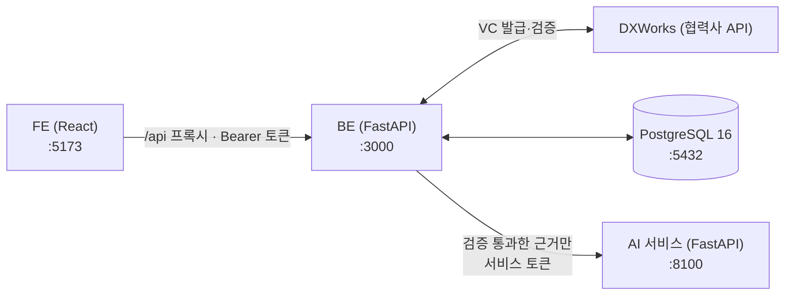

# VC_AI_Career_agent
[종합설계프로젝트1] 디지털 배지 및 자격증명 기반 초개인화 AI 커리어 에이전트 지갑 개발 과제

| 폴더 | 내용 | 안내 |
|---|---|---|
| `BE/` | VC 검증·저장·인증 백엔드, AI 연동 (직무 비교·커리큘럼 API) | [BE/README.md](BE/README.md) |
| `FE/` | 사용자 웹 (지갑·발급·직무 비교·커리큘럼) | [FE/README.md](FE/README.md) |
| `research-vc/` | **논문 실험용** VC 검증 코어: fixture 발급기관·테스트 키 기반 파싱·정규화·검증 파이프라인 (실서비스 VC 연동은 `BE/`가 DXWorks BaaS로 담당) | [research-vc/README.md](research-vc/README.md) |
| `ai/` | **AI 서비스**: 검증된 자격증명과 검토된 채용공고의 직무 비교, 커리큘럼 생성 (BE가 호출) | [ai/README.md](ai/README.md) |
| `report/` | 발표·보고 자료 | |

## 서비스 구성



- **BE**: 회원(이메일·비밀번호, Google·카카오·네이버 소셜 로그인)·DID 지갑, VC 발급·검증(DXWorks), 실행 시점 재검증, 포트폴리오·공유 링크, 공고·학습자료 보관, 직무 비교·커리큘럼 API, 직무별 채용 시장 통계 조회
- **AI**: BE가 보낸 검증된 자격증명과 공고로 직무 요구사항을 비교하고 학습 계획을 계산합니다. DB와 키를 갖지 않습니다. 수집한 공고 묶음으로 직무별 요구 역량 통계도 계산합니다.
- **FE**: 지갑, 배지 발급, 직무 비교·커리큘럼 화면

## 서비스 실행 방법

아래 명령은 모두 **저장소 최상위 폴더**(`VC_AI_Career_agent/`)에서 실행합니다. 폴더 이동은 `( … )` 안에서만 하므로 순서대로 붙여 넣어도 됩니다. Windows는 Git Bash 또는 WSL을 쓰세요.

### 1. 준비물

- Docker Desktop (DB·BE·AI를 컨테이너로 실행)
- Node.js 22.12 이상 (FE, Vite 8 요구사항. 20.19 이상도 가능)
- Python 3.11 (테스트나 Docker 없이 실행할 때만)
- DXWorks 접속 정보(`DXWORKS_API_HOST`, `DXWORKS_API_KEY`, `DXWORKS_BADGE_TEMPLATE_ID`): 협력사 비공개 값이라 팀 내부 채널로 받습니다. 없으면 배지 발급·검증과 직무 비교를 할 수 없습니다. 협력사 전달본의 `API_BASE_URL`은 `DXWORKS_API_HOST`, `API_KEY`는 `DXWORKS_API_KEY`에 넣고, `DXWORKS_BADGE_TEMPLATE_ID`에는 전달본 안내서(START_HERE)의 준비된 "OB3 배지" 템플릿 ID를 넣습니다. `TENANT_CODE`는 BE가 쓰지 않습니다(템플릿 ID 자리에 넣으면 발급이 400 `BADGE template not found`로 실패).

### 2. 환경 변수 설정 (`BE/.env`)

```bash
cp -n BE/.env.example BE/.env
```

아래 명령으로 값을 하나씩 만들어 `BE/.env`의 같은 이름 항목에 붙여 넣습니다. 출력된 값은 공유 저장소에 올리지 마세요.

```bash
python3 -c "import secrets; print('JWT_SECRET=' + secrets.token_urlsafe(48))"
```

```bash
python3 -c "import secrets; print('AI_SERVICE_TOKEN=' + secrets.token_urlsafe(48))"
```

```bash
python3 -c "import base64, os; print('HOLDER_KEY_ENCRYPTION_KEY=' + base64.b64encode(os.urandom(32)).decode())"
```

| 항목 | 설명 |
|---|---|
| `APP_ENV` | 실행 환경. 로컬은 예시 파일 값 `development` 그대로(비워도 같음). `production`(BE Docker 이미지 기본값, Compose는 로컬 서비스에 `development`를 넣음)이면 아래 `JWT_SECRET`·`HOLDER_KEY_ENCRYPTION_KEY`와 `DB_HOST`·`DB_NAME`·`DB_USER`·`DB_PASSWORD`가 없거나 이 저장소의 테스트·예시 값(예: `DB_PASSWORD=password`)일 때, 또는 `JWT_SECRET`·`HOLDER_KEY_ENCRYPTION_KEY`·`SERVICE_API_KEY`·`AI_SERVICE_TOKEN`·`DXWORKS_API_KEY`·`GOOGLE_CLIENT_SECRET`·`KAKAO_CLIENT_SECRET`·`NAVER_CLIENT_SECRET` 중 넣은 두 값이 서로 같을 때, 소셜 로그인(Google·카카오·네이버) 설정이나 `CORS_ORIGINS`가 운영 규칙에 맞지 않을 때 BE가 시작하지 않습니다. `production`에서는 API 문서(`/docs`·`/redoc`·`/openapi.json`)도 제공하지 않습니다(아래 "AWS 배포 체크리스트") |
| `DXWORKS_API_HOST`, `DXWORKS_API_KEY`, `DXWORKS_BADGE_TEMPLATE_ID` | 협력사 DXWorks 접속 정보. `DXWORKS_API_HOST`는 `https://` 주소(`http://`는 `localhost`·`127.0.0.1`·`[::1]`만). 비워 두면 BE는 뜨고 DXWorks를 쓰는 기능만 503이며, 넣은 값이 이 규칙에 맞지 않거나 사용자 정보(`user:pw@`)·쿼리·프래그먼트·공백이 들어 있거나 포트가 1~65535 밖이면 `APP_ENV`와 관계없이 BE가 시작하지 않습니다 |
| `JWT_SECRET` | 로그인 토큰 서명 키(32바이트 이상). 비우면(`development`에서만 허용) 재시작할 때마다 로그인이 풀립니다 |
| `HOLDER_KEY_ENCRYPTION_KEY` | 사용자 지갑 키 암호화 키. **한 번 정하면 바꾸거나 잃어버리면 안 됩니다**. 비우면(`development`에서만 허용) 새 가입자가 임시 DID를 받습니다 |
| `AI_SERVICE_TOKEN` | BE와 AI가 같이 쓰는 비밀(32바이트 이상, 위 명령으로 따로 만들어 `JWT_SECRET`·`HOLDER_KEY_ENCRYPTION_KEY`·`SERVICE_API_KEY`·`DXWORKS_API_KEY`·`GOOGLE_CLIENT_SECRET`·`KAKAO_CLIENT_SECRET`·`NAVER_CLIENT_SECRET`과 다른 값). Compose가 AI 컨테이너에도 같은 값을 넣습니다 |
| `MOCK_ISSUER_ENABLED`, `MOCK_ISSUER_TEMPLATE_IDS`, `MOCK_ISSUER_DAILY_LIMIT`, `MOCK_ISSUER_GLOBAL_DAILY_LIMIT` | FE **자격증명 발급**(`/issue`) 화면이 쓰는 모의 발급. `MOCK_ISSUER_ENABLED`를 비우면(예시 파일 값) `development`에서는 켜지고 `production`에서는 꺼집니다. 켜져 있어도 로그인한 본인 DID에만, `DXWORKS_BADGE_TEMPLATE_ID`와 `MOCK_ISSUER_TEMPLATE_IDS`(선택, 쉼표 구분)의 템플릿만, 사용자별 24시간 `MOCK_ISSUER_DAILY_LIMIT`건(기본 10)·모든 사용자를 합쳐 24시간 `MOCK_ISSUER_GLOBAL_DAILY_LIMIT`건(기본 200)까지 발급합니다 |
| `GOOGLE_CLIENT_ID`, `GOOGLE_CLIENT_SECRET`, `GOOGLE_REDIRECT_URI`, `GOOGLE_ALLOWED_REDIRECT_URIS` | (선택) 로그인·회원가입 화면의 "Google로 계속하기". ID·시크릿은 Google Cloud Console의 OAuth 클라이언트 값이며 팀 내부 채널로 받습니다. 둘 중 하나라도 비면 Google 로그인만 503(`Google OAuth is not configured`)이고 나머지 기능은 그대로입니다 |
| `KAKAO_CLIENT_ID`, `KAKAO_CLIENT_SECRET`, `KAKAO_REDIRECT_URI` | (선택) "카카오 로그인". 카카오 디벨로퍼스 앱의 REST API 키와 그 클라이언트 시크릿이며 팀 내부 채널로 받습니다. 이메일 동의 항목은 비즈 앱(개인 개발자 비즈 앱 가능)에서만 설정할 수 있습니다. 둘 중 하나라도 비면 카카오 로그인만 503(`Kakao OAuth is not configured`) |
| `NAVER_CLIENT_ID`, `NAVER_CLIENT_SECRET`, `NAVER_REDIRECT_URI` | (선택) "네이버 로그인". 네이버 개발자센터 애플리케이션의 Client ID·Client Secret이며 팀 내부 채널로 받습니다. 검수 전에는 애플리케이션에 등록한 멤버 아이디만 로그인할 수 있습니다. 둘 중 하나라도 비면 네이버 로그인만 503(`Naver OAuth is not configured`) |
| `OAUTH_TIMEOUT_SECONDS` | (선택) 세 소셜 로그인 제공자 호출 제한 시간(초, 1~120, 기본 10). 이 줄이 없거나 비어 있는 예전 `.env`는 `GOOGLE_OAUTH_TIMEOUT_SECONDS`를 그대로 읽습니다 |
| `IDENTITY_VERIFICATION_ENABLED`, `DB_MAX_CONNECTIONS`, `AI_MAX_CONCURRENCY` | (선택) 차례로 신원 VP 검증(`POST /api/v1/verify`의 `type: identity`) 사용 여부(기본 `false`. 화면이 쓰지 않으므로 그대로 둠), BE 프로세스 하나가 동시에 여는 DB 연결 수 상한(기본 20, 2 이상), BE 프로세스 하나가 AI로 동시에 보내는 공고·학습자료 묶음 요청 수 상한(기본 4, 1 이상). 로컬에서는 바꿀 필요가 없습니다 |
| `RESEARCHER_USER_IDS` | 공고·학습자료를 반입할 연구자 계정 UUID (5번에서 채움) |
| `CURRICULUM_LLM_USER_IDS` | 커리큘럼 LLM 모드를 쓸 계정 UUID (선택, 7번) |

소셜 로그인의 콜백 주소(`GOOGLE_REDIRECT_URI`·`KAKAO_REDIRECT_URI`·`NAVER_REDIRECT_URI`)는 로컬이면 예시 파일 값(`http://localhost:5173/auth/<google|kakao|naver>/callback`)을 그대로 두고, 같은 주소를 각 제공자 콘솔에 등록합니다(빈 값으로 두면 그 버튼이 503 `<Label> OAuth redirect_uri is not configured`, 화면은 "<제공자> 로그인을 지금 사용할 수 없습니다"). 콘솔 설정과 계정 연동 규칙은 [BE/README.md](BE/README.md) "소셜 로그인".

로그인 토큰은 설정과 관계없이 항상 필요합니다. 회원가입·로그인·소셜 로그인·`/health`·기업용 공유 링크 조회 말고는 `Authorization: Bearer <토큰>`이 없으면 401입니다. 예전에 만든 `BE/.env`에 `AUTH_REQUIRED=false` 줄이 남아 있으면 지웁니다(이제 쓰지 않으며, 남아 있으면 BE 시작 로그에 경고만 남습니다).

### 3. DB·BE·AI 실행 (Docker Compose)

```bash
(cd BE && docker compose up --build -d)
```

처음 실행하면 DB 스키마·시드·마이그레이션(04~13)이 자동 적용됩니다. 그 뒤에도 `docker compose up` 때마다 한 번 실행되고 끝나는 `migrate` 서비스(`python -m app.migrate --seed`)가 아직 적용하지 않은 마이그레이션만 적용하고(기록: DB의 `schema_migrations` 표), 성공해야 `backend`가 뜹니다. 상태 확인:

```bash
(cd BE && docker compose ps)
```

```bash
curl http://localhost:3000/health
```

```bash
curl http://localhost:8100/health
```

- BE API 문서: <http://localhost:3000/docs> (`APP_ENV=development`에서만 제공하며 Compose는 `development`로 띄웁니다)
- 로그 확인: `(cd BE && docker compose logs -f backend ai)`
- 종료(데이터 유지): `(cd BE && docker compose down)` / DB까지 초기화: `(cd BE && docker compose down -v)`
- 포트(DB 5432·BE 3000·AI 8100)는 이 PC(`127.0.0.1`)에서만 열립니다. DB 기본 비밀번호·시드 계정·모의 발급이 켜진 개발 설정이므로 다른 기기에서 접속하도록 바꾸지 않습니다.

> **이미 DB 볼륨이 있는 경우(이전 버전에서 업그레이드)** 위 `docker compose up --build -d`를 다시 실행하면 `migrate` 서비스가 기존 볼륨에 없는 마이그레이션(04~13 중 아직 적용하지 않은 것)을 자동으로 적용합니다. 새 BE를 붙인 DB에 09(`users.token_version`)가 없으면 로그인·가입과 토큰이 필요한 모든 요청이, 10(`mock_issuances`)이 없으면 모의 발급이, 11(`oauth_accounts`)이 없으면 소셜 로그인과 내 정보 조회가, 12(`market_postings`·`market_snapshots`)가 없으면 시장 통계 조회가 500입니다. 13은 대소문자를 구분하지 않는 이메일 유일 인덱스를 만들고 쓰지 않는 표 두 개(`student_credential_embeddings`·`user_skills`)를 지우며, 대소문자만 다른 이메일의 계정이 있으면 적용하지 않고 멈춥니다(목록과 조치는 [BE/README.md](BE/README.md) "DB 마이그레이션"). 결과는 `(cd BE && docker compose logs migrate)`로 보고, 직접 다시 실행하려면:
> ```bash
> (cd BE && docker compose run --rm migrate)
> ```

### 4. FE 실행

새 터미널에서 실행합니다 (개발 서버가 계속 떠 있어야 합니다).

```bash
(cd FE && npm install && npm run dev)
```

브라우저에서 <http://localhost:5173>을 엽니다. `/api` 요청은 개발 서버가 BE(`localhost:3000`)로 넘겨 줍니다.

### 5. 처음 사용하기

**① 사용자: 가입 → 배지 발급·검증**
FE에서 회원가입하면 DID 지갑이 만들어집니다. **자격증명 발급** 화면에서 배지를 발급받고 "검증하고 지갑에 저장하기"를 누릅니다.
모의 발급은 로컬(`APP_ENV=development`)에서 기본으로 켜져 있고 사용자별 24시간 10건, 모든 사용자를 합쳐 24시간 200건까지입니다. 더 필요하면 `BE/.env`의 `MOCK_ISSUER_DAILY_LIMIT`·`MOCK_ISSUER_GLOBAL_DAILY_LIMIT`을 올리고 backend를 다시 띄웁니다. 전체 한도 200건은 20명이 10건씩 받으면 차므로, 여러 명이 함께 쓰는 실습이면 인원 × 사용자별 한도에 맞춰 올립니다(전체 한도에 닿으면 발급 화면에 "전체 모의 발급 한도(24시간)에 도달했습니다…"가 나옴).
`BE/.env`에 제공자의 ID·시크릿(`GOOGLE_*`·`KAKAO_*`·`NAVER_*`)을 넣었다면 "Google로 계속하기"·"카카오 로그인"·"네이버 로그인"으로도 가입·로그인할 수 있습니다. 계정은 이메일 하나에 하나이고, 같은 이메일의 계정이 이미 있으면 다음과 같습니다. 이메일·비밀번호로 가입한 계정에는 소셜 로그인이 붙지 않으므로(409) 이메일과 비밀번호로 로그인합니다. Google·카카오는 제공자가 인증한 이메일만 받으므로, 둘 중 하나로 만든 계정에는 같은 이메일의 다른 하나가 연동됩니다. 네이버는 이메일 인증 여부를 알려 주지 않아서 네이버 로그인은 같은 이메일의 기존 계정에 붙지 않고, 네이버로 만든 계정에도 Google·카카오가 붙지 않습니다(409 "이미 다른 방법(이메일 또는 다른 소셜 로그인)으로 가입한 이메일입니다…"). 그때는 처음 가입한 방법으로 로그인합니다.
시드 계정(`user001@example.com` ~ `user045@example.com`, 비밀번호 `test1234`)은 화면 확인용입니다. 서명 원본이 없어 직무 비교에서는 근거로 쓰이지 않으므로, 새로 가입해 배지를 받으세요.

**② 연구자 지정**
공고·학습자료를 반입할 계정을 FE에서 가입한 뒤, 그 계정의 UUID를 확인합니다. 로그인 토큰을 셸 변수에 담아 두고(③에서도 씁니다), 이메일·비밀번호는 실제 값으로 바꿉니다.

```bash
TOKEN=$(curl -s -X POST http://localhost:3000/api/v1/users/login -H 'Content-Type: application/json' -d '{"email":"researcher@example.com","password":"<비밀번호>"}' | python3 -c "import sys, json; print(json.load(sys.stdin)['access_token'])")
```

```bash
curl -s http://localhost:3000/api/v1/users/me -H "Authorization: Bearer $TOKEN" | python3 -c "import sys, json; print(json.load(sys.stdin)['data']['id'])"
```

출력된 UUID를 `BE/.env`의 `RESEARCHER_USER_IDS=`에 넣고(여러 명이면 쉼표로 구분) BE를 다시 띄웁니다.

```bash
(cd BE && docker compose up -d --force-recreate backend)
```

**③ 연구자: 공고·학습자료 반입**
요구사항마다 원문 인용(`quote`)과 원문 안의 정확한 위치(`start`, `end`, 글자 수 기준)가 있어야 합니다.
AI가 주석이 원문과 맞는지(예: "또는" 조건을 "그리고"로 바꾸지 않았는지) 검사하고, 틀리면 422로 이유를 알려 줍니다.
비교에는 `dataset_kind: "real"`이고 수집(`captured_at`) 7일 이내·게시 90일 이내인 공고만 쓰이므로, **이용 허가를 받은 실제 공고**를 반입하세요.
아래는 형식 예시입니다(회사·URL은 가상 값). 같은 터미널에서 ②의 `TOKEN`을 그대로 씁니다.

```bash
NOW=$(date -u +%Y-%m-%dT%H:%M:%SZ)
cat > posting.json <<EOF
{
  "source": "manual", "external_id": "example-de-001",
  "source_url": "https://jobs.example.com/example-de-001",
  "company": "예시데이터(주)", "title": "주니어 데이터 엔지니어", "region": "서울", "seniority": "junior",
  "role_id": "data_engineer", "posted_at": "$NOW", "captured_at": "$NOW",
  "dataset_kind": "real", "rights_basis": "permission", "review_note": "게시처 허가를 받아 원문을 그대로 옮김",
  "raw_text": "SQL 평가 통과\nPython 또는 Scala 과정 수료\nSpark 실무 경험\n",
  "requirements": [
    {"key": "r0", "kind": "skill", "importance": "required", "quote": "SQL 평가 통과", "start": 0, "end": 9,
     "skill_ids": ["sql"], "minimum_evidence": "assessment"},
    {"key": "r1", "kind": "skill", "importance": "required", "quote": "Python 또는 Scala 과정 수료", "start": 10, "end": 31,
     "skill_ids": ["python", "scala"], "match": "any", "minimum_evidence": "completion"},
    {"key": "r2", "kind": "skill", "importance": "required", "quote": "Spark 실무 경험", "start": 32, "end": 43,
     "skill_ids": ["spark"]}
  ]
}
EOF
curl -s -X POST http://localhost:3000/api/v1/research/job-postings -H "Authorization: Bearer $TOKEN" -H 'Content-Type: application/json' -d @posting.json
```

```bash
NOW=$(date -u +%Y-%m-%dT%H:%M:%SZ)
cat > resource.json <<EOF
{
  "source": "manual", "external_id": "example-spark-101",
  "source_url": "https://learning.example.com/spark-101",
  "title": "Apache Spark 입문 실습", "provider": "예시 교육기관",
  "raw_text": "Apache Spark 입문 실습\n무료",
  "skill_annotations": [{"skill_id": "spark", "quote": "Apache Spark", "start": 0, "end": 12}],
  "prerequisite_annotations": [], "prerequisites_reviewed": true,
  "level": "beginner", "minimum_study_hours": 4,
  "cost_krw": 0, "cost_annotation": {"quote": "무료", "start": 19, "end": 21},
  "captured_at": "$NOW", "available": true,
  "dataset_kind": "real", "rights_basis": "permission", "review_note": "제공처 허가를 받아 소개 문구를 그대로 옮김"
}
EOF
curl -s -X POST http://localhost:3000/api/v1/research/learning-resources -H "Authorization: Bearer $TOKEN" -H 'Content-Type: application/json' -d @resource.json
```

- 기술 ID: `sql`, `python`, `scala`, `spark`, `kafka`, `airflow`, `etl`, `data_modeling`, `git`, `linux`, `aws`, `docker`
- 원문에서 기술 후보만 먼저 보고 싶으면 `POST /api/v1/research/job-postings/preview`에 `{"raw_text": "..."}`를 보냅니다.
- 학습자료는 수집 30일 이내만 쓰입니다. 같은 `source`·`external_id`로 다시 반입하면 새 버전이 쌓이고 최신 버전이 쓰입니다.
- 각 필드의 규칙은 [BE/openapi.yaml](BE/openapi.yaml)과 <http://localhost:3000/docs>를 참고하세요.

**④ 사용자: 직무 비교 → 학습 계획**
FE의 **직무 비교·커리큘럼** 화면에서 공고를 고르고 "검증하고 비교하기"를 누르면, BE가 모든 자격증명을 지금 다시 검증한 뒤 AI가 요구사항별로 비교합니다.
같은 화면에서 기간·주당 시간·예산을 정해 학습 계획을 만듭니다. 비교 결과는 5분 동안만 계획 생성에 쓸 수 있습니다.

### 6. Docker 없이 실행 (개발·디버깅)

DB만 컨테이너로 띄우고 BE와 AI를 각각 다른 터미널에서 실행합니다. `ai/.env`의 `AI_SERVICE_TOKEN`은 `BE/.env`와 같은 값이어야 합니다.

```bash
(cd BE && docker compose up -d postgres)
```

```bash
(cd BE && python3.11 -m venv .venv && .venv/bin/pip install -r requirements.txt && .venv/bin/python -m app.migrate && .venv/bin/python -m uvicorn main:app --reload --port 3000)
```

`app.migrate`는 `BE/.env`의 DB 접속 정보로 아직 적용하지 않은 마이그레이션만 적용합니다(이전 볼륨 업그레이드 포함, 최신이면 아무것도 하지 않음). `APP_ENV=production`이면 `--seed`를 거부하고, `DB_PASSWORD`가 비었거나 `password`면 접속하지 않으며, 공개된 시드 테스트 비밀번호를 쓰는 계정이 DB에 있으면 실패합니다(운영 절차는 아래 "AWS 배포 체크리스트").

```bash
cp -n ai/.env.example ai/.env
```

```bash
(cd ai && python3.11 -m venv .venv && .venv/bin/pip install -r requirements.txt && .venv/bin/python -m uvicorn src.server.app:app --host 127.0.0.1 --port 8100)
```

로컬 실행 시 BE는 기본값 `AI_SERVICE_URL=http://127.0.0.1:8100`으로 AI에 접속합니다. FE는 4번과 같습니다.

### 7. (선택) 커리큘럼 LLM 모드

기본은 LLM 없이 만드는 템플릿 계획입니다. LLM을 쓰려면 `BE/.env`의 `CURRICULUM_LLM_USER_IDS`에 계정 UUID를 넣고, `ai/.env`에 `CURRICULUM_LLM_ENABLED=true`와 공급자 설정을 넣은 뒤 다시 띄웁니다.

```bash
(cd BE && docker compose up -d --force-recreate backend ai)
```

FE에서 "LLM으로 단계 순서·시간을 배분" 동의를 체크해야 사용됩니다. OpenAI 호환 API와 로컬 Qwen(GPU) 설정은 [ai/README.md](ai/README.md) 6번을 보세요.

### 7-1. (선택) 직무별 채용 시장 통계 넣기

직무 비교 화면 위쪽의 "직무별 요구 역량 통계" 카드는 DB에 통계가 있을 때만 나타납니다(없으면 카드만 보이지 않고 나머지는 그대로 동작).
넣을 파일은 저장소의 `ai/data/market_snapshots/*.json`입니다. 팀이 수집한 공고를 AI 서비스로 집계한 뒤 `python -m app.jobs.market export`로 내보낸 직무별 최신 통계(빅데이터·개인정보보호·백엔드·프런트엔드·인프라 5개 직무)이며, 공고 원문은 들어 있지 않습니다.
Compose의 backend 컨테이너에는 `BE/`만 연결되므로 폴더를 먼저 `BE/` 아래로 복사한 뒤 실행하고, 끝나면 지웁니다(`BE/market_snapshots/`는 git이 무시).

```bash
cp -r ai/data/market_snapshots BE/market_snapshots
```

```bash
(cd BE && docker compose exec backend python -m app.jobs.market import --dir /app/market_snapshots)
```

```bash
rm -r BE/market_snapshots
```

Docker 없이 실행 중이면 복사 없이 `BE/`에서 `python -m app.jobs.market import --dir ../ai/data/market_snapshots`를 실행합니다. 이 명령은 `BE/.env`의 `DB_*`만 있으면 됩니다(AI 서비스는 부르지 않음).

- 종료 코드 0: 성공. 로그의 `가져온 통계: {'backend_developer': True, …}`에서 `True`는 새로 저장한 직무, `False`는 같은 내용이 이미 있어 넣지 않은 직무입니다(다시 실행해도 안전).
- 종료 코드 1: 아무것도 넣지 않았습니다. 이유는 `실패: …` 한 줄에 나옵니다: 폴더가 없거나 `*.json`이 없음(위 복사를 건너뜀), 형식이 틀리거나 해시가 맞지 않는 파일, 기준 시각(`as_of`)이 지금보다 5분 넘게 미래인 파일, 이름이 80자를 넘거나 경고가 20개·각 200자를 넘는 파일, 건수가 음수이거나 DB 정수 범위(2,147,483,647)를 넘는 파일, DB 접속 실패. 파일 검사에서 하나라도 걸리면 나머지도 넣지 않습니다(검사를 모두 통과한 뒤 저장하는 중에 DB 오류가 나면 그 앞의 파일은 이미 들어가 있고, 다시 실행하면 건너뜀).
- 종료 코드 2: 명령 인자 오류(`--dir` 빠짐 등)나 없는 수준 이름을 넣은 `LOG_LEVEL`(예: `verbose`). 아무것도 하지 않습니다.

공고를 새로 수집해 통계를 다시 만드는 방법과 수집 원칙은 [BE/README.md](BE/README.md)의 "직무별 채용 시장 통계"를 보세요.

### 8. 테스트

BE 테스트는 테스트 전용 DB가 필요합니다(개발 DB는 건드리지 않음). 앱과 마이그레이션은 DB 확장을 쓰지 않지만, 예전 버전이 `pgcrypto`·`vector`를 만들어 둔 DB의 업그레이드를 재현하는 마이그레이션 테스트가 두 확장을 만들므로 Compose와 같은 pgvector 이미지를 씁니다.

```bash
docker run -d --name vc-be-test -e POSTGRES_PASSWORD=password -p 127.0.0.1:55432:5432 pgvector/pgvector:0.8.7-pg16-bookworm
```

```bash
(cd BE && python3.11 -m venv .venv && .venv/bin/pip install -r requirements-dev.txt && .venv/bin/python -m pytest -q)
```

```bash
(cd ai && python3.11 -m venv .venv && .venv/bin/pip install -r requirements-dev.txt && .venv/bin/python -m pytest -q && .venv/bin/python scripts/sync_contract_to_be.py --check)
```

```bash
(cd FE && npm run lint && npm run build)
```

`requirements.txt`는 테스트한 버전을 `==`로 고정한 실행용 목록이고, 테스트 도구(pytest)는 `requirements-dev.txt`에 있습니다. 허용 범위는 `requirements.in`에서 고치고, BE·AI가 함께 쓰는 패키지는 같은 버전으로 맞춥니다(다시 만드는 방법은 각 `requirements.txt` 머리 주석).
GitHub Actions(`.github/workflows/tests.yml`)가 PR마다 같은 검사를 실행하고(job마다 20분 제한: 멈춘 테스트는 20분에 실패로 끝남), BE·AI Docker 이미지 빌드와 `BE/docker-compose.yml` 문법도 확인합니다(BE 이미지 안에서 `python -m app.migrate --help`와 `python -m app.jobs.market --help`가 뜨는지도 봄). FE 작업은 빌드한 `dist`에 외부 스크립트(`mcp.figma.com`, 다른 출처의 `<script src>`)나 개발 전용 안내(`localhost:3000`, `AI_SERVICE_TOKEN`·`AI_SERVICE_URL`, `DXWORKS_`, `GOOGLE_`, `KAKAO_`, `NAVER_`, `ai_contract`)가 있으면 실패합니다.
두 워크플로(`tests.yml`, Strix 보안 스캔 `main.yml`)는 읽기 전용 `GITHUB_TOKEN`(`permissions: contents: read`)으로 돌고, 체크아웃은 토큰을 git 설정에 남기지 않습니다(`persist-credentials: false`). 액션은 태그 대신 커밋 SHA와 버전 주석(`# vX.Y.Z`)으로 고정하고, `.github/dependabot.yml`이 매주 새 릴리스를 확인해 하나로 묶은 갱신 PR을 엽니다. Strix는 PyPI의 `strix-agent==1.7.0`으로 설치하므로 버전은 `main.yml`의 그 줄에서 올립니다. 비밀값(`STRIX_LLM`, `LLM_API_KEY`)은 Strix 실행 단계에만 넘깁니다. 이 규칙들은 BE 테스트 `tests/test_ci_workflows.py`가 검사합니다.
`ai/src/career/contracts/`(BE와 AI가 주고받는 형식)를 바꿨다면 `ai/`에서 `python scripts/sync_contract_to_be.py`로 BE 사본을 갱신하고 BE와 AI를 함께 다시 띄웁니다.

### 9. 문제 해결

| 증상 | 확인할 것 |
|---|---|
| FE에 "BE 서버에 연결할 수 없습니다" | BE가 3000번에서 실행 중인지 (`curl http://localhost:3000/health`) |
| FE에 "AI 서버에 연결할 수 없습니다" | AI가 실행 중인지 (`curl http://localhost:8100/health`), BE의 `AI_SERVICE_URL` |
| "BE에 AI 서버 주소·토큰이 설정되지 않았습니다" | `BE/.env`의 `AI_SERVICE_TOKEN`이 비었거나 32바이트 미만 |
| "AI_SERVICE_TOKEN이 서로 다릅니다" | Docker 없이 실행할 때 `BE/.env`와 `ai/.env`의 토큰이 다름 |
| 발급·검증이 502/503 ("배지 발급·검증 서비스에서 오류가 발생했습니다" / "…지금 사용할 수 없습니다") | `DXWORKS_*` 값. 응답에는 `code`(`PROVIDER_ERROR`/`PROVIDER_NOT_CONFIGURED`)만 있고, 협력사 오류·빠진 설정 이름은 BE 로그의 `Provider error:` 줄에 있습니다(협력사가 되돌려 준 API 키·토큰·DID는 `[redacted]`로 가림. DID·JWT 모양이나 숫자가 섞인 32자 이상의 base64url 문자열은 보낸 값과 달라도 가리므로 협력사의 UUID·추적 ID·요청 ID도 `[redacted]`로 보이고 로그에 남지 않음. 글자와 `_`·`-`로만 된 긴 오류 코드는 그대로 보임. 그래서 되돌아온 값의 조각도 보낸 값 그대로가 아니고 숫자가 없으면 남을 수 있음). 503은 `DXWORKS_API_HOST`·`DXWORKS_API_KEY`·`DXWORKS_BADGE_TEMPLATE_ID` 중 필요한 값이 비어 있을 때입니다(`https://`가 아닌 호스트처럼 형식이 틀린 값은 BE가 시작할 때 거부). 502의 로그가 `DXWorks가 요청하지 않은 압축 응답을 반환했습니다`·`DXWorks 응답 본문이 너무 큽니다`·`전체 제한 시간 초과`·`호출 대기 시간 초과 (동시 호출 상한)`이면 BE가 협력사 응답에 건 한도(압축은 `gzip`·`deflate`만 상한 안에서 풀고 그 밖의 방식은 거부, 전송된 본문과 풀어낸 본문 각 1 MiB, 교환 한 번에 `DXWORKS_TIMEOUT_SECONDS`의 2배, 동시 16개와 그 자리 대기 2배)에 걸린 것입니다 |
| 운영 빌드 화면에 "잠시 후 다시 시도해주세요…"·"서버에서 일시적인 오류가 발생했습니다" | 운영 빌드(`npm run build`)는 서버 주소·설정 이름 같은 운영자용 안내를 보여 주지 않습니다(이 표의 안내 문구 일부는 `npm run dev`에서만). BE 로그의 `Provider error:`·`AI service error:` 줄과 브라우저 네트워크 탭의 응답 `code`를 확인 |
| API가 401 `Authentication required` (curl·Postman) | 토큰 없이 부름. 회원가입·로그인·`/health`·공유 링크 조회 말고는 `-H "Authorization: Bearer $TOKEN"`이 필요합니다(5번 ②의 `TOKEN`). `AUTH_REQUIRED=false`로는 끌 수 없습니다 |
| BE 시작 로그에 `AUTH_REQUIRED=false 설정은 더 이상 쓰지 않습니다` | 예전 `BE/.env`의 `AUTH_REQUIRED` 줄을 지움 (인증은 항상 켜져 있음) |
| 로그인이 "로그인 시도가 너무 많습니다." (429 `Too many attempts. Try again later.`) | 같은 이메일로 15분 안에 10번 틀림 → 응답의 `Retry-After`(초) 뒤에 다시 시도. 로그인에 성공하면 다시 세고, BE 프로세스마다 메모리에서 세므로 로컬은 BE를 다시 시작해도 지워짐. DB가 바빠 503 `Service is busy. Try again later.`로 답한 로그인 시도는 세지 않음(비밀번호를 확인하지 않았으므로 다시 시도해도 잠기지 않음). 운영에서 가입도 429면("회원가입 시도가 너무 많습니다.") WAF의 IP별 속도 제한(아래 "AWS 배포 체크리스트". FE 로그인·가입 화면은 WAF·로드밸런서의 429도 본문과 관계없이 같은 문구로 보여 줌) |
| 발급 화면에 "이 서버에서는 모의 발급을 사용할 수 없습니다" (404 `Mock issuer is disabled`) | `MOCK_ISSUER_ENABLED`가 꺼짐. 비워 두면 `APP_ENV=production`(Docker 이미지 기본값)에서는 꺼지므로 시연 배포는 `MOCK_ISSUER_ENABLED=true`를 넣음 |
| 발급이 403 `Template not allowed` 또는 429 `Mock issuance limit reached; try again later`("모의 발급 한도(24시간)를 넘었습니다…") / 429 `Mock issuance service limit reached; try again later.`("전체 모의 발급 한도(24시간)에 도달했습니다…") / 429 `Mock issuance is paused after repeated failures. Try again shortly.`("발급 서버 오류가 이어져 모의 발급을 잠시 멈췄습니다…") | 403: 발급 화면의 Template ID를 비우거나 그 ID를 `BE/.env`의 `MOCK_ISSUER_TEMPLATE_IDS`에 추가. 첫 번째 429(그 사용자의 한도): 사용자별 24시간 한도 `MOCK_ISSUER_DAILY_LIMIT`(기본 10)에 닿았거나, 협력사 호출을 시도한 요청이 그 사용자에게서 24시간에 `max(30, 3 × MOCK_ISSUER_DAILY_LIMIT)`번을 넘음(성공과 연결 실패를 포함한 실패를 모두 셈. BE 프로세스마다 셈). 두 번째 429(전체 한도. 발급을 적게 한 사용자도 받음): 모든 사용자를 합친 24시간 한도 `MOCK_ISSUER_GLOBAL_DAILY_LIMIT`(기본 200)에 닿음(DB로 세는 이 한도. 그 밖에는 실패한 것 없이 한도만큼의 발급 요청이 그 BE 프로세스에서 한꺼번에 진행 중일 때도 이 문구). 협력사가 거절·실패로 답했거나 요청이 닿지 않은 발급은 두 발급 한도(DB)에 세지 않고(그 기록을 지우는 DB 작업까지 실패한 경우만 남음), 응답 대기 중 시간 초과처럼 결과를 모르는 실패는 배지가 이미 발급됐을 수 있어 셉니다(남은 기록과 결과를 모르는 실패는 그 사용자의 한도에는 24시간, 전체 한도에는 10분 동안만 셈. 그래서 시간 초과로 이어진 장애가 전체 한도를 채워도 협력사가 돌아온 뒤 길어야 10분에 1분쯤 더 지나면 다시 발급됨) → 로컬은 값을 올리고 backend 재시작(사용자별 시도 한도는 프로세스 메모리에 있어 재시작하면 지워짐). 세 번째 429(`Retry-After` 헤더 있음. 한도에 닿은 것이 아님): 협력사 호출을 시도했는데 성공하지 못한 발급이 그 BE 프로세스에서 24시간에 `MOCK_ISSUER_GLOBAL_DAILY_LIMIT`번 쌓여 발급을 멈춘 상태입니다. 협력사가 계속 실패하고 있는 것이므로 `Provider error:` 로그를 먼저 확인합니다. 멈춘 동안 BE는 1분에 한 건만 협력사로 보내 보고(그 밖의 요청은 협력사를 부르지 않고 이 429), 그 한 건이 성공하면 실패 기록을 지워 모두 바로 다시 발급할 수 있습니다(재시작하거나 24시간을 기다릴 필요 없음) → 협력사가 돌아온 뒤 `Retry-After`(1~60초) 뒤에 다시 시도 |
| 발급·검증이 403 `Forbidden: can only issue to your own DID` / `Forbidden: credential was issued to a different DID` | `holderDid`나 배지의 수신자 DID가 로그인한 계정의 DID와 다름(다른 계정 DID로 발급했거나 다른 계정의 배지를 검증함) → 지금 로그인한 계정의 DID로 다시 발급해 검증 |
| 공유 링크 조회가 503 `Share verification is busy. Try again later.` | 그 BE 태스크의 기업용 조회 검증기 호출 한도(분당 300번, 최근 60초 안에 확인한 원본은 세지 않음)를 넘음 → 응답의 `Retry-After`(초) 뒤에 다시 열기 |
| 검증·재검증·포트폴리오 저장·직무 비교가 429 `Too many verification requests. Try again later.` ("검증 요청이 너무 많습니다…") | 그 BE 태스크에서 검증기(DXWorks) 호출 몫이 모자람: 계정마다 분당 120번·시간당 1,200번, 태스크 전체로 분당 600번이고 요청 하나가 서명 원본 수만큼 씁니다. 발급 화면의 배지 검증(`POST /api/v1/verify`)은 검증기까지 가서 토큰이 거절된 요청(저장되지 않은 `success: false`, 403·409, 그 토큰 하나에 대한 검증기 오류 502)이 그 계정에서 10분에 10번을 넘어도 같은 429입니다(로그의 `route=verify_rejected`. 폐기·만료 상태로 저장된 배지와 DB가 바빠 503으로 끝난 검증은 세지 않음). 어느 경우든 DXWorks를 부르지 않았고 아무것도 저장하지 않았으므로 응답의 `Retry-After`(초. 모자란 몫이 다시 찰 때까지의 시간 중 가장 긴 값) 뒤에 다시 시도합니다. BE 로그에 `event=verifier_budget_denied` 줄이 남습니다 |
| 여러 화면이 503 `Service is busy. Try again later.` ("요청이 많아 처리가 지연되고 있습니다…") | DB가 바쁨. BE 로그의 `Database busy: method=… path=… reason=…` 줄에서 `reason`이 `DatabaseBusy`면 그 BE 태스크의 DB 연결 자리(`DB_MAX_CONNECTIONS`, 기본 20)를 5초 안에 얻지 못한 것, `QueryCanceled`면 DB 문장이 15초를 넘은 것, `LockNotAvailable`이면 잠금을 5초 안에 얻지 못한 것입니다. 응답의 `Retry-After`(5초) 뒤에 다시 시도하고, 계속되면 오래 걸리는 쿼리·잠금을 쥔 세션(`pg_stat_activity`)을 확인합니다 |
| 공고 목록·직무 비교·학습 계획이 503 `code: AI_SERVICE_BUSY` ("분석 요청이 많습니다…") | 그 BE 태스크가 AI로 동시에 보내는 공고·학습자료 묶음 요청이 `AI_MAX_CONCURRENCY`(기본 4)개로 찬 채 10초가 지남. AI를 부르지 않았으므로 `Retry-After`(5초) 뒤에 다시 시도(직무 비교는 자격증명 재검증을 마친 뒤에 자리를 기다리므로, 이 503으로 끝나도 그 요청의 검증기 호출 몫은 이미 쓴 상태) |
| 포트폴리오·공유 링크 만들기가 409 `Portfolio limit reached.` / `Share link limit reached. Revoke unused links first.` | 사용자별 상한(포트폴리오 100개, 철회·만료되지 않은 공유 링크 100개) → 쓰지 않는 포트폴리오를 지우거나 링크를 철회. 두 목록 조회는 한 번에 200개까지 돌려줍니다 |
| 소셜 로그인 버튼이 "<제공자> 로그인을 지금 사용할 수 없습니다"(개발 서버에서는 "BE에 … OAuth 설정이 없습니다 …") (503 `Google OAuth is not configured`·`Kakao OAuth is not configured`·`Naver OAuth is not configured`) | 그 제공자의 `*_CLIENT_ID`·`*_CLIENT_SECRET`(예: `KAKAO_CLIENT_ID`·`KAKAO_CLIENT_SECRET`) 중 빈 값이 있음 → `BE/.env`에 둘 다 넣고 backend 재시작. 503 `<Label> OAuth redirect_uri is not configured`면 그 제공자의 콜백 주소(`*_REDIRECT_URI`)가 빈 값이거나 운영에서 넣지 않음 → 예시 파일 값(로컬)이나 FE의 `https://` 콜백 주소(운영)를 넣음 |
| 소셜 로그인 버튼이 "허용되지 않은 로그인 경로입니다…"(개발 서버에서는 "BE가 허용하지 않은 콜백 주소입니다 …") (400 `Invalid redirect_uri`) | FE가 보낸 콜백 주소(`<FE 주소>/auth/{google,kakao,naver}/callback`)가 BE 설정과 글자 그대로 같지 않음(Google은 `GOOGLE_REDIRECT_URI`·`GOOGLE_ALLOWED_REDIRECT_URIS` 중 하나, 카카오·네이버는 `KAKAO_REDIRECT_URI`·`NAVER_REDIRECT_URI` 하나): FE를 `http://localhost:5173`이 아닌 주소로 열었거나, 운영(`APP_ENV=production`)에서 콜백 주소를 FE 도메인과 다르게 넣음(콜백 주소를 아예 비웠으면 400이 아니라 503 `… redirect_uri is not configured`) |
| 소셜 로그인 뒤 "이 이메일은 <제공자>로 로그인할 수 없습니다" (409 `This email is registered with a password. Log in with your email and password.` 또는 `This email is already used by another sign-in method. Log in with that method.`) | 같은 이메일의 계정이 이미 있는데 붙일 수 없음. 첫째(비밀번호 계정): BE는 비밀번호가 있는 계정에 소셜 로그인을 붙이지 않습니다(가입은 이메일 소유를 확인하지 않으므로, 남의 주소로 먼저 만들어 둔 계정에 그 주소의 주인을 들이지 않기 위함) → 이메일과 비밀번호로 로그인. 둘째(다른 방법): 네이버 로그인이거나 그 계정이 네이버로 만든 계정이라 이메일이 양쪽에서 확인되지 않음(같은 이메일로 연동되는 것은 Google·카카오끼리뿐. BE 감사 로그 `outcome=refused_unverified_link`) → 처음 가입한 방법으로 로그인 |
| 소셜 로그인 뒤 "이메일 제공 동의가 필요합니다." (400 `OAuth email is required`) / "<제공자> 계정의 이메일이 인증되지 않아 로그인할 수 없습니다." (400 `OAuth email is not verified`) | 첫째: 제공자가 이메일을 주지 않음(동의 화면에서 이메일 제공을 거절했거나, 카카오 앱의 동의 항목에 이메일이 없거나(비즈 앱에서만 설정 가능), 네이버 제공 정보에 이메일이 없음) → 콘솔 설정을 확인하고 이메일 제공에 동의해 다시 시도. 둘째: Google·카카오가 그 이메일을 인증되지 않은 이메일로 알림(카카오는 `is_email_valid`·`is_email_verified`가 모두 참이어야 함) → 제공자 계정에서 이메일을 인증 |
| 소셜 로그인이 "로그인 인증이 만료되었습니다…" (400) / "<제공자> 로그인 서비스에 일시적인 문제가 있습니다" (502 `Google OAuth error`·`Kakao OAuth error`·`Naver OAuth error`) / "로그인 시도가 너무 많습니다" (429) | 400: 인가 코드가 만료·재사용됨. BE 로그에 `Google OAuth token request rejected: error=redirect_uri_mismatch` 경고가 있으면 Google Cloud Console의 승인된 리디렉션 URI가 `GOOGLE_REDIRECT_URI`와 다른 것, `Kakao OAuth token request rejected: error=invalid_grant error_code=KOE303`이면 카카오 리디렉트 URI가 `KAKAO_REDIRECT_URI`와 다른 것, `Naver OAuth token request rejected: error=…`이면 네이버 Client ID·Secret·Callback URL을 확인. 502: 제공자 응답 실패(카카오 시크릿이 틀린 `invalid_client` 포함)로, 원인은 BE 로그의 `Provider error:` 줄. 429: 그 BE 태스크의 그 제공자 토큰 교환 한도(제공자별 분당 300번, 모든 사용자가 함께 씀) → `Retry-After`(초) 뒤에 다시 시도 |
| `POST /api/v1/verify`가 400 `Identity verification is disabled` | `type: identity`(신원 VP 검증)는 기본으로 꺼져 있음. 화면은 쓰지 않으며, 직접 써야 할 때만 `IDENTITY_VERIFICATION_ENABLED=true`(사용자가 보낸 값에 회사 API 키를 붙여 DXWorks로 보내는 호출) |
| `/docs`·`/redoc`·`/openapi.json`이 404 | `APP_ENV=production`(Docker 이미지 기본값)에서는 API 문서를 제공하지 않음 → 계약은 [BE/openapi.yaml](BE/openapi.yaml)로 보고, 로컬은 `APP_ENV=development` |
| 끝에 `/`를 붙인 경로가 404 (예: `/api/v1/portfolios/`, `/health/`) | BE는 끝의 `/`를 리디렉션하지 않음 → `/` 없이 호출 (로드밸런서 상태 확인 경로도 `/health`). 끝에 줄바꿈이 붙은 경로(`/api/v1/users/login%0A` 등)도 404 `Not Found` |
| 요청이 413 `Content Too Large` | 요청 본문이 그 경로의 상한을 넘음: 기본 64 KiB, 로그인·회원가입·소셜 로그인 콜백(`POST`) 16 KiB, `POST /api/v1/verify` 320 KiB(VC 토큰은 256 KiB까지), 연구자 공고·학습자료 반입과 미리보기(`POST /api/v1/research/*`) 2 MiB(공고 원문은 10만 자까지). 기본 상한을 쓰는 경로의 정상 요청은 가장 큰 것(커리큘럼 요청, 대안 선택 200개)도 35 KB쯤이라 닿지 않음 ([BE/README.md](BE/README.md) "요청 본문 상한") |
| 422 응답에 보낸 값이 없음 | 요청 검증 실패(422) 본문은 오류마다 `type`·`loc`·`msg`만 싣고(받은 값 `input`·`ctx` 없음) 앞에서부터 20개까지만 실립니다. 64자를 넘는 키 이름은 `loc`에 `<long key>`로 나옵니다 |
| 422 `must be a single line without control characters` / `must not contain NUL or unpaired surrogate characters` / `Input should be a valid string, unable to parse raw data as a unicode string` | 이름·이메일·포트폴리오 제목·희망 직무 안에 줄바꿈·탭 같은 제어 문자가 있거나, 입력에 NUL(`\u0000`, 두 번째 메시지)·짝 없는 서로게이트(예: JSON `\ud800`, 세 번째 메시지)가 있음 → 지우고 다시 보냄 |
| 직무 비교 화면에 공고가 없음 | 연구자 반입 공고가 없거나, `dataset_kind`가 `real`이 아니거나, 수집 7일·게시 90일이 지남 |
| 공고 반입이 403 | 그 계정 UUID가 `RESEARCHER_USER_IDS`에 없음 (넣은 뒤 backend 재시작). 연구자인지를 본문 형식 검사보다 먼저 확인하므로, 연구자가 아니면 본문이 틀려도 422가 아니라 403 |
| 공고 반입이 422 | 응답 `detail`의 규칙 코드 (예: `ANNOTATED_SKILL_NOT_MENTIONED_IN_QUOTE`), `start`/`end` 위치. `TEXT_EXPANDS_TOO_MUCH_WHEN_NORMALIZED`면 원문·인용에 NFKC 정규화로 크게 늘어나는 호환 문자(예: U+FDFA)가 많음 → 풀어 쓴 문자로 고쳐 다시 반입 |
| 로그인 화면에 "로그인 시간이 만료되었습니다" | 토큰 만료(BE `JWT_EXPIRES_MINUTES`, 기본 1440분), 같은 계정이 다른 브라우저·기기에서 로그아웃함, DB를 초기화해 계정이 없어짐, 이전 버전에서 로그인해 토큰이 없음, 또는 `BE/.env`의 `JWT_SECRET`이 빈 채로 BE가 재시작됨 → 다시 로그인 (`JWT_SECRET` 설정) |
| 학습 계획 생성이 409 | 비교 결과 5분이 지남 → 다시 비교 |
| BE가 시작하지 않음 `APP_ENV=production requires ...` | `APP_ENV=production`(Docker 이미지 기본값)인데 오류에 나온 값이 없거나 쓸 수 없음: `JWT_SECRET`(32바이트 이상, 저장소의 테스트·자리표시 값 아님)·`HOLDER_KEY_ENCRYPTION_KEY`(테스트 키 아님)·`SERVICE_API_KEY`(비우거나 32바이트 이상 임의 값)·`DB_HOST`·`DB_NAME`·`DB_USER`(빈 값 아님)·`DB_PASSWORD`(빈 값·`password`가 아닌 값) → 2번 명령으로 새로 만든 값을 넣거나, 로컬이면 `APP_ENV=development`. `<이름> (not the same value as <다른 이름>)`은 `JWT_SECRET`·`HOLDER_KEY_ENCRYPTION_KEY`·`SERVICE_API_KEY`·`AI_SERVICE_TOKEN`·`DXWORKS_API_KEY`·`GOOGLE_CLIENT_SECRET`·`KAKAO_CLIENT_SECRET`·`NAVER_CLIENT_SECRET` 중 두 값이 같음(같은 쌍마다 하나씩 나옴) → 앞쪽 변수를 2번 명령으로 새로 만듦(`AI_SERVICE_TOKEN`은 BE와 AI에 같은 새 값, `SERVICE_API_KEY`는 비워도 됨. `JWT_SECRET`을 바꾸면 모든 사용자가 한 번 로그아웃됨. 협력사가 발급한 `DXWORKS_API_KEY`는 앞쪽에 나오지 않음. 제공자가 발급한 `GOOGLE_CLIENT_SECRET`·`KAKAO_CLIENT_SECRET`·`NAVER_CLIENT_SECRET`은 `DXWORKS_API_KEY`나 이 순서로 자기보다 앞의 시크릿과 같을 때만 앞쪽이고 그 제공자 콘솔에서 새 시크릿을 만듦. `HOLDER_KEY_ENCRYPTION_KEY`는 `DXWORKS_API_KEY`·`*_CLIENT_SECRET`과 같을 때만 앞쪽인데, 바꾸면 기존 홀더 키를 복호화할 수 없으므로(재암호화 도구 없음) 가입자가 있는 DB면 먼저 팀에서 정함). `GOOGLE_CLIENT_ID and GOOGLE_CLIENT_SECRET (set both, or leave both empty)`·`GOOGLE_REDIRECT_URI (set explicitly when Google OAuth is configured)`·`GOOGLE_REDIRECT_URI and GOOGLE_ALLOWED_REDIRECT_URIS (https:// addresses only)`는 Google 로그인 설정: ID와 시크릿을 함께 넣고(쓰지 않으면 둘 다 비움), `GOOGLE_REDIRECT_URI`에 FE의 `https://` 콜백 주소를 명시하고, 허용 목록에 `https://`가 아닌 주소를 두지 않음. 카카오·네이버도 같은 꼴(`KAKAO_CLIENT_ID and KAKAO_CLIENT_SECRET (set both, or leave both empty)`, `KAKAO_REDIRECT_URI (set explicitly when Kakao OAuth is configured)`, `KAKAO_REDIRECT_URI (https:// address only)`, 네이버는 `NAVER_`·`Naver`)이고 고치는 방법도 같음. `CORS_ORIGINS (scheme://host[:port] entries only: no *, null, path or trailing slash)`는 `*`·`null`이나 경로·끝의 `/`가 붙은 항목이 있음 → `https://app.example.com` 꼴로만 넣거나 비움 |
| BE가 시작하지 않음 `<변수 이름> must be ...` | 숫자 설정이 범위를 벗어남(비우면 기본값): `JWT_EXPIRES_MINUTES` 1~1440 정수(1440), `MOCK_ISSUER_DAILY_LIMIT`·`MOCK_ISSUER_GLOBAL_DAILY_LIMIT`·`AI_MAX_CONCURRENCY` 1 이상 정수(10·200·4), `DB_MAX_CONNECTIONS` 2 이상 정수(20), `DXWORKS_TIMEOUT_SECONDS`·`OAUTH_TIMEOUT_SECONDS`(없거나 비면 예전 이름 `GOOGLE_OAUTH_TIMEOUT_SECONDS`를 읽고 오류에도 그 이름이 나옴) 1~120초(15·10), `AI_TIMEOUT_SECONDS`·`AI_GENERATION_TIMEOUT_SECONDS` 1~600초(30·90). `DXWORKS_API_HOST must be an https:// URL ...`은 `https://` 주소가 아니거나(`http://`는 루프백만) 사용자 정보·쿼리·프래그먼트·공백이 있거나 포트가 1~65535 밖임, `DXWORKS_API_KEY must contain only ASCII characters`는 키에 ASCII가 아닌 문자가 있음 |
| BE가 시작하지 않음 `APP_ENV must be one of ...` | `APP_ENV` 오타(예: `prod`) → `development` 또는 `production` |
| `docker compose up`이 `migrate` 오류로 멈춤 | `(cd BE && docker compose logs migrate)`. "적용한 뒤 SQL이 바뀐 마이그레이션"이면 적용된 파일을 되돌리고 바꿀 내용은 다음 번호 파일로 추가 ([BE/README.md](BE/README.md) "DB 마이그레이션"). `대소문자만 다른 이메일을 쓰는 계정이 있어 users_email_lower_key 인덱스를 만들 수 없습니다 (겹치는 이메일 N개)`면 13 마이그레이션이 멈춘 것(13은 통째로 롤백되고 그 앞 번호까지는 적용된 채로 남음. 운영 마이그레이션 태스크도 같음) → 그 아래 `HINT:` 줄의 조회로 겹치는 이메일을 찾아 이메일마다 계정을 하나만 남긴 뒤 다시 실행 |
| 시장 통계 `import`가 종료 코드 1 (`실패: 통계 JSON 파일이 없습니다: …` 등) | `--dir` 폴더가 없거나 `*.json`이 없음(Compose는 `BE/market_snapshots`로 먼저 복사) 또는 파일이 검사를 통과하지 못함 → 7-1번의 종료 코드 설명 |
| 운영 마이그레이션 태스크가 종료 코드 1 (`마이그레이션 실패: ...`) | `--seed`를 줌(운영에서는 거부) / 공개된 시드 테스트 비밀번호를 쓰는 계정이 있음(개발 DB 덤프) / `DB_PASSWORD`가 비었거나 `password` / `DB_APP_ROLE` 역할이 없거나 특권 계정(그 역할이 속한 역할에 슈퍼유저·`CREATEROLE`·`CREATEDB`·`REPLICATION`·`BYPASSRLS` 속성이 있으면 로그 줄에 그 역할 이름이 나옴) / `DB_APP_ROLE`이나 그 역할이 속한 역할(`NOINHERIT`·`WITH INHERIT FALSE` 소속 포함)이 `public` 스키마·DB에 CREATE 권한을 가지거나(PostgreSQL 14 이하에서 만들었거나 업그레이드·복원한 DB, `PUBLIC`에 준 DB CREATE 등) DB·`public` 스키마를 소유함 → 로그 줄이 걸린 검사(`public 스키마`·`DB "<DB 이름>"`), 그 권한·소유를 가진 소속 역할과 함께 알려 주는 GRANT·ALTER ... OWNER·REVOKE 문(예: 마이그레이션 계정이 슈퍼유저가 아니면 맨 앞의 `GRANT "<소유한 역할>" TO "<마이그레이션 계정>" WITH INHERIT TRUE;`, `ALTER DATABASE "<DB 이름>" OWNER TO "<마이그레이션 계정>";`, `ALTER SCHEMA public OWNER TO pg_database_owner;`, 지금 소유자 몫의 CREATE를 거둔 상태면 그 뒤의 `GRANT CREATE ON SCHEMA public TO pg_database_owner;`, `REVOKE CREATE ON SCHEMA public FROM PUBLIC;`, `REVOKE CREATE ON DATABASE "<DB 이름>" FROM "<소속 역할>";`)을 마이그레이션 계정으로 나온 순서대로 실행 / `DB_APP_ROLE`이나 그 역할이 속한 역할, 기본 제공 역할(`pg_database_owner`·`pg_monitor` 등), `public` 스키마에 CREATE 권한이 있거나 DB·`public` 스키마를 소유한 다른 역할(마이그레이션 계정·OID 10 제외)이 `public` 스키마에 객체를 소유함 → 로그 줄의 객체(10개까지)를 마이그레이션 계정으로 확인해 예상하지 못한 것은 `DROP`, 앱에 필요한 것은 `ALTER <종류> <이름> OWNER TO "<마이그레이션 계정>"`(앱 테이블이 나오면 DB·테이블을 소유하지 않은 다른 관리 계정으로 실행한 것이므로 소유한 계정(마스터 사용자)으로 다시 실행) / `DB_APP_ROLE`이나 그 역할이 속한 역할(또는 `PUBLIC`)이 `public` 테이블에 `TRIGGER` 권한이 있음(예전에 준 `GRANT ALL` 등) → 로그 줄의 `REVOKE TRIGGER ON ALL TABLES IN SCHEMA public FROM ...;`을 마이그레이션 계정으로 실행하고, 그 권한으로 만든 트리거는 REVOKE 뒤에도 남으므로 같은 줄에 나온 `public` 테이블의 트리거 중 예상하지 못한 것은 `DROP TRIGGER` / `public` 테이블의 트리거에 WHEN 조건이 있거나 그 트리거가 임시 스키마의 함수나 그 역할들이 소유한 함수를 부름 → 로그 줄의 트리거(10개까지)를 확인해 예상하지 못한 것은 `DROP TRIGGER`(임시 스키마 함수를 부르는 트리거는 그 함수를 만든 세션이 끝나면 없어짐) / `DB_APP_ROLE`이나 그 역할이 속한 역할(또는 `PUBLIC`)이 `public` 테이블에 `REFERENCES` 권한(열 단위 포함)이 있음 → 로그 줄의 `REVOKE REFERENCES ON ALL TABLES IN SCHEMA public FROM ...;`을 마이그레이션 계정으로 실행하고, 그 권한으로 만든 외래 키는 REVOKE 뒤에도 남으므로 같은 줄에 나온 `public` 밖 테이블의 외래 키 중 예상하지 못한 것은 `ALTER TABLE <스키마>.<테이블> DROP CONSTRAINT <이름>;` / 그 역할들(또는 `PUBLIC`)이 원장 `public.schema_migrations`에 `INSERT`·`UPDATE`·`DELETE`·`TRUNCATE` 권한이 있음 → 로그 줄의 `REVOKE ALL ON public.schema_migrations FROM ...;`을 실행하고, 그 권한이 있던 동안 바뀐 원장 행이 남으므로 원장이 실제로 적용한 마이그레이션과 맞는지 확인 / `DB_APP_ROLE`이나 그 역할이 속한 역할이 DB의 스키마를 소유함(예전 DB CREATE 권한으로 만든 것 등) → 그 안의 객체를 확인한 뒤 로그 줄의 `DROP SCHEMA "<스키마>" CASCADE;`나 `ALTER SCHEMA "<스키마>" OWNER TO "<마이그레이션 계정>";`(슈퍼유저가 아니면 그 앞의 `GRANT "<소유자>" TO "<마이그레이션 계정>" WITH INHERIT TRUE;`부터. ALTER SCHEMA는 그 안 객체의 소유자를 바꾸지 않으므로 예상하지 못한 객체는 따로 지움) → 아래 "AWS 배포 체크리스트"의 "DB 마이그레이션"(RDS 마스터 사용자로 소유자를 바꾸는 방법 포함) |
| BE 로그에 `permission denied for table ...` (API 500) | 서비스 계정(`DB_APP_ROLE`)으로 바꾼 뒤 새 이미지의 마이그레이션 태스크를 `DB_APP_ROLE` 없이 실행함 → `DB_APP_ROLE`을 넣어 다시 실행 |
| DB 접속 오류 `root certificate file ... does not exist`·`certificate verify failed`·`does not match host name` | `PGSSLROOTCERT`가 RDS CA 번들 파일을 가리키는지, `DB_HOST`가 RDS 엔드포인트 이름 그대로인지(CNAME·IP 아님) |

## AWS 배포 체크리스트

예시 구성: FE는 S3+CloudFront, BE·AI는 ECS(Fargate) 서비스, DB는 RDS for PostgreSQL 16. `BE/docker-compose.yml`은 로컬 개발 전용(소스 마운트·`--reload`·root·기본 비밀번호 DB)이라 운영에 쓰지 않습니다. 공개된 비밀번호의 시드 계정(`user001@example.com` 등)도 만들므로 EC2 같은 공개 호스트나 데모 서버에서도 띄우지 않습니다.
인증은 설정과 관계없이 항상 켜져 있습니다(토큰 없는 요청은 401, 예전 `AUTH_REQUIRED` 변수는 없어짐). 모의 발급(FE `/issue` 화면)은 운영 이미지(`APP_ENV=production`)에서 기본으로 꺼져 있으므로, 시연 배포에서 쓰려면 아래 `MOCK_ISSUER_ENABLED=true`를 넣습니다. 운영 이미지에서는 API 문서(`/docs`·`/redoc`·`/openapi.json`)와 BE 단독 테스트용 `GET /api/v1/users/oauth/{google,kakao,naver}/callback`이 404이고, 신원 VP 검증(`type: identity`)은 꺼져 있습니다.
아래에 나오는 BE 자체 한도(로그인 실패 제한, 검증기 호출 한도와 소셜 로그인(제공자별) 토큰 교환 한도, 배지 검증의 거절 창, 모의 발급의 시도 한도·실패 차단기, DB 연결·AI 동시 호출 상한)는 모두 **BE 프로세스(ECS 태스크)마다** 메모리에서 따로 세고 태스크를 다시 시작하면 지워집니다. 태스크가 N개면 전체 한도도 N배가 되고 IP별 제한은 없으므로, IP별 제한은 아래 WAF 규칙으로 둡니다. 여러 태스크가 함께 지키는 한도는 DB로 세는 것(모의 발급의 사용자별·전체 24시간 한도, 포트폴리오·공유 링크 개수)뿐입니다.

**이미지**
- [ ] BE·AI 이미지는 같은 커밋으로 만들고(`docker build -t <ECR 주소>/vc-be:<커밋> BE`, `docker build -t <ECR 주소>/vc-ai:<커밋> ai`) 함께 배포합니다. 공유 계약 ID가 다르면 직무 비교 API가 502입니다. 되돌릴 때는 다시 빌드하지 말고 이전 이미지 태그를 배포합니다.
- [ ] 두 이미지는 `python:3.11.15-slim-bookworm` 기반, 비루트(uid/gid 10001), `--reload` 없는 uvicorn 한 프로세스이고, 의존성은 `requirements.txt`의 고정 버전입니다. 서비스 작업 정의에서 명령·사용자를 덮어쓰지 않습니다(마이그레이션 태스크만 명령 덮어쓰기). `UVICORN_*` 환경변수는 uvicorn 실행 옵션으로 읽힙니다. 아래 `UVICORN_TIMEOUT_KEEP_ALIVE` 외에는 넣지 않습니다(특히 `UVICORN_RELOAD`는 운영 이미지에서 리로더를 켭니다). BE 이미지의 Python 버전(3.11, 유니코드 14)과 DB 엔진·libc(RDS 엔진 업그레이드 포함)는 함께 맞춰 올립니다: 한쪽만 올리면 로그인 실패 제한이 이메일을 접는 방식이 DB `lower()`와 달라질 수 있고, 그때는 [BE/README.md](BE/README.md) "로그인 실패 제한"의 예외 동작을 따릅니다.
- [ ] Fargate 기본 플랫폼은 x86_64입니다. Apple Silicon Mac에서 빌드하면 `docker build --platform linux/amd64 ...`로 만들거나 작업 정의의 플랫폼을 ARM64로 맞춥니다.

**BE·AI 환경변수·비밀값** (비밀값은 작업 정의의 `secrets`로 Secrets Manager·SSM Parameter Store에서 넣습니다. `.env`는 이미지에 들어가지 않습니다)
- [ ] `APP_ENV=production`: 이미지 기본값이므로 `development`를 넣지 않습니다. 아래 비밀값이 없거나 이 저장소에 공개된 테스트·예시 값(`BE/tests`·`BE/.env.example`의 값, `x`·`0x01` 반복 같은 자리표시 값)이면, 또는 `DB_HOST`·`DB_NAME`·`DB_USER`가 비었거나 `DB_PASSWORD`가 비었거나 로컬 기본값 `password`면, 또는 `JWT_SECRET`·`HOLDER_KEY_ENCRYPTION_KEY`·`SERVICE_API_KEY`·`AI_SERVICE_TOKEN`·`DXWORKS_API_KEY`·`GOOGLE_CLIENT_SECRET`·`KAKAO_CLIENT_SECRET`·`NAVER_CLIENT_SECRET` 중 넣은 두 값이 서로 같으면, 또는 아래 소셜 로그인·`CORS_ORIGINS` 규칙에 맞지 않으면 BE가 시작하지 않습니다(오류에는 변수 이름만 나옴. 마이그레이션 태스크도 같은 `DB_PASSWORD` 규칙으로 접속하지 않음). 비밀값은 2번 명령으로 운영용을 새로 만듭니다.
- [ ] `JWT_SECRET`: 32바이트 이상, 모든 태스크·워커가 같은 값. 다르면 태스크끼리 서로의 토큰을 거절해 FE가 계속 로그인 화면으로 돌아갑니다. 바꾸면 모든 사용자가 한 번 로그아웃됩니다.
- [ ] `JWT_EXPIRES_MINUTES`(선택): 토큰 수명(분). 1~1440 정수만 받습니다(기본 1440, 그 밖이면 BE가 시작하지 않음). 로그아웃하지 않고 떠난 세션(공용 PC 등)이 살아 있는 최대 시간이라 짧을수록(예: 480) 안전하지만 다시 로그인하는 일이 잦아집니다. 로그아웃(`POST /api/v1/users/logout`)은 이 값과 관계없이 그 계정의 토큰을 바로 모두 무효로 만듭니다.
- [ ] `HOLDER_KEY_ENCRYPTION_KEY`: 32바이트 base64, 모든 태스크가 같은 값. 바꾸거나 잃어버리면 기존 홀더 키를 복호화할 수 없습니다.
- [ ] `AI_SERVICE_TOKEN`: 32바이트 이상, BE와 AI 서비스에 같은 값. `JWT_SECRET`·`HOLDER_KEY_ENCRYPTION_KEY`·`SERVICE_API_KEY`·`DXWORKS_API_KEY`·`GOOGLE_CLIENT_SECRET`·`KAKAO_CLIENT_SECRET`·`NAVER_CLIENT_SECRET`과는 다른 값으로 따로 만듭니다(같으면 BE가 시작하지 않음).
- [ ] `DXWORKS_API_HOST`(`https://` 주소), `DXWORKS_API_KEY`(ASCII 문자만), `DXWORKS_BADGE_TEMPLATE_ID`. 호스트가 `https://` 주소가 아니거나(`http://`는 루프백만) 사용자 정보·쿼리·프래그먼트·공백이 들어 있으면, 또는 키에 ASCII가 아닌 문자가 있으면 BE가 시작하지 않습니다(오류에는 변수 이름만 나옴). 비워 두면 BE는 뜨고 발급·검증·재검증·포트폴리오 생성·직무 비교가 503 `PROVIDER_NOT_CONFIGURED`입니다. `DXWORKS_TIMEOUT_SECONDS`(선택, 기본 15)는 1~120만 받습니다.
- [ ] DXWorks 호출 보호(설정값이 아니라 코드에 고정된 한도이고 태스크마다 따로 셈. 운영자가 넣을 값은 없고, 아래 WAF 규칙과 로그 지표만 준비):
  - 로그인 사용자가 검증기를 부르는 API(`POST /api/v1/verify`, 재검증, 근거 조회, 포트폴리오 생성, 직무 비교)는 부르기 전에 필요한 호출 수(서명 원본 수)만큼 몫을 가져갑니다. 계정마다 분당 120번·시간당 1,200번(서비스 키는 한 몫을 함께 씀), 태스크 전체로 분당 600번이고, 하나라도 모자라면 DXWorks를 한 번도 부르지 않고 429 `Too many verification requests. Try again later.` + `Retry-After`(모자란 몫이 다시 찰 때까지의 시간 중 가장 긴 값)로 답합니다. 시간 몫을 다 쓴 계정은 분당 20번만 부를 수 있어, 태스크 몫(분당 600번)을 계속 비워 두려면 계정이 30개쯤 필요합니다(시간 한도가 없던 때는 6개. 지금도 처음 10여 분은 6개로 가능). 시간당 1,200번은 몫이 다시 차는 속도라, 가득 찬 몫으로 시작하는 계정의 첫 한 시간은 1,200 + 1,200번까지입니다. 새로 가입한 계정도 저마다 가득 찬 몫을 가져오고 BE는 가입 수를 제한하지 않으므로, 아래 WAF의 가입(`/api/v1/users/register`) IP별 규칙도 이 보호의 일부입니다.
  - 배지 검증(`POST /api/v1/verify`)은 DXWorks까지 가서 그 토큰이 거절된 요청을 계정마다 10분에 10번까지만 받습니다(넘으면 DXWorks를 부르지 않고 같은 429). 세는 것은 저장하지 않는 `success: false`(해석할 수 없는 원본, 수신자 없음, 발급자 미확인), 다른 DID에 발급된 배지(403), 다른 사용자가 등록한 배지(409), 그 토큰 하나에 대한 검증기 오류(502), 그리고 DXWorks에 묻는 동안 끊긴 요청입니다. 통과한 검증, 폐기·만료 상태로 저장된 배지, 검증기 장애, DXWorks가 답한 뒤 BE 쪽 문제(DB가 바빠 503 등)로 끝난 요청은 세지 않습니다. 모양만 맞춘 쓰레기 토큰을 계정 하나가 분당 한도만큼 DXWorks로 보내지 못하게 하려는 것입니다.
  - 로그인 없는 공유 링크 조회는 따로 태스크마다 분당 300번입니다(503 + `Retry-After`). 같은 서명 원본은 60초 동안 다시 묻지 않고, 같은 원본을 동시에 여는 조회는 먼저 물은 응답을 함께 기다립니다(`DXWORKS_TIMEOUT_SECONDS`의 4배까지).
  - 동시에 DXWorks로 나가는 요청은 태스크마다 16개까지입니다. 응답 본문은 1 MiB까지이고, 압축은 요청하지 않지만 `gzip`·`deflate`로 온 응답은 전송된 크기와 풀어낸 크기를 각각 1 MiB까지만 받으며 직접 풉니다(그 밖의 압축 방식은 거부). 시간은 교환(연결·전송·본문 수신, 연결 재시도 포함)이 `DXWORKS_TIMEOUT_SECONDS`의 2배까지, 그 전에 동시 호출 자리를 기다리는 시간도 2배까지라 호출 한 번은 최악의 경우 4배(기본 15초면 60초로, ALB 유휴 제한 시간 기본값과 같으므로 아래 "시간 제한"대로 ALB 값을 올려 둠)입니다. 넘으면 그 호출을 실패로 처리합니다(배지 검증·모의 발급은 502, 재검증은 검증기 장애면 502).
  - `token`이 JWT(compact JWS) 모양이 아니면 DXWorks로 보내지 않습니다(배지는 200 `success: false`, 신원은 422). 조각 끝의 `=` 패딩과 SD-JWT 형식(`<jws>~…`)은 받습니다. 배지를 모양 때문에 거절하면 감사 로그 `event=verify_shape_refused`가 남습니다. 검증기 장애(연결 실패·시간 초과·5xx·408·429·401·403·3xx)가 한 번 확인되면 그 요청의 남은 자격증명은 부르지 않습니다.
  - 직무 비교는 재검증 전에 AI 설정과 대상 공고를 먼저 확인하므로, 503 `AI_SERVICE_NOT_CONFIGURED`·404로 끝날 요청은 DXWorks를 부르지 않습니다. AI 묶음 요청 자리(`AI_MAX_CONCURRENCY`)는 재검증을 마친 뒤에 잡습니다(자리를 쥔 채 DXWorks를 기다리지 않으므로, DXWorks가 느리거나 멈춰도 공고 목록·학습자료 검색·커리큘럼이 그 뒤에 서지 않음). 그래서 자리가 없어 503 `AI_SERVICE_BUSY`로 끝난 직무 비교는 그 요청의 DXWorks 호출을 이미 쓴 뒤이고, 그 양은 위 계정별 몫에 묶입니다. 재검증 한 건(`POST /api/v1/credentials/{id}/reverify`)에서 DXWorks가 그 자격증명만 거절하면(400·404·422 등) 502가 아니라 200 `success: false`입니다(502/503은 검증기 장애일 때만).
- [ ] 신원 VP 검증: `IDENTITY_VERIFICATION_ENABLED`는 넣지 않습니다(기본 `false`. 꺼져 있으면 `type: identity`는 DXWorks를 부르지 않고 400 `Identity verification is disabled`). 화면이 쓰지 않는 기능이고, 켜면 사용자가 보낸 값에 회사 API 키가 붙어 DXWorks로 나갑니다.
- [ ] 모의 발급(FE `/issue` 화면, 가입 후 첫 배지): 시연 배포에서 쓰려면 `MOCK_ISSUER_ENABLED=true`를 넣습니다(없으면 발급 화면이 404 `Mock issuer is disabled`). 켜면 BE 시작 로그에 경고가 한 줄 남고, 로그인한 본인 DID에만, `DXWORKS_BADGE_TEMPLATE_ID`(+ 선택 `MOCK_ISSUER_TEMPLATE_IDS`, 쉼표 구분)의 템플릿만(그 밖은 403 `Template not allowed`), 사용자별 24시간 `MOCK_ISSUER_DAILY_LIMIT`건(기본 10)·모든 사용자를 합쳐 24시간 `MOCK_ISSUER_GLOBAL_DAILY_LIMIT`건(기본 200)까지 회사 API 키로 발급합니다(넘으면 429). 가입은 누구나 할 수 있어 계정을 여러 개 만들면 사용자별 한도가 곱해지므로, 전체 한도는 시연 인원 × 사용자별 한도보다 조금 크게만 잡습니다(기본 200은 20명 × 10건이라, 그보다 많은 인원이 쓰면 올림). 429의 문구는 세 가지입니다: 그 사용자의 한도면 `Mock issuance limit reached; try again later`, 전체 한도(모든 사용자를 합친 24시간 발급 수(DB), 또는 실패한 것 없이 한도만큼의 발급 요청이 한꺼번에 진행 중)면 `Mock issuance service limit reached; try again later.`(FE는 "전체 모의 발급 한도(24시간)에 도달했습니다…"로 따로 안내), 협력사 실패가 이어져 발급을 잠시 멈춘 동안이면 `Mock issuance is paused after repeated failures. Try again shortly.` + `Retry-After`(FE는 "발급 서버 오류가 이어져 모의 발급을 잠시 멈췄습니다. 1분쯤 뒤에 다시 시도해주세요."). 전체 한도는 성공한 발급을 24시간 동안 세고, 결과를 모르는 실패(응답 대기 중 시간 초과 등)는 만든 뒤 10분 동안만 셉니다(그 사용자의 한도에는 24시간): 시간 초과로 이어진 장애 뒤에도 협력사가 돌아오면 길어야 10분에 1분쯤 더 지나 다시 발급됩니다. 이와 별도로 태스크마다 메모리에서 세는 것이 둘 있습니다. 하나는 사용자별 시도 한도로, 협력사 호출을 시도한 요청은 실패해도(연결 실패 포함) 사용자별 24시간 `max(30, 3 × MOCK_ISSUER_DAILY_LIMIT)`번까지입니다(사용자 한도 문구). 다른 하나는 실패 차단기로, 협력사 호출을 시도했는데 성공하지 못한 발급이 모든 사용자를 합쳐 24시간에 `MOCK_ISSUER_GLOBAL_DAILY_LIMIT`번 쌓이면 발급을 멈추고 1분에 한 건만 협력사로 보내 봅니다(그 밖의 요청은 협력사를 부르지 않고 세 번째 문구의 429). 그 한 건이 성공하면 실패 기록을 모두 지워 바로 다시 엽니다(재시작하거나 24시간을 기다리지 않음). 협력사가 계속 실패하는 동안 태스크 하나가 회사 API 키로 보내는 실패한 발급 요청은 그 한도만큼, 그 뒤로는 분당 한 번입니다(탐침이 성공할 때마다 실패 기록이 지워지는 경우는 아래 "하지 않은 것"). 이 템플릿에는 시연용 배지만 두고, 실제 자격·이수를 뜻하는 템플릿은 넣지 않습니다.
- [ ] 소셜 로그인(선택. 제공자마다 따로 켭니다. 쓰지 않는 제공자는 그 `*_CLIENT_ID`·`*_CLIENT_SECRET`을 비움 → 그 버튼만 503으로 동작하지 않음):
  - 공통: 쓰는 제공자마다 ID와 시크릿(Secrets Manager)을 함께 넣고, 콜백 주소에 FE의 `https://` 주소를 명시합니다(`GOOGLE_REDIRECT_URI=https://<FE 도메인>/auth/google/callback`, `KAKAO_REDIRECT_URI=https://<FE 도메인>/auth/kakao/callback`, `NAVER_REDIRECT_URI=https://<FE 도메인>/auth/naver/callback`). 콜백 주소는 FE가 BE에 보내는 주소(브라우저의 FE 출처 + `/auth/<제공자>/callback`)와 글자 그대로 같아야 하고(다르면 그 버튼이 400 `Invalid redirect_uri`), 같은 주소를 제공자 콘솔에도 등록합니다(운영 앱·클라이언트에는 localhost 주소를 넣지 않음). BE API 주소가 아니라 FE 주소입니다. Google만 `GOOGLE_ALLOWED_REDIRECT_URIS`(선택, 쉼표 구분)로 FE 도메인을 여러 개 받고, 카카오·네이버는 주소 하나만 받습니다.
  - 운영에서는 ID·시크릿 중 하나만 넣었거나, 둘을 넣었는데 콜백 주소가 비었거나, 허용하는 콜백 주소 중 `https://`가 아닌 것이 있으면 BE가 시작하지 않습니다(운영은 localhost 기본값을 대신 쓰지 않음). `*_CLIENT_SECRET`은 `JWT_SECRET`·`HOLDER_KEY_ENCRYPTION_KEY`·`SERVICE_API_KEY`·`AI_SERVICE_TOKEN`·`DXWORKS_API_KEY`와도, 서로도 다른 값이어야 합니다(같으면 BE가 시작하지 않음). 운영용 OAuth 클라이언트·앱은 로컬 개발용과 따로 만듭니다.
  - Google: OAuth 동의 화면이 "테스트" 상태면 등록한 테스트 사용자만 로그인할 수 있으므로, 공개하려면 게시 상태로 바꿉니다.
  - 카카오: 이메일 동의 항목(카카오계정(이메일))은 비즈 앱에서만 설정할 수 있습니다(개인 개발자 비즈 앱 가능: 본인인증과 카카오비즈니스 통합 서비스 약관 동의, 사업자 등록 불필요). 필수 동의로 두지 않으면 이메일을 주지 않은 사용자는 400 `OAuth email is required`입니다. 운영 도메인의 콜백 주소를 앱의 리디렉트 URI에 등록합니다. BE는 `KAKAO_CLIENT_SECRET` 없이는 카카오 로그인을 켜지 않고 토큰 요청마다 시크릿을 보내므로, REST API 키의 클라이언트 시크릿(기본으로 켜져 있음)을 그대로 씁니다.
  - 네이버: 검수를 받기 전에는 애플리케이션 관리자와 멤버관리에 등록한 아이디만 로그인할 수 있으므로, 서비스를 열기 전에 검수를 요청합니다(제공 정보로 고른 이메일을 실제로 쓰는지 봄). 서비스 URL·네이버 로그인 Callback URL을 운영 FE 주소로 등록합니다. 네이버는 이메일 인증 여부를 알려 주지 않으므로 아래 계정 규칙대로 기존 계정에 연동하지 않습니다.
  - 계정 규칙: 같은 이메일의 기존 계정에 비밀번호가 있으면 소셜 로그인을 그 계정에 붙이지 않고 409 `This email is registered with a password. Log in with your email and password.`로 답합니다. 비밀번호 없는 계정에는 이번 로그인의 이메일이 제공자가 인증한 것(Google·카카오)이고 그 계정에 같은 이메일의 Google 또는 카카오 연동이 있을 때만 붙이고, 아니면(네이버 로그인, 네이버로 만든 계정) 409 `This email is already used by another sign-in method. Log in with that method.`입니다. 이미 연동된 제공자 계정은 그대로 로그인됩니다.
  - 콜백의 토큰 교환은 태스크마다 제공자별로 분당 300번까지(그 제공자의 모든 사용자가 함께 씀)이고, 넘으면 제공자를 부르지 않고 429 + `Retry-After`이며 감사 로그 `event=oauth_exchange_denied … provider=<제공자>`가 남습니다. 제공자 응답 실패는 502 `Google OAuth error`·`Kakao OAuth error`·`Naver OAuth error`이고 원인은 BE 로그 `Provider error` 줄에만 남습니다.
- [ ] RDS 접속: `DB_HOST`(RDS 엔드포인트 이름 그대로)·`DB_PORT`·`DB_NAME`과 BE 서비스 계정의 `DB_USER`·`DB_PASSWORD`(아래 "DB 마이그레이션"의 `vc_app`, 마스터 사용자가 아님). 필요하면 `DB_CONNECT_TIMEOUT`(초, 기본 10).
- [ ] DB 연결 수: BE 태스크 하나는 DB 연결을 동시에 `DB_MAX_CONNECTIONS`개(기본 20, 2 이상)까지만 엽니다(연결 풀이 아니라 요청마다 새 연결을 열고 닫으며 동시에 열린 수만 묶음). RDS `max_connections`(인스턴스 클래스의 메모리로 정해지는 파라미터)는 **BE 태스크 최대 수(오토스케일링 상한) × `DB_MAX_CONNECTIONS` + 마이그레이션 태스크 1 + 운영자·모니터링 접속 여유(예: 10)** 보다 크게 잡습니다. 예: 태스크 3개 × 20 + 1 + 10 = 71. 인스턴스가 작아 모자라면 `DB_MAX_CONNECTIONS`를 낮춥니다. `max_connections`가 이보다 작으면 BE의 상한에 닿기 전에 DB가 접속을 거절하고(`too many connections`), 그 요청은 503이 아니라 500입니다.
  - 앱 세션에는 문장 15초(`statement_timeout`), 잠금 대기 5초(`lock_timeout`), 트랜잭션을 연 채 쉬는 세션 30초(`idle_in_transaction_session_timeout`) 제한이 접속할 때마다 걸립니다(RDS 파라미터 그룹이나 역할에 건 값보다 우선). 연결 자리를 5초 안에 얻지 못했거나 문장·잠금 제한에 걸린 요청은 503 `Service is busy. Try again later.` + `Retry-After: 5`이고, BE 로그에 `Database busy: …` 경고가 한 줄 남습니다.
  - 마이그레이션 태스크(`python -m app.migrate`)는 이 상한과 시간 제한을 받지 않습니다.
- [ ] RDS TLS: BE 서비스와 마이그레이션 태스크 모두에 `PGSSLMODE=verify-full`과 `PGSSLROOTCERT=<RDS CA 번들 경로>`를 넣어 서버 인증서와 호스트 이름을 확인합니다(`require`는 인증서를 확인하지 않아 가짜 서버를 막지 못함). BE 이미지에는 CA 번들이 없으므로 운영자가 넣습니다: AWS가 공개하는 RDS 전역 CA 번들(<https://truststore.pki.rds.amazonaws.com/global/global-bundle.pem>)을 받아, 예를 들어 BE 이미지에 한 층을 더한 배포용 이미지(`FROM <ECR 주소>/vc-be:<커밋>` 다음 `COPY global-bundle.pem /app/certs/rds-global-bundle.pem`)를 만들고 `PGSSLROOTCERT=/app/certs/rds-global-bundle.pem`으로 가리킵니다. AWS가 새 RDS CA를 발표하면 번들을 다시 받습니다.
- [ ] `CORS_ORIGINS`: FE를 API와 다른 출처에서 서비스하면 FE 출처를 정확히 넣습니다(`https://app.example.com`, 끝에 `/` 없음. 여러 개면 쉼표 구분). 같은 출처에서 `/api/*`를 BE로 넘기면 넣지 않습니다: 운영에서는 변수가 없거나 비어 있으면 다른 출처를 하나도 허용하지 않습니다(로컬 주소 기본값은 `development`에서만 씀). `*`·`null`이나 경로·끝의 `/`·쿼리가 붙은 항목처럼 `scheme://host[:port]` 꼴이 아닌 값이 있으면 BE가 시작하지 않습니다.
- [ ] `AI_SERVICE_URL`: BE→AI 요청에는 서비스 토큰과 학생의 검증된 이력(DID·자격명)이 실리므로 태스크 사이 구간도 암호화하고, AI는 공개 로드밸런서에 붙이지 않습니다. AI 태스크 보안 그룹은 BE 태스크 보안 그룹에서 오는 8100번 접속만 허용합니다.
  - ECS Service Connect: AI 서비스의 Service Connect 설정에서 TLS(AWS Private CA)를 켜고 `AI_SERVICE_URL=http://ai:8100`·`AI_SERVICE_ALLOW_HTTP=true`로 둡니다(암호화는 두 태스크의 Service Connect 프록시가 하므로 평문은 BE 태스크 안에만 남음). TLS를 켜지 않은 Service Connect나 다른 내부망 `http://` 주소는 쓰지 않습니다. AWS Private CA 요금이 따로 듭니다.
  - 그 밖(내부 ALB 등): HTTPS 리스너(ACM 인증서) 주소 `https://...`를 넣고 `AI_SERVICE_ALLOW_HTTP`는 넣지 않습니다(기본 false).
- [ ] `SERVICE_API_KEY`는 비워 둡니다(쓰는 서비스가 없고, 넣으면 모든 DID를 읽는 키가 됩니다. 넣는다면 `JWT_SECRET`·`HOLDER_KEY_ENCRYPTION_KEY`·`AI_SERVICE_TOKEN`·`DXWORKS_API_KEY`·`GOOGLE_CLIENT_SECRET`·`KAKAO_CLIENT_SECRET`·`NAVER_CLIENT_SECRET`과 다른 32바이트 이상의 새 임의 값이어야 BE가 시작합니다). `RESEARCHER_USER_IDS`·`CURRICULUM_LLM_USER_IDS`는 필요한 계정 UUID만.
- [ ] `AI_MAX_CONCURRENCY`(선택, 기본 4, 1 이상): BE 태스크 하나가 AI 서비스로 동시에 보내는 공고·학습자료 묶음 요청(공고 목록, 직무 비교, 학습자료 검색, 커리큘럼 계획) 수의 상한입니다. 요청마다 검토된 공고·학습자료 전체를 실어 보내므로 BE·AI 태스크 메모리에 맞춰 둡니다. 자리가 10초 안에 나지 않으면 AI를 부르지 않고 503 `code: AI_SERVICE_BUSY` + `Retry-After: 5`입니다. 자리는 묶음을 DB에서 읽기 전에 잡으므로, 자리를 기다리는 요청은 묶음을 메모리에 올리지 않습니다. 직무 비교는 DXWorks 재검증을 마친 뒤에 자리를 잡습니다(자리를 쥔 채 DXWorks를 기다리지 않음). 그래서 503 `AI_SERVICE_BUSY`로 끝난 직무 비교도 그 요청의 DXWorks 호출은 이미 쓴 상태입니다(계정별 검증기 호출 몫에 묶임).
- [ ] `LOG_LEVEL`은 넣지 않거나 `INFO`로 둡니다(빈 값도 `INFO`). `DEBUG`면 외부 호출마다 전체 URL(비공개 DXWorks 호스트 포함)을 남기는 httpx 로그와 접속 호스트·응답 헤더를 남기는 httpcore 로그가 다시 나옵니다. `WARNING` 이상으로 올리면 아래 "상태 확인·로그"의 감사 로그(`vc-be.audit`, INFO)가 남지 않습니다.
- [ ] AI 서비스는 `AI_SERVICE_TOKEN`(BE와 같은 값)만 필수입니다. LLM 모드는 [ai/README.md](ai/README.md) 6번의 `CURRICULUM_LLM_*`.

**DB 마이그레이션**
- [ ] RDS에 `DB_NAME` 데이터베이스를 먼저 만듭니다. 마이그레이션은 그 DB와 테이블을 소유할 계정(마스터 사용자)으로 실행하고, 마스터 사용자는 마이그레이션에만 씁니다.
- [ ] DB 확장은 필요 없습니다. 기본 스키마와 마이그레이션(04~13)은 확장을 만들지 않으므로(`gen_random_uuid()`는 PostgreSQL 13부터 기본 제공) RDS에 `pgcrypto`·`vector` 확장을 만들어 두거나 마이그레이션 계정에 확장을 만들 권한을 줄 필요가 없습니다. 예전 버전으로 만든 DB에 남아 있는 `pgcrypto`·`vector`는 그대로 둬도 됩니다(마이그레이션이 지우지 않고, 앱은 쓰지 않음). 로컬 Compose·CI의 DB 이미지는 그대로 `pgvector/pgvector:0.8.7-pg16-bookworm`입니다.
- [ ] 그 DB를 PostgreSQL 14 이하에서 만들었거나 그 버전에서 업그레이드·복원했다면, 마이그레이션 태스크 전에 마스터 사용자로 그 DB에 접속해 `REVOKE CREATE ON SCHEMA public FROM PUBLIC;`을 한 번 실행합니다(14 이하는 기본으로 모든 역할에 `public` 스키마 CREATE 권한을 주고 업그레이드·복원 뒤에도 남아, 그대로면 마이그레이션이 종료 코드 1). 그다음 같은 `psql` 세션에서 아래 조회를 실행해 결과가 없는지 확인합니다. 그 권한으로 다른 역할이 만들어 둔 함수·연산자 등은 CREATE를 거둬도 남는데, 마이그레이션은 `vc_app`과 그 소속 역할, 기본 제공 역할, 그리고 마스터 사용자·OID 10 말고 `public`에 CREATE 권한이 있거나 DB·`public` 스키마를 소유한 역할이 소유한 객체만 거부하기 때문입니다(둘 다 아닌 보통 역할의 객체는 보지 않음). `TRIGGER` 권한도 거둔 뒤에 그 권한으로 만든 트리거가 남는데, 마이그레이션은 WHEN 조건이 있거나 임시 스키마·위 역할들의 함수를 부르는 트리거만 거부합니다. `REFERENCES` 권한도 거둔 뒤에 그 권한으로 만든 외래 키가 남는데, 마이그레이션은 `REFERENCES` 권한이 남아 있을 때만 그 외래 키를 알려 줍니다. 첫 줄의 `SET`은 이 세션이 `pg_catalog`만 찾게 해, `public`이나 마스터 사용자 이름의 스키마에 심어 둔 함수·연산자(예: 결과를 숨기는 `public.<>(oid, regrole)`)가 조회 중에 마스터 사용자 권한으로 불리지 않게 합니다(조회의 비교도 인자 형을 정확히 맞춤). 조회는 ① `public` 스키마에서 마스터 사용자와 부트스트랩 슈퍼유저(OID 10) 말고 다른 역할(`pg_database_owner`·`pg_monitor` 같은 기본 제공 역할 포함)이 소유한 객체, ② 마스터 사용자 이름의 스키마(기본 `search_path`의 `"$user"`라 마스터 사용자가 직접 접속한 세션에서는 `public`보다 먼저 찾음), ③ `public` 테이블에 `TRIGGER`·`REFERENCES` 권한을 받은 역할(`vc_app`이 이미 있으면 그 계정과 그 소속 역할, `PUBLIC` 포함. 열 단위 `REFERENCES`는 둘째 열이 `<테이블> (<열>)`), ④ `public` 테이블의 트리거(시스템 내부 트리거 제외. 이 앱의 스키마·마이그레이션은 트리거를 만들지 않음. 둘째 열은 `<트리거> on public.<테이블> -> <함수>`, 셋째 열은 그 함수의 소유자, WHEN 조건이 있으면 첫째 열이 `trigger (WHEN)`), ⑤ `public` 밖의 테이블에서 `public` 테이블을 참조하는 외래 키(이 앱의 스키마·마이그레이션은 `public` 안의 외래 키만 만듦. 셋째 열은 그 테이블의 소유자), ⑥ `vc_app`(이미 있으면)이나 `vc_app`이 속한 역할이 소유한 스키마(마이그레이션이 거부)를 보여 줍니다. 결과가 있으면 하나씩 확인해 예상하지 못한 객체·스키마는 `DROP`하고, 필요한 객체는 소유자를 마스터 사용자로 바꾸고(슈퍼유저가 아닌 마스터 사용자가 다른 역할의 객체를 지우거나 소유자를 바꿀 때 `must be owner of ...`가 나오면 아래 RDS 항목처럼 먼저 그 역할의 권한을 받음), `TRIGGER`·`REFERENCES` 권한은 `REVOKE TRIGGER ON ALL TABLES IN SCHEMA public FROM "<역할>";`·`REVOKE REFERENCES ON ALL TABLES IN SCHEMA public FROM "<역할>";`(또는 `FROM PUBLIC;`. 열 단위 권한도 함께 거둠)으로 거두고, 예상하지 못한 트리거는 `DROP TRIGGER <이름> ON public.<테이블>;`로, 외래 키는 `ALTER TABLE <스키마>.<테이블> DROP CONSTRAINT <이름>;`으로 지웁니다. ⑥의 스키마는 그 안의 객체를 확인한 뒤 `DROP SCHEMA "<스키마>" CASCADE;`(다른 스키마에서 그 안의 객체를 쓰는 것도 함께 지움)나 `ALTER SCHEMA "<스키마>" OWNER TO "<마스터 사용자>";`(그 안 객체의 소유자는 바뀌지 않으므로 예상하지 못한 객체는 따로 지움)로 정리합니다. 새로 만든 PostgreSQL 15 이상 DB(예: RDS for PostgreSQL 16)는 필요 없습니다.
  ```sql
  SET search_path = pg_catalog;  -- 이 세션은 pg_catalog만 찾음 (public·"$user"에 심은 함수·연산자를 부르지 않음)
  WITH me AS (SELECT r.oid FROM pg_roles r WHERE r.rolname = current_user),
  x (classid, objid, nsp, owner) AS (
    SELECT 'pg_class'::regclass::oid, oid, relnamespace, relowner FROM pg_class WHERE relkind NOT IN ('i', 'I', 't', 'c')
    UNION ALL SELECT 'pg_proc'::regclass::oid, oid, pronamespace, proowner FROM pg_proc
    UNION ALL SELECT 'pg_type'::regclass::oid, t.oid, typnamespace, typowner FROM pg_type t WHERE NOT EXISTS (SELECT 1
      FROM pg_depend d WHERE d.classid = 'pg_type'::regclass::oid AND d.objid = t.oid AND d.deptype = 'i')
    UNION ALL SELECT 'pg_operator'::regclass::oid, oid, oprnamespace, oprowner FROM pg_operator
    UNION ALL SELECT 'pg_collation'::regclass::oid, oid, collnamespace, collowner FROM pg_collation
    UNION ALL SELECT 'pg_conversion'::regclass::oid, oid, connamespace, conowner FROM pg_conversion
    UNION ALL SELECT 'pg_opclass'::regclass::oid, oid, opcnamespace, opcowner FROM pg_opclass
    UNION ALL SELECT 'pg_opfamily'::regclass::oid, oid, opfnamespace, opfowner FROM pg_opfamily
    UNION ALL SELECT 'pg_ts_config'::regclass::oid, oid, cfgnamespace, cfgowner FROM pg_ts_config
    UNION ALL SELECT 'pg_ts_dict'::regclass::oid, oid, dictnamespace, dictowner FROM pg_ts_dict
    UNION ALL SELECT 'pg_statistic_ext'::regclass::oid, oid, stxnamespace, stxowner FROM pg_statistic_ext
    UNION ALL SELECT 'pg_extension'::regclass::oid, oid, extnamespace, extowner FROM pg_extension)
  -- ① public 스키마에서 마스터 사용자·부트스트랩 슈퍼유저(OID 10) 말고 다른 역할(기본 제공 역할 포함)이 소유한 객체
  SELECT i.type, i.identity, x.owner::regrole::text AS role
  FROM x, me, pg_identify_object(x.classid, x.objid, 0) i
  WHERE x.nsp = 'public'::regnamespace::oid AND x.owner <> me.oid AND x.owner <> 10::oid
  -- ② 마스터 사용자 이름의 스키마 (기본 search_path의 "$user"라 public보다 먼저 찾음)
  UNION ALL SELECT 'schema', n.nspname::text, n.nspowner::regrole::text FROM pg_namespace n WHERE n.nspname = current_user
  -- ③ public 테이블에 TRIGGER·REFERENCES 권한을 받은 역할 (vc_app·그 소속 역할·PUBLIC 등. REFERENCES는 열 단위 포함)
  UNION ALL SELECT a.privilege_type || ' privilege', c.oid::regclass::text || l.col,
    CASE WHEN a.grantee = 0::oid THEN 'PUBLIC' ELSE a.grantee::regrole::text END
  FROM pg_class c CROSS JOIN me
  CROSS JOIN LATERAL (SELECT ''::text, c.relacl UNION ALL SELECT ' (' || t.attname::text || ')', t.attacl
    FROM pg_attribute t WHERE t.attrelid = c.oid AND NOT t.attisdropped AND t.attacl IS NOT NULL) l (col, acl)
  CROSS JOIN LATERAL aclexplode(l.acl) a
  WHERE c.relnamespace = 'public'::regnamespace::oid AND a.privilege_type IN ('TRIGGER', 'REFERENCES')
    AND a.grantee <> me.oid
  -- ④ public 테이블의 트리거 (시스템 내부 트리거 제외. TRIGGER 권한을 거둬도 남음. WHEN 조건이 있으면 'trigger (WHEN)')
  UNION ALL SELECT CASE WHEN g.tgqual IS NULL THEN i.type ELSE i.type || ' (WHEN)' END,
    i.identity || ' -> ' || g.tgfoid::regprocedure::text, p.proowner::regrole::text
  FROM pg_trigger g, pg_class c, pg_proc p, pg_identify_object('pg_trigger'::regclass::oid, g.oid, 0) i
  WHERE c.oid = g.tgrelid AND p.oid = g.tgfoid AND c.relnamespace = 'public'::regnamespace::oid AND NOT g.tgisinternal
  -- ⑤ public 밖의 테이블에서 public 테이블을 참조하는 외래 키 (REFERENCES 권한을 거둬도 남음. 셋째 열은 그 테이블의 소유자)
  UNION ALL SELECT i.type, i.identity, c.relowner::regrole::text
  FROM pg_constraint k, pg_class p, pg_class c, pg_identify_object('pg_constraint'::regclass::oid, k.oid, 0) i
  WHERE k.contype = 'f' AND p.oid = k.confrelid AND c.oid = k.conrelid
    AND p.relnamespace = 'public'::regnamespace::oid AND c.relnamespace <> 'public'::regnamespace::oid
  -- ⑥ vc_app(이미 있으면)이나 vc_app이 속한 역할이 소유한 스키마 (마이그레이션이 거부)
  UNION ALL SELECT 'schema (vc_app)', n.nspname::text, n.nspowner::regrole::text
  FROM pg_namespace n, pg_roles r
  WHERE r.rolname = 'vc_app' AND pg_has_role(r.oid, n.nspowner, 'MEMBER'::text)
  ORDER BY 1, 2, 3;
  ```
- [ ] BE 서비스 계정을 한 번 만듭니다: 마스터 사용자로 `psql`에 접속해 `CREATE ROLE vc_app LOGIN;` 후 `\password vc_app`(비밀번호가 셸 기록·로그에 남지 않음). 슈퍼유저·`CREATEROLE`·`CREATEDB`·`rds_superuser` 같은 권한은 주지 않고, DB나 `public` 스키마의 소유자로 만들거나 CREATE 권한을 주지도 않으며, DB·`public` 스키마를 소유하거나 거기에 CREATE 권한이 있는 역할이나 슈퍼유저·`CREATEROLE`·`CREATEDB`·`REPLICATION`·`BYPASSRLS` 속성이 있는 역할의 소속으로 넣지도 않습니다(`NOINHERIT`·`GRANT ... WITH INHERIT FALSE` 소속도 마이그레이션이 거부). `vc_app`으로 `public` 스키마에 객체를 만들어 두지도 않습니다(`vc_app`이나 그 소속 역할, `pg_database_owner`·`pg_monitor` 같은 기본 제공 역할, `public`에 CREATE 권한이 있거나 DB·`public` 스키마를 소유한 다른 역할(마스터 사용자 제외)이 소유한 객체가 있으면 마이그레이션이 거부). 테이블에 `GRANT ALL`이나 `TRIGGER`·`REFERENCES` 권한, 원장 `schema_migrations`에 쓰기 권한도 주지 않습니다(`vc_app`이나 그 소속 역할, `PUBLIC`에 있으면 마이그레이션이 거부하고, 그 권한으로 만든 트리거·외래 키·원장 행은 권한을 거둔 뒤에도 남음. `vc_app` 자신에게 준 그 밖의 DML이 아닌 권한(`TRUNCATE` 등)은 마이그레이션이 실행할 때마다 거둠). `vc_app`이나 그 소속 역할이 소유한 스키마도 두지 않습니다(마이그레이션이 거부). 이 계정의 이름·비밀번호는 별도 Secrets Manager 비밀에 두고 BE 서비스 작업 정의의 `DB_USER`·`DB_PASSWORD`로 넣습니다.
- [ ] 마이그레이션은 서비스와 **다른 작업 정의**(같은 BE 이미지 태그)로 실행합니다(`run-task` 덮어쓰기로는 `secrets`를 바꿀 수 없음): `DB_USER`·`DB_PASSWORD`는 마스터 사용자 비밀(DB와 테이블을 소유한 계정. 다른 관리 계정으로 실행하면 마스터 사용자가 소유한 테이블이 아래 소유 객체 검사에 걸림), `DB_APP_ROLE=vc_app`, 명령 `python -m app.migrate`(**`--seed`는 쓰지 않음**, `APP_ENV=production`이면 거부). 실행기는 끝날 때마다 `public` 테이블·시퀀스에서 `vc_app`의 권한을 모두 거둔 뒤 앱 테이블 SELECT·INSERT·UPDATE·DELETE와 시퀀스 사용 권한만 다시 줍니다(새 테이블 포함, 원장 `schema_migrations` 제외). `vc_app`이 없거나 특권 계정(마이그레이션 계정 자신이나 그 소속, 특권 속성이 있는 역할의 소속 포함)이거나, `vc_app`이나 `vc_app`이 속한 역할이 `public` 스키마·DB에 CREATE 권한이 있거나(`PUBLIC`에 준 CREATE 포함) DB·`public` 스키마나 그 밖의 스키마를 소유하거나 `public` 테이블에 `TRIGGER`·`REFERENCES`(열 단위 포함) 권한이나 원장 `schema_migrations`에 쓰기(`INSERT`·`UPDATE`·`DELETE`·`TRUNCATE`) 권한이 있거나(`PUBLIC`에 준 것 포함), 그 역할들이나 기본 제공 역할(`pg_database_owner`·`pg_monitor` 등), `public`에 CREATE 권한이 있거나 DB·`public` 스키마를 소유한 다른 역할(마스터 사용자 제외)이 `public` 스키마에 객체를 소유하거나, `public` 테이블의 트리거에 WHEN 조건이 있거나 그 트리거가 임시 스키마의 함수나 그 역할들이 소유한 함수를 부르면 종료 코드 1입니다. 이 검사는 마이그레이션 SQL을 하나라도 실행하기 전에 하고 권한을 주기 직전에 다시 하므로, 처음부터 걸리면 아무것도 적용하거나 주지 않습니다. 로그의 `마이그레이션 실패:` 줄이 걸린 검사·소속 역할 이름과 마스터 사용자로 나온 순서대로 실행할 GRANT·ALTER ... OWNER·REVOKE 문(예: `ALTER DATABASE "<DB 이름>" OWNER TO "<마스터 사용자>";`, `REVOKE CREATE ON DATABASE "<DB 이름>" FROM PUBLIC;`, `REVOKE TRIGGER ON ALL TABLES IN SCHEMA public FROM "vc_app";`, `REVOKE REFERENCES ON ALL TABLES IN SCHEMA public FROM "vc_app";`, `REVOKE ALL ON public.schema_migrations FROM "vc_app";`, `DROP SCHEMA "<스키마>" CASCADE; 또는 ALTER SCHEMA "<스키마>" OWNER TO "<마스터 사용자>";`)이나 소유한 객체·스키마·트리거·외래 키 목록(`TRIGGER` 권한으로 걸리면 그 권한으로 만든 트리거가 REVOKE 뒤에도 남으므로 `public` 테이블의 트리거도, `REFERENCES` 권한으로 걸리면 같은 이유로 `public` 밖 테이블에서 `public` 테이블을 참조하는 외래 키도)을 알려 줍니다. 원장 쓰기 권한으로 걸리면 그 권한으로 넣거나 바꾼 원장 행이 남으므로 원장이 실제로 적용한 마이그레이션과 맞는지 확인합니다. 마스터 사용자 비밀은 이 작업 정의에만 연결합니다.
  - 슈퍼유저가 아닌 마스터 사용자는 다른 역할이 소유한 DB·스키마(`public`, `vc_app`이 소유한 스키마 등)의 소유자를 바로 바꾸거나 그 스키마를 지우지 못합니다(`must be owner of database ...`·`must be owner of schema ...`). 그래서 마이그레이션 계정이 슈퍼유저가 아니면 로그 줄이 ALTER ... OWNER·DROP SCHEMA 문보다 먼저 `GRANT "<소유한 역할>" TO "<마스터 사용자>" WITH INHERIT TRUE;`(PostgreSQL 16 기준)를 알려 줍니다. 마스터 사용자가 만든 역할(`vc_app` 등)이 소유자면 마스터 사용자에게 그 역할의 ADMIN 권한이 있어 그대로 실행할 수 있고, 로그의 문을 나온 순서대로 다 실행한 뒤 `REVOKE "<소유한 역할>" FROM "<마스터 사용자>";`로 그 소속을 다시 거둡니다(이 REVOKE는 로그에 나오지 않음. 그 역할을 만들 때 받은 ADMIN 권한은 그대로 남음).
  - 소유자를 바꿀 때 지금 소유자 몫의 CREATE를 이미 거둔 상태면 로그 줄이 ALTER 문 뒤에 새 소유자에게 CREATE를 다시 주는 문도 알려 줍니다: `GRANT CREATE ON SCHEMA public TO pg_database_owner;`(PostgreSQL 14 이하는 `TO "<마스터 사용자>"`), `public` 스키마의 소유자도 함께 바꿀 때는 `GRANT CREATE ON DATABASE "<DB 이름>" TO "<마스터 사용자>";`. 로그 없이 직접 예전 소유자의 CREATE를 먼저 거둔 뒤 소유자를 바꿨다면 새 소유자도 CREATE가 없어 마이그레이션이 `permission denied for schema public`으로 실패하므로, 마스터 사용자로 같은 GRANT 문을 실행한 뒤 다시 실행합니다.
- [ ] 서비스를 갱신하기 전에 이 마이그레이션 태스크를 실행합니다. 종료 코드 0을 확인한 뒤 서비스를 갱신하고, 1이면 배포를 멈추고 로그의 `마이그레이션 실패:` 줄을 봅니다. 이번 BE는 04~13이 적용된 DB를 씁니다: 09(`users.token_version`)가 없으면 로그인·가입과 토큰이 필요한 모든 요청이, 10(`mock_issuances`)이 없으면 모의 발급이, 11(`oauth_accounts`)이 없으면 소셜 로그인과 내 정보 조회가, 12(`market_postings`·`market_snapshots`)가 없으면 시장 통계 조회가 500입니다. 13은 `users`에 대소문자를 구분하지 않는 이메일 유일 인덱스(`users_email_lower_key`)를 만들고, 중복 인덱스 `idx_users_did`와 쓰지 않는 표 `student_credential_embeddings`·`user_skills`를 지웁니다(그 표에 직접 넣어 둔 행이 있으면 함께 없어짐. 확장은 지우지 않음). 대소문자만 다른 이메일의 계정이 있으면 13은 적용되지 않고 종료 코드 1이며, 로그의 `HINT:` 줄에 있는 조회(`SELECT lower(email), count(*) FROM users GROUP BY 1 HAVING count(*) > 1;`)로 찾아 이메일마다 계정을 하나만 남긴 뒤 다시 실행합니다(로그에는 겹치는 수만 나오고 이메일 주소는 나오지 않음). 여러 개가 동시에 실행돼도 하나씩 적용되며, RDS Proxy 같은 풀러가 아니라 DB 엔드포인트로 접속합니다. 마스터 사용자로 운영하던 서비스를 바꿀 때도 같은 순서입니다(`DB_APP_ROLE`을 넣은 마이그레이션 태스크 → 서비스의 `DB_USER`·`DB_PASSWORD`를 `vc_app` 비밀로). 13은 `users` 표에 배타 잠금이 잠깐 필요하므로, 그 DB에 오래 열린 트랜잭션이 없을 때 실행합니다(아래 "하지 않은 것"의 마이그레이션 항목).
- [ ] 개발·공용 DB를 덤프해 RDS로 옮기지 않습니다. 공개된 시드 테스트 비밀번호(04 마이그레이션의 해시)를 쓰는 계정이 있으면 운영 마이그레이션이 1로 끝납니다(이미 적용한 마이그레이션은 남음). 그 계정은 가상 데이터이므로 확인한 뒤 지우고(`DELETE FROM users WHERE password_hash = '<BE/DB/migrations/04_users_password_hash.sql의 해시>';`, 그 계정의 자격증명·공유 링크 등은 함께 지워짐) 다시 실행합니다.
- [ ] 연구자가 학습자료를 반입한 기존 DB라면 이번 AI를 배포하기 전에 [BE/README.md](BE/README.md)의 "학습자료 선수 조건 점검"을 한 번 실행합니다. 공고·학습자료를 반입한 기존 DB는 같은 곳의 "결합 문자 점검"도 한 번 실행합니다(결합 문자가 30개 넘게 이어진 구간이 저장돼 있는지 확인. 실제 문장에는 없는 형태).
- [ ] (선택) 직무별 채용 시장 통계: 넣지 않으면 직무 비교 화면의 "직무별 요구 역량 통계" 카드만 보이지 않습니다. 넣을 파일은 저장소의 `ai/data/market_snapshots/*.json`(집계 결과, 공고 원문 없음)인데 BE 이미지에는 들어 있지 않으므로, RDS CA 번들처럼 배포용 이미지에 한 층을 더해 넣고(예: 저장소 최상위에서 빌드하며 `COPY ai/data/market_snapshots /app/market_snapshots`) 마이그레이션 뒤에 일회성 태스크로 `python -m app.jobs.market import --dir /app/market_snapshots`를 실행합니다. 이 명령은 `DB_*`(와 위 TLS 변수)만 있으면 되고 서비스 계정(`vc_app`) 권한으로 충분하므로, BE 서비스 작업 정의에 명령만 덮어써 실행할 수 있습니다. 종료 코드 0이면 성공(로그 `가져온 통계: {…}`의 `False`는 같은 내용이 이미 있음), 1이면 `실패: …` 한 줄의 이유를 봅니다(7-1번). 공고 수집(`collect`)과 통계 계산(`snapshot`)은 이 절차에 들어 있지 않습니다: `collect`는 외부 채용 사이트를 읽고 `snapshot`은 AI 서비스와(운영이면) BE와 같은 운영 비밀값이 있어야 돌므로, 운영에서 돌리기 전에 [BE/README.md](BE/README.md) "직무별 채용 시장 통계"의 수집 원칙을 먼저 확인합니다.

**FE**
- [ ] Node.js 22.12 이상에서 `cd FE && npm ci && npm run build` 후 `dist/`를 S3(비공개, CloudFront OAC)에 올립니다. `VITE_API_BASE_URL`은 빌드 때 번들에 들어갑니다: 비우면 `/api`(같은 출처에서 CloudFront 동작 `/api/*` → BE용 ALB), API가 다른 도메인이면 `/api`까지 넣은 `https://api.example.com/api`.
- [ ] `/api/*` 동작은 캐시하지 않고(`Managed-CachingDisabled`), `Authorization` 헤더를 넘기고(`Managed-AllViewerExceptHostHeader`), 모든 HTTP 메서드를 허용합니다.
- [ ] SPA history fallback: `/dashboard` 같은 경로를 새로고침해도 `/index.html`(200)을 돌려주게 합니다. CloudFront 오류 페이지(403/404 → `/index.html`)는 배포 전체에 적용되므로 API가 다른 도메인일 때만 씁니다. `/api/*`가 같은 배포에 있으면 BE의 403/404 JSON까지 바뀌어 화면의 오류 처리가 깨지므로, 기본(S3) 동작에만 CloudFront Function으로 처리합니다([FE/README.md](FE/README.md) "운영 빌드").
- [ ] 보안 응답 헤더: CloudFront 응답 헤더 정책(사용자 지정)을 하나 만들어 기본(S3) 동작에 연결합니다(`/api/*`에 함께 연결해도 됨). 헤더마다 원본 재정의(Origin override)를 켭니다.
  - `Strict-Transport-Security: max-age=31536000` (모든 하위 도메인이 HTTPS일 때만 `includeSubDomains`, `preload`는 쓰지 않음)
  - `X-Content-Type-Options: nosniff`, `X-Frame-Options: DENY`, `Referrer-Policy: no-referrer` (`X-XSS-Protection`은 넣지 않음)
  - `Content-Security-Policy`(한 줄): `default-src 'self'; script-src 'self'; style-src 'self' https://cdn.jsdelivr.net; font-src 'self' data: https://cdn.jsdelivr.net; img-src 'self' data:; connect-src 'self'; object-src 'none'; base-uri 'none'; form-action 'self'; frame-ancestors 'none'`
  - Pretendard 웹폰트는 아직 jsDelivr CDN에서 받으므로(`FE/src/main.tsx`가 스크립트로 붙이는 스타일시트 `<link>`. `index.html`에는 없어 CDN이 느려도 첫 화면을 막지 않음. 자체 호스팅은 [FE/README.md](FE/README.md) TODO) `style-src`·`font-src`에서 `https://cdn.jsdelivr.net`을 빼면 글꼴이 시스템 글꼴로 바뀝니다. API를 다른 도메인에 두면 `connect-src`에 그 출처를 더합니다(예: `connect-src 'self' https://api.example.com`). FE가 다른 출처의 리소스를 새로 쓰면 이 값도 함께 바꿉니다.
  - 처음에는 같은 값을 사용자 지정 헤더 `Content-Security-Policy-Report-Only`로 넣고 아래 "배포 후 확인"을 한 번 한 뒤(콘솔에 CSP 경고가 없으면) `Content-Security-Policy`로 바꿔도 됩니다.

**HTTPS·네트워크**
- [ ] FE와 API 모두 HTTPS로만 서비스합니다(CloudFront·ALB에 ACM 인증서). HTTPS 페이지는 `http://` API를 부를 수 없고, 평문 HTTP면 비밀번호·토큰이 그대로 오갑니다.
  - CloudFront의 모든 동작(기본 S3, `/api/*`)에서 뷰어 프로토콜 정책을 `Redirect HTTP to HTTPS`로 둡니다(콘솔 기본값 `HTTP and HTTPS`는 평문 요청도 받음). 배포의 최소 TLS 보안 정책은 `TLSv1.2_2021` 이상.
  - CloudFront → BE용 ALB 원본 프로토콜은 `HTTPS only`(ALB 443 리스너에 원본 도메인 이름의 ACM 인증서). `HTTP only`면 CloudFront와 ALB 사이에서 비밀번호·토큰이 평문으로 오갑니다.
  - ALB는 443 리스너만 대상 그룹으로 보냅니다. 80 리스너는 두지 않거나 기본 동작을 `HTTPS:443` 리디렉션(301)으로만 둡니다. S3 정적 웹 사이트 호스팅(HTTP 전용 엔드포인트)은 켜지 않습니다(CloudFront OAC로만 읽음).
  - API를 다른 도메인(ALB 직접)으로 서비스하면 CloudFront 응답 헤더 정책이 API 응답에는 붙지 않습니다. BE가 모든 응답에 `Cache-Control: no-store`·`X-Content-Type-Options`·`X-Frame-Options`·`Content-Security-Policy: frame-ancestors 'none'`·`Referrer-Policy`를, `APP_ENV=production`에서는 `Strict-Transport-Security`도 직접 붙이므로 ALB에는 80 → 443 리디렉션만 둡니다.
- [ ] BE용 ALB는 CloudFront를 거친 요청만 받게 합니다. 아니면 `https://<ALB DNS>`로 바로 보내 아래 WAF 규칙을 건너뜁니다. 권장: ALB를 내부(internal)로 만들고 CloudFront **VPC 원본**으로 연결합니다. 공개 ALB를 쓰면 ① ALB 보안 그룹 인바운드 443을 AWS 관리형 접두사 목록 `com.amazonaws.global.cloudfront.origin-facing`에서만 허용하고(보안 그룹 규칙 할당량을 많이 차지하므로 이것만 두는 전용 보안 그룹), ② CloudFront 원본에 사용자 지정 헤더(예: `X-Origin-Verify`, 값은 Secrets Manager의 긴 무작위 값)를 넣고 ALB 리스너 규칙은 그 헤더가 맞을 때만 BE 대상 그룹으로 보내며 기본 동작은 고정 응답 403으로 둡니다(접두사 목록에는 다른 사람의 CloudFront 배포도 들어 있으므로 ②까지 필요). API를 별도 도메인으로 ALB에서 바로 서비스하면 이 항목 대신 아래 WAF를 ALB에 연결합니다.
- [ ] AWS WAF 웹 ACL을 인터넷에 열린 쪽에 연결합니다: CloudFront면 `CLOUDFRONT` 범위(us-east-1에서 생성), API 도메인이 ALB면 ALB에 `REGIONAL` 범위. IP별 속도 기반 규칙(5분 창, 범위 축소 문 = 메서드 + URI 경로, 텍스트 변환 `URL_DECODE`: BE는 `/api/v1/users/%6Cogin`도 로그인으로 처리함):
  - `POST` `/api/v1/users/login`(경로 정확히 일치) 300회, `POST` `/api/v1/users/register` 100회, (모의 발급을 켰다면) `POST` `/api/mock-issuer/issue` 100회. 차단 동작은 사용자 지정 응답(응답 코드 429)으로 둡니다. 기본 차단 응답은 403이라 FE가 일반 오류("Request failed with status code 403"과 "잠시 후 다시 시도" 안내)로 보여 주고, 429면 본문과 관계없이 로그인·가입 화면은 BE 로그인 제한의 429와 같은 안내("로그인 시도가 너무 많습니다."·"회원가입 시도가 너무 많습니다." + "보안을 위해 잠시 동안 … 제한되었습니다. 잠시 후 다시 시도해주세요.")를, 발급 화면은 "시도가 너무 많습니다. 잠시 후 다시 시도해주세요."를 보여 줍니다. 사용자 지정 응답 본문 `{"detail":"Too many attempts. Try again later."}`(JSON)은 선택이며, 넣으면 API를 직접 부르는 클라이언트도 BE 로그인 제한의 429와 같은 본문을 받습니다.
  - `GET` + URI 경로가 `/api/v1/public/shares/`로 시작: 300회.
  - DXWorks를 부르는 경로(로그인 토큰이 필요한 요청. BE가 계정마다 분당 120번·시간당 1,200번, 태스크 전체로 분당 600번으로 묶지만, 가입은 누구나 할 수 있어 계정을 여러 개 만든 한 IP가 모든 사용자가 함께 쓰는 태스크 몫을 다 쓸 수 있으므로 IP별 규칙을 함께 둠):
    - `POST` `/api/v1/verify`(경로 정확히 일치) 100회(사용자는 배지를 받을 때마다 한 번만 부름).
    - `POST` + URI 경로가 `/api/v1/credentials/`로 시작하고 `/reverify`로 끝남: 300회(지갑의 일괄 재검증은 자격증명마다 요청을 하나씩 보냄).
    - `GET` + URI 경로가 `/api/v1/subjects/`로 시작하고 `/evidence`로 끝남: 100회(FE가 쓰지 않는 API이고, 요청 하나가 자격증명 수만큼 DXWorks를 부름).
    - `POST` `/api/v1/portfolios`(경로 정확히 일치) 100회, `POST` `/api/v1/career-analyses`(경로 정확히 일치) 100회(요청 하나가 고른 자격증명 수·가진 자격증명 수만큼 DXWorks를 부름).
  - 소셜 로그인 경로(제공자마다 경로 정확히 일치 규칙 두 개, 켠 제공자만): `GET` `/api/v1/users/oauth/google/authorize`·`/api/v1/users/oauth/kakao/authorize`·`/api/v1/users/oauth/naver/authorize` 각 300회, `POST` `/api/v1/users/oauth/google/callback`·`/api/v1/users/oauth/kakao/callback`·`/api/v1/users/oauth/naver/callback` 각 100회(사용자는 로그인 한 번에 콜백을 한두 번만 부름). BE의 토큰 교환 한도(태스크마다 제공자별 분당 300번)는 그 제공자의 모든 사용자가 함께 쓰므로, 누가 몰아 보내는 동안에는 그 제공자의 다른 사용자 로그인도 429가 됩니다(BE 감사 로그 `event=oauth_exchange_denied … provider=<제공자>`. 다른 제공자는 막히지 않음). 그 전에 IP별로 막는 것은 이 규칙뿐입니다.
  - `/verify`·재검증·소셜 로그인 콜백 값을 낮게 둔 이유: 한 IP가 이 규칙 안에서 계속 보낼 수 있는 양이 `/verify` 분당 20회, 재검증 분당 60회, 콜백 분당 20회가 됩니다. 그래서 한 IP가 혼자서는 태스크 몫(검증기 분당 600번, 제공자별 토큰 교환 분당 300번)을 비울 수 없고, 계속 비워 두려면 `/verify`로는 IP 30개, 재검증으로는 10개, 콜백으로는 15개쯤이 필요합니다(나눗셈으로 낸 값). 예전 시작 값(`/verify` 300회, 재검증 600회, 콜백 300회)에서는 IP 5~10개면 됐습니다.
  - 위 값은 모두 시작 값입니다(부하 시험으로 정한 값은 아님). 로그인·가입·공유 링크 값은 강의실 하나가 NAT IP 하나로 함께 써도 넘지 않게 잡았습니다. `/verify`·재검증·소셜 로그인 콜백 값은 위 이유로 낮게 잡아 같은 IP를 쓰는 단체 실습에서는 닿을 수 있습니다: 5분에 `/verify` 100회는 40명이 배지를 2개씩 검증하는 정도(80회)까지이고, 재검증 300회는 자격증명 10개인 지갑 30개의 일괄 재검증입니다. 더 큰 실습이면 그 값을 올리고 WAF의 차단 지표를 보고 조정합니다. BE 자체 제한(같은 이메일 15분 10번 실패 → 429, 로그인 사용자의 검증기 호출 계정당 분당 120번·시간당 1,200번과 태스크당 분당 600번 → 429, 토큰이 거절된 배지 검증 계정당 10분 10번 → 429, 공유 링크 조회의 검증기 호출 태스크당 분당 300번 → 503, 소셜 로그인 토큰 교환 태스크당 제공자별 분당 300번 → 429, 모의 발급의 사용자별·전체 24시간 한도와 시도 한도·실패 차단기 → 429)은 모두 이메일·계정·태스크 단위이고 IP별 제한은 없으므로 이 WAF가 필요합니다. WAF가 묶는 것은 IP별 요청 수이고, DXWorks·소셜 로그인 제공자로 나가는 호출 수 자체는 BE 한도가 묶습니다.
  - AWS 관리형 규칙: `AWSManagedRulesAmazonIpReputationList`·`AWSManagedRulesKnownBadInputsRuleSet`. `AWSManagedRulesCommonRuleSet`을 더하면 `SizeRestrictions_BODY`(본문 8KB 초과 차단)를 Count로 바꿉니다(그대로면 공고·학습자료 반입과 큰 VC 토큰 검증이 403). 웹 ACL·규칙마다 월 요금이 붙습니다.
- [ ] 요청 본문 크기: BE가 경로별 상한(`BE/main.py`의 `body_limit`)을 넘는 본문을 413으로 끊으므로(`Content-Length`로 알리면 읽기 전에, chunked 전송이면 상한 남짓까지만 읽고) 설정할 값은 없습니다(ALB는 본문 크기를 제한하지 않음). 상한은 기본 64 KiB, 토큰 없이 부르는 `POST /api/v1/users/login`·`POST /api/v1/users/register`·`POST /api/v1/users/oauth/{google,kakao,naver}/callback` 16 KiB, `POST /api/v1/verify` 320 KiB, 연구자용 `POST /api/v1/research/*` 세 경로 2 MiB입니다. WAF·프록시에 본문 크기 규칙을 더한다면 `/api/v1/research/*`(공고 반입 최대 약 1.75 MiB)와 `/api/v1/verify`(VC-JWT 최대 256 KiB)를 막지 않게 합니다. 연구자용 세 경로는 본문 형식 검사보다 먼저 연구자인지 확인하므로, 연구자가 아닌 계정이 보낸 큰 본문은 형식 검사 없이 403입니다(본문을 읽고 JSON으로 푸는 것까지는 함). 필요하면 이 경로에도 IP별 속도 규칙을 둡니다(예: `POST` + URI 경로가 `/api/v1/research/`로 시작, 100회. 연구자의 반입 작업량에 맞춰 조정).
- [ ] BE는 DXWorks·AI·소셜 로그인 제공자 호출에 `HTTP_PROXY`·`HTTPS_PROXY`·`ALL_PROXY` 같은 프록시 환경변수를 쓰지 않고 리디렉션도 따라가지 않습니다. 프라이빗 서브넷의 BE는 NAT 게이트웨이 같은 VPC 라우팅으로 DXWorks와, 켠 소셜 로그인 제공자의 HTTPS(443) 호스트에 나갑니다: Google `oauth2.googleapis.com`·`openidconnect.googleapis.com`, 카카오 `kauth.kakao.com`(토큰)·`kapi.kakao.com`(사용자 정보), 네이버 `nid.naver.com`(토큰)·`openapi.naver.com`(사용자 정보). 인가 화면(`accounts.google.com`·`kauth.kakao.com`·`nid.naver.com`)은 사용자 브라우저가 엽니다. 나가는 주소를 막는 방화벽을 둔다면 이 호스트를 허용하고, 카카오 앱에 허용 IP를 등록했다면 NAT 게이트웨이의 공인 IP를 넣습니다(아니면 토큰 요청이 KOE127 `invalid_client`로 502).
- [ ] ALB 뒤에서는 작업 정의에 `FORWARDED_ALLOW_IPS`(VPC CIDR, 예: `10.0.0.0/16`)를 넣어 uvicorn이 ALB의 `X-Forwarded-*` 헤더를 믿게 합니다(기본은 127.0.0.1만, 프록시 헤더 처리는 기본으로 켜져 있음). 지금 BE는 클라이언트 IP를 쓰지 않으므로(로그인 실패 제한도 IP가 아니라 이메일별) 접근 로그에만 영향이 있습니다.
- [ ] 시간 제한: LLM 커리큘럼은 BE가 AI를 최대 90초(`AI_GENERATION_TIMEOUT_SECONDS`) 기다리고 FE는 120초까지 기다립니다. ALB 유휴 제한 시간을 120초 이상(기본 60초)으로 올리고, CloudFront `/api/*`의 원본 응답 제한 시간(기본 30초, 60초 초과는 할당량 증가 요청)도 확인합니다. uvicorn keep-alive(기본 5초)는 ALB 유휴 제한보다 길게 둡니다(예: ALB 120초면 `UVICORN_TIMEOUT_KEEP_ALIVE=130`). AI를 ECS Service Connect로 연결하고 포트 매핑 `appProtocol`을 HTTP로 두면 요청별 제한 시간(`perRequestTimeoutSeconds`) 기본값이 15초라 LLM 커리큘럼 호출이 끊기므로(503 "AI service temporarily unavailable"), AI 서비스의 Service Connect 설정에서 120초 이상으로 올립니다.

**상태 확인·로그**
- [ ] `/health`(인증 없음, DB는 확인하지 않음): BE 3000번, AI 8100번. BE의 `/health`는 워커 스레드를 쓰지 않고 이벤트 루프에서 바로 답하므로, DB 연결 자리나 잠금을 기다리는 요청이 워커 스레드를 모두 잡고 있어도(각 최대 5초) 상태 확인이 함께 밀리지 않습니다. ECS는 Dockerfile의 `HEALTHCHECK`를 쓰지 않으므로 작업 정의 `healthCheck`에 같은 명령을 넣습니다(이미지에 curl이 없음): `python -c "import urllib.request as r; r.build_opener(r.ProxyHandler({})).open('http://127.0.0.1:3000/health', timeout=4)"`(AI는 8100. 프록시 환경변수를 타지 않도록 `ProxyHandler({})`를 씀). ALB 대상 그룹 상태 확인 경로도 `/health`(끝에 `/`를 붙인 `/health/`는 404).
- [ ] 로그는 stdout(`PYTHONUNBUFFERED=1`)으로 나오므로 `awslogs` 로그 드라이버로 CloudWatch Logs에 보냅니다. 로그 그룹마다 보존 기간을 정합니다(기본값은 만료 없음, 예: 30~90일). BE는 `LOG_LEVEL`로 수준을 정합니다. 지표 필터 예: `AI service error`, `Credential re-verification failed`, `Provider error`, `Public share view rejected`, `Database busy`, `Mock issuance outcome unknown`, `Market snapshot integrity check failed`, `Google OAuth token request rejected`·`Kakao OAuth token request rejected`·`Naver OAuth token request rejected`, `Rejected unstorable text`(경고), `Unhandled error`(오류). 협력사 오류 코드·메시지와 빠진 설정 이름은 응답에 싣지 않고 `Provider error` 줄(한 줄, 300자까지)에만 남습니다.
- [ ] 감사 로그: 로거 `vc-be.audit`가 INFO로 한 줄씩 남깁니다(같은 stdout, 줄 머리 `INFO:vc-be.audit:`. 이메일·DID·토큰·이름은 싣지 않음). `LOG_LEVEL`을 `WARNING` 이상으로 올리면 남지 않습니다.
  - `event=verifier_calls user=<사용자 UUID|service|anonymous> route=<verify_badge|verify_identity|reverify|evidence|portfolio_create|career_analysis|share_view> calls=<부른 수> failed=<그중 실패 수>`: DXWorks 검증기를 부른 요청마다.
  - `event=verifier_budget_denied user=<사용자 UUID|service> route=<…> retry_after=<초>`: 호출 한도로 429를 돌려준 요청마다. 토큰이 거절된 배지 검증이 10분에 10번을 넘어 막힌 요청은 `route=verify_rejected`.
  - `event=verify_shape_refused user=<사용자 UUID>`: `POST /api/v1/verify`의 배지 토큰이 JWT 모양 검사에 걸려 DXWorks로 보내지 않은 요청마다(이때는 `verifier_calls` 줄이 없음).
  - `event=login_locked key=<이메일 SHA-256의 앞 12자리> retry_after=<초>`: 로그인 실패 제한으로 잠긴 이메일에 온 시도마다.
  - `event=oauth_login outcome=<created|linked|login|refused_password_account|refused_unverified_link> user=<사용자 UUID> provider=<google|kakao|naver>`: 소셜 로그인 결과마다(두 `refused_*`의 `user`는 그 로그인을 붙이지 않은 기존 계정: 비밀번호 계정, 또는 이메일이 양쪽에서 확인되지 않은 계정. 끝의 `provider=`는 Google 줄에도 붙으므로 예전 Google 줄 전체와 같아야 하는 필터는 고침).
  - `event=oauth_exchange_denied retry_after=<초> provider=<google|kakao|naver>`: 그 제공자의 토큰 교환 한도(태스크마다 제공자별 분당 300번)로 429를 돌려준 콜백마다.
  - CloudWatch Logs 지표 필터 패턴 예(등호가 든 말은 큰따옴표로 감쌈): `"event=verifier_budget_denied"`(검증기 호출 한도에 닿음. 계속 나오면 한 계정·IP가 몰아 보내는지 `user`로 확인), `"event=login_locked"`(잠긴 이메일에 대한 시도), `"event=oauth_login" "outcome=refused_password_account"`(같은 `user`에 반복되면 그 주소를 남이 먼저 가입해 둔 것일 수 있음), `"event=oauth_exchange_denied"`(그 `provider`의 소셜 로그인이 모든 사용자에게 429가 되고 있음. WAF의 콜백 규칙과 차단 지표를 확인), `"event=verify_shape_refused"`(발급한 배지의 검증에서 나오면 토큰 형식이 모양 검사와 맞지 않는 것. 아래 "배포 후 확인"). `verifier_calls` 줄의 `calls`를 분 단위로 더한 값이 그 태스크가 DXWorks로 보낸 검증 호출 수이고, 로그인 사용자 몫의 태스크 한도는 분당 600입니다.
- [ ] BE 접근 로그는 공유 링크 토큰과 DID를 가리고(`/api/v1/public/shares/[redacted]`, `/api/v1/subjects/[did]/...`), 소셜 로그인 콜백 경로(`…/google/callback?…`·`…/kakao/callback?…`·`…/naver/callback?…`)의 쿼리를 통째로 가립니다(`?[redacted]`). 공유 링크 토큰은 아직 URL 경로에 들어가므로(경로에서 빼는 변경은 하지 않음) CloudFront·ALB 접근 로그를 켜면 그 로그에는 토큰이 그대로 남습니다. 제공자가 FE 콜백 주소(`https://<FE 도메인>/auth/<제공자>/callback?code=…&state=…`)로 돌려보내는 요청의 쿼리(한 번만 쓸 수 있는 인가 코드와 `state`)도 CloudFront 접근 로그에는 남습니다(FE는 콜백 화면에서 주소창의 쿼리를 바로 지우고 `POST` 본문으로 BE에 보냄). 켠다면 로그 버킷 접근을 좁히고 보존 기간을 짧게 둡니다. 특히 네이버는 PKCE를 쓰지 않아, 사용자의 `POST`가 끝나지 않은 콜백 주소(탭을 닫았거나 네트워크 오류)를 로그에서 본 사람이 코드가 만료되기 전에 그 `code`·`state`로 대신 로그인할 수 있습니다. CloudFront 로그를 켜면 `/auth/*/callback`의 쿼리 문자열은 남기지 않게(실시간 로그는 필드 선택, 표준 로그는 버킷 접근 최소화) 둡니다.

**배포 후 확인**
- [ ] 가입 → 로그인 → 지갑, 모의 발급 → 검증(`MOCK_ISSUER_ENABLED=true`일 때), `/career` 비교·학습 계획, `/dashboard`·`/career` 새로고침. 브라우저 개발자 도구 콘솔을 연 채로 하고 `Content Security Policy` 오류가 없는지, Pretendard 글꼴이 적용됐는지 봅니다.
- [ ] DXWorks 첫 연결 확인(스테이징에서 먼저. 실제 협력사 서버로는 아직 확인하지 못한 네 가지이므로 서비스를 열기 전에 한 번 확인):
  - 발급한 배지의 검증: 스테이징에서 배지를 하나 발급해 `POST /api/v1/verify`로 보냅니다(`MOCK_ISSUER_ENABLED=true`면 발급 화면에서 "검증하고 지갑에 저장하기"까지. 모의 발급을 켜지 않는 배포면 협력사가 실제로 발급한 배지 토큰을 API로 직접 보냄). `success: true`로 저장되고 BE 로그에 `event=verifier_calls … route=verify_badge calls=1 failed=0` 줄이 남으면 됩니다. 응답이 200 `success: false`·`Badge verification failed.`(화면은 "배지 검증에 실패했습니다")인데 로그에 `event=verify_shape_refused` 줄이 있고 `event=verifier_calls` 줄이 없으면, 실제 토큰의 형식이 BE의 JWT 모양 검사(compact JWS, 조각 끝의 `=` 패딩, SD-JWT만 받음)와 맞지 않아 DXWorks로 보내지도 않은 것입니다. 위조 배지를 거절할 때와 같은 응답이라 화면만으로는 구분되지 않고, 이 상태에서는 발급한 배지를 지갑에 넣을 수 없으므로 서비스를 열기 전에 팀에 알립니다(`BE/app/domain/credential.py`의 `is_compact_jws`를 실제 형식에 맞춰야 함).
  - 압축 응답: 배지 검증이나 모의 발급이 502이고 BE 로그의 `Provider error:` 줄이 `DXWorks가 요청하지 않은 압축 응답을 반환했습니다`면, 협력사(또는 중간 CDN)가 BE의 `Accept-Encoding: identity` 요청과 달리 `gzip`·`deflate`가 아닌 방식(`br`·`zstd`, 겹친 압축 등)으로 압축한 응답을 보낸 것입니다. `gzip`·`deflate` 응답은 BE가 1 MiB 상한 안에서 직접 풀지만 그 밖의 방식은 거절하므로, 이 줄이 나오면 모든 DXWorks 호출이 실패합니다(코드 수정이 필요하니 팀에 알림).
  - 쓰레기 토큰에 대한 협력사 응답: 스테이징에서 JWS 모양만 맞춘 쓰레기 토큰 하나를 `POST /api/v1/verify`로 보내고(`{"type": "badge", "token": "eyJhbGciOiJFZERTQSJ9.e30.AAAA"}`) 협력사가 무엇으로 답했는지 적어 둡니다. BE 응답이 200 `success: false`면 협력사가 2xx로 거절한 것이고, 502면 BE 로그 `Provider error: … (upstream=<상태 코드>)` 줄의 상태 코드를 봅니다. 2xx나 4xx(400·404·422 등)면 위 "10분에 10번" 거절 창이 쓰레기 토큰을 묶습니다. 5xx(또는 401·403·408·429·3xx, 응답 없음)면 BE가 검증기 장애로 보아 거절 창에 세지 않으므로, 쓰레기 토큰은 계정별 시간당 한도로만 묶입니다(아래 "하지 않은 것").
  - 공개 항목이 덧붙은 배지: 위에서 발급한 실제 배지 토큰 끝에 쓰레기 공개 항목 하나를 붙여(`<jws>~AAAA~`) 같은 API로 보내고 협력사가 받아들이는지 적어 둡니다. BE의 모양 검사는 SD-JWT 형식을 받으므로 이 토큰은 DXWorks까지 가고, 협력사가 덧붙은 부분을 무시하고 통과시키면(`success: true`) 그 문자열 그대로 서명 원본으로 저장되어 공유 링크 조회에도 나갑니다.
- [ ] `curl -i 'https://<도메인>/api/v1/users/oauth/google/callback?code=x&state=y'`가 404 JSON(`Not Found`)인지 확인합니다(`kakao`·`naver`도 같음). 400(`Invalid or expired OAuth state`)이면 BE가 `APP_ENV=development`로 떠 있는 것입니다(API 문서와 개발용 기본값이 켜진 상태).
- [ ] 켠 소셜 로그인마다 버튼으로 가입·로그인이 되는지, 이메일·비밀번호로 먼저 가입해 둔 주소의 소셜 계정으로는 "이 이메일은 <제공자>로 로그인할 수 없습니다" 안내(409)가 나오는지 확인합니다. 카카오는 이메일 동의 화면이 나오고 이메일이 오는지(오지 않으면 "이메일 제공 동의가 필요합니다.", 400 `OAuth email is required`), 네이버는 검수 전이면 멤버로 등록한 아이디로 확인합니다. 카카오 로그인이 콜백에서 계속 실패하면(400·502) BE 로그의 `Kakao OAuth token request rejected`·`Provider error` 줄을 보고, 카카오가 PKCE `code_verifier`를 거절하는 것으로 보이면 아래 "하지 않은 것"의 카카오 항목대로 합니다.
- [ ] 토큰 없이 `curl -i https://<도메인>/api/v1/subjects/did:key:z6MkDeployCheck/careers`가 401 JSON(`Authentication required`)인지 확인합니다. 404(`User not found or not verified yet.`)가 오면 토큰 없는 요청을 받던 이전 이미지가 배포된 것입니다.
- [ ] 로그아웃한 뒤 그 전 토큰으로 `curl -i -H "Authorization: Bearer <토큰>" https://<도메인>/api/v1/users/me`가 401(`Invalid token`)인지 확인합니다.
- [ ] `curl -i https://<도메인>/api/v1/public/shares/nonexistent`가 404 JSON(`Share link not found or expired`)인지 확인합니다. HTML이 오면 CloudFront 오류 페이지가 API 응답을 가로채고 있습니다. 이 응답에 `cache-control: no-store`·`x-content-type-options: nosniff`·`strict-transport-security`가 있어야 합니다(API가 다른 도메인이면 그 도메인으로 확인).
- [ ] `curl -s -o /dev/null -w '%{http_code} %{redirect_url}\n' http://<도메인>/dashboard`가 `301 https://<도메인>/dashboard`인지 확인합니다(API가 다른 도메인이면 `http://<API 도메인>/health`도 301).
- [ ] `curl -s -D - -o /dev/null https://<도메인>/dashboard`에 `strict-transport-security`·`content-security-policy`·`x-frame-options: DENY`·`x-content-type-options: nosniff`·`referrer-policy`가 있는지 확인합니다.
- [ ] `curl -sk -m 5 -o /dev/null -w '%{http_code}\n' https://<ALB DNS 이름>/health`가 연결 실패(내부 ALB·보안 그룹) 또는 403(원본 헤더 규칙)인지 확인합니다. 200이면 CloudFront와 WAF를 건너뛸 수 있습니다. WAF 웹 ACL이 배포(또는 ALB)에 연결되어 있는지도 콘솔에서 확인합니다.
- [ ] 모의 발급을 켰다면 허용하지 않은 템플릿이 거절되는지 확인합니다: 로그인 토큰으로 `POST /api/mock-issuer/issue` `{"holderDid": "<본인 DID>", "templateId": "not-allowed"}` → 403 `Template not allowed`.

**하지 않은 것 (운영 전에 알아 둘 것)**
- DXWorks 응답: `valid: true`만 있고 서명·발급자 신뢰 결과가 빠진 2xx 응답도 지금은 통과(`verified`)로 처리합니다. 두 항목이 반드시 있어야 통과시키는 검사는 실제 응답 표본을 확인한 뒤로 미뤘습니다. (`valid`가 참·거짓이 아닌 응답은 판정으로 읽지 않고 검증기 오류로 처리합니다.) 실제 DXWorks가 발급한 토큰이 BE의 JWT 모양 검사를 통과하는지, 실제 서버가 어떤 압축으로 응답하는지도 실제 서버로는 확인하지 못했습니다(위 "배포 후 확인"의 DXWorks 첫 연결 확인).
- DXWorks 호출: 호출마다 새 연결을 엽니다. 요청한 쪽이 연결을 끊어도 이미 시작한 재검증은 끝까지 돕니다(호출 수는 위 한도로 묶임). 근거 조회 API(`GET /api/v1/subjects/{did}/evidence`)와 서비스 키(`SERVICE_API_KEY`)는 그대로 있습니다.
- 한도의 범위: BE 자체 한도는 태스크마다 따로 세고 재시작하면 지워집니다(IP별 제한은 WAF). 직무 비교·커리큘럼에는 사용자별 개수 상한이 없습니다. 검증기 호출에는 하루 단위 한도가 없고 가입 수도 제한하지 않으므로, 계정을 30개쯤 만들어 계속 부르면 태스크의 검증기 몫(분당 600번)을 비워 둘 수 있고 그동안 다른 사용자의 검증·재검증·포트폴리오 저장·직무 비교는 429입니다(그때도 로그인 사용자 몫으로 DXWorks에 나가는 호출은 태스크마다 분당 600번 수준으로 묶임). 소셜 로그인 토큰 교환 몫(제공자별 분당 300번)도 여러 IP에서 몰아 보내면 비울 수 있습니다. 둘 다 WAF의 IP별 규칙과 감사 로그 지표(`event=verifier_budget_denied`·`event=oauth_exchange_denied`)로 보고 대응합니다.
- 배지 검증의 거절 창: 검증기 장애로 보는 답(5xx·401·403·408·429·3xx, 응답 없음)은 창에 세지 않습니다(실제 장애 때 사용자가 잠기지 않게). 그래서 실제 DXWorks가 쓰레기 토큰에 4xx가 아니라 5xx로 답한다면, 쓰레기 토큰은 10분에 10번이 아니라 계정별 호출 몫(첫 한 시간 2,400번쯤, 그 뒤 분당 20번)만큼 DXWorks로 나갑니다. 장애로 끝난 검증을 따로 세는 창은 두지 않았습니다(위 "배포 후 확인"에서 실제 응답을 확인). 신원 VP 검증(`type: identity`, 기본으로 꺼져 있음)에는 거절 창이 없어, 켜면 계정별 호출 몫만 적용됩니다.
- 일괄 재검증: DXWorks가 장애 응답(5xx 등) 없이 모든 호출에 판정이 아닌 200이나 400으로 답하는 상태에서는 재검증 한 건이 502가 아니라 200 `success: false`(`verifier_error`)입니다. 그래서 FE의 일괄 재검증이 첫 항목에서 멈추지 않고 자격증명마다 한 번씩 부릅니다(계정별 호출 몫 안이고 저장된 상태는 바뀌지 않음. 화면에는 모든 항목이 "검증 서버가 확인하지 못함"으로 나옴).
- 공유 링크 조회의 대기: 같은 서명 원본을 먼저 물은 조회를 기다리는 시간은 조회 전체가 아니라 자격증명마다 `DXWORKS_TIMEOUT_SECONDS`의 4배까지입니다. 자격증명은 5개씩 처리하므로, 먼저 물은 호출이 끝내 끝나지 않으면(어댑터의 시간 제한까지 듣지 않는 고장이 겹친 경우) 조회 하나가 (자격증명 수 ÷ 5, 올림) × 4배만큼 걸릴 수 있습니다(50개, 기본 15초면 10분). 한 번 기다림이 시간 초과로 끝난 뒤 남은 자격증명의 기다림을 건너뛰는 처리는 하지 않았습니다.
- 모의 발급의 실패 차단기: 발급을 멈춘 동안 1분에 한 건 나가는 요청은 그때 먼저 온 요청이므로 어느 계정이든 차지할 수 있습니다(DB 한도나 설정 누락으로 협력사에 가지 못한 요청은 그 기회를 쓰지 않음). 그 한 건만 성공하고 나머지는 실패하는 협력사(예: 우리를 분당 한 건쯤으로 제한)나, 허용 템플릿 가운데 발급되는 것과 협력사가 거절하는 것을 번갈아 보내는 계정들 앞에서는 성공할 때마다 실패 기록이 지워져 다시 `MOCK_ISSUER_GLOBAL_DAILY_LIMIT`번까지 나가므로, 그때 실패한 발급 요청의 하루 양은 차단기가 아니라 계정 수 × 사용자별 시도 한도(기본 하루 30번)가 묶습니다(해시까지 기록된 성공한 발급은 DB 발급 한도가 그대로 묶고, 해시를 기록하지 못한 발급은 진행 중 창 10분이 지나면 사용자별 하루 발급 한도 × 계정 수만 묶음).
- 관리형 지갑(홀더 키): 가입할 때 사용자마다 홀더 개인키를 만들어 암호화해 `holder_keys`에 저장하지만, 그 키를 복호화하거나 그 키로 서명하는 코드(`BE/app/services/key_custody.py`의 `sign`)를 부르는 곳은 아직 없습니다(신원 자격증명 기능용으로 남겨 둔 것). 그래서 `HOLDER_KEY_ENCRYPTION_KEY`가 바뀌어 기존 키를 복호화할 수 없게 되어도 BE는 알아채지 못하고 `GET /api/v1/users/me`는 계속 `wallet.custody: managed`로 답합니다. 시작할 때 마스터 키를 확인하는 검사와 재암호화 도구는 없습니다. 쓰는 기능이 생기기 전까지 개인키를 저장하지 않게 할지는 정하지 않았습니다.
- 소셜 로그인: 비밀번호로 가입한 계정에 나중에 소셜 로그인을 붙이는 기능은 없습니다. 이 규칙 이전에 연동된 계정(비밀번호 + Google)은 두 방법 모두 계속 로그인됩니다. 서버는 PKCE를 필수로 요구하지 않고 `state`를 브라우저에 묶지 않습니다(FE가 `state`와 PKCE를 확인. 세 제공자 같음). 제공자 쪽 이메일이 바뀌어도 `users.email`은 그대로입니다. `redirect=true`(302로 제공자에 보내기)와 개발용 `GET` 콜백 경로는 남아 있습니다(운영에서 `GET` 콜백은 404). 이메일 검사가 연동 확인보다 먼저라, 이미 연동된 사용자도 제공자에서 이메일 제공 동의를 철회하면 400 `OAuth email is required`, 카카오가 이메일을 인증되지 않았다고 알리면 400 `OAuth email is not verified`로 로그인이 막힙니다. 보이지 않는 서식 문자나 소문자로 바꾸면 ASCII가 되는 문자(켈빈 기호 U+212A 등)가 든 제공자 이메일은 다른 계정과 같게 읽히거나 똑같아 보이므로 502로 받지 않습니다.
  - 네이버: 이메일 인증 여부를 알려 주지 않으므로, 네이버로 만든 계정의 이메일은 그 사람이 소유하지 않은 주소일 수 있습니다. 그런 계정은 다른 로그인 방법과 연동되지 않고, 그 주소의 진짜 주인은 같은 이메일로 새로 가입할 수 없습니다(이메일 가입은 400 `Email already registered`, Google·카카오 로그인은 409 `This email is already used by another sign-in method. …`). 남의 주소로 만든 네이버 계정을 찾거나 지우는 관리 도구는 없습니다. 네이버는 기존 OAuth 2.0 엔드포인트(`/oauth2.0/*`)를 쓰고 PKCE를 보내지 않습니다(네이버 OIDC 엔드포인트는 쓰지 않음). 그래서 콜백 주소의 `code`·`state`가 새면(위 CloudFront 로그) 코드가 만료되기 전에는 누구나 그 값으로 로그인을 마칠 수 있습니다(`state`를 브라우저 쿠키에 묶는 처리는 하지 않음). 또 네이버 이메일은 사용자가 정하는 값이므로, 아무 주소나 네이버 연락처 이메일로 넣어 보면 그 주소가 어떤 방법(비밀번호·Google/카카오·네이버)으로 가입됐는지 409 문구로 알 수 있습니다(이메일 가입도 이미 있는 주소인지는 알려 줌).
  - 카카오: PKCE(S256)를 보냅니다. 카카오 OIDC 메타데이터는 S256을 알리지만 토큰 단계의 `code_verifier`는 공식 문서에 없어, 실제 카카오가 거절하면 `BE/app/integrations/oauth.py`의 `KakaoOAuthAdapter.supports_pkce`를 `False`로 바꿉니다.
  - Google 계정의 이메일이 바뀌면 그 계정의 Google 연동 이메일(로그인할 때마다 갱신)이 계정 이메일과 달라져, 같은 이메일의 카카오 로그인이 그 계정에 연동되지 않고 409가 됩니다(잘못 붙는 일은 없음).
  - 카카오·네이버의 실제 동작(로컬 콜백 주소 허용, 오류 응답 본문, 동의 화면)은 실제 서버로 확인하지 못했습니다(테스트는 가짜 응답만 씀). 서비스를 열기 전에 위 "배포 후 확인"으로 한 번 확인합니다.
- DB: 연결 풀이 아니라 요청마다 새 연결을 엽니다(RDS에서는 매번 TLS·인증 절차). DB 접속 자체가 실패하면(DB 중단, DB 쪽 연결 수 초과) 503이 아니라 500입니다. 철회·만료된 공유 링크와 지난 직무 비교·커리큘럼을 지우는 정리 작업, 목록의 페이지 나누기는 없습니다(목록은 200개까지). RDS Proxy를 앞에 둔 구성에서 앱의 세션 시간 제한이 그대로 걸리는지는 확인하지 않았습니다.
- 마이그레이션의 잠금: 13(쓰지 않는 인덱스·표 삭제)과 `users`를 고치는 04·09는 `users` 표에 배타 잠금(`ACCESS EXCLUSIVE`)이 필요하고, 실행기에는 잠금 대기 제한이 없습니다. 그 DB에 `users`를 읽는 트랜잭션이 열려 있으면(`pg_dump`, 운영자가 열어 둔 `psql` 등) 마이그레이션이 그 뒤에서 기다리고, 그동안 `users`를 읽는 요청(로그인한 모든 요청)이 다시 그 뒤에 줄을 섭니다. 지금 BE는 5초 뒤 503으로 답하지만, 마이그레이션 태스크를 실행하는 시점에 아직 떠 있는 이전 버전 BE는 잠금 제한이 없어 끝날 때까지 멈춥니다. 실행하기 전에 `pg_stat_activity`로 오래 열린 트랜잭션이 없는지 확인하고 요청이 적은 시간에 실행하며, 몇 초 안에 끝나지 않으면 취소한 뒤 다시 실행합니다(13은 한 트랜잭션이라 취소하면 통째로 롤백).
- AI 서비스: BE는 요청마다 검토된 공고·학습자료 전체를 AI로 보냅니다(캐시 없음). `AI_MAX_CONCURRENCY`는 태스크 전체 상한이라 한 계정의 요청이 자리를 모두 차지할 수 있습니다. AI 서비스의 `/docs`는 켜져 있습니다(AI는 공개 로드밸런서에 붙이지 않음). AI의 `GET /v1/market/catalog`는 남아 있지만 지금은 BE·FE 어디에서도 부르지 않습니다. `POST /v1/market/snapshots`에는 요청 전체의 계산량 상한이 없어, 서비스 토큰을 가진 쪽이 계약 상한 안에서 일부러 만든 요청 하나가 CPU 약 286초를 씁니다([ai/docs/CAREER_AI_SERVICE.md](ai/docs/CAREER_AI_SERVICE.md)). 로컬 Qwen 실행과 `requirements-gpu.txt`는 이번에 확인하지 않았습니다.
- AI 업그레이드: 결합 문자가 30개 넘게 이어진 구간을 자르는 정규화 변경 때문에, 그런 구간이 든 공고·학습자료가 이미 저장된 DB에서는 그 공고가 들어가는 공고 목록·직무 비교가 409가 될 수 있습니다(일부러 만든 입력에서만 확인된 경우). 기존 DB에 새 AI를 올리기 전에 [BE/README.md](BE/README.md)의 "결합 문자 점검"으로 한 번 확인합니다. 자동으로 고쳐 주는 마이그레이션은 없습니다.
- 시장 통계: 출처는 한 곳이고 공고 번호는 사람이 모읍니다. 수집 코드는 robots.txt를 읽지 않으므로 수집 전에 사람이 확인합니다([BE/README.md](BE/README.md) "직무별 채용 시장 통계"). 공고 한 건을 읽는 30초 상한은 본문 데이터가 올 때만 재므로, 응답 머리말을 아주 천천히 보내는 서버에는 걸리지 않습니다(읽기 한 번마다의 15초 제한만 있어, 머리말을 한 줄씩 5초마다 보내는 시험 서버는 보내는 동안 계속(75초) 수집을 붙잡았음). 전화번호·이메일 가리기는 `/`·`_`·`~`로 나눈 번호, 대표번호, `(at)` 표기, `@` 앞이 한글인 주소를 잡지 않습니다.
- FE: Pretendard 웹폰트는 CDN에서 받습니다(자체 호스팅·SRI 없음). 자동 테스트가 없어 CI는 lint·타입 검사·빌드와 `dist` 검사만 합니다. 포트폴리오 화면의 대화는 모의 응답입니다.
- CI: Strix 보안 스캔 워크플로(`.github/workflows/main.yml`)는 PR마다 돌지만 저장소 Secrets에 `STRIX_LLM`·`LLM_API_KEY` 중 하나라도 없으면 스캔을 건너뛰고 성공으로 끝납니다. Secrets를 등록하기 전에는 실제 스캔이 돌지 않는 상태이고, 등록해 쓸지 워크플로를 지울지는 정하지 않았습니다.
- 설정 검사: 빈 값이 아닌 잘못된 `LOG_LEVEL`(예: `verbose`)은 서버와 마이그레이션 실행기가 시작할 때 traceback으로 실패하고(시장 통계 배치는 오류 한 줄과 종료 코드 2), 숫자가 아닌 `DB_PORT`는 접속할 때마다 실패합니다. WAF 속도 값은 부하 시험으로 정한 값이 아닙니다.

## AI 연구 현황 (2026-10-16 기준, `AI` 브랜치)

VC 기록을 읽고 지원 문장을 쓰는 AI가 기록에 없는 내용을 만들거나 부풀리는지, 그리고 VC 검증이 이를 막는지 네 차례 실험했습니다.

| 차수 | 무엇을 비교했나 | 규모 | 핵심 결과 |
|---|---|---|---|
| 1차 | 근거 없음 vs 전체 기록 vs 검증 기록 | 답변 144건 | 검증 필터가 거짓 교육시간 전파를 15/16 → 0/16으로 막음 (사후 분석) |
| 2차 | 일반 문서 vs 미검증 VC vs 검증 VC | 답변 272건 | 필터는 거짓을 막지만 참인 정보도 함께 지움. VC 형식 자체의 효과는 없음 |
| 3차 | 저장된 "verified" 표시 vs 실행 시점 VC 재검증 (DB 변조 상황) | 답변 448건 | 변조 160개를 VC 실검증은 모두, 표시 신뢰 시스템은 하나도 막지 못함 |
| 4차 | 3차 설계를 VC 1,008개 + 같은 내용의 더미 1,008개로 확대 | 답변 2,352건 | 3차 결과가 그대로 재현됨 (840 대 0). 플래그 + 사후 대조가 참인 정보를 더 살림 |

모든 판정은 자동 판정 초안이며 사람 검토 전입니다. 데이터는 합성 지원자이고, VC는 연구용 테스트 키로 서명했습니다.

- 실험 코드·데이터·설계 문서는 `ai/`를 서비스 전용으로 정리하면서 이 브랜치에서 뺐습니다. 이전 커밋 기록에 남아 있습니다 (예: 36건 개발 실험 자료는 커밋 `d9d933e`).
