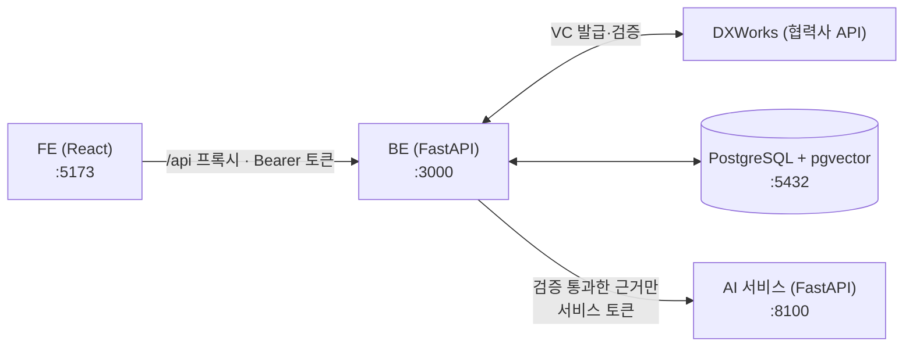

# VC_AI_Career_agent
[종합설계프로젝트1] 디지털 배지 및 자격증명 기반 초개인화 AI 커리어 에이전트 지갑 개발 과제

| 폴더 | 내용 | 안내 |
|---|---|---|
| `BE/` | VC 검증·저장·인증 백엔드, AI 연동 (직무 비교·커리큘럼 API) | [BE/README.md](BE/README.md) |
| `FE/` | 사용자 웹 (지갑·발급·직무 비교·커리큘럼) | [FE/README.md](FE/README.md) |
| `research-vc/` | **논문 실험용** VC 검증 코어: fixture 발급기관·테스트 키 기반 파싱·정규화·검증 파이프라인 (실서비스 VC 연동은 `BE/`가 DXWorks BaaS로 담당) | [research-vc/README.md](research-vc/README.md) |
| `ai/` | **AI 서비스**: 검증된 자격증명과 검토된 채용공고의 직무 비교, 커리큘럼 생성 (BE가 호출) | [ai/README.md](ai/README.md) |
| `report/` | 발표·보고 자료 | |

## 서비스 구성



- **BE**: 회원·DID 지갑, VC 발급·검증(DXWorks), 실행 시점 재검증, 포트폴리오·공유 링크, 공고·학습자료 보관, 직무 비교·커리큘럼 API
- **AI**: BE가 보낸 검증된 자격증명과 공고로 직무 요구사항을 비교하고 학습 계획을 계산합니다. DB와 키를 갖지 않습니다.
- **FE**: 지갑, 배지 발급, 직무 비교·커리큘럼 화면

## 서비스 실행 방법

아래 명령은 모두 **저장소 최상위 폴더**(`VC_AI_Career_agent/`)에서 실행합니다. 폴더 이동은 `( … )` 안에서만 하므로 순서대로 붙여 넣어도 됩니다. Windows는 Git Bash 또는 WSL을 쓰세요.

### 1. 준비물

- Docker Desktop (DB·BE·AI를 컨테이너로 실행)
- Node.js 22 이상 (FE)
- Python 3.11 (테스트나 Docker 없이 실행할 때만)
- DXWorks 접속 정보(`DXWORKS_API_HOST`, `DXWORKS_API_KEY`, `DXWORKS_BADGE_TEMPLATE_ID`): 협력사 비공개 값이라 팀 내부 채널로 받습니다. 없으면 배지 발급·검증과 직무 비교를 할 수 없습니다.

### 2. 환경 변수 설정 (`BE/.env`)

```bash
cp -n BE/.env.example BE/.env
```

아래 명령으로 값을 하나씩 만들어 `BE/.env`의 같은 이름 항목에 붙여 넣습니다. 출력된 값은 공유 저장소에 올리지 마세요.

```bash
python3 -c "import secrets; print('JWT_SECRET=' + secrets.token_urlsafe(48))"
```

```bash
python3 -c "import secrets; print('AI_SERVICE_TOKEN=' + secrets.token_urlsafe(48))"
```

```bash
python3 -c "import base64, os; print('HOLDER_KEY_ENCRYPTION_KEY=' + base64.b64encode(os.urandom(32)).decode())"
```

| 항목 | 설명 |
|---|---|
| `DXWORKS_API_HOST`, `DXWORKS_API_KEY`, `DXWORKS_BADGE_TEMPLATE_ID` | 협력사 DXWorks 접속 정보 |
| `JWT_SECRET` | 로그인 토큰 서명 키. 비우면 재시작할 때마다 로그인이 풀립니다 |
| `HOLDER_KEY_ENCRYPTION_KEY` | 사용자 지갑 키 암호화 키. **한 번 정하면 바꾸거나 잃어버리면 안 됩니다** |
| `AI_SERVICE_TOKEN` | BE와 AI가 같이 쓰는 비밀(32바이트 이상). Compose가 AI 컨테이너에도 같은 값을 넣습니다 |
| `RESEARCHER_USER_IDS` | 공고·학습자료를 반입할 연구자 계정 UUID (5번에서 채움) |
| `CURRICULUM_LLM_USER_IDS` | 커리큘럼 LLM 모드를 쓸 계정 UUID (선택, 7번) |

### 3. DB·BE·AI 실행 (Docker Compose)

```bash
(cd BE && docker compose up --build -d)
```

처음 실행하면 DB 스키마·시드·마이그레이션(04~08)이 자동 적용됩니다. 상태 확인:

```bash
(cd BE && docker compose ps)
```

```bash
curl http://localhost:3000/health
```

```bash
curl http://localhost:8100/health
```

- BE API 문서: <http://localhost:3000/docs>
- 로그 확인: `(cd BE && docker compose logs -f backend ai)`
- 종료(데이터 유지): `(cd BE && docker compose down)` / DB까지 초기화: `(cd BE && docker compose down -v)`

> **이미 DB 볼륨이 있는 경우(이전 버전에서 업그레이드)** 새 테이블이 자동으로 생기지 않으므로 한 번 직접 적용합니다.
> ```bash
> (cd BE && docker compose exec -T postgres psql -U postgres -d vc_career_agent < DB/migrations/08_career_curriculum.sql)
> ```

### 4. FE 실행

새 터미널에서 실행합니다 (개발 서버가 계속 떠 있어야 합니다).

```bash
(cd FE && npm install && npm run dev)
```

브라우저에서 <http://localhost:5173>을 엽니다. `/api` 요청은 개발 서버가 BE(`localhost:3000`)로 넘겨 줍니다.

### 5. 처음 사용하기

**① 사용자: 가입 → 배지 발급·검증**
FE에서 회원가입하면 DID 지갑이 만들어집니다. **자격증명 발급** 화면에서 배지를 발급받고 "검증하고 지갑에 저장하기"를 누릅니다.
시드 계정(`user001@example.com` ~ `user045@example.com`, 비밀번호 `test1234`)은 화면 확인용입니다. 서명 원본이 없어 직무 비교에서는 근거로 쓰이지 않으므로, 새로 가입해 배지를 받으세요.

**② 연구자 지정**
공고·학습자료를 반입할 계정을 FE에서 가입한 뒤, 그 계정의 UUID를 확인합니다. 로그인 토큰을 셸 변수에 담아 두고(③에서도 씁니다), 이메일·비밀번호는 실제 값으로 바꿉니다.

```bash
TOKEN=$(curl -s -X POST http://localhost:3000/api/v1/users/login -H 'Content-Type: application/json' -d '{"email":"researcher@example.com","password":"<비밀번호>"}' | python3 -c "import sys, json; print(json.load(sys.stdin)['access_token'])")
```

```bash
curl -s http://localhost:3000/api/v1/users/me -H "Authorization: Bearer $TOKEN" | python3 -c "import sys, json; print(json.load(sys.stdin)['data']['id'])"
```

출력된 UUID를 `BE/.env`의 `RESEARCHER_USER_IDS=`에 넣고(여러 명이면 쉼표로 구분) BE를 다시 띄웁니다.

```bash
(cd BE && docker compose up -d --force-recreate backend)
```

**③ 연구자: 공고·학습자료 반입**
요구사항마다 원문 인용(`quote`)과 원문 안의 정확한 위치(`start`, `end`, 글자 수 기준)가 있어야 합니다.
AI가 주석이 원문과 맞는지(예: "또는" 조건을 "그리고"로 바꾸지 않았는지) 검사하고, 틀리면 422로 이유를 알려 줍니다.
비교에는 `dataset_kind: "real"`이고 수집(`captured_at`) 7일 이내·게시 90일 이내인 공고만 쓰이므로, **이용 허가를 받은 실제 공고**를 반입하세요.
아래는 형식 예시입니다(회사·URL은 가상 값). 같은 터미널에서 ②의 `TOKEN`을 그대로 씁니다.

```bash
NOW=$(date -u +%Y-%m-%dT%H:%M:%SZ)
cat > posting.json <<EOF
{
  "source": "manual", "external_id": "example-de-001",
  "source_url": "https://jobs.example.com/example-de-001",
  "company": "예시데이터(주)", "title": "주니어 데이터 엔지니어", "region": "서울", "seniority": "junior",
  "role_id": "data_engineer", "posted_at": "$NOW", "captured_at": "$NOW",
  "dataset_kind": "real", "rights_basis": "permission", "review_note": "게시처 허가를 받아 원문을 그대로 옮김",
  "raw_text": "SQL 평가 통과\nPython 또는 Scala 과정 수료\nSpark 실무 경험\n",
  "requirements": [
    {"key": "r0", "kind": "skill", "importance": "required", "quote": "SQL 평가 통과", "start": 0, "end": 9,
     "skill_ids": ["sql"], "minimum_evidence": "assessment"},
    {"key": "r1", "kind": "skill", "importance": "required", "quote": "Python 또는 Scala 과정 수료", "start": 10, "end": 31,
     "skill_ids": ["python", "scala"], "match": "any", "minimum_evidence": "completion"},
    {"key": "r2", "kind": "skill", "importance": "required", "quote": "Spark 실무 경험", "start": 32, "end": 43,
     "skill_ids": ["spark"]}
  ]
}
EOF
curl -s -X POST http://localhost:3000/api/v1/research/job-postings -H "Authorization: Bearer $TOKEN" -H 'Content-Type: application/json' -d @posting.json
```

```bash
NOW=$(date -u +%Y-%m-%dT%H:%M:%SZ)
cat > resource.json <<EOF
{
  "source": "manual", "external_id": "example-spark-101",
  "source_url": "https://learning.example.com/spark-101",
  "title": "Apache Spark 입문 실습", "provider": "예시 교육기관",
  "raw_text": "Apache Spark 입문 실습\n무료",
  "skill_annotations": [{"skill_id": "spark", "quote": "Apache Spark", "start": 0, "end": 12}],
  "prerequisite_annotations": [], "prerequisites_reviewed": true,
  "level": "beginner", "minimum_study_hours": 4,
  "cost_krw": 0, "cost_annotation": {"quote": "무료", "start": 19, "end": 21},
  "captured_at": "$NOW", "available": true,
  "dataset_kind": "real", "rights_basis": "permission", "review_note": "제공처 허가를 받아 소개 문구를 그대로 옮김"
}
EOF
curl -s -X POST http://localhost:3000/api/v1/research/learning-resources -H "Authorization: Bearer $TOKEN" -H 'Content-Type: application/json' -d @resource.json
```

- 기술 ID: `sql`, `python`, `scala`, `spark`, `kafka`, `airflow`, `etl`, `data_modeling`, `git`, `linux`, `aws`, `docker`
- 원문에서 기술 후보만 먼저 보고 싶으면 `POST /api/v1/research/job-postings/preview`에 `{"raw_text": "..."}`를 보냅니다.
- 학습자료는 수집 30일 이내만 쓰입니다. 같은 `source`·`external_id`로 다시 반입하면 새 버전이 쌓이고 최신 버전이 쓰입니다.
- 각 필드의 규칙은 [BE/openapi.yaml](BE/openapi.yaml)과 <http://localhost:3000/docs>를 참고하세요.

**④ 사용자: 직무 비교 → 학습 계획**
FE의 **직무 비교·커리큘럼** 화면에서 공고를 고르고 "검증하고 비교하기"를 누르면, BE가 모든 자격증명을 지금 다시 검증한 뒤 AI가 요구사항별로 비교합니다.
같은 화면에서 기간·주당 시간·예산을 정해 학습 계획을 만듭니다. 비교 결과는 5분 동안만 계획 생성에 쓸 수 있습니다.

### 6. Docker 없이 실행 (개발·디버깅)

DB만 컨테이너로 띄우고 BE와 AI를 각각 다른 터미널에서 실행합니다. `ai/.env`의 `AI_SERVICE_TOKEN`은 `BE/.env`와 같은 값이어야 합니다.

```bash
(cd BE && docker compose up -d postgres)
```

```bash
(cd BE && python3.11 -m venv .venv && .venv/bin/pip install -r requirements.txt && .venv/bin/python -m uvicorn main:app --reload --port 3000)
```

```bash
cp -n ai/.env.example ai/.env
```

```bash
(cd ai && python3.11 -m venv .venv && .venv/bin/pip install -r requirements.txt && .venv/bin/python -m uvicorn src.server.app:app --host 127.0.0.1 --port 8100)
```

로컬 실행 시 BE는 기본값 `AI_SERVICE_URL=http://127.0.0.1:8100`으로 AI에 접속합니다. FE는 4번과 같습니다.

### 7. (선택) 커리큘럼 LLM 모드

기본은 LLM 없이 만드는 템플릿 계획입니다. LLM을 쓰려면 `BE/.env`의 `CURRICULUM_LLM_USER_IDS`에 계정 UUID를 넣고, `ai/.env`에 `CURRICULUM_LLM_ENABLED=true`와 공급자 설정을 넣은 뒤 다시 띄웁니다.

```bash
(cd BE && docker compose up -d --force-recreate backend ai)
```

FE에서 "LLM으로 단계 순서·시간을 배분" 동의를 체크해야 사용됩니다. OpenAI 호환 API와 로컬 Qwen(GPU) 설정은 [ai/README.md](ai/README.md) 6번을 보세요.

### 8. 테스트

BE 테스트는 pgvector가 들어 있는 테스트 전용 DB가 필요합니다(개발 DB는 건드리지 않음).

```bash
docker run -d --name vc-be-test -e POSTGRES_PASSWORD=password -p 55432:5432 pgvector/pgvector:pg16
```

```bash
(cd BE && python3.11 -m venv .venv && .venv/bin/pip install -r requirements-dev.txt && .venv/bin/python -m pytest -q)
```

```bash
(cd ai && python3.11 -m venv .venv && .venv/bin/pip install -r requirements.txt && .venv/bin/python -m pytest -q && .venv/bin/python scripts/sync_contract_to_be.py --check)
```

```bash
(cd FE && npm run lint && npm run build)
```

GitHub Actions(`.github/workflows/tests.yml`)가 PR마다 같은 검사를 실행합니다.
`ai/src/career/contracts/`(BE와 AI가 주고받는 형식)를 바꿨다면 `ai/`에서 `python scripts/sync_contract_to_be.py`로 BE 사본을 갱신하고 BE와 AI를 함께 다시 띄웁니다.

### 9. 문제 해결

| 증상 | 확인할 것 |
|---|---|
| FE에 "BE 서버에 연결할 수 없습니다" | BE가 3000번에서 실행 중인지 (`curl http://localhost:3000/health`) |
| FE에 "AI 서버에 연결할 수 없습니다" | AI가 실행 중인지 (`curl http://localhost:8100/health`), BE의 `AI_SERVICE_URL` |
| "BE에 AI 서버 주소·토큰이 설정되지 않았습니다" | `BE/.env`의 `AI_SERVICE_TOKEN`이 비었거나 32바이트 미만 |
| "AI_SERVICE_TOKEN이 서로 다릅니다" | Docker 없이 실행할 때 `BE/.env`와 `ai/.env`의 토큰이 다름 |
| 발급·검증이 502/503 | `DXWORKS_*` 값 |
| 직무 비교 화면에 공고가 없음 | 연구자 반입 공고가 없거나, `dataset_kind`가 `real`이 아니거나, 수집 7일·게시 90일이 지남 |
| 공고 반입이 403 | 그 계정 UUID가 `RESEARCHER_USER_IDS`에 없음 (넣은 뒤 backend 재시작) |
| 공고 반입이 422 | 응답 `detail`의 규칙 코드 (예: `ANNOTATED_SKILL_NOT_MENTIONED_IN_QUOTE`), `start`/`end` 위치 |
| 직무 비교 화면에서 "다시 로그인" | 이전 버전에서 로그인해 토큰이 없음 → 로그아웃 후 다시 로그인 |
| 학습 계획 생성이 409 | 비교 결과 5분이 지남 → 다시 비교 |

## AI 연구 현황 (2026-10-16 기준, `AI` 브랜치)

VC 기록을 읽고 지원 문장을 쓰는 AI가 기록에 없는 내용을 만들거나 부풀리는지, 그리고 VC 검증이 이를 막는지 네 차례 실험했습니다.

| 차수 | 무엇을 비교했나 | 규모 | 핵심 결과 |
|---|---|---|---|
| 1차 | 근거 없음 vs 전체 기록 vs 검증 기록 | 답변 144건 | 검증 필터가 거짓 교육시간 전파를 15/16 → 0/16으로 막음 (사후 분석) |
| 2차 | 일반 문서 vs 미검증 VC vs 검증 VC | 답변 272건 | 필터는 거짓을 막지만 참인 정보도 함께 지움. VC 형식 자체의 효과는 없음 |
| 3차 | 저장된 "verified" 표시 vs 실행 시점 VC 재검증 (DB 변조 상황) | 답변 448건 | 변조 160개를 VC 실검증은 모두, 표시 신뢰 시스템은 하나도 막지 못함 |
| 4차 | 3차 설계를 VC 1,008개 + 같은 내용의 더미 1,008개로 확대 | 답변 2,352건 | 3차 결과가 그대로 재현됨 (840 대 0). 플래그 + 사후 대조가 참인 정보를 더 살림 |

모든 판정은 자동 판정 초안이며 사람 검토 전입니다. 데이터는 합성 지원자이고, VC는 연구용 테스트 키로 서명했습니다.

- 실험 코드·데이터·설계 문서는 `ai/`를 서비스 전용으로 정리하면서 이 브랜치에서 뺐습니다. 이전 커밋 기록에 남아 있습니다 (예: 36건 개발 실험 자료는 커밋 `d9d933e`).
