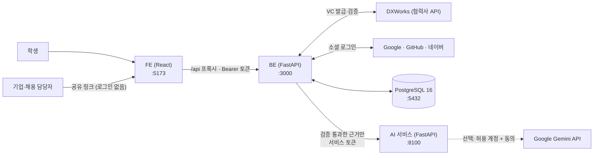

# VC_AI_Career_agent
[종합설계프로젝트1] 디지털 배지 및 자격증명 기반 초개인화 AI 커리어 에이전트 지갑 개발 과제

## 프로젝트 소개

학생이 받은 디지털 배지를 검증 가능한 자격증명(VC)으로 DID 지갑에 모으고, **지금 다시 검증을 통과한 기록만** 근거로 실제 채용 공고의 요구사항과 비교해 무엇이 증명되고 무엇이 부족한지 보여 주는 웹 서비스입니다. 부족한 역량은 검토된 학습자료로 짠 학습 계획으로 채우고, 검증된 이력은 공유 링크로 기업·채용 담당자에게 보여 줍니다.

- **검증된 근거만 씁니다.** DB에 저장된 "verified" 표시를 믿지 않고, 직무 비교·포트폴리오 생성·공유 링크 조회 때마다 서명 원본을 다시 검증해 통과한 자격증명만 근거로 씁니다. VC 발급·검증은 협력사 DXWorks BaaS가 맡습니다.
- **AI는 규칙 기반이 기본입니다.** 직무 비교, 직무별 시장 통계, 기본 학습 계획(템플릿)은 AI 서비스가 정해진 규칙으로 계산합니다. 외부 LLM인 **Google Gemini API는 학습 계획의 선택 기능**으로, AI 서비스에서 켜고(`CURRICULUM_LLM_ENABLED=true`, `GEMINI_API_KEY`) BE 허용 목록(`CURRICULUM_LLM_USER_IDS`)에 든 계정이 화면에서 동의할 때만 쓰입니다. 이때 Gemini는 허용된 학습 단계·자료 중에서 순서와 시간 배분만 고르고, 결과는 검사해서 한 번 다시 받은 뒤에도 통과하지 못하면 템플릿 계획으로 대체됩니다. 자격증명 원문과 이름·이메일·DID 같은 개인정보는 Gemini로 보내지 않습니다.

## 핵심 기능

| 기능 | 내용 |
|---|---|
| 가입·로그인, DID 지갑 | 이메일·비밀번호 또는 Google·GitHub·네이버 소셜 로그인. 가입하면 BE가 관리형 `did:key`(Ed25519) 지갑을 만들고 홀더 키를 암호화해 보관합니다 |
| 배지 발급·검증·보관 | 배지(VC-JWT)를 DXWorks로 검증해 지갑에 저장하고, 지갑에서 언제든 (일괄) 재검증합니다. 시연용 모의 발급 화면이 있습니다 |
| 직무 비교 | 연구자가 원문 인용·위치까지 검토해 넣은 실제 채용 공고의 요구사항마다, 검증된 자격증명이 근거가 되는지 `supported`·`partially_supported`·`not_evidenced`·`unknown`으로 판정합니다(근거가 없다고 기술이 없다고 단정하지 않음) |
| 학습 계획(커리큘럼) | 부족한 요구사항을 학습 단계·선수 단계·검토된 학습자료·최소 학습 시간으로 바꾸고 기간·주당 시간·예산에 맞춥니다. 기본은 템플릿, 선택으로 Google Gemini API 배분 |
| 직무별 채용 시장 통계 | 빅데이터·개인정보보호·백엔드·프런트엔드·인프라 5개 직무의 요구 역량 통계 카드 |
| AI 포트폴리오·공유 링크 | 고른 자격증명을 다시 검증해 서버가 Markdown 포트폴리오 본문을 만들고(초안·게시), 공개할 자격증명만 골라 기한(기본 14일, 최대 90일)이 있는 공유 링크를 만들거나 철회합니다. 포트폴리오 화면의 대화창은 아직 모의 응답입니다 |
| 입력·과부하 보호 | 경로별 요청 본문 상한, 한 줄 입력 검사(제어·방향 제어 문자 거부), 로그인 실패 제한, 사용자별 검증기·AI 요청 한도와 24시간 한도, AI 동시 처리·LLM 동시 생성 상한, 운영 WAF 규칙 |

## 기술 스택

| 영역 | 기술 (버전) |
|---|---|
| FE | React 19.3 · TypeScript 7.0 · Vite 8.3 · Tailwind CSS 4.3 · React Router 7.18 · TanStack Query 5.105 · Zustand 5.0 · React Hook Form 7.91 + Zod 4.6 · Axios 1.21 · Motion 14.9 · Anime.js 4.5 · d3-shape 3.2 · oxlint 1.90 (Node.js 22.12 이상, `FE/package-lock.json` 기준) |
| BE | Python 3.11 · FastAPI 0.162.0 · Starlette 1.10.0 · Uvicorn 0.54.0 · Pydantic 2.14.3 · psycopg 3.3.8 · httpx 0.28.1 · bcrypt 5.0.0 · PyJWT 2.15.1 · cryptography 50.0.2 · rfc8785 0.1.4 (`BE/requirements.txt`) |
| AI | Python 3.11 · FastAPI 0.162.0 · Starlette 1.10.0 · Uvicorn 0.54.0 · Pydantic 2.14.3 · httpx 0.28.1 (`ai/requirements.txt`) · 규칙 기반 직무 비교·학습 계획·시장 통계 · (선택) Google Gemini API: Interactions API `v1`, 기본 모델 `gemini-3.5-flash-lite`, SDK 없이 httpx로 호출 · 대안 공급자: OpenAI 호환 API, 로컬 Qwen(GPU, torch 2.5.1 · transformers 4.51.3) |
| DB | PostgreSQL 16: 로컬·CI는 `pgvector/pgvector:0.8.7-pg16-bookworm` 이미지(확장은 쓰지 않음), 운영은 Amazon RDS for PostgreSQL 16(TLS `verify-full`) · SQL 마이그레이션 실행기 `python -m app.migrate` |
| VC·인증 | DXWorks BaaS(협력사 API: OB3 배지 VC 발급·검증) · 관리형 `did:key` 지갑 · JWT 로그인 토큰 · bcrypt · OAuth 2.0(Google·GitHub·네이버) |
| 인프라 | Docker(`python:3.11.15-slim-bookworm` 기반 BE·AI 이미지) · Docker Compose(로컬 개발) · AWS: ECR, ECS Fargate(BE·AI, Service Connect), RDS, S3 + CloudFront(OAC·VPC 원본·CloudFront Function), 내부 ALB, AWS WAF, Secrets Manager, CloudWatch Logs |
| CI | GitHub Actions: `tests.yml`(BE·AI pytest 9.2.0, FE lint·빌드·`dist` 검사, research-vc 타입 검사·vitest, Docker 이미지 빌드), `main.yml`(Strix 보안 스캔) · Dependabot(액션 버전 갱신) |

## 시스템 구성

- **BE**: 회원(이메일·비밀번호, Google·GitHub·네이버 소셜 로그인)·DID 지갑, VC 발급·검증(DXWorks), 실행 시점 재검증, 포트폴리오·공유 링크, 공고·학습자료 보관, 직무 비교·커리큘럼 API, 직무별 채용 시장 통계 조회
- **AI**: BE가 보낸 검증된 자격증명과 공고로 직무 요구사항을 비교하고 학습 계획을 계산합니다. DB와 VC 서명 키를 갖지 않습니다(LLM 모드를 켜면 Gemini API 키만 `ai/.env`에 둠). 수집한 공고 묶음으로 직무별 요구 역량 통계도 계산합니다.
- **FE**: 지갑, 배지 발급, 직무 비교·커리큘럼, AI 포트폴리오·공유 링크 화면과 기업용 공유 링크 조회 화면
- 포트는 로컬 개발(Docker Compose) 기준입니다. AWS 운영 구성은 CloudFront(FE는 S3) → `/api/*`는 VPC 원본·내부 ALB → BE(ECS Fargate) → AI(ECS Service Connect), DB는 RDS입니다.

## 사용자 시나리오

### 학생

1. **가입·로그인**: 이메일·비밀번호 또는 Google·GitHub·네이버로 가입하면 DID 지갑이 만들어집니다.
2. **배지 발급·검증·저장**: **자격증명 발급**(`/issue`) 화면에서 배지를 받고 "검증하고 지갑에 저장하기"를 누르면, DXWorks 검증을 통과한 배지가 **자격증명 지갑**(`/dashboard`)에 쌓입니다. 지갑에서 자격증명을 다시 검증할 수 있습니다.
3. **직무 비교**: **직무 비교·커리큘럼**(`/career`) 화면에서 공고(또는 전체 공고 기준)를 고르고 "검증하고 비교하기"를 누르면, BE가 모든 자격증명을 지금 다시 검증한 뒤 AI가 요구사항별로 근거가 있는 것·부족한 것·판단을 보류한 것을 보여 줍니다. 같은 화면 위쪽에서 직무별 요구 역량 통계를 봅니다.
4. **학습 계획**: 기간·주당 시간·예산을 정해 학습 계획을 만듭니다(비교 결과는 5분 동안 계획 생성에 쓸 수 있음). 기본은 템플릿 계획이고, 허용된 계정은 "LLM(외부 서비스 Google Gemini API)으로 단계 순서·시간을 배분"에 동의하면 Gemini가 순서·시간을 배분한 계획을 받습니다.
5. **포트폴리오·공유 링크**: **AI 포트폴리오**(`/portfolio`)에서 자격증명을 골라 포트폴리오를 만들고(서버가 다시 검증해 본문 작성), 공개할 자격증명만 담은 공유 링크를 만들어 지원서에 붙입니다. 필요 없어진 링크는 철회합니다.

### 기업·채용 담당자 (공유 링크)

1. 학생에게 받은 공유 링크(`/share/<토큰>`)를 로그인 없이 엽니다.
2. 링크를 여는 순간 BE가 공개된 자격증명의 서명 원본을 다시 검증하고, 학생 이름·DID와 자격증명마다 지금 유효한지(폐기·만료·서명 실패 등)를 보여 줍니다. 이메일 같은 다른 개인정보는 보이지 않습니다.
3. 학생이 철회했거나 기한이 지난 링크는 열리지 않습니다.

### 연구자 (공고·학습자료 반입)

1. 운영자가 연구자 계정의 UUID를 BE 설정 `RESEARCHER_USER_IDS`에 넣습니다. 반입은 화면이 아니라 API(`curl`, [BE/openapi.yaml](BE/openapi.yaml))로 합니다.
2. 이용 허가를 받은 실제 채용 공고를 원문과 요구사항별 원문 인용·위치(`quote`·`start`·`end`)·기술 ID 주석과 함께 `POST /api/v1/research/job-postings`로 반입합니다(`.../job-postings/preview`로 기술 후보를 먼저 볼 수 있음). AI가 주석이 원문과 맞는지(예: "또는"을 "그리고"로 바꾸지 않았는지) 검사하고, 틀리면 422로 이유를 알려 줍니다.
3. 학습자료도 기술 주석·비용·수준·최소 학습 시간과 함께 `POST /api/v1/research/learning-resources`로 반입합니다.
4. 반입한 공고(수집 7일·게시 90일 이내의 실제 공고)와 학습자료(수집 30일 이내)가 학생의 직무 비교와 학습 계획에 쓰입니다. 같은 출처·ID로 다시 반입하면 새 버전이 쌓입니다.

## 팀 소개

| 역할 | 이름 |
|---|---|
| 팀장 | 이현우 |
| 팀원 | 홍지환 |
| 팀원 | 이동현 |
| 팀원 | 백종은 |

## 문서

| 폴더·문서 | 내용 |
|---|---|
| [docs/GETTING_STARTED.md](docs/GETTING_STARTED.md) | 서비스 실행 방법: 준비물, 환경 변수, Docker Compose 실행, 처음 사용하기, LLM 모드·시장 통계, 테스트, 문제 해결 |
| [deploy/CHECKLIST.md](deploy/CHECKLIST.md) | AWS 배포 체크리스트(항목별 기준). 배포 순서는 [deploy/README.md](deploy/README.md), 변수 표는 [deploy/ENV_MATRIX.md](deploy/ENV_MATRIX.md) |
| `BE/` | VC 검증·저장·인증 백엔드, AI 연동 (직무 비교·커리큘럼 API): [BE/README.md](BE/README.md), [BE/openapi.yaml](BE/openapi.yaml) |
| `FE/` | 사용자 웹 (지갑·발급·직무 비교·커리큘럼·포트폴리오): [FE/README.md](FE/README.md) |
| `ai/` | **AI 서비스**: 검증된 자격증명과 검토된 채용공고의 직무 비교, 커리큘럼 생성 (BE가 호출): [ai/README.md](ai/README.md)(Gemini 설정은 6번), [ai/docs/CAREER_AI_SERVICE.md](ai/docs/CAREER_AI_SERVICE.md) |
| [ai/docs/RESEARCH_STATUS.md](ai/docs/RESEARCH_STATUS.md) | AI 연구 현황: VC 검증이 AI의 근거 없는 서술을 막는지 본 네 차례 실험 요약 |
| `research-vc/` | **논문 실험용** VC 검증 코어: fixture 발급기관·테스트 키 기반 파싱·정규화·검증 파이프라인 (실서비스 VC 연동은 `BE/`가 DXWorks BaaS로 담당): [research-vc/README.md](research-vc/README.md) |
| `report/` | 발표·보고 자료 |
