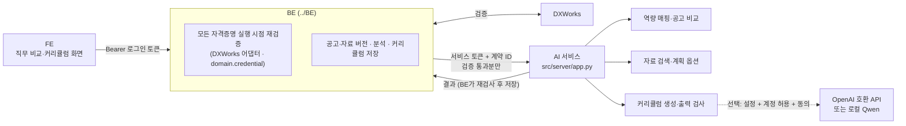

# AI 서비스 구조와 동작

BE(`../BE`)가 보낸 검증된 근거로 **직무 비교와 커리큘럼 생성만 계산하는 상태 없는 서버**입니다.
사용자 인증, VC 검증(DXWorks), DB 저장, 권한(연구자·LLM 허용 계정)은 BE가 맡습니다. 설치·실행은 [../README.md](../README.md)를 보세요.

## 1. 전체 흐름

1. **직무 비교** (`POST /api/v1/career-analyses`): BE가 사용자의 모든 자격증명을 서명 원본으로 지금 다시 검증하고,
   통과한 것만 검증 스냅샷(`VerificationSnapshot`, 5분 유효)으로 묶어 검토된 공고 버전과 함께 AI에 보냅니다.
2. **커리큘럼** (`POST /api/v1/curricula`, 동기): 저장된 분석과 학습자료로 AI가 계획 컨텍스트를 만들고, 템플릿 또는 LLM으로 생성합니다.

AI는 **VC 서명 원본을 받지 않고 검증을 판단하지 않습니다.** 검증 판단은 BE의 DXWorks 어댑터가 실제 응답 형식으로 합니다.

## 2. 모듈 (`src/career/`)

| 모듈 | 내용 |
|---|---|
| `skill_catalog.py`, `skill_normalizer.py` | 12개 데이터 엔지니어 기술. 검증된 VC의 성취 이름·설명·alignment 문구에 정확히 맞는 규칙만 근거로 인정 |
| `job_requirements.py` | 공고 주석이 원문 인용과 맞는지, "그리고/또는" 해석이 원문과 맞는지 검사. 기술 후보 미리보기 |
| `gap_analyzer.py`, `career_analysis.py` | 최근 30일(부족하면 90일) 표본, 중복 제거, 요구사항별 supported/partially_supported/not_evidenced/unknown, 빈도 통계 |
| `learning_retrieval.py`, `curriculum_service.py` | 검토된 자료의 기술 태그·비용·최신성(30일) 기준 검색, 계획 컨텍스트 |
| `curriculum_planner.py` | 부족한 요구사항 → 단계·선수 단계·자료 후보·시간 하한, 확인 질문 |
| `curriculum_generator.py`, `output_validator.py` | 템플릿 또는 LLM 초안 → 검사 → 1회 수정 → 실패 시 템플릿 대체 → 문구 조립 |
| `llm_client.py`, `local_selector.py` | OpenAI 호환 HTTPS 클라이언트, 고정 Qwen 로컬 실행 어댑터(`../src/llm/transformers_llm.py`) |
| `contracts/` | BE와 공유하는 요청/응답 형식 (BE `app/ai_contract/`에 바이트 단위 사본) |

판단 원칙:

- VC가 없다는 것을 기술이 없다는 뜻으로 바꾸지 않습니다(`not_evidenced`, 제외된 VC가 있으면 `unknown`).
- 수료·평가·프로젝트·실무 경험을 구분하고, 기간·학력 같은 조건은 확인 질문으로 남깁니다.
- 원문에 없는 강의명·URL·가격을 만들지 않습니다. 자료가 없으면 "일반 과제"로 표시합니다.
- LLM은 허용된 단계·자료 ID·순서·시간만 고릅니다. 사용자 이력·URL·자유 서술은 쓰지 않고, 공고·자료 문구는 지시가 아닌 데이터로 취급합니다.

## 3. 신뢰 경계

- 이 서비스에는 DB 접속, BE 키, 비밀번호, VC 서명 원본이 없습니다.
- BE는 응답을 그대로 믿지 않고 다음을 다시 검사합니다. 어긋나면 저장하지 않고 502로 처리합니다.
  - 계약 ID와 응답 형식
  - 분석이 BE가 보낸 스냅샷·공고 버전만 인용하는지, 근거 레코드가 검증 통과분인지, 유효기간이 스냅샷을 넘지 않는지
  - 계획·결과가 보낸 자료와 컨텍스트 단계만 쓰는지, 템플릿 요청에 LLM 결과가 섞이지 않았는지
- 이 서비스도 BE가 보낸 공고·자료의 내용 해시(RFC 8785)와 주석·인용을 다시 검사합니다(409).
- 요청 본문은 저장하거나 로그에 남기지 않고, 입력 검증 오류는 입력값을 되돌려 보내지 않습니다.
- 커리큘럼 생성 요청에는 스냅샷·DID·공고 원문이 없고 동결된 계획 옵션만 옵니다. BE는 모델 원문 출력은 저장하지 않고 해시·사용량·검사 결과만 남깁니다.

## 4. API

모든 `/v1` 경로는 `Authorization: Bearer $AI_SERVICE_TOKEN`이 필요하고, BE만 호출하도록 설계했습니다.

| Method | Path | 입력 → 출력 |
|---|---|---|
| GET | `/health` | 인증 없음. 상태와 계약 ID |
| GET | `/v1/contract` | 계약 ID |
| GET | `/v1/skills` | 기술 카탈로그 |
| POST | `/v1/job-postings/preview` | 공고 원문 → 검토용 기술 후보 |
| POST | `/v1/job-postings/validate` | 반입할 공고 주석 검사 |
| POST | `/v1/job-postings/search` | 공고 버전 목록 → 표본·통계·경고 |
| POST | `/v1/career-analyses` | BE 검증 스냅샷·공고 버전·대상 공고 → 분석 + 사용한 카탈로그 |
| POST | `/v1/learning-resources/validate` | 반입할 자료 인용 검사 |
| POST | `/v1/learning-resources/search` | 자료 버전 목록 → 조건에 맞는 자료 |
| GET | `/v1/curricula/generator` | 현재 생성기 공개 정보(키 제외) |
| POST | `/v1/curricula/context` | 분석·자료·요청 → 계획 컨텍스트 |
| POST | `/v1/curricula/generate` | 동결된 컨텍스트 → 결과 또는 실패 코드 + 감사 기록 |

오류 응답은 `{"detail": 메시지, "code": 코드}`이고 BE가 같은 상태 코드·메시지로 FE에 전달합니다.
모든 응답에는 `X-Career-AI-Contract` 헤더가 붙고, 다른 계약 ID를 보낸 요청은 409로 거부합니다.

## 5. 공유 형식(계약)

`src/career/contracts/`가 원본이고 `../BE/app/ai_contract/`는 바이트 단위 사본입니다. 계약 ID는 버전 + 파일 지문이라 한쪽만 바뀌면 바로 실패합니다.
계약 파일 안에서는 상대 import만 씁니다(테스트로 강제). 갱신 방법은 [../README.md](../README.md) 5번, CI는 `--check`로 차이를 막습니다.

## 6. 한계

- 기술 카탈로그와 매핑 규칙은 데이터 엔지니어 한 직무용 프로젝트 자체 기준입니다(NCS/ESCO 공인 매핑 아님).
- VC 검증은 BE의 DXWorks 응답에 의존합니다. VC 검증은 발급자의 주장이 원문 그대로라는 근거이지 실제 능력이나 채용 적합성의 보증이 아닙니다.
- 공고·자료는 연구자가 반입한 것만 씁니다. 자동 수집·URL 진위 확인은 하지 않으며, 자료 검색은 태그·키워드 기반입니다.
