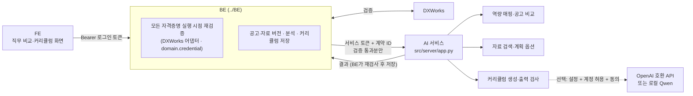

# AI 서비스 구조와 동작

BE(`../BE`)가 보낸 검증된 근거로 **직무 비교와 커리큘럼 생성만 계산하는 상태 없는 서버**입니다.
사용자 인증, VC 검증(DXWorks), DB 저장, 권한(연구자·LLM 허용 계정)은 BE가 맡습니다. 설치·실행은 [../README.md](../README.md)를 보세요.

## 1. 전체 흐름

1. **직무 비교** (`POST /api/v1/career-analyses`): BE가 사용자의 모든 자격증명을 서명 원본으로 지금 다시 검증하고,
   통과한 것만 검증 스냅샷(`VerificationSnapshot`, 5분 유효)으로 묶어 검토된 공고 버전과 함께 AI에 보냅니다.
2. **커리큘럼** (`POST /api/v1/curricula`, 동기): 저장된 분석과 학습자료로 AI가 계획 컨텍스트를 만들고, 템플릿 또는 LLM으로 생성합니다.

AI는 **VC 서명 원본을 받지 않고 검증을 판단하지 않습니다.** 검증 판단은 BE의 DXWorks 어댑터가 실제 응답 형식으로 합니다.

## 2. 모듈 (`src/career/`)

| 모듈 | 내용 |
|---|---|
| `skill_catalog.py`, `skill_normalizer.py` | 12개 데이터 엔지니어 기술. 검증된 VC의 성취 이름·설명·alignment 문구에 정확히 맞는 규칙만 근거로 인정 |
| `job_requirements.py` | 공고 주석이 원문 인용과 맞는지, "그리고/또는" 해석이 원문과 맞는지 검사. 기술 후보 미리보기 |
| `gap_analyzer.py`, `career_analysis.py` | 최근 30일(부족하면 90일) 표본, 중복 제거, 요구사항별 supported/partially_supported/not_evidenced/unknown, 빈도 통계 |
| `learning_retrieval.py`, `curriculum_service.py` | 검토된 자료의 기술 태그·비용·최신성(30일) 기준 검색, 계획 컨텍스트 |
| `curriculum_planner.py` | 부족한 요구사항 → 단계·선수 단계·자료 후보·시간 하한, 확인 질문 |
| `curriculum_generator.py`, `output_validator.py` | 템플릿 또는 LLM 초안 → 검사 → 1회 수정 → 실패 시 템플릿 대체 → 문구 조립 |
| `llm_client.py`, `local_selector.py` | OpenAI 호환 HTTPS 클라이언트, 고정 Qwen 로컬 실행 어댑터(`../src/llm/transformers_llm.py`) |
| `contracts/` | BE와 공유하는 요청/응답 형식 (BE `app/ai_contract/`에 바이트 단위 사본) |

판단 원칙:

- VC가 없다는 것을 기술이 없다는 뜻으로 바꾸지 않습니다. 근거가 없으면 `not_evidenced`이고, 검증을 통과하지 못해 제외된 VC가 있으면 `unknown`(판단 보류)입니다.
  매핑 규칙이 없는 검증 VC는 근거로 쓰지 않고 경고(`UNMAPPED_CREDENTIALS_REQUIRE_CURATED_RULE_REVIEW`)만 붙이며, 판단 보류 사유로 보지 않습니다.
- 수료·평가·프로젝트·실무 경험을 구분하고, 기간·학력 같은 조건은 확인 질문으로 남깁니다.
- 원문에 없는 강의명·URL·가격을 만들지 않습니다. 자료가 없으면 "일반 과제"로 표시합니다.
- LLM은 허용된 단계·자료 ID·순서·시간만 고릅니다. 사용자 이력·URL·자유 서술은 쓰지 않고, 공고·자료 문구는 지시가 아닌 데이터로 취급합니다.

### 직무별 시장 통계 (`src/market/`)

| 모듈 | 내용 |
|---|---|
| `catalog.py` | 직무 5개(빅데이터·개인정보보호·백엔드·프런트엔드·인프라)와 공통 기술 사전(약 120개, 표기·한글 별칭). 기존 카탈로그와 겹치는 기술은 같은 ID |
| `statistics.py` | 공고의 기술스택·자격요건·우대사항·주요업무에서 기술 추출 → 중복 제거 → 언급률(Wilson 구간)·필수 비율·중요도·함께 나오는 기술·경력 분포 |

`GET /v1/market/catalog`, `POST /v1/market/snapshots`로 노출합니다. BE가 수집·저장한 공고 묶음을 받아 통계만 돌려주며
공고를 저장하지 않고, 응답에 원문을 넣지 않습니다. 지금 BE가 부르는 것은 `POST /v1/market/snapshots`뿐이고, `GET /v1/market/catalog`는
BE·FE 어디에서도 부르지 않습니다(BE 클라이언트의 호출 코드를 지운 뒤 경로만 남아 있음. 둘지 지울지는 정하지 않음).
수집·저장·조회 API는 BE(`../BE/README.md`의 "직무별 채용 시장 통계")가 맡습니다.

- 요청 하나는 공고 500건, 구간(주요업무·자격요건·우대사항)마다 2만 자까지입니다(계약 `contracts/market.py`의 `MAX_POSTINGS`·`MAX_SECTION_CHARS`).
- 기술 추출은 규칙 기반입니다(`EXTRACTOR_VERSION = "rules/1"`). 별칭 표기가 구간에 들어 있을 때만 그 정규식을 돌리고, 제목과 주요업무는 따로 찾아 합칩니다(둘을 이어 붙였을 때만 맞는 표기는 세지 않음).
- 공고 한 건의 글이 정규화로 크게 늘어나도(아래 3번의 2배 + 64자) 요청을 거절하지 않고 그 길이에서 잘라 계산합니다. 수집한 공고 한 건 때문에 직무 전체의 통계가 실패하지 않게 하려는 것으로, 공고·자료 미리보기·반입의 422와는 다릅니다.
- 가중 합은 `math.fsum`으로 내므로, 중복으로 빠지는 공고가 없는 묶음은 공고 순서가 달라도 중요도와 내용 해시(`content_hash`)가 같습니다.
  순서에 따라 해시가 달라질 수 있는 경우는 중복 제거가 일어날 때뿐입니다. 중복은 먼저 온 공고를 남기므로, ① 내용 중복(회사·제목·자격요건·우대사항·기술스택이
  같은 재게시)인데 중복 판단에 쓰지 않는 값(주요업무·경력 등)이 서로 다르거나 ② 같은 `(source, external_id)`인데 내용이 다른 공고가 한 묶음에 있으면,
  어느 쪽이 먼저 왔는지에 따라 통계와 해시가 달라집니다. BE는 `(source, external_id)`가 겹치지 않게 저장하고 정해진 순서(수집 시각 내림차순 → 출처 → ID)로
  보내므로, 저장된 공고가 같으면 해시도 같습니다.
- 계산량: 실제 크기의 공고 500건은 CPU 1초 안쪽이고, 계약 최대 크기로 채운 요청(500건, 약 29 MiB)도 표기가 없거나 표기가 모두 단어로 나오는 글이면
  5~6초에 끝납니다(실제 서버 측정: 200 응답까지 6.4초). 계약 상한 안에서 일부러 만든 최악의 요청은 훨씬 오래 걸립니다. 모든 별칭 표기를 다른 글자에
  붙여 넣고(표기는 있지만 단어가 아니어서 정규식이 구간 끝까지 돕니다) 정규화로 늘어나는 문자로 2배 + 64자 상한을 채운 공고 약 445건(32 MiB)은
  CPU 약 286초를 씁니다(실제 서버 측정 285.7초, 공고 한 건에 약 0.6초, 최대 메모리 324 MiB).
  BE는 90초(`AI_GENERATION_TIMEOUT_SECONDS`) 뒤에 기다리기를 그만두지만 AI는 계산을 끝까지 하고, 그동안에도 `/health`는 응답합니다(측정 중앙값 52 ms).
  이 요청은 서비스 토큰이 있어야 보낼 수 있습니다(토큰이 없으면 본문을 읽기 전에 401). 토큰 없이는 그런 공고 수백 건이 BE가 수집한 공고에 들어 있어야 합니다.
  요청 전체의 계산량 상한(예: 정규화된 글자 수 예산)은 두지 않았습니다.

집계 결과 사본은 `data/market_snapshots/`에 있습니다. 설계 배경과 다음 단계는 [JOB_MARKET_STATS_DESIGN.md](JOB_MARKET_STATS_DESIGN.md)를 보세요.

## 3. 신뢰 경계

- 이 서비스에는 DB 접속, BE 키, 비밀번호, VC 서명 원본이 없습니다.
- BE는 응답을 그대로 믿지 않고 다음을 다시 검사합니다. 어긋나면 저장하지 않고 502로 처리합니다.
  - 계약 ID와 응답 형식
  - 분석이 BE가 보낸 스냅샷·공고 버전만 인용하는지, 근거 레코드가 검증 통과분인지, 유효기간이 스냅샷을 넘지 않는지
  - 계획·결과가 보낸 자료와 컨텍스트 단계만 쓰는지, 템플릿 요청에 LLM 결과가 섞이지 않았는지
- 이 서비스도 BE가 보낸 공고·자료의 내용 해시(RFC 8785)와 주석·인용을 다시 검사합니다(409).
- 연구자가 보낸 공고 원문·요구사항 인용·자료 인용은 각각 한 번만 정규화(NFKC + 대소문자 통일)해 모든 기술 검사에 다시 쓰고,
  정규화 결과가 원래 길이의 2배 + 64자를 넘으면 422 `TEXT_EXPANDS_TOO_MUCH_WHEN_NORMALIZED`로 거절합니다(예: U+FDFA 한 글자는 18자가 됨).
  미리보기·반입 검사와 저장된 버전의 재검사(409)에 같은 규칙을 씁니다.
  정규화하기 전에 결합 문자(악센트처럼 앞 글자에 붙는 문자)가 30개를 넘게 이어진 구간은 30개에서 자릅니다. NFKC가 그런 구간에서
  길이의 제곱만큼 시간을 써 서비스 전체가 멈추는 것을 막기 위한 것이며, 실제 문장의 결과는 그대로입니다.
  이 규칙이 생기기 전에 저장된 공고·자료에 그런 구간이 있으면(일부러 만든 입력), 31번째부터의 결합 문자가 빠지면서 기술 판정이 반입 때와 달라져
  저장된 버전의 재검사에 걸릴 수 있습니다. 그 공고 하나 때문에 공고 검색·직무 비교 요청 전체가 409 `JOB_SOURCE_INVALID`가 되므로, 기존 DB에
  이 버전을 올리기 전에 BE(`../BE/README.md`)의 "결합 문자 점검"으로 저장된 버전을 한 번 확인합니다.
- 요청 본문은 저장하거나 로그에 남기지 않고, 입력 검증 오류(422 `REQUEST_SCHEMA_INVALID`)는 입력값을 되돌려 보내지 않습니다.
  `detail`은 오류마다 `loc`·`msg`·`type`만 싣고 앞에서부터 20개까지이며, 64자를 넘는 키 이름은 `<long key>`로 바꿉니다.
- LLM 공급자의 응답을 해석할 수 없으면(JSON이 아니거나 너무 깊게 중첩됨 등) `LLM_MALFORMED_RESPONSE` 실패로 끝내고 감사 기록을 남깁니다.
  `CURRICULUM_LLM_API_KEY`는 공백 없는 출력 가능한 ASCII여야 하고 아니면 생성기 설정 오류입니다.
- 커리큘럼 생성 요청에는 스냅샷·DID·공고 원문이 없고 동결된 계획 옵션만 옵니다. BE는 모델 원문 출력은 저장하지 않고 해시·사용량·검사 결과만 남깁니다.

## 4. API

모든 `/v1` 경로는 `Authorization: Bearer $AI_SERVICE_TOKEN`이 필요하고, BE만 호출하도록 설계했습니다.
토큰은 요청 본문을 읽기 전에 검사하므로(없거나 다르면 본문을 읽지 않고 401, 없는 `/v1` 경로도 마찬가지), 토큰 없는 요청은 본문 크기와 관계없이 메모리를 쓰지 않습니다.
본문이 `AI_MAX_BODY_BYTES`(기본 32 MiB)를 넘으면 `Content-Length`가 없는 청크 전송이라도 읽는 도중 413 `REQUEST_TOO_LARGE`로 끊습니다.
`AI_MAX_BODY_BYTES`는 비워 두면 기본값이고, 양의 정수(바이트)가 아닌 값(예: `32MiB`, `0`)이면 서비스가 시작하지 않습니다
(`ConfigurationError: AI_MAX_BODY_BYTES must be a positive integer (bytes)`).
값은 ASCII 숫자(`0`~`9`)만 18자리까지 씁니다(앞뒤 공백은 무시). 부호·밑줄·소수점·지수·16진 표기나 전각 숫자(`+4096`, `4_096`, `4096.0`, `1e6`, `0x1000`, `４０９６`)도
양의 정수가 아닌 값으로 보아 시작하지 않습니다. 이전 버전은 `+4096`, `4_096`, `４０９６`을 4096으로 받았으므로, 그렇게 써 둔 배포는 ASCII 숫자만 남기고 올립니다.

| Method | Path | 입력 → 출력 |
|---|---|---|
| GET | `/health` | 인증 없음. 상태와 계약 ID |
| GET | `/v1/contract` | 계약 ID |
| GET | `/v1/skills` | 기술 카탈로그 |
| POST | `/v1/job-postings/preview` | 공고 원문 → 검토용 기술 후보 |
| POST | `/v1/job-postings/validate` | 반입할 공고 주석 검사 |
| POST | `/v1/job-postings/search` | 공고 버전 목록 → 표본·통계·경고 |
| POST | `/v1/career-analyses` | BE 검증 스냅샷·공고 버전·대상 공고 → 분석 + 사용한 카탈로그 |
| POST | `/v1/learning-resources/validate` | 반입할 자료 인용 검사 |
| POST | `/v1/learning-resources/search` | 자료 버전 목록 → 조건에 맞는 자료 |
| GET | `/v1/curricula/generator` | 현재 생성기 공개 정보(키 제외) |
| POST | `/v1/curricula/context` | 분석·자료·요청 → 계획 컨텍스트 |
| POST | `/v1/curricula/generate` | 동결된 컨텍스트 → 결과 또는 실패 코드 + 감사 기록 |
| GET | `/v1/market/catalog` | 직무 5개와 시장 통계용 기술 사전 |
| POST | `/v1/market/snapshots` | 직무 하나의 공고 묶음(500건까지) → 통계 스냅샷 + 공고별 추출 결과 |

오류 응답은 `{"detail": 메시지, "code": 코드}`입니다. BE는 AI가 요청을 거절한 4xx(예: 주석 오류 422)만 같은 상태 코드·메시지로 FE에 전달하고,
인증 실패(401/403)·AI 5xx·연결 실패는 503으로, 계약 ID 불일치·요청 형식 오류(`REQUEST_SCHEMA_INVALID`)·형식이 맞지 않는 응답은 502로 바꿉니다(BE `app/integrations/ai_service.py`).
처리되지 않은 예외로 난 500을 빼면 모든 응답에 `X-Career-AI-Contract` 헤더가 붙고, 다른 계약 ID를 보낸 요청은 409로 거부합니다.
본문을 읽기 전 검사 순서는 계약 ID(409) → `/v1` 토큰(AI 쪽 토큰 미설정 503, 없거나 다르면 401) → 선언된 `Content-Length`(상한을 넘거나, ASCII 숫자가 아니거나, 18자를 넘으면 413 `REQUEST_TOO_LARGE`)입니다.

## 5. 공유 형식(계약)

`src/career/contracts/`가 원본이고 `../BE/app/ai_contract/`는 바이트 단위 사본입니다. 계약 ID는 버전 + 파일 지문이라 한쪽만 바뀌면 바로 실패합니다.
계약 파일 안에서는 상대 import만 씁니다(테스트로 강제). 갱신 방법은 [../README.md](../README.md) 5번, CI는 `--check`로 차이를 막습니다.

## 6. 한계

- 기술 카탈로그와 매핑 규칙은 데이터 엔지니어 한 직무용 프로젝트 자체 기준입니다(NCS/ESCO 공인 매핑 아님).
- VC 검증은 BE의 DXWorks 응답에 의존합니다. VC 검증은 발급자의 주장이 원문 그대로라는 근거이지 실제 능력이나 채용 적합성의 보증이 아닙니다.
- 직무 비교·커리큘럼의 공고·자료는 연구자가 반입한 것만 씁니다. 자동 수집·URL 진위 확인은 하지 않으며, 자료 검색은 태그·키워드 기반입니다.
- 직무별 시장 통계는 BE 배치가 수집한 공고(지금은 출처 한 곳)를 규칙으로 추출한 참고용 수치이고, 아직 커리큘럼 계획에는 쓰지 않습니다.
- 이 서비스의 `/docs`(Swagger UI)는 환경과 관계없이 켜져 있습니다(`/v1` 경로는 서비스 토큰이 있어야 호출됨). 서비스는 공개 로드밸런서에 붙이지 않습니다.
- 로컬 Qwen 공급자(`local-transformers`)와 `requirements-gpu.txt`는 GPU 환경이 필요해 CI와 서비스 테스트에서 실행되지 않습니다.
