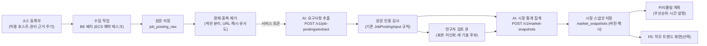

# 직무 공고 수집·통계 → 커리큘럼 반영 설계 (초안)

목표: 관련 직무 공고를 지속적으로 모아 **어떤 역량이 얼마나 중요한지 통계**를 내고, 그 통계를 커리큘럼의
단계 우선순위·시간 배분·설명 근거로 쓴다. 이 문서는 아직 구현 전 설계이며, 지금 구조([CAREER_AI_SERVICE.md](CAREER_AI_SERVICE.md))를
깨지 않고 확장하는 것을 원칙으로 한다.

## 0. 지금 구조에서 출발점

| 이미 있는 것 | 위치 | 이번 설계에서의 의미 |
|---|---|---|
| 공고 반입(연구자 수동) + 원문 인용 검사 | `JobPostingInput`, `job_requirements.py`, BE `job_posting_versions` | 수집한 공고도 같은 형식(원문 + 인용 구간)으로 저장해 기존 검사를 그대로 쓴다 |
| 요구사항별 빈도 통계 | `gap_analyzer.demand_statistics` → `DemandStatistic` | 30/90일 창 안의 공고 수 기준. 이를 "시장 스냅샷"으로 분리·확장한다 |
| 기술 카탈로그 12개 (데이터 엔지니어) | `skill_catalog.py` | 수집 공고에서 새 기술 후보를 찾아 연구자 승인 후 버전을 올린다 |
| 권리 근거 필드 | `rights_basis` (permission / public_api_license / research_authorization) | 수집 소스마다 권리 근거를 고정하고, 근거 없는 소스는 수집하지 않는다 |
| `annotation_method = "human_reviewed"` 만 허용 | `JobVersion` | 자동 추출 값(`auto_extracted`)을 추가하되, 통계와 개인 분석에서 쓰임을 구분한다 |

원칙(유지): AI 서비스는 DB·외부 접속 없는 계산기로 남고, **수집·저장·권한은 BE**가 맡는다.
공고 문구는 지시가 아닌 데이터로 다루며, 모든 요구사항은 원문 구간을 인용해야 한다.

## 1. 전체 흐름

## 2. 수집 (BE 배치)

### 2.1 소스 선택 우선순위
1. **공식 오픈 API·피드**: 고용24(워크넷) 채용정보 오픈API, 공공기관 채용(잡알리오) 등. `rights_basis = public_api_license`.
2. **제휴·허락 받은 소스**: 기업 채용 페이지(그리팅·그리터 등 ATS 공개 페이지 포함)는 사전 허락 또는 약관 확인 후. `permission`.
3. **연구 목적 수집**: 학교·지도교수 승인과 약관·robots.txt 확인을 거친 범위만. `research_authorization`.

> 국내 채용 플랫폼 데이터는 데이터베이스 제작자 권리·부정경쟁 판례가 있어, 대량 크롤링은 피하고 API·허락을 우선한다.
> 원문은 분석 목적 최소 보관(텍스트만, HTML·이미지·연락처 제외)하고 보관 기간을 둔다.

### 2.2 수집기 규칙 (보안·운영)
- **허용 호스트 목록**에 있는 HTTPS 주소만 요청(SSRF 방지, 리다이렉트도 같은 목록 안에서만), 응답 크기·시간 상한.
- 소스별 요청 간격·하루 상한, `robots.txt` 준수, 식별 가능한 User-Agent(연락처는 프로젝트 공용 주소).
- 원문은 텍스트로 정제(스크립트·스타일 제거) 후 저장. 채용 담당자 이름·전화·이메일은 마스킹.
- 실행 기록(`job_fetch_runs`): 소스, 시작·끝, 새로 수집/변경/마감 건수, 오류. 실패해도 이전 스냅샷은 유지.

### 2.3 정제·중복 제거
- 섹션 분리: "담당업무 / 자격요건 / 우대사항 / 기술스택 / 복지" 제목 패턴으로 구간을 나눠 중요도 판단에 쓴다
  (자격요건 → `required`, 우대사항 → `preferred`, 기술스택만 → `unspecified`).
- 중복: 정규화 URL(기존 `canonical_url`) → 본문 해시 → 근사 중복(MinHash/SimHash, 유사도 0.9 이상)을 같은 공고로 묶는다.
  같은 회사가 여러 플랫폼에 올린 공고, 재게시 공고를 하나로 센다.
- 마감·수정 추적: 같은 공고가 바뀌면 새 버전(`job_posting_versions`)으로 남기고, 통계는 최신 버전만 쓴다.

## 3. 요구사항 추출 (AI, 상태 없음)

새 엔드포인트 `POST /v1/job-postings/extract` (입력: 정제된 원문 + 섹션 구간, 출력: `Requirement` 후보 목록).

1. **규칙 추출(기본)**: 카탈로그 별칭 사전 매칭(기존 `skill_normalizer`) + 섹션 기반 중요도 + "또는/및" 해석(기존 `job_requirements`).
2. **LLM 보조(선택)**: 규칙이 놓친 구간에 대해 "원문 구간 인용 + 카탈로그 ID 선택"만 하게 한다. 원문에 없는 인용은 버린다
   (기존 출력 검사와 같은 방식). LLM 결과는 `confidence`와 `extractor` 이름을 붙인다.
3. **새 기술 후보 발견**: 카탈로그에 없는 기술 용어(영문 고유명사·버전 표기·"~경험" 패턴)를 빈도와 함께 모아 검토 큐로 보낸다.
   연구자가 승인하면 카탈로그 버전을 올린다(`skill_catalog_versions`). 자동으로 카탈로그에 넣지 않는다.

출력은 기존 `JobPostingInput` 검사(인용 구간 = 원문)를 그대로 통과해야 저장된다.
`annotation_method`에 `auto_extracted`를 추가하고 `extractor_version`, `confidence`를 기록한다.

### 품질 관리
- 주간 표본 검토: 자동 추출 공고 중 무작위 N건(예: 20건)을 연구자가 확인 → 정밀도·재현율 추적.
- 기준 미달(예: 정밀도 0.9 미만)인 추출기 버전은 통계에서 제외하고 이전 버전으로 되돌린다.
- 개인 직무 비교(`career-analyses`)의 **대상 공고**는 지금처럼 `human_reviewed`만 쓴다. 시장 통계는 자동 추출분도 쓰되 구분 표시.

## 4. 통계 (무엇이 중요한가)

새 엔드포인트 `POST /v1/market-snapshots` (입력: 기간 안의 공고 버전들, 출력: `MarketSnapshot`). 집계 단위는
직무(`role_id`) × 기간(30/90/180일) × 선택 필터(경력 수준, 지역).

| 지표 | 정의 | 용도 |
|---|---|---|
| 언급률 | 기술을 언급한 공고 수 / 전체 공고 수 (공고당 1회) | 기본 수요 |
| 필수 비율 | 자격요건에서 요구한 공고 / 언급 공고 | 필수 vs 우대 구분 |
| 중요도 점수 | `언급률 × (1.0·필수 + 0.5·우대 + 0.3·대안/불명) / 언급 공고` | 커리큘럼 우선순위 |
| 신뢰구간 | 언급률의 Wilson 95% 구간 | 표본이 적을 때 과신 방지 (구간 폭이 크면 "데이터 부족" 표시) |
| 추세 | 최근 30일 언급률 − 이전 90일 언급률 (또는 주별 기울기) | 떠오르는/줄어드는 기술 |
| 동시 출현 | 두 기술의 lift = P(A∧B) / (P(A)·P(B)) | 함께 배울 묶음, 선수 관계 후보 |
| 경력별 차이 | 신입/주니어/시니어별 언급률 | 사용자 경력 수준에 맞춘 우선순위 |

편향 보정:
- **회사 가중치**: 한 회사가 공고를 많이 올려 통계를 좌우하지 않게, 회사당 가중치 상한(예: 회사별 공고 가중 합 ≤ 3).
- **소스 편향**: 소스별 비중을 함께 보고, 한 소스가 80%를 넘으면 경고.
- **최소 표본**: 기간 내 공고가 30건 미만이면 90일→180일로 넓히고, 그래도 부족하면 통계를 "참고용"으로 표시(기존 30→90일 확장 규칙과 같은 방식).

`MarketSnapshot`은 내용 해시(RFC 8785)·카탈로그 버전·추출기 버전·표본 수·기간을 담아 BE가 `market_snapshots`에 저장한다.
기존 `DemandStatistic`은 스냅샷의 한 행으로 흡수하고, 직무 비교 결과에는 사용한 스냅샷 ID를 남긴다.

## 5. 커리큘럼에 반영

현재 계획기(`curriculum_planner.py`)는 "부족한 요구사항 → 단계"를 만든다. 여기에 스냅샷을 더한다.

1. **우선순위**: 사용자의 `not_evidenced`/`partially_supported` 기술을 중요도 점수 순으로 정렬. 필수 비율이 높은 기술을 앞에.
2. **순서**: 카탈로그의 선수 관계 + 동시 출현 lift가 높은 묶음을 인접 단계로 배치(예: Python → Spark → Airflow).
3. **시간 배분**: 기존 시간 하한을 유지하고, 남는 시간을 중요도 비율로 나눈다.
4. **설명 근거**: 각 단계에 "최근 90일 데이터 엔지니어 공고 212건 중 64%가 필수로 요구(95% 구간 57–70%)"처럼
   스냅샷 수치만 인용한다. LLM은 이 숫자를 바꾸거나 만들 수 없고, 출력 검사가 스냅샷 값과 대조한다.
5. **경력 수준 반영**: 사용자의 희망 경력 수준 필터로 만든 스냅샷을 우선 사용.

계약 변경: `PlanningInput`에 `market_snapshot`(요약: 기술별 점수·구간·추세·lift 상위)을 추가하고 `CONTRACT_ID`를 올린다
(`scripts/sync_contract_to_be.py`로 BE 사본 동기화). 스냅샷이 없으면 지금과 같은 동작(빈도 통계만)으로 동작해야 한다.

## 6. 데이터 모델 (BE 마이그레이션 11~)

| 테이블 | 주요 열 |
|---|---|
| `job_sources` | id, name, kind(api/feed/html), allowed_hosts, rights_basis, fetch_interval, daily_cap, enabled |
| `job_fetch_runs` | id, source_id, started_at, finished_at, fetched, new, updated, closed, errors JSONB |
| `job_posting_raw` | id, source_id, external_id, canonical_url, fetched_at, text, sections JSONB, content_hash, near_dup_group, expires_at |
| `job_posting_versions` (기존) | + annotation_method, extractor_version, confidence |
| `skill_catalog_versions` | version, catalog JSONB, approved_by, approved_at |
| `skill_term_candidates` | term, role_id, mentions, sample_quotes, status(pending/approved/rejected) |
| `market_snapshots` | id, role_id, window_days, filters JSONB, stats JSONB, sample_size, catalog_version, extractor_version, content_hash, created_at |

권한: 수집 작업은 별도 DB 계정(수집 테이블 INSERT/UPDATE만). 서비스 계정(`vc_app`)은 스냅샷 읽기만.
기존 마이그레이션 안전 검사(`DB_APP_ROLE`)와 같은 원칙으로 수집 계정도 최소 권한을 둔다.

## 7. API (안)

| 위치 | 엔드포인트 | 설명 |
|---|---|---|
| AI | `POST /v1/job-postings/extract` | 원문 → 요구사항 후보(인용 구간, 신뢰도) + 새 기술 후보 |
| AI | `POST /v1/market-snapshots` | 공고 버전들 → 시장 스냅샷(지표·구간·추세·lift) |
| BE | `GET /api/v1/market/snapshots/latest?role=&window=&seniority=` | 최신 스냅샷(로그인 사용자) |
| BE | `GET/POST /api/v1/research/extraction-reviews` | 연구자 검토 큐(표본·저신뢰·새 기술 후보 승인) |
| BE | `python -m app.jobs.collect [--source]` | 수집 배치 (ECS 예약 태스크, EventBridge 하루 1회 등) |

## 8. 평가 (논문·발표용)

- 추출 정확도: 연구자가 직접 라벨링한 공고 100건 기준 기술별 정밀도·재현율·F1, 중요도(필수/우대) 정확도.
- 통계 안정성: 기간·표본을 바꿔도 상위 기술 순위가 유지되는지(Kendall τ), 부트스트랩 구간.
- 커리큘럼 효과: 시장 통계 반영 전후 커리큘럼이 실제 공고 필수 기술을 얼마나 덮는지(coverage@k), 사용자 설문.
- 환각 감소: LLM 설명 문장의 수치가 스냅샷과 일치하는 비율(출력 검사 통과율).

## 9. 단계별 진행 (제안)

| 단계 | 내용 | 완료 기준 |
|---|---|---|
| P0 | 소스 선정·약관/권리 확인, 수집 대상 직무 확정 | 소스 등록부와 권리 근거 문서 |
| P1 | 수집 배치 + 원문 저장 + 중복 제거 | 하루 1회 수집, 중복률·실패율 기록 |
| P2 | 규칙 기반 추출 + 인용 검사 + 검토 큐 | 라벨 100건 기준 정밀도 0.9 이상 |
| P3 | 시장 스냅샷 집계·저장, 기존 `DemandStatistic` 대체 | 스냅샷 해시 재현 가능, 테스트 |
| P4 | 커리큘럼 우선순위·설명 반영(계약 버전 업) | 스냅샷 없을 때 기존과 동일 동작 |
| P5 | 새 기술 후보·카탈로그 버전 관리, 직무 확장, LLM 보조 추출 | 카탈로그 승인 흐름, 직무 2개 이상 |

## 10. 정해야 할 것

- 수집할 소스(공식 API만 vs 기업 채용 페이지 포함)와 권리 근거.
- 대상 직무: 데이터 엔지니어만 유지할지, 백엔드·데이터 분석가 등으로 넓힐지(카탈로그 확장 범위).
- LLM 보조 추출 사용 여부와 비용 상한.
- 연구자 검토에 쓸 수 있는 시간(주당 표본 수).
- 원문 보관 기간(예: 마감 후 180일)과 공개 범위.
