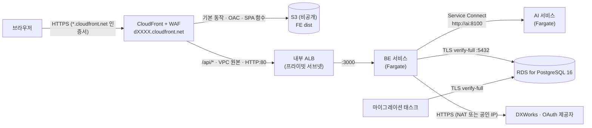

# AWS 배포 (도메인 없는 CloudFront 구성)

이 폴더는 자기 도메인 없이 CloudFront 기본 주소(`https://dXXXXXXXXXXXXX.cloudfront.net`, 아래 `<CLOUDFRONT_DOMAIN>`)로
서비스하는 구성의 배포 순서와 작업 정의 템플릿입니다. 리전은 서울(`ap-northeast-2`)입니다. 항목별 기준(비밀값 규칙, WAF 규칙,
보안 헤더, DB 권한 검사 등)은 [CHECKLIST.md](CHECKLIST.md)("AWS 배포 체크리스트")에 있고, 이 문서는 그 기준을 이 구성에서
어떤 순서·값으로 맞추는지 적습니다. 변수별 표는 [ENV_MATRIX.md](ENV_MATRIX.md)입니다.



- FE는 비공개 S3에 두고 CloudFront(OAC)로만 읽습니다. `/api/*`는 같은 배포판에서 **VPC 원본**으로 내부 ALB에 보냅니다
  (같은 출처라 `CORS_ORIGINS`가 필요 없음).
- ALB에 공인 인증서(ACM)를 붙이려면 자기 도메인이 있어야 하므로, CloudFront → ALB 구간은 VPC 원본의 비공개 연결 위에서
  HTTP:80으로 둡니다. ALB는 인터넷에 열지 않습니다.
- BE·AI는 ECS Fargate 서비스, DB 마이그레이션은 같은 BE 이미지로 도는 일회성 태스크입니다. 비밀값은 Secrets Manager,
  로그는 CloudWatch Logs입니다.

## 이 폴더의 파일

| 파일 | 내용 |
|---|---|
| [ENV_MATRIX.md](ENV_MATRIX.md) | BE 서비스·마이그레이션 태스크·AI 서비스·FE 빌드·제공자 콘솔별 변수 표 (필수 여부, 이 구성의 값, 비밀값 여부, 검사하는 코드, 틀리면 생기는 일) |
| [ecs/be-service.taskdef.json](ecs/be-service.taskdef.json) | BE 서비스 작업 정의 (1단계: 소셜 로그인 변수 없음. 2단계에 더할 항목은 아래 ⑪) |
| [ecs/be-migrate.taskdef.json](ecs/be-migrate.taskdef.json) | 마이그레이션 태스크 작업 정의 (`python -m app.migrate`, 마스터 사용자 비밀, `DB_APP_ROLE=vc_app`) |
| [ecs/ai-service.taskdef.json](ecs/ai-service.taskdef.json) | AI 서비스 작업 정의 (포트 매핑 이름 `ai-http`) |
| [ecs/be-market-import.taskdef.json](ecs/be-market-import.taskdef.json) | (선택) 시장 통계 반입 일회성 태스크 작업 정의 (스냅샷을 더한 이미지 `vc-be:<TAG>-market`, 서비스 계정 비밀, 아래 "⑤-1") |
| [cloudfront/spa-fallback.js](cloudfront/spa-fallback.js) | 기본(S3) 동작의 뷰어 요청 CloudFront Function (SPA 되돌리기). ASCII만 씀(설명은 아래 시험 파일 머리) |
| [cloudfront/spa-fallback.test.cjs](cloudfront/spa-fallback.test.cjs) | 위 함수의 설명과 로컬 확인 스크립트: `node deploy/cloudfront/spa-fallback.test.cjs` (CloudFront에는 올리지 않음) |

작업 정의 파일은 `aws ecs register-task-definition --cli-input-json`이 받는 RegisterTaskDefinition 요청 형식이고, 계정마다
다른 값은 꺾쇠 자리표시(`<ACCOUNT_ID>` 등)로만 적혀 있습니다(실제 값·비밀값 없음). JSON에는 주석을 넣을 수 없으므로 설명은
이 문서에 둡니다. 자리표시를 채운 사본은 저장소 밖에 두고 커밋하지 않습니다.

```bash
cp deploy/ecs/be-service.taskdef.json /tmp/vc-be.json     # 저장소 밖 사본을 편집기로 채운다
grep -n '<[A-Z0-9_]*>' /tmp/vc-be.json                    # 아무것도 나오지 않아야 한다
aws ecs register-task-definition --region ap-northeast-2 --cli-input-json file:///tmp/vc-be.json
```

| 자리표시 | 채울 값 |
|---|---|
| `<ACCOUNT_ID>` | AWS 계정 ID (12자리) |
| `<REGION>` | `ap-northeast-2` |
| `<TAG>` | ③에서 푸시한 이미지 태그(커밋 해시 등). BE·AI·마이그레이션 모두 같은 커밋의 태그 |
| `<RDS_ENDPOINT>` | RDS 엔드포인트 이름 그대로(`<식별자>.<해시>.ap-northeast-2.rds.amazonaws.com`). IP·CNAME 금지 |
| `<VPC_CIDR>` | VPC CIDR (예: `10.0.0.0/16`) |
| `<SECRET_ARN_BE_APP>`, `<SECRET_ARN_AI_TOKEN>`, `<SECRET_ARN_DB_APP>`, `<SECRET_ARN_RDS_MASTER>` | ④의 비밀 ARN 전체(끝의 `-AbCdEf` 접미사 포함). RDS 관리형 마스터 비밀은 `rds!db-…` 이름 |
| `<DXWORKS_BADGE_TEMPLATE_ID>` | 시연용 배지 템플릿 ID (협력사 제공) |
| `<CLOUDFRONT_DOMAIN>`, `<GOOGLE_CLIENT_ID>`, `<GITHUB_CLIENT_ID>`, `<NAVER_CLIENT_ID>` | ⑪(2단계)에서만 씀 |

## 배포 순서

1단계(①~⑩)는 소셜 로그인 없이 끝까지 배포해 CloudFront 주소를 얻고 연기 시험까지 하는 단계이고, 2단계(⑪)는 그 주소로
제공자 콘솔과 `*_REDIRECT_URI`를 맞춰 BE만 다시 배포하는 단계입니다. CloudFront 주소는 배포판을 만든 뒤에야 알 수 있고,
BE는 운영에서 제공자 설정이 반쯤 들어 있으면(ID·시크릿 중 하나만, 또는 콜백 주소 없음) 시작하지 않기 때문입니다.

### ① 네트워크 · ECR

- VPC 하나에 가용 영역 2개, 영역마다 퍼블릭 서브넷 1개와 프라이빗 서브넷 2개(앱용·DB용). **인터넷 게이트웨이는 필수**입니다:
  CloudFront VPC 원본은 VPC에 인터넷 게이트웨이가 붙어 있어야 만들 수 있습니다(라우팅에는 쓰지 않음). 내부 ALB는 프라이빗
  서브넷 2개(두 영역)에 둡니다. 네트워크 ACL을 기본값에서 바꾼다면 아웃바운드에 임시 포트(1024–65535)를 열어 둡니다(VPC 원본은
  인바운드 NACL을 보지 않지만 돌아가는 길의 아웃바운드는 봄).
- **태스크의 아웃바운드(egress)**: 태스크가 시작하려면 ECR(이미지), Secrets Manager(비밀값), CloudWatch Logs(로그)에 닿아야
  합니다. 둘 중 하나를 고릅니다.

  | | A. 프라이빗 서브넷 + NAT 게이트웨이 (권장) | B. 퍼블릭 서브넷 + 태스크 공인 IP |
  |---|---|---|
  | 태스크 위치 | 앱용 프라이빗 서브넷, `assignPublicIp=DISABLED` | 퍼블릭 서브넷, `assignPublicIp=ENABLED` |
  | 나가는 IP | NAT의 탄력적 IP 하나로 고정 (DXWorks가 IP 허용 목록을 요구하면 이쪽) | 태스크마다 바뀜 (IP 허용 목록 불가) |
  | 들어오는 접속 | 없음 | 보안 그룹으로 막음(아래 표 외 인바운드 없음) |
  | 비용 | NAT 시간당 요금 + 처리한 GB당 요금 + 그 공인 IPv4. ECR 이미지 층은 S3에서 받으므로 S3 게이트웨이 엔드포인트(무료)를 두면 NAT 처리량이 줄어듦 | 태스크 공인 IPv4마다 시간당 $0.005 |
  | CloudShell VPC 환경(②) | 같은 프라이빗 서브넷에서 인터넷 사용 가능 | 퍼블릭 서브넷의 CloudShell은 인터넷이 없음 → ②의 대안 사용 |

  NAT·엔드포인트의 서울 리전 금액은 [Amazon VPC 요금](https://aws.amazon.com/vpc/pricing/) 페이지에서 확인합니다(이 문서에서
  확인하지 못함). B에서도 RDS와 내부 ALB는 프라이빗 서브넷에 둡니다.
  - 비용: NAT 처리량을 무료로 줄이는 것은 **S3 게이트웨이 엔드포인트**뿐입니다(ECR 이미지 층). ECR(`ecr.api`·`ecr.dkr`)·
    `secretsmanager`·`logs` **인터페이스 엔드포인트**는 엔드포인트·가용 영역마다 시간 요금이 붙어(us-east-1 예: ENI당
    시간당 $0.01 → 4개 × 2개 영역 ≈ 월 $58) BE가 부르는 DXWorks·소셜 로그인 제공자 때문에 NAT(또는 B)를 그대로 두는 이
    구성에서는 **비용이 늘어납니다**(이 앱이 태스크 시작마다 받는 이미지는 약 120 MB라 줄어드는 NAT 처리 요금은 적음).
  - 보안 선택지: 인터페이스 엔드포인트는 ECR·Secrets Manager·Logs로 가는 트래픽이 VPC 밖으로 나가지 않게 하고 싶을 때만
    더합니다(비용이 늘어나는 것을 받아들이는 결정).

  | 누가 | 어디로 (HTTPS 443) | 언제 |
  |---|---|---|
  | 모든 태스크 | ECR, S3(이미지 층), Secrets Manager, CloudWatch Logs | 태스크 시작·실행 중 |
  | BE 서비스 | DXWorks 호스트 | 배지 발급·검증·재검증·포트폴리오·직무 비교 |
  | BE 서비스 | Google `oauth2.googleapis.com`·`openidconnect.googleapis.com`, GitHub `github.com`·`api.github.com`, 네이버 `nid.naver.com`·`openapi.naver.com` | 켠 소셜 로그인의 콜백 처리 (인가 화면은 브라우저가 엶) |
  | AI 서비스 | Google Gemini API `generativelanguage.googleapis.com` (OpenAI 호환 공급자를 쓰면 `CURRICULUM_LLM_BASE_URL`의 호스트) | LLM 모드를 켰을 때만 (기본 꺼짐) |
  | 마이그레이션 태스크 | 없음 (AWS 쪽과 RDS만) | — |

- 보안 그룹 (인바운드):

  | 보안 그룹 | 인바운드 |
  |---|---|
  | `sg-alb` (내부 ALB) | TCP 80 ← `CloudFront-VPCOrigins-Service-SG` (⑧에서 VPC 원본을 만든 뒤 추가. 그 전에는 비워 둠) |
  | `sg-be` (BE 서비스·마이그레이션·시장 통계 태스크) | TCP 3000 ← `sg-alb` |
  | `sg-ai` (AI 서비스) | TCP 8100 ← `sg-be` |
  | `sg-rds` | TCP 5432 ← `sg-be` (②의 CloudShell 보안 그룹은 작업하는 동안만) |

  아웃바운드는 **기본값(모두 허용)으로 둡니다**. 보안 그룹은 IP 범위·접두사 목록·다른 보안 그룹만 가리킬 수 있어 위 표의
  호스트 이름 단위로는 막을 수 없습니다(호스트 이름 단위 제한이 필요하면 AWS Network Firewall 등 별도 서비스). 그래도 좁히려면
  VPC 안 경로까지 함께 엽니다. 빠뜨리면 BE는 `connection timed out (check DB_HOST, DB_PORT and security groups)`로 시작하지
  못하고, `/career`는 503, CloudFront는 502가 됩니다.

  | 보안 그룹 | 좁힐 때의 아웃바운드 |
  |---|---|
  | `sg-be` | TCP 443 → `0.0.0.0/0`(ECR·Secrets Manager·Logs·DXWorks·OAuth 제공자), TCP 5432 → `sg-rds`, TCP 8100 → `sg-ai` |
  | `sg-ai` | TCP 443 → `0.0.0.0/0`(ECR·Secrets Manager·Logs, LLM을 켰다면 `generativelanguage.googleapis.com`) |
  | `sg-alb` | TCP 3000 → `sg-be` |

- **CloudWatch 로그 그룹을 먼저 만듭니다.** 네 작업 정의 모두 `awslogs`로 `/ecs/vc-be`(스트림 접두사 `be`·`migrate`·`market`)와
  `/ecs/vc-ai`(`ai`)에 쓰는데, 작업 정의에 `awslogs-create-group`을 넣지 않았고(기본값 false) 실행 역할의
  `AmazonECSTaskExecutionRolePolicy`에는 로그 그룹을 만드는 권한이 없습니다. 그룹이 없으면 ⑤의 첫 태스크부터
  `ResourceInitializationError`(… `The specified log group does not exist`)로 시작하지 못합니다. 보존 기간도 함께 정합니다
  (기본값은 만료 없음, 예: 30일).

  ```bash
  for g in /ecs/vc-be /ecs/vc-ai; do
    aws logs create-log-group --region ap-northeast-2 --log-group-name "$g"
    aws logs put-retention-policy --region ap-northeast-2 --log-group-name "$g" --retention-in-days 30
  done
  ```

- ECR 리포지토리 `vc-be`·`vc-ai`를 만들고 태그 불변(`IMMUTABLE`)으로 둡니다(같은 태그로 다른 이미지를 덮어쓰지 못하게.
  되돌릴 때는 이전 태그를 배포). 이전 태그 몇 개는 수명 주기 규칙에서 남겨 둡니다.

  ```bash
  aws ecr create-repository --region ap-northeast-2 --repository-name vc-be --image-tag-mutability IMMUTABLE
  aws ecr create-repository --region ap-northeast-2 --repository-name vc-ai --image-tag-mutability IMMUTABLE
  ```

### ② RDS for PostgreSQL 16 · `vc_app` 만들기

- 엔진 PostgreSQL 16, DB용 프라이빗 서브넷의 DB 서브넷 그룹, **퍼블릭 액세스 없음**, 보안 그룹 `sg-rds`, 저장 데이터 암호화 켬.
  "초기 데이터베이스 이름"은 작업 정의의 `DB_NAME`과 같은 `vc_career_agent`로 둡니다. 마스터 사용자 비밀번호는 "AWS Secrets
  Manager에서 관리"를 고릅니다(RDS 관리형 비밀 `rds!db-…`, 기본 7일마다 교체. 마이그레이션 태스크는 시작할 때 읽으므로 그대로 씀).
- RDS for PostgreSQL 15 이상은 `rds.force_ssl` 기본값이 1이라 TLS가 아닌 접속은 거절됩니다. 기본 파라미터 그룹이면 그대로 둡니다.
  인스턴스 클래스의 `max_connections`는 [CHECKLIST.md](CHECKLIST.md) "DB 연결 수"의 식(BE 태스크 최대 수 × `DB_MAX_CONNECTIONS` + 1 + 여유)보다
  크게 잡습니다.
- BE 서비스 계정 `vc_app`을 마스터 사용자로 한 번 만듭니다. RDS는 비공개이므로 **CloudShell VPC 환경**에서 접속합니다(`psql`이
  미리 설치되어 있음. VPC 환경은 사용자마다 2개까지, 저장소는 세션이 끝나면 지워짐).
  1. CloudShell → "Create VPC environment": 이 VPC, 앱용 프라이빗 서브넷(A 구성: NAT가 있어 인터넷 사용 가능), 보안 그룹
     `sg-cloudshell`(인바운드 없음). `sg-rds`에 TCP 5432 ← `sg-cloudshell`을 잠시 더합니다.
  2. BE 서비스 계정의 비밀 `vc/db-app`을 지금 만듭니다(④의 표에 있는 비밀 중 이것만 ②에서 먼저 만듦. 값은 화면에 찍지
     않고 `aws` 출력에는 ARN·이름만 나옴). Secrets Manager 콘솔의 "비밀 값 검색"에서 `password`를 복사해 둡니다.

     ```bash
     umask 077
     python3 -c 'import json, secrets; print(json.dumps({"username": "vc_app", "password": secrets.token_urlsafe(32)}))' > db-app.json
     aws secretsmanager create-secret --region ap-northeast-2 --name vc/db-app --secret-string file://db-app.json
     rm -f db-app.json
     ```
  3. CloudShell VPC 환경에서:

     ```bash
     curl --proto '=https' -fsS -o global-bundle.pem https://truststore.pki.rds.amazonaws.com/global/global-bundle.pem
     sha256sum global-bundle.pem   # BE/certs/README.md의 SHA-256과 같은지 (다르면 AWS가 묶음을 갱신한 것: 이미지 묶음도 갱신)
     psql "host=<RDS_ENDPOINT> port=5432 dbname=vc_career_agent user=<마스터 사용자> sslmode=verify-full sslrootcert=global-bundle.pem"
     ```

     마스터 비밀번호는 RDS 관리형 비밀에서 복사해 프롬프트에 붙여 넣습니다. `psql` 안에서
     `CREATE ROLE vc_app LOGIN;` 다음 `\password vc_app`에 2.의 값을 붙여 넣습니다(비밀번호가 셸 기록·DB 로그에 남지 않음).
     `vc_app`에 주면 안 되는 권한·소속은 [CHECKLIST.md](CHECKLIST.md) "DB 마이그레이션"의 서비스 계정 항목대로입니다.
  4. 끝나면 `sg-rds`의 CloudShell 규칙을 지우고 VPC 환경을 지웁니다.

  B 구성(NAT 없음)이면 CloudShell VPC 환경에 인터넷이 없어 CA 묶음을 받을 수 없고 파일 올리기도 막혀 있습니다. 그래도
  `sslmode=require`(서버 인증서를 확인하지 않음)로 낮추지 않고, 저장소에 든 묶음에서 서울 리전 CA 3개만 뽑아 붙여 넣습니다
  (공개 인증서라 비밀값이 아님. 약 5 KB). 어느 쪽이든 RDS를 퍼블릭으로 바꾸지 않습니다.

  ```bash
  # 개발 PC(저장소 최상위)에서: ap-northeast-2 루트 CA(RSA2048·RSA4096·ECC384)만 꺼내 화면에 출력
  openssl crl2pkcs7 -nocrl -certfile BE/certs/rds-global-bundle.pem | openssl pkcs7 -print_certs \
    | awk '/^subject=/ {keep = /ap-northeast-2/} keep' > rds-ca-apne2.pem
  grep -c 'BEGIN CERTIFICATE' rds-ca-apne2.pem   # 3
  cat rds-ca-apne2.pem
  ```

  CloudShell VPC 환경에서 `cat > rds-ca.pem <<'EOF'`를 입력하고 위 출력을 붙여 넣은 뒤 `EOF` 한 줄로 닫고, 3.의 `psql`을
  `sslmode=verify-full sslrootcert=rds-ca.pem`으로 실행합니다(RDS 인스턴스가 서울 리전의 기본 CA를 쓰면 이 3개 중 하나로
  확인됨). 또는 SSM Session Manager로만 접속하는 임시 EC2 인스턴스(프라이빗 서브넷, 인바운드 없음)를 씁니다.

### ③ 이미지 빌드 · 푸시 (`--platform linux/amd64`)

Fargate 작업 정의는 `runtimePlatform.cpuArchitecture: X86_64`입니다. Apple Silicon Mac에서 `--platform` 없이 빌드하면 arm64
이미지가 되어 태스크가 시작하지 못하므로 항상 `linux/amd64`로 빌드합니다. BE·AI는 같은 커밋으로 만들고 함께 배포합니다(공유
계약 ID가 다르면 직무 비교 API가 502). BE 이미지에는 RDS CA 묶음(`/app/certs/rds-global-bundle.pem`)과
`PGSSLROOTCERT` 기본값이 들어 있으므로 따로 파생 이미지를 만들지 않습니다([BE/certs/README.md](../BE/certs/README.md)).

```bash
REG=<ACCOUNT_ID>.dkr.ecr.ap-northeast-2.amazonaws.com
TAG=<커밋 해시>
aws ecr get-login-password --region ap-northeast-2 | docker login --username AWS --password-stdin $REG
docker build --platform linux/amd64 -t $REG/vc-be:$TAG BE
docker build --platform linux/amd64 -t $REG/vc-ai:$TAG ai
docker image inspect --format '{{.Os}}/{{.Architecture}}' $REG/vc-be:$TAG $REG/vc-ai:$TAG   # linux/amd64 두 줄
docker push $REG/vc-be:$TAG
docker push $REG/vc-ai:$TAG
```

### ④ Secrets Manager · 실행 역할

| 비밀 | 형식 · 키 | 연결하는 작업 정의 | 읽는 실행 역할 |
|---|---|---|---|
| `vc/be-app` | JSON: `JWT_SECRET`, `HOLDER_KEY_ENCRYPTION_KEY`, `DXWORKS_API_HOST`, `DXWORKS_API_KEY` (⑪에서 `GOOGLE_CLIENT_SECRET`·`GITHUB_CLIENT_SECRET`·`NAVER_CLIENT_SECRET` 추가) | BE 서비스 | `vc-be-execution` |
| `vc/ai-token` | 평문 값 하나: `AI_SERVICE_TOKEN` | BE 서비스, AI 서비스 | `vc-be-execution`, `vc-ai-execution` |
| `vc/db-app` | JSON: `username`(=`vc_app`), `password` | BE 서비스 (시장 통계 반입 태스크) | `vc-be-execution` |
| `rds!db-…` (RDS 관리형) | JSON: `username`, `password` (마스터 사용자) | 마이그레이션 태스크만 | `vc-migrate-execution` |
| `vc/ai-llm` (선택, LLM을 켤 때만 ⑥) | JSON: `GEMINI_API_KEY` | AI 서비스 | `vc-ai-execution` |

- IAM은 비밀 단위로 허용하고 JSON 키 단위로는 나누지 못합니다. 그래서 `AI_SERVICE_TOKEN`은 따로 두어 AI 실행 역할이 BE 비밀
  전체를 읽지 않게 하고, 마스터 사용자 비밀은 마이그레이션 실행 역할만 읽게 합니다.
- **값만** 넣습니다. [GETTING_STARTED.md](../docs/GETTING_STARTED.md) 2번의 로컬용 명령처럼 `JWT_SECRET=…` 꼴로 이름째 넣으면 `HOLDER_KEY_ENCRYPTION_KEY`는 시작이
  거부되고(`HOLDER_KEY_ENCRYPTION_KEY must decode to 32 bytes` 한 줄, 종료 코드 1) 나머지는 조용히 다른 값이 됩니다. 끝 줄바꿈·공백도 넣지 않습니다(`AI_SERVICE_TOKEN`에 공백·줄바꿈이 있으면 BE가
  AI 기능을 503 `AI_SERVICE_NOT_CONFIGURED`로 막음). 비밀값은 용도마다 따로 만들고(같은 값이면 BE가 시작하지 않음) 개발용 값을
  다시 쓰지 않습니다.
- 값을 화면에 찍지 않고 만드는 예 (`aws` 출력에는 ARN·이름만 나옴). `vc/db-app`은 ②에서 이미 만들었습니다.

  ```bash
  umask 077
  python3 -c 'import base64, json, os, secrets; print(json.dumps({"JWT_SECRET": secrets.token_urlsafe(48), "HOLDER_KEY_ENCRYPTION_KEY": base64.b64encode(os.urandom(32)).decode()}))' > be-app.json
  aws secretsmanager create-secret --region ap-northeast-2 --name vc/be-app --secret-string file://be-app.json
  rm -f be-app.json
  aws secretsmanager create-secret --region ap-northeast-2 --name vc/ai-token \
    --secret-string "$(python3 -c 'import secrets; print(secrets.token_urlsafe(48))')"
  ```

  `DXWORKS_API_HOST`(`https://` 주소)·`DXWORKS_API_KEY`는 협력사 값이므로 콘솔에서 `vc/be-app`을 편집해 키를 더합니다. BE 작업
  정의는 이 두 키를 참조하므로, 아직 협력사 값이 없으면 작업 정의 사본에서 두 줄을 지웁니다(없는 JSON 키를 참조하면 태스크가
  비밀값을 가져오지 못해 시작하지 않음. 키를 빼면 BE는 뜨고 DXWorks 기능만 503 `PROVIDER_NOT_CONFIGURED`).
- 실행 역할 세 개(`vc-be-execution`, `vc-ai-execution`, `vc-migrate-execution`)는 신뢰 주체 `ecs-tasks.amazonaws.com`, 관리형
  정책 `AmazonECSTaskExecutionRolePolicy`(ECR·로그)에 위 표의 비밀만 읽는 인라인 정책을 더합니다. 고객 관리형 KMS 키로 암호화한
  비밀이면 그 키의 `kms:Decrypt`도 더합니다. Service Connect TLS(⑥ 선택지 A)는 `ecs-sc!`로 시작하는 비밀을 직접 만들므로,
  `GetSecretValue`를 `*`로 주지 않습니다.

  ```json
  {
    "Version": "2012-10-17",
    "Statement": [
      {
        "Effect": "Allow",
        "Action": "secretsmanager:GetSecretValue",
        "Resource": ["<SECRET_ARN_BE_APP>", "<SECRET_ARN_AI_TOKEN>", "<SECRET_ARN_DB_APP>"]
      }
    ]
  }
  ```

- 태스크 역할 `vc-task-no-aws-access`는 정책 없이 만듭니다(신뢰 주체 `ecs-tasks.amazonaws.com`). BE·AI 코드는 AWS API를 부르지
  않습니다. ECS Exec를 켤 때만 여기에 권한을 더합니다.
- ECS는 비밀값을 컨테이너가 시작할 때만 넣습니다. 값을 바꾸면 서비스를 "새 배포 강제"로 다시 띄웁니다.

### ⑤ 마이그레이션 태스크 (종료 코드 0 확인)

클러스터 `vc`(Fargate, Service Connect 기본 네임스페이스 `vc`)를 만들고 [ecs/be-migrate.taskdef.json](ecs/be-migrate.taskdef.json)을
채워 등록한 뒤 한 번 실행합니다. 명령은 `["python", "-m", "app.migrate"]`이고 `--seed`는 쓰지 않습니다(운영에서는 접속 전에
거부). `DB_APP_ROLE=vc_app`이 있어야 실행기가 끝날 때 `vc_app`에 앱 테이블 DML 권한만 줍니다. 로그 그룹(①)이 먼저 있어야 합니다.

```bash
aws ecs create-cluster --region ap-northeast-2 --cluster-name vc --service-connect-defaults namespace=vc
# (자리표시를 채운 사본을 저장소 밖에 두고) aws ecs register-task-definition --region ap-northeast-2 --cli-input-json file:///tmp/vc-be-migrate.json
TASK=$(aws ecs run-task --region ap-northeast-2 --cluster vc --launch-type FARGATE --task-definition vc-be-migrate \
  --network-configuration 'awsvpcConfiguration={subnets=[<SUBNET_APP_A>,<SUBNET_APP_B>],securityGroups=[<SG_BE>],assignPublicIp=DISABLED}' \
  --query 'tasks[0].taskArn' --output text)
aws ecs wait tasks-stopped --region ap-northeast-2 --cluster vc --tasks "$TASK"
aws ecs describe-tasks --region ap-northeast-2 --cluster vc --tasks "$TASK" \
  --query 'tasks[0].{exitCode: containers[0].exitCode, reason: stoppedReason}'
```

`--service-connect-defaults namespace=vc`는 클러스터의 기본 Service Connect 네임스페이스로 Cloud Map HTTP 네임스페이스 `vc`를
함께 만듭니다(이미 있으면 그것을 씀. 콘솔은
클러스터 만들기의 "Service Connect 기본값"·"기본 네임스페이스"). `exitCode`가 0이면 다음으로 갑니다(B 구성이면 퍼블릭 서브넷과
`assignPublicIp=ENABLED`).

- `exitCode`가 **`null`(없음)** 이면 컨테이너가 시작조차 못 한 것입니다. `reason`(`stoppedReason`)을 봅니다: 로그 그룹 없음
  (`ResourceInitializationError` … `The specified log group does not exist` → ①의 로그 그룹), 이미지·비밀값을 받지 못함(아래
  "문제 해결"의 `ResourceInitializationError`·`CannotPullContainerError` 행).
- **1**이면 배포를 멈추고 로그 그룹 `/ecs/vc-be`의 `migrate/…` 스트림에서 `마이그레이션 실패:` 줄을 봅니다. TLS 설정이 빠진
  경우는 접속하기 전에 바로 한 줄로 끝납니다(60초 접속 대기 없음):

  ```text
  ERROR:app.migrate:마이그레이션 실패: APP_ENV=production requires PGSSLMODE (verify-full or verify-ca in production), PGSSLROOTCERT (readable CA bundle file)
  ```

  `DB_PASSWORD`와 TLS가 함께 틀렸으면 먼저 `DB_PASSWORD`를 알리고, 고친 뒤 다시 실행하면 TLS 이름을 알립니다.
- 접속 단계의 오류는 운영 시작 DB 점검(아래)과 같은 안전한 요약(DB 주소·IP·사용자 이름·인증서 경로 없음)으로 남습니다. 다시
  해도 같은 오류(CA 묶음에 없는 인증서·호스트 이름 불일치·비밀번호·없는 역할·DB, `pg_hba.conf`)는 기다리지 않고 바로 한 줄입니다:

  ```text
  ERROR:app.migrate:마이그레이션 실패: DB에 접속하지 못했습니다: OperationalError: server certificate verification failed (check PGSSLROOTCERT: RDS CA bundle)
  ```

  연결 거부·시간 초과·DB가 시작·복구 중인 경우만 60초 동안 2초마다 다시 시도하며 `INFO:app.migrate:DB 연결 대기 중: <요약>`을
  남기고, 그래도 안 되면 `마이그레이션 실패: DB에 접속하지 못했습니다: <요약>` 한 줄로 끝납니다. 요약별 원인은 "문제 해결" 표와 같습니다.

서비스를 갱신하기 전에는 매번 새 이미지 태그로 이 태스크를 먼저 실행합니다.

### ⑤-1 (선택) 직무별 시장 통계 반입 (마이그레이션 다음, 일회성 태스크)

넣지 않으면 직무 비교 화면의 "직무별 요구 역량 통계" 카드만 보이지 않습니다. 넣을 파일 `ai/data/market_snapshots/*.json`
(집계 결과, 공고 원문 없음)은 BE 이미지에 들어 있지 않습니다. `run-task`의 컨테이너 덮어쓰기로는 명령만 바꿀 수 있고 이미지는
바꿀 수 없으므로, **스냅샷만 더한 이미지를 따로 태그**하고 **그 이미지를 쓰는 일회성 작업 정의**
[ecs/be-market-import.taskdef.json](ecs/be-market-import.taskdef.json)으로 실행합니다. ECR 태그가 불변이므로 서비스 이미지와
다른 태그(`<TAG>-market`)를 씁니다. 빌드 컨텍스트는 스냅샷 폴더 하나뿐이라 저장소의 다른 파일(`.env`·`.venv` 등)은 빌더에
보내지 않습니다.

```bash
REG=<ACCOUNT_ID>.dkr.ecr.ap-northeast-2.amazonaws.com
TAG=<③의 커밋 해시>
docker build --platform linux/amd64 -t $REG/vc-be:$TAG-market -f - ai/data/market_snapshots <<EOF
FROM $REG/vc-be:$TAG
COPY *.json /app/market_snapshots/
EOF
docker push $REG/vc-be:$TAG-market
# be-market-import.taskdef.json 사본의 <TAG>를 같은 커밋 해시로 채워 등록한 뒤
TASK=$(aws ecs run-task --region ap-northeast-2 --cluster vc --launch-type FARGATE --task-definition vc-be-market-import \
  --network-configuration 'awsvpcConfiguration={subnets=[<SUBNET_APP_A>,<SUBNET_APP_B>],securityGroups=[<SG_BE>],assignPublicIp=DISABLED}' \
  --query 'tasks[0].taskArn' --output text)
aws ecs wait tasks-stopped --region ap-northeast-2 --cluster vc --tasks "$TASK"
aws ecs describe-tasks --region ap-northeast-2 --cluster vc --tasks "$TASK" \
  --query 'tasks[0].{exitCode: containers[0].exitCode, reason: stoppedReason}'
```

- 명령은 `python -m app.jobs.market import --dir /app/market_snapshots`이고 `DB_*`·`PGSSLMODE=verify-full`만 씁니다(서비스
  계정 `vc_app`의 권한으로 충분, 앱 비밀값 없음). CA 묶음과 `PGSSLROOTCERT`는 BE 이미지에서 물려받습니다.
- 종료 코드 0이면 성공(로그 `/ecs/vc-be`의 `market/…` 스트림, `가져온 통계: {…}`의 `False`는 같은 내용이 이미 있음), 1이면
  `실패: …` 한 줄의 이유를 봅니다. 같은 파일로 다시 실행해도 안전합니다.
- 대신 같은 `DB_*`·`PGSSLMODE=verify-full`·`PGSSLROOTCERT`(RDS CA 묶음)로 VPC 안의 다른 호스트(CloudShell VPC 환경 등, BE
  의존성 설치 필요)에서 실행해도 됩니다. 공고 수집(`collect`)·통계 계산(`snapshot`)은 이 절차에 넣지 않습니다([CHECKLIST.md](CHECKLIST.md)
  "DB 마이그레이션"의 시장 통계 항목).

### ⑥ AI 서비스 + Service Connect

[ecs/ai-service.taskdef.json](ecs/ai-service.taskdef.json)을 등록하고 AI 서비스를 만듭니다(로드밸런서 없음, 앱용 프라이빗
서브넷, `sg-ai`, 배포 회로 차단기와 롤백 켬). Service Connect 설정(`create-service --service-connect-configuration`):

```json
{
  "enabled": true,
  "namespace": "vc",
  "services": [
    {
      "portName": "ai-http",
      "discoveryName": "ai",
      "clientAliases": [{ "dnsName": "ai", "port": 8100 }],
      "timeout": { "perRequestTimeoutSeconds": 120 },
      "tls": {
        "issuerCertificateAuthority": { "awsPcaAuthorityArn": "<PRIVATE_CA_ARN>" },
        "roleArn": "arn:aws:iam::<ACCOUNT_ID>:role/ecsInfrastructureRole"
      }
    }
  ]
}
```

- `portName`은 작업 정의의 포트 매핑 이름 `ai-http`와 같아야 합니다. 포트 매핑의 `appProtocol: http`는 Service Connect 서비스를
  만든 뒤에는 바꿀 수 없습니다(서비스를 지우고 다시 만들어야 함).
- `clientAliases`의 `dnsName: ai`·`port: 8100`이 BE의 `AI_SERVICE_URL=http://ai:8100`과 짝입니다. 별칭이 없으면 기본 이름이
  `ai.vc`(`discoveryName.namespace`)라 `http://ai:8100`이 풀리지 않아 `/career`가 503입니다.
- 요청별 제한 시간 기본값은 15초라 LLM 커리큘럼(BE가 최대 90초 기다림)이 끊기므로 120초로 둡니다. 유휴 제한 기본값(HTTP 5분)은
  이보다 길어 그대로 둡니다.
- Service Connect 프록시가 태스크마다 붙으므로 작업 정의의 CPU·메모리에 256 CPU 단위·64 MiB 이상을 더해 두었습니다(아래 "작업
  크기"). 컨테이너 단위 메모리 상한은 두지 않습니다.
- BE 서비스는 같은 네임스페이스의 **클라이언트**로 켜고(`{"enabled": true, "namespace": "vc"}`, `services` 없음) **AI 서비스가
  안정된 다음에** 배포합니다. Service Connect 끝점은 그 배포 뒤에 새로 시작한 같은 네임스페이스의 태스크만 풀 수 있으므로, AI의
  Service Connect 설정을 바꾸면 BE도 "새 배포 강제"로 다시 띄웁니다. 단독 태스크(`run-task`)는 Service Connect를 쓰지 못하지만
  마이그레이션·시장 통계 태스크는 AI가 필요 없습니다.

BE ↔ AI 구간 암호화는 셋 중 하나를 고릅니다(BE→AI 요청에는 서비스 토큰과 학생의 검증된 이력이 실림):

| | A. Service Connect TLS (기본 권장) | B. TLS 없이 프라이빗 서브넷 + 보안 그룹만 | C. AI를 BE 태스크의 두 번째 컨테이너로 |
|---|---|---|---|
| 설정 | 위 JSON 그대로. 아래 "선택지 A 준비" 1~4 | 위 JSON에서 `tls` 블록만 뺌 | AI 서비스·Service Connect를 만들지 않고 BE 작업 정의에 아래 컨테이너를 더함. BE의 `AI_SERVICE_URL`·`AI_SERVICE_ALLOW_HTTP` 두 줄을 지움(기본값 `http://127.0.0.1:8100`은 루프백이라 그대로 받음) |
| 비용 | 단기 인증서 모드 CA 월 $50 + 인증서당 $0.058 (계정에서 처음 30일은 CA 운영 요금 없음, 인증서 요금은 냄). 범용 모드는 월 $400 | 추가 비용 없음 | 추가 비용 없음(AI 태스크·프록시 몫이 없어 오히려 줄어듦) |
| 보안 | 프록시끼리 TLS 1.3, 평문은 각 태스크 안에만 | VPC 안 구간이 평문. `sg-ai`가 `sg-be`의 8100만 받으므로 밖에서는 닿지 않지만, 같은 VPC에서 트래픽을 볼 수 있는 쪽(잘못 연 보안 그룹·침해된 다른 자원 등)은 토큰과 이력을 읽을 수 있음 | 토큰·이력이 태스크 밖으로 나가지 않음(같은 태스크의 루프백). 8100은 `sg-be`가 받지 않으므로 밖에서 닿지 않음 |
| 운영 | 따로 늘리고 줄임 | 따로 늘리고 줄임 | BE와 AI가 함께 늘고 줄며 함께 죽음(AI가 멈추면 태스크 전체 교체), CPU·메모리를 나눠 씀, 둘은 늘 같은 이미지 커밋으로만 배포됨 |
| 코드 | 같음 (`AI_SERVICE_ALLOW_HTTP=true`) | 같음. 코드는 TLS 여부를 알지 못함 | 같음 (`AI_SERVICE_URL` 기본값) |

[CHECKLIST.md](CHECKLIST.md)의 기준은 A입니다. B를 고르면 위험을 받아들이는 결정으로 남겨 두고, 나중에 A로 바꿀 때는 AI 서비스 설정에
`tls`를 더한 뒤 BE를 다시 배포합니다. 예산이 빠듯한 시연이면 C가 A보다 싸고 B보다 안전합니다.

**선택지 A 준비** (AI 서비스를 만들기 전에 순서대로):

1. AWS Private CA 콘솔에서 **루트 CA**를 만듭니다: 사용 모드 **단기 인증서(Short-lived certificate)**, 태그 키
   `AmazonECSManaged` = 값 `true`(이 태그가 없으면 ECS가 그 CA를 쓰지 못함).
2. 만든 직후의 상태는 `PENDING_CERTIFICATE`(인증서 대기)라 아직 인증서를 발급하지 못합니다. CA 세부 정보의 **작업 → CA 인증서
   설치(Install CA certificate)** → "확인 및 설치"로 자체 서명 루트 인증서를 설치하고 상태가 **활성(`ACTIVE`)** 인지 봅니다.

   ```bash
   aws acm-pca describe-certificate-authority --region ap-northeast-2 --certificate-authority-arn <PRIVATE_CA_ARN> \
     --query 'CertificateAuthority.Status'   # "ACTIVE"
   ```
3. ECS 인프라 역할 `ecsInfrastructureRole`(위 JSON의 `roleArn`)을 만들고 관리형 정책을 붙입니다.

   ```bash
   cat > ecs-infra-trust.json <<'EOF'
   {"Version": "2012-10-17", "Statement": [{"Effect": "Allow", "Principal": {"Service": "ecs.amazonaws.com"}, "Action": "sts:AssumeRole"}]}
   EOF
   aws iam create-role --role-name ecsInfrastructureRole --assume-role-policy-document file://ecs-infra-trust.json
   aws iam attach-role-policy --role-name ecsInfrastructureRole \
     --policy-arn arn:aws:iam::aws:policy/service-role/AmazonECSInfrastructureRolePolicyForServiceConnectTransportLayerSecurity
   ```
4. AI 서비스를 만드는(배포하는) IAM 사용자·역할에 그 역할을 ECS에 넘길 권한을 줍니다: `iam:PassRole`, 대상
   `arn:aws:iam::<ACCOUNT_ID>:role/ecsInfrastructureRole`, 조건 `iam:PassedToService` = `ecs.amazonaws.com`.

**선택지 C의 컨테이너** (BE 작업 정의 [ecs/be-service.taskdef.json](ecs/be-service.taskdef.json) 사본의 `containerDefinitions`에
두 번째 항목으로 더함. [ecs/ai-service.taskdef.json](ecs/ai-service.taskdef.json)은 A·B용으로 그대로 둠):

```json
{
  "name": "ai",
  "image": "<ACCOUNT_ID>.dkr.ecr.<REGION>.amazonaws.com/vc-ai:<TAG>",
  "essential": true,
  "environment": [
    { "name": "CURRICULUM_LLM_ENABLED", "value": "false" }
  ],
  "secrets": [
    { "name": "AI_SERVICE_TOKEN", "valueFrom": "<SECRET_ARN_AI_TOKEN>" }
  ],
  "readonlyRootFilesystem": true,
  "stopTimeout": 120,
  "healthCheck": {
    "command": [
      "CMD",
      "python",
      "-c",
      "import sys, urllib.request as r; sys.exit(0 if r.build_opener(r.ProxyHandler({})).open('http://127.0.0.1:8100/health', timeout=4).status == 200 else 1)"
    ],
    "interval": 30,
    "timeout": 5,
    "retries": 3,
    "startPeriod": 30
  },
  "logConfiguration": {
    "logDriver": "awslogs",
    "options": {
      "awslogs-group": "/ecs/vc-ai",
      "awslogs-region": "<REGION>",
      "awslogs-stream-prefix": "ai"
    }
  }
}
```

- 포트 매핑은 넣지 않습니다(같은 태스크의 컨테이너는 네트워크를 같이 써서 BE가 `127.0.0.1:8100`으로 닿음). BE 컨테이너에는
  `"dependsOn": [{"containerName": "ai", "condition": "HEALTHY"}]`를 더해 AI가 healthy가 된 뒤 시작하게 합니다.
- 실행 역할 `vc-be-execution`은 이미 `vc/ai-token`을 읽습니다. 작업 크기 1024 / 2048은 그대로 두면 됩니다(Service Connect
  프록시 몫이 빠지고 AI 앱은 0.25 vCPU면 충분). ⑥의 AI 서비스와 BE의 Service Connect 클라이언트 설정은 만들지 않습니다.

**LLM(Google Gemini API) 켜기 (선택, 기본 꺼짐)** — 템플릿 계획만 쓰면 건너뜁니다. 키 만들기·모델·데이터 정책은
[../ai/README.md](../ai/README.md) 6번입니다. 무료 등급 키는 Google 약관상 입력·출력이 제품 개선·사람 검토에 쓰일 수 있으므로 실제
사용자 데이터로 운영하면 결제 계정을 연결한 유료 등급 키를 씁니다.

1. 키를 화면에 찍지 않고 비밀로 넣습니다(키는 프롬프트에 붙여 넣고 셸 기록에 남기지 않음).

   ```bash
   umask 077
   python3 -c 'import getpass, json; print(json.dumps({"GEMINI_API_KEY": getpass.getpass("Gemini API key: ").strip()}))' > ai-llm.json
   aws secretsmanager create-secret --region ap-northeast-2 --name vc/ai-llm --secret-string file://ai-llm.json
   rm -f ai-llm.json
   ```

2. `vc-ai-execution`의 인라인 정책 `Resource`에 `<SECRET_ARN_AI_LLM>`을 더합니다(④). 선택지 C면 `vc-be-execution`에 더합니다.
3. AI 작업 정의 사본(선택지 C면 BE 작업 정의의 `ai` 컨테이너)에서 `CURRICULUM_LLM_ENABLED`를 `"true"`로 바꾸고 `secrets`에 한 줄을
   더한 뒤 새 개정으로 등록하고 AI 서비스를 그 개정으로 다시 배포합니다(⑪처럼 `register-task-definition` → `update-service
   --task-definition vc-ai` → `deployments[0].taskDefinition` 확인).
   모델(`CURRICULUM_LLM_MODEL`, 기본 `gemini-3.5-flash-lite`)·동시 생성 상한(`CURRICULUM_LLM_MAX_CONCURRENCY`, 기본 2)은 기본값이면
   넣지 않습니다([ENV_MATRIX.md](ENV_MATRIX.md) 3).

   ```json
   { "name": "GEMINI_API_KEY", "valueFrom": "<SECRET_ARN_AI_LLM>:GEMINI_API_KEY::" }
   ```

4. AI에서 `generativelanguage.googleapis.com:443`으로 나가는 길(①의 NAT 또는 공인 IP, `sg-ai` 아웃바운드)이 있어야 합니다.
   키를 IP로 제한하려면 Google Cloud 콘솔의 키 설정에서 NAT 탄력적 IP만 허용합니다.
5. BE 작업 정의(`deploy/ecs/be-service.taskdef.json`)의 `environment`에는 이 항목이 없으므로 새로 넣고(쉼표로 구분한 계정 UUID.
   하루 한도를 바꾸려면 `CURRICULUM_LLM_DAILY_LIMIT`도), ⑪처럼 `register-task-definition` → `update-service --task-definition vc-be`
   → `deployments[0].taskDefinition` 확인 순서로 BE를 다시 배포합니다(사용자는 FE에서 동의를 체크).

   `environment` 배열에 더할 두 항목입니다:

   ```json
   {
     "environment": [
       { "name": "CURRICULUM_LLM_USER_IDS", "value": "<계정 UUID>,<계정 UUID>" },
       { "name": "CURRICULUM_LLM_DAILY_LIMIT", "value": "20" }
     ]
   }
   ```
6. 확인: 허용된 계정으로 LLM 모드 계획을 하나 만들어 결과가 "LLM 배분"(`generation_method: "llm"`)인지 봅니다. 실패하면 AI 로그의
   `Gemini API rejected the request: status=… code=…` 줄(키·메시지는 남지 않음)과 아래 "문제 해결"을 봅니다. 배포 전에 개발 PC에서
   같은 키로 `ai/scripts/gemini_check.py`를 한 번 돌려 보면 키·모델 문제를 먼저 걸러 낼 수 있습니다.

### ⑦ 내부 ALB + BE 서비스 (소셜 로그인 변수 없이)

- ALB: 스킴 **internal**, 프라이빗 서브넷 2개(두 영역), `sg-alb`. 리스너 **HTTP:80** 하나 → 대상 그룹 `vc-be`(대상 유형 `ip`,
  HTTP, 포트 3000, 상태 확인 경로 `/health`(끝에 `/` 없음), 성공 코드 200). 80 → 443 리디렉션은 넣지 않습니다(CloudFront는 원본의
  리디렉션을 따라가지 않음).
- 시간 설정: ALB 유휴 제한 120초(기본 60초), 대상 그룹 등록 취소 지연 130초(기본 300초). 태스크를 멈출 때 ECS는 먼저 대상을
  등록 취소하고 이 시간 동안 기다린 뒤(ALB는 새 요청을 보내지 않고 진행 중인 요청 — CloudFront 응답 제한 시간 120초 이내 —
  이 끝나기를 기다림) 컨테이너에 SIGTERM을 보냅니다. 그래서 130초는 CloudFront 120초보다 길게 잡은 값이고, 배포·축소 때마다
  옛 태스크가 약 2분 더 남습니다. BE의 `UVICORN_TIMEOUT_KEEP_ALIVE=130`은 ALB 유휴 제한보다 길어야 ALB 쪽 간헐 502가 생기지
  않습니다.

  ```bash
  aws elbv2 modify-load-balancer-attributes --region ap-northeast-2 --load-balancer-arn <ALB_ARN> \
    --attributes Key=idle_timeout.timeout_seconds,Value=120
  aws elbv2 modify-target-group-attributes --region ap-northeast-2 --target-group-arn <TG_BE_ARN> \
    --attributes Key=deregistration_delay.timeout_seconds,Value=130
  ```

- BE 서비스: [ecs/be-service.taskdef.json](ecs/be-service.taskdef.json)(1단계, `GOOGLE_*`·`GITHUB_*`·`NAVER_*` 없음)을 등록하고
  서비스를 만듭니다. 대상 그룹 `vc-be` ← 컨테이너 `be`:3000, 상태 확인 유예 90초, 배포 회로 차단기와 롤백 켬, Service Connect
  클라이언트(`{"enabled": true, "namespace": "vc"}`), 앱용 프라이빗 서브넷과 `sg-be`.
- BE는 운영(`APP_ENV=production`)에서 요청을 받기 전에 DB 자체 점검을 하고(아래 "`/health`와 운영 시작 DB 점검"), 설정이 틀리면
  한 줄을 남기고 끝납니다. 회로 차단기가 이 실패를 세어 이전 작업 정의로 되돌립니다.
- 작업 정의의 그 밖 값: `PGSSLMODE=verify-full`(`PGSSLROOTCERT`는 이미지 기본값이라 넣지 않음), `AI_SERVICE_URL=http://ai:8100`·
  `AI_SERVICE_ALLOW_HTTP=true`, `FORWARDED_ALLOW_IPS=<VPC_CIDR>`(uvicorn 기본값 `127.0.0.1,::1` 대신 ALB·VPC 원본이 붙인
  `X-Forwarded-*`를 믿음. BE는 클라이언트 IP를 쓰지 않으므로 접근 로그에만 영향. CloudFront를 거치면 로그의 IP는 보통 CloudFront
  엣지 주소), `MOCK_ISSUER_ENABLED=true`(시연용 모의 발급. 시연이 아니면 그 줄을 지움).

### ⑧ S3 + CloudFront(OAC, VPC 원본, SPA 함수, 응답 헤더) + WAF

배포판은 요금제 선택에서 **종량제(pay-as-you-go)** 로 만듭니다. CloudFront 정액 요금제 중 Free·Pro는 VPC 원본(Private origins
within VPC)과 사용자 지정 응답 헤더 정책(아래 CSP)을 지원하지 않고 WAF 규칙 수가 5·25개(Business 50, Premium 75. AWS 관리형
규칙 포함. [CHECKLIST.md](CHECKLIST.md)의 WAF 설계는 속도 규칙만 15개 남짓)라 이 구성을 만들 수 없습니다. 정액 요금제는 WAF 웹 ACL을 떼어 낼
수 없고 규칙 그룹을 지원하지 않는 등 제약이 더 있으므로 Business 이상을 쓰려면
[정액 요금제 문서](https://docs.aws.amazon.com/AmazonCloudFront/latest/DeveloperGuide/flat-rate-pricing-plan.html)의 규칙 수·제약·
요금을 따로 확인합니다.

1. **S3**: 버킷(서울), 퍼블릭 액세스 차단 켬, 정적 웹 사이트 호스팅 끔. 버킷 정책은 CloudFront OAC를 만들 때 콘솔이 주는 정책을
   붙입니다.
2. **CloudFront Function**: [cloudfront/spa-fallback.js](cloudfront/spa-fallback.js)를 런타임 `cloudfront-js-2.0`으로 만들고 게시합니다.
   콘솔의 테스트(뷰어 요청)에서 `/dashboard` → `/index.html`, `/assets/x.js` → 그대로인지 봅니다. 함수 파일은 ASCII만 쓰므로
   (주석도 영어. 한국어 설명은 [cloudfront/spa-fallback.test.cjs](cloudfront/spa-fallback.test.cjs) 머리) 그대로 올리고, 고쳤다면
   올리기 전에 `node deploy/cloudfront/spa-fallback.test.cjs`(ASCII 검사 포함)를 실행합니다.

   ```bash
   aws cloudfront create-function --name vc-spa-fallback \
     --function-config '{"Comment": "SPA fallback", "Runtime": "cloudfront-js-2.0"}' \
     --function-code fileb://deploy/cloudfront/spa-fallback.js
   aws cloudfront publish-function --name vc-spa-fallback --if-match <ETAG>   # create-function 출력의 ETag
   ```

   이 함수가 없으면 OAuth 콜백(`/auth/<제공자>/callback`)과 공유 링크(`/share/<token>`)의 첫 방문, 모든 새로고침이 S3의 403이 됩니다.
   AWS 문서의 SPA 예시 함수(`/dashboard` → `/dashboard/index.html`)와 배포판 전체 오류 페이지(403/404 → `/index.html`)는 쓰지 않습니다.
3. **VPC 원본**: CloudFront → VPC origins → Create VPC origin. ALB가 Active여야 하고 `Deployed`까지 최대 15분입니다.
   - Origin ARN = 내부 ALB, **Protocol = HTTP only**(API `OriginProtocolPolicy=http-only`), **HTTP port = 80**, Origin type =
     IPv4(기본값). 프로토콜·포트는 배포판의 원본이 아니라 **이 VPC 원본 자원**의 설정입니다. `Match viewer`·`HTTPS only`로
     두면 CloudFront가 ALB 443에 접속하는데 ALB에는 80 리스너만 있어 모든 `/api/*`가 502가 됩니다(로그인 불가).
   - 만들면 `CloudFront-VPCOrigins-Service-SG` 보안 그룹이 생기므로 `sg-alb`에 TCP 80 ← 그 보안 그룹을 더합니다(관리형 접두사
     목록보다 좁음: 우리 배포판만).
   - 나중에 프로토콜·포트를 고치려면 VPC 원본을 배포판에서 떼어 내야 합니다: 그 원본을 쓰는 동작(`/api/*`)을 잠시 지우거나
     다른 원본으로 돌리고 → 배포판의 원본 탭에서 그 원본을 삭제 → VPC origins에서 편집 → `Deployed`가 되면 원본과 `/api/*`
     동작을 다시 만듭니다(그동안 API는 끊김).
4. **배포판** (인증서는 기본 `*.cloudfront.net`. 대체 도메인 없음):
   - 원본 S3: OAC.
   - 원본 VPC 원본(ALB): 원본 도메인에서 3.의 VPC 원본을 고릅니다. 배포판 쪽에서 정하는 것은 **응답 제한 시간 120초**(기본
     30초, 할당량 1–120초라 요청 없이 설정됨. LLM 모드를 끄고 쓰면 최소 65초), 연결 유지(keep-alive) 제한 시간(기본값 그대로:
     ALB 유휴 제한 120초보다 짧음), **연결 시도 1회**(기본 3회. GET·HEAD는 응답 제한 시간 안에 답이 없으면 연결 시도 수만큼
     다시 보내므로 DXWorks를 부르는 `GET /api/v1/public/shares/{token}`·`GET /api/v1/subjects/{did}/evidence`가 되풀이될 수
     있음. POST는 다시 보내지 않음)뿐입니다(프로토콜·포트는 3.).
   - 기본 동작(`*`) → S3: 뷰어 프로토콜 `Redirect HTTP to HTTPS`, 메서드 GET·HEAD, 캐시 정책 `Managed-CachingOptimized`(자동
     압축 켬), 응답 헤더 정책(아래), 함수 연결 = 뷰어 요청 `vc-spa-fallback`.
   - 동작 `/api/*` → VPC 원본: 뷰어 프로토콜 `Redirect HTTP to HTTPS`, 모든 메서드, 캐시 정책 `Managed-CachingDisabled`, 원본 요청
     정책 `Managed-AllViewerExceptHostHeader`(`Authorization`을 넘김), 응답 헤더 정책은 같이 붙여도 됨, **함수 연결 없음**.
   - 사용자 지정 오류 응답 없음. 기본 루트 객체 `index.html`은 넣어도 되고 빼도 됨(함수가 `/`를 `/index.html`로 바꿈).
   - **보안 정책**: 기본 인증서를 쓰면 CloudFront가 `TLSv1`로 정하고 바꿀 수 없습니다. 요즘 브라우저는 TLS 1.2 이상으로
     접속하므로 받아들이고, `TLSv1.2_2021` 이상이 필요해지면 자기 도메인과 us-east-1의 ACM 인증서를 붙입니다.
   - **응답 헤더 정책**(사용자 지정, 헤더마다 원본 재정의 켬): [CHECKLIST.md](CHECKLIST.md) "FE"의 `Strict-Transport-Security`,
     `X-Content-Type-Options`, `X-Frame-Options`, `Referrer-Policy`, `Content-Security-Policy` 값을 그대로 씁니다(로컬 브라우저
     시험에서 위반 0건 확인).
5. **WAF**: 웹 ACL을 **us-east-1(CloudFront 범위)** 에서 만들고 배포판에 연결합니다. 규칙과 값은 [CHECKLIST.md](CHECKLIST.md) "AWS WAF 웹 ACL"
   항목 그대로입니다(차단 응답 429).
6. 배포판의 주소 `dXXXX.cloudfront.net`을 적어 둡니다. 이 주소는 배포판을 지우면 바뀌므로 **배포판을 지웠다가 다시 만들지
   않습니다**(멈춰야 하면 "사용 안 함"). 바뀌면 세 제공자 콘솔과 `*_REDIRECT_URI`를 모두 다시 맞춰야 합니다.

### ⑨ FE 업로드 순서 · Cache-Control · 무효화

Node.js 22.12 이상에서 `cd FE && npm ci && npm run build`(`VITE_API_BASE_URL`은 비움 → `/api`). FE는 CloudFront 주소를 몰라도
됩니다(API는 상대 경로, OAuth 콜백은 `window.location.origin`). 해시가 붙은 자산을 먼저, `index.html`을 마지막에 올립니다.

```bash
aws s3 sync FE/dist/assets s3://<BUCKET>/assets --cache-control 'public,max-age=31536000,immutable'
aws s3 cp FE/dist/favicon.svg s3://<BUCKET>/favicon.svg --cache-control 'public,max-age=86400'
aws s3 cp FE/dist/index.html s3://<BUCKET>/index.html --cache-control 'no-cache' --content-type 'text/html; charset=utf-8'
aws cloudfront create-invalidation --distribution-id <DISTRIBUTION_ID> --paths '/index.html'
```

- `assets/`는 `--delete` 없이 올리고 이전 자산은 한 번 더 배포한 뒤에 지웁니다. 열려 있던 탭이나 늦게 갱신된 `index.html`이
  지운 자산을 찾으면 빈 화면이 됩니다.
- 모든 화면 경로가 함수에서 `/index.html`로 바뀌므로 무효화는 `/index.html` 하나면 됩니다.
- JS는 `text/javascript`(또는 `application/javascript`), CSS는 `text/css`로 올라가야 합니다(`nosniff` 때문에 틀린 형식이면 빈 화면).
  `aws s3 sync`·`cp`는 확장자로 형식을 정하므로 ⑩에서 확인합니다.

### ⑩ 연기 시험

`<CLOUDFRONT_DOMAIN>`은 ⑧의 주소입니다. 소셜 로그인은 이 주소에서만 시험할 수 있습니다(localhost·IP·다른 이름에서는 FE가 보내는
콜백 주소가 달라 400 `Invalid redirect_uri`).

```bash
CF=https://<CLOUDFRONT_DOMAIN>
curl -s -o /dev/null -w '%{http_code} %{content_type}\n' "$CF/"                                   # 200 text/html
curl -s -o /dev/null -w '%{http_code} %{content_type}\n' "$CF/auth/google/callback?x=1"            # 200 text/html (SPA 함수)
curl -s -o /dev/null -w '%{http_code} %{content_type}\n' "$CF/share/abc"                           # 200 text/html
curl -s -o /dev/null -w '%{http_code} %{redirect_url}\n' "http://<CLOUDFRONT_DOMAIN>/dashboard"    # 301 https://…/dashboard
curl -sI -H 'Accept-Encoding: br,gzip' "$CF/assets/<index-해시>.js" | grep -i -E '^content-(type|encoding)'   # javascript, br 또는 gzip
curl -s -i "$CF/api/v1/public/shares/nonexistent" | head -20                                      # 404 JSON, no-store·nosniff·HSTS
curl -s -o /dev/null -w '%{http_code}\n' "$CF/api/v1/users/oauth/google/callback?code=x&state=y"    # 404 (production)
curl -s -o /dev/null -w '%{http_code}\n' -X POST "$CF/api/v1/users/login" \
  -H 'Content-Type: application/json' -d '{"email":"smoke-test@example.com","password":"not-a-real-password"}'   # 401
head -c 17000 /dev/zero | tr '\0' a | curl -s -o /dev/null -w '%{http_code}\n' -X POST "$CF/api/v1/users/login" \
  -H 'Content-Type: application/json' --data-binary @-                                            # 413 (16 KiB 상한)
curl -s -m 5 -o /dev/null -w '%{http_code}\n' "http://<ALB DNS 이름>/health"                       # 연결 실패(000): 내부 ALB
```

- 로그인 시험의 401은 BE가 DB에서 계정을 찾아본 결과입니다(DB·TLS·권한 정상). 500이면 DB 설정을 의심합니다. `/health`는 DB를 보지
  않으므로 이 확인이 따로 필요합니다(운영 시작 DB 점검이 시작 때 한 번 막아 주지만, 그 뒤의 변경은 이 시험으로 봄).
- 17,000바이트 본문의 413은 CloudFront·ALB를 거쳐도 BE의 공개 인증 본문 상한(16 KiB, 본문을 읽기 전에 `Content-Length`로
  판단)이 그대로 걸린다는 확인입니다. 403이면 WAF 규칙(본문 크기 규칙 등)이 먼저 막은 것이므로 그 규칙을 봅니다. 이 시험 뒤
  `/ecs/vc-be`의 `be/…` 스트림에서 그 요청의 접근 로그 한 줄을 찾아 어떤 IP가 찍히는지 봅니다(아래 "받아들이는 잔여 위험").
- 브라우저에서 가입 → 대시보드 → `/career`(BE→AI. 공고 목록이 뜨면 Service Connect 정상) → 새로고침 → 로그아웃 → 로그인을 해 보고,
  개발자 도구 콘솔에 CSP 경고가 없는지 봅니다. 그 밖의 항목은 [CHECKLIST.md](CHECKLIST.md) "배포 후 확인"입니다.

### ⑪ 소셜 로그인 2단계 (CloudFront 주소로 제공자 등록 후 BE 재배포)

1. 제공자 콘솔에 `https://<CLOUDFRONT_DOMAIN>/auth/<제공자>/callback`을 등록합니다(콜백은 BE가 아니라 FE 주소).
   - **Google**(OAuth 클라이언트: 웹 애플리케이션): Branding의 승인된 도메인에 `<CLOUDFRONT_DOMAIN>`을 먼저 더하고, 승인된
     리디렉션 URI에 콜백 주소를 넣습니다. 콘솔이 이 도메인을 받는지는 이 저장소에서 확인하지 못했으므로 배포판을 만든 직후에
     해 봅니다. 앱 이름·로고를 보이는 브랜드 확인은 Search Console의 도메인 소유 확인이 필요해 `*.cloudfront.net`으로는 할 수
     없다고 보고, 앱은 **Testing** 상태로 두고 시연 계정을 테스트 사용자(최대 100명)로 등록합니다. 누구나 쓰게 공개하려면
     자기 도메인을 씁니다. 콘솔이 도메인을 받지 않으면 Google 로그인은 끕니다(ID·시크릿을 넣지 않음 → 그 버튼만 503).
     Testing 상태 앱에 Google이 주는 refresh token은 7일 뒤 만료되지만, BE는 `access_type=offline`을 보내지 않아 refresh token을
     받지 않고 로그인할 때 한 번만 Google을 부릅니다(그 뒤는 BE 자체 토큰, 최대 1440분). 그래서 7일 만료는 영향이 없고, 사용자는
     BE 토큰이 끝나면 Google로 다시 로그인하면 됩니다.
   - **GitHub**(OAuth App): Homepage URL `https://<CLOUDFRONT_DOMAIN>`, Authorization callback URL은 콜백 주소와 글자 그대로
     같게(와일드카드 끔). Expire user access tokens 켬, Device Flow 끔. Client secret을 GitHub Actions에 보관한다면 이름이
     `GITHUB_`로 시작할 수 없으므로 다른 이름으로 저장합니다(ECS에서는 그대로 `GITHUB_CLIENT_SECRET`).
   - **네이버**: 서비스 URL `https://<CLOUDFRONT_DOMAIN>`, 네이버 로그인 Callback URL은 콜백 주소, 제공 정보에 이메일. CloudFront
     기본 도메인으로 검수를 받을 수 있는지는 확인하지 못했습니다. 시연은 검수 없이 멤버관리에 등록한 아이디로 하고, 검수가
     거절되면 자기 도메인을 쓰거나 네이버 로그인을 끕니다.
2. 시크릿을 `vc/be-app`에 키로 더합니다(`GOOGLE_CLIENT_SECRET`, `GITHUB_CLIENT_SECRET`, `NAVER_CLIENT_SECRET`. 서로·다른 비밀값과
   다른 값). 쓰지 않는 제공자는 ID·시크릿·콜백을 모두 넣지 않습니다.
3. BE 작업 정의 사본의 컨테이너 `be`에 아래를 더해(쓰는 제공자 것만) **새 개정으로 등록**하고, 서비스 업데이트에서 작업 정의
   개정을 **방금 등록한 최신 개정**으로 고릅니다. 개정을 바꾸지 않고 "새 배포 강제"만 하면 OAuth 변수가 없는 예전 개정이 다시
   떠서 버튼이 계속 503(`… OAuth redirect_uri is not configured`)입니다.

   ```json
   {
     "environment": [
       { "name": "GOOGLE_CLIENT_ID", "value": "<GOOGLE_CLIENT_ID>" },
       { "name": "GOOGLE_REDIRECT_URI", "value": "https://<CLOUDFRONT_DOMAIN>/auth/google/callback" },
       { "name": "GITHUB_CLIENT_ID", "value": "<GITHUB_CLIENT_ID>" },
       { "name": "GITHUB_REDIRECT_URI", "value": "https://<CLOUDFRONT_DOMAIN>/auth/github/callback" },
       { "name": "NAVER_CLIENT_ID", "value": "<NAVER_CLIENT_ID>" },
       { "name": "NAVER_REDIRECT_URI", "value": "https://<CLOUDFRONT_DOMAIN>/auth/naver/callback" }
     ],
     "secrets": [
       { "name": "GOOGLE_CLIENT_SECRET", "valueFrom": "<SECRET_ARN_BE_APP>:GOOGLE_CLIENT_SECRET::" },
       { "name": "GITHUB_CLIENT_SECRET", "valueFrom": "<SECRET_ARN_BE_APP>:GITHUB_CLIENT_SECRET::" },
       { "name": "NAVER_CLIENT_SECRET", "valueFrom": "<SECRET_ARN_BE_APP>:NAVER_CLIENT_SECRET::" }
     ]
   }
   ```

   ```bash
   aws ecs register-task-definition --region ap-northeast-2 --cli-input-json file:///tmp/vc-be.json   # 2단계 사본
   aws ecs update-service --region ap-northeast-2 --cluster vc --service vc-be --task-definition vc-be
   aws ecs describe-services --region ap-northeast-2 --cluster vc --services vc-be \
     --query 'services[0].deployments[0].taskDefinition'   # …:task-definition/vc-be:<방금 등록한 개정 번호>
   ```

   `--task-definition`에 패밀리 이름만 주면 그 패밀리의 최신 ACTIVE 개정을 씁니다. 출력의 끝 번호가 `register-task-definition`이
   돌려준 `revision`과 같은지 봅니다.

   한 제공자의 ID·시크릿 중 하나만 넣었거나 콜백 주소가 비었거나 `https://`가 아니면 BE가 시작하지 않고(`APP_ENV=production
   requires GITHUB_REDIRECT_URI (set explicitly when GitHub OAuth is configured)` 같은 한 줄, 종료 코드 1) 회로 차단기가 이전
   개정으로 되돌립니다. 콜백 주소가 FE가 보내는 주소와 글자 하나라도 다르면(끝의 `/`, `http://`) 그 버튼이 400 `Invalid redirect_uri`입니다.
4. 각 버튼으로 가입·로그인을 확인합니다([CHECKLIST.md](CHECKLIST.md) "배포 후 확인").

## 작업 크기 · 하드닝

| 작업 정의 | `cpu` / `memory` | 근거 |
|---|---|---|
| `vc-be` | 1024 / 2048 MiB | 앱 몫 0.5 vCPU 이상(1 vCPU 권장) + Service Connect 프록시 256 CPU·64 MiB. bcrypt(비용 12) 한 번이 CPU 한도 0.25에서 약 1.7초, 0.5에서 약 0.5초, 1에서 약 0.23초였음(amd64 에뮬레이션 측정). Fargate에 768 CPU는 없고 1024 CPU의 최소 메모리가 2048 MiB |
| `vc-ai` | 512 / 1024 MiB | 앱 0.25 vCPU면 충분(유휴 메모리 약 54 MiB) + 프록시. 512 CPU의 최소 메모리가 1024 MiB |
| `vc-be-migrate` | 256 / 512 MiB | SQL만 실행, Service Connect 없음 |

측정값은 Apple Silicon의 amd64 에뮬레이션에서 잰 것이므로 실제 Fargate에서 다시 봅니다. 태스크를 작게 두면 WAF의 IP별
로그인·가입 속도 값을 낮추고, 필요하면 BE 서비스에 CPU 대상 추적 오토스케일링을 둡니다.

- `readonlyRootFilesystem: true`: BE·AI·마이그레이션 모두 쓰기 가능한 마운트 없이 동작합니다(읽기 전용 루트, 모든 권한 제거로
  로컬 확인). 파일을 쓰는 것은 `python -m app.jobs.market export --dir`뿐이라, 그 명령을 돌릴 때만 쓰기 가능한 볼륨을 붙입니다.
- `stopTimeout: 120`(Fargate 최대, 기본 30초): SIGTERM 뒤 SIGKILL까지 기다리는 시간입니다. uvicorn은 종료 신호를 받으면 처리
  중인 요청을 마치고 끝납니다. BE는 ALB 등록 취소 지연(130초, ⑦) 동안 이미 요청이 빠진 뒤 SIGTERM을 받으므로 이 값은 그 뒤에도
  남은 일(클라이언트가 끊긴 뒤에도 끝까지 처리하는 DXWorks 최악 60초·LLM 90초 요청)을 위한 여유입니다. ALB가 없는 AI 서비스는
  등록 취소 지연이 없어 이 값이 진행 중인 LLM 요청(최대 90초)을 지킵니다.
- 작업 정의의 `healthCheck`는 Dockerfile `HEALTHCHECK`와 같은 python 명령입니다(ECS는 이미지의 `HEALTHCHECK`를 쓰지 않음,
  이미지에 curl 없음). BE의 `startPeriod: 60`은 아래 시작 점검 시간(최대 약 30초 + 마지막 시도의 `DB_CONNECT_TIMEOUT`)을 덮습니다.
- 명령·사용자는 덮어쓰지 않습니다(두 이미지 모두 uid/gid 10001, 리로더 없는 uvicorn). 마이그레이션 태스크만 명령을 정합니다.
  `UVICORN_*`는 `UVICORN_TIMEOUT_KEEP_ALIVE` 외에는 넣지 않습니다(`UVICORN_RELOAD`는 리로더를 켬).

## `/health`와 운영 시작 DB 점검

- `/health`(BE 3000, AI 8100)는 프로세스가 응답하는지만 보고 DB를 보지 않습니다. ECS `healthCheck`와 ALB 대상 그룹 상태 확인이
  이 경로를 씁니다. DB 장애 때 태스크가 줄줄이 교체되지 않게 하려는 것이고, DB를 보는 공개 경로(`/ready` 등)는 만들지 않았습니다
  (인증 없는 요청마다 DB 연결을 여는 경로는 연결 고갈 위험).
- 대신 BE는 `APP_ENV=production`에서 요청을 받기 전에 한 번, 요청과 같은 연결 경로(같은 계정·TLS)로 `SELECT 1`과
  `SELECT 1 FROM users LIMIT 1`을 실행합니다(주소·계정·비밀번호·TLS·마이그레이션·권한을 한 번에 확인).
  - 실패하면 5초마다 다시 시도하고(시도마다 `WARNING:vc-be:DB startup check: attempt N failed (<요약>); retrying in 5s`), 약 30초
    안에 통과하지 못하면 `DB startup check failed: <오류 종류>: <요약>` 한 줄과 uvicorn의 `Application startup failed. Exiting.`을
    남기고 종료 코드 3으로 끝납니다. 시도마다 `DB_CONNECT_TIMEOUT`(기본 10초)도 걸립니다. 30초·5초는 코드에 고정된 값입니다.
  - 요약에는 DB 호스트·사용자 이름·비밀번호·인증서 경로가 들어가지 않습니다(아래 "문제 해결" 표).
  - 설정 오류(`APP_ENV=production requires …` 등)는 다시 시도하지 않고, 대부분은 그보다 앞서 서버가 모듈을 불러올 때 한 줄로
    끝납니다(종료 코드 1).
  - development·테스트에서는 하지 않습니다.
- 그래서 DB 설정이 틀린 새 태스크는 healthy가 되지 못하고 끝나며, 배포 회로 차단기가 롤백합니다. 이미 떠 있는 태스크의 DB가
  나중에 끊기는 것은 이 점검이 잡지 못하므로 로그 지표(`Unhandled error`, `Database busy`)와 ⑩의 로그인 시험으로 봅니다.

## 로그

- 네 작업 정의 모두 `awslogs`(로그 그룹 `/ecs/vc-be`(스트림 접두사 `be`·`migrate`·`market`), `/ecs/vc-ai`(`ai`)). 로그 그룹은
  ①에서 **첫 태스크보다 먼저** 만들고 보존 기간을 정합니다(기본값은 만료 없음, 예: 30~90일. 명령은 ①). 작업 정의는
  `awslogs-create-group`을 쓰지 않습니다(쓰려면 세 실행 역할에 `logs:CreateLogGroup`이 더 필요해 미리 만드는 쪽이 권한이 작음).
- 시작 실패를 잡는 지표 필터 패턴 예: `"DB startup check failed"`, `"APP_ENV=production requires"`, `"must be"`(숫자 범위·
  `APP_ENV`·`LOG_LEVEL`·AI의 `AI_MAX_BODY_BYTES`), `"HOLDER_KEY_ENCRYPTION_KEY must"`(키 형식), `"마이그레이션 실패"`.
  운영 중 지표 필터는 [CHECKLIST.md](CHECKLIST.md) "상태 확인·로그"(`Unhandled error`, `Provider error`, `AI service error`, `Database busy`,
  감사 로그 등).

## 문제 해결

| 증상 | 원인 · 확인할 것 |
|---|---|
| 태스크가 바로 멈추고 로그 한 줄이 `APP_ENV=production requires …` (종료 코드 1) | 그 줄에 나온 변수가 없거나 쓸 수 없음. `PGSSLMODE (verify-full or verify-ca in production)`이면 작업 정의에 `PGSSLMODE=verify-full`(빈 값·`require`·대문자는 안 됨), `PGSSLROOTCERT (readable CA bundle file)`이면 `PGSSLROOTCERT`를 지우거나 이미지 경로 그대로(빈 값·공백·줄바꿈 금지). 그 밖의 이름은 [GETTING_STARTED.md](../docs/GETTING_STARTED.md) 9번 "BE가 시작하지 않음" 행 |
| 로그 한 줄이 `… must be …`·`APP_ENV must be one of …` (종료 코드 1) | 숫자 범위·`APP_ENV` 오타. [GETTING_STARTED.md](../docs/GETTING_STARTED.md) 9번 |
| 로그 한 줄이 `LOG_LEVEL must be one of: DEBUG, INFO, WARNING, ERROR, CRITICAL (empty means INFO)` (서버 종료 코드 1, 마이그레이션은 `마이그레이션 실패:` 줄) | `LOG_LEVEL`을 지우거나 다섯 이름 중 하나로(`NOTSET`·`WARN`·`verbose` 등은 받지 않음) |
| 로그 한 줄이 `HOLDER_KEY_ENCRYPTION_KEY must be base64` 또는 `HOLDER_KEY_ENCRYPTION_KEY must decode to 32 bytes` (종료 코드 1) | `vc/be-app`의 그 키에 값만(`HOLDER_KEY_ENCRYPTION_KEY=` 접두사·공백 없이) `base64(os.urandom(32))`로 넣었는지(④). 이미 가입자가 있는 DB면 예전 키를 되살림(바꾸면 기존 홀더 키를 복호화할 수 없음) |
| 로그 한 줄이 `A setting value is not valid UTF-8 text (check the secret and environment values for stray bytes)` (종료 코드 1) | 비밀값·환경변수 중 하나에 UTF-8이 아닌 바이트가 있음(다른 인코딩 파일에서 붙여 넣은 값 등). 어느 변수인지는 싣지 않으므로 ④에서 만든 값을 차례로 확인 |
| AI 태스크 로그 한 줄이 `AI_MAX_BODY_BYTES must be a positive integer (bytes)` (종료 코드 1) | AI 작업 정의의 `AI_MAX_BODY_BYTES`를 지우거나(기본 32 MiB) 양의 정수(바이트)로 |
| 마이그레이션이 `ERROR:app.migrate:마이그레이션 실패: APP_ENV=production requires PGSSLMODE …` | 마이그레이션 작업 정의에도 `PGSSLMODE=verify-full`. 그 밖의 `마이그레이션 실패:` 줄은 [CHECKLIST.md](CHECKLIST.md) "DB 마이그레이션" |
| 마이그레이션이 `마이그레이션 실패: DB에 접속하지 못했습니다: <종류>: <요약>` | 요약은 아래 시작 점검 행들과 같고 원인도 같음(⑤). 인증서·호스트 이름·비밀번호·없는 역할·DB·`pg_hba.conf`는 바로, 연결 거부·시간 초과·DB 시작 중은 약 60초(`DB 연결 대기 중: …` 줄) 뒤에 이 줄로 끝남. 마이그레이션 태스크는 마스터 사용자(RDS 관리형 비밀)로 접속함 |
| `DB startup check failed: OperationalError: connection refused (check DB_HOST and DB_PORT)` | `DB_HOST`·`DB_PORT`, RDS가 떠 있는지 |
| `DB startup check failed: ConnectionTimeout: connection timed out (check DB_HOST, DB_PORT and security groups)` | `sg-rds`가 `sg-be`의 5432를 받는지, 서브넷 라우팅 |
| `… host name not resolved (check DB_HOST)` | `DB_HOST` 오타 |
| `… server certificate does not match the host name (set DB_HOST to the RDS endpoint name, not an IP or CNAME)` | `DB_HOST`를 RDS 엔드포인트 이름 그대로 |
| `… server certificate verification failed (check PGSSLROOTCERT: RDS CA bundle)` | 이미지의 CA 묶음이 RDS 인스턴스 CA를 포함하는지(묶음 갱신 → 이미지 재빌드), `PGSSLROOTCERT`를 다른 파일로 바꿨는지 |
| `… CA bundle file is missing or unreadable (check PGSSLROOTCERT)` | `PGSSLROOTCERT` 경로. 파생 이미지에서 `/app/certs`를 지웠는지 |
| `… server does not support SSL (check DB_HOST and PGSSLMODE)` | RDS가 아닌 TLS 없는 DB를 가리킴 |
| `… connection rejected by pg_hba.conf (check PGSSLMODE: RDS requires SSL)` | TLS 없이 접속함(`rds.force_ssl=1`) |
| `… SSL connection failed (check PGSSLMODE and PGSSLROOTCERT)` | 그 밖의 TLS 실패. 두 값 |
| `… password authentication failed (check DB_USER and DB_PASSWORD)` | `vc/db-app`의 `password`와 `\password vc_app`으로 넣은 값이 같은지 |
| `… role does not exist (check DB_USER)` / `… database does not exist (check DB_NAME)` | `vc_app`을 만들었는지(②) / RDS 초기 DB 이름과 `DB_NAME` |
| `UndefinedTable: table users not found (run the migration task first)` | ⑤의 마이그레이션 태스크를 먼저 실행 |
| `InsufficientPrivilege: permission denied on table users (run the migration task with DB_APP_ROLE set to this DB_USER)` | 마이그레이션을 `DB_APP_ROLE=vc_app`으로 다시 실행 |
| `… too many connections (check RDS max_connections and DB_MAX_CONNECTIONS)` / `DatabaseBusy: no free DB connection slot` | RDS `max_connections`와 태스크 수 × `DB_MAX_CONNECTIONS` |
| `… database server is starting up, shutting down or in recovery` | RDS 재시작·장애 조치 중. 끝난 뒤 다시 배포 |
| `QueryCanceled: query timed out` / `<종류>: SQLSTATE <코드>` / `<종류>: unclassified database error` | DB 부하·잠금(마이그레이션이 잠금을 쥐고 있는지), 그 밖의 DB 오류 |
| `RuntimeError: <설정 메시지>` / `ValueError: DB_PORT and DB_CONNECT_TIMEOUT must be integers` | 그 설정 값 |
| 태스크가 `ResourceInitializationError`·`CannotPullContainerError`로 시작하지 못함(`exitCode`가 `null`) | `stoppedReason`에 `The specified log group does not exist`면 로그 그룹(`/ecs/vc-be`·`/ecs/vc-ai`)을 만들지 않음(①). 그 밖에는 태스크가 ECR·Secrets Manager·Logs에 닿지 못함(NAT·공인 IP·엔드포인트, ①), 실행 역할 권한·비밀 ARN·없는 JSON 키(④), 이미지 아키텍처(③에서 `linux/amd64` 확인) |
| CloudFront가 502·503 (`/api/*`) | VPC 원본의 Protocol이 `HTTP only`·HTTP port 80인지(`Match viewer`·`HTTPS only`면 ALB 443에 리스너가 없어 모두 502. 고치는 순서는 ⑧-3), `sg-alb`가 `CloudFront-VPCOrigins-Service-SG`의 80을 받는지, ALB 대상이 healthy인지, VPC 원본이 `Deployed`인지 |
| FE에 "서버에 연결할 수 없습니다"인데 BE 로그에는 요청이 끝까지 처리됨 | CloudFront 원본 응답 제한 시간(기본 30초)이 먼저 끝나 504를 받음. VPC 원본의 응답 제한 시간 120초(⑧). BE 쪽 작업(모의 발급 등)은 취소되지 않았으므로 다시 시도하기 전에 결과를 확인 |
| `/career`가 503 `AI_SERVICE_NOT_CONFIGURED` | BE `AI_SERVICE_ALLOW_HTTP=true`, `AI_SERVICE_TOKEN`이 32바이트 이상이고 공백·줄바꿈이 없는지 |
| `/career`가 503 `AI_SERVICE_AUTH_FAILED` | BE와 AI의 `AI_SERVICE_TOKEN`이 다름(둘 다 `vc/ai-token`을 참조하는지) |
| LLM 모드 계획이 503 `GENERATOR_CONFIGURATION_REQUIRED` | AI 작업 정의의 `CURRICULUM_LLM_ENABLED`가 `true`가 아니거나 `GEMINI_API_KEY` 비밀이 없음·공백·줄바꿈 포함(⑥ "LLM 켜기"). 개발 PC에서 같은 키로 `ai/scripts/gemini_check.py` |
| LLM 모드 계획이 422 `LLM_PROVIDER_REJECTED`, AI 로그 `Gemini API rejected the request: status=…` | 401 키 오류, 403 권한·프로젝트 확인·결제, 404 모델 ID, 400 요청 오류·안전 차단, 402 선불 잔액 0 ([../ai/README.md](../ai/README.md) 6-5) |
| LLM 모드 계획이 503 `LLM_PROVIDER_UNAVAILABLE` (약 25초 뒤) / 503 `LLM_PROVIDER_REJECTED`·`LLM_BUSY` | AI에서 `generativelanguage.googleapis.com:443`으로 나가는 길(NAT·`sg-ai` 아웃바운드·DNS) / Google 분·일 한도(429)·일시 장애 또는 AI의 동시 생성 상한 `CURRICULUM_LLM_MAX_CONCURRENCY`(기본 2) → 잠시 뒤 다시 시도 |
| AI 태스크 로그 한 줄이 `CURRICULUM_LLM_MAX_CONCURRENCY must be an integer from 1 to 32` (종료 코드 1) | AI 작업 정의의 그 변수를 지우거나(기본 2) 1~32로 |
| `/career`가 503 `AI_SERVICE_UNAVAILABLE`·`AI_SERVICE_ERROR` (`AI service temporarily unavailable`) | 연결 실패이거나 프록시가 대신 답한 5xx. `http://ai:8100`이 풀리지 않음: AI의 `clientAliases`(dnsName `ai`, port 8100), BE가 같은 네임스페이스의 클라이언트인지, AI보다 먼저 뜬 BE 태스크인지(BE 새 배포 강제), `sg-ai`가 `sg-be`의 8100을 받는지. LLM 커리큘럼만 끊기면 `perRequestTimeoutSeconds` |
| 배지 발급·검증 502, BE 로그 `Provider error: DXWorks 연결 실패: ConnectTimeout` (약 15초 뒤) | DXWorks로 나가는 길이 없음: NAT·라우팅, `sg-be` 아웃바운드, 협력사의 IP 허용 목록(A 구성의 NAT 탄력적 IP를 알려 줌) |
| 같은 502, `Provider error: DXWorks 연결 실패: ConnectError` (바로) | DNS·`DXWORKS_API_HOST` 값 |
| `/dashboard` 새로고침·OAuth 콜백·공유 링크가 403 XML | SPA 함수가 기본 동작의 뷰어 요청에 연결·게시됐는지, AWS 예시 함수를 쓰지 않았는지 |
| 배포 직후 빈 화면 | `index.html`을 자산보다 먼저 올렸거나 이전 자산을 지움, JS·CSS의 `Content-Type`(⑨) |
| 소셜 로그인 버튼이 400 `Invalid redirect_uri` | 브라우저 주소가 `https://<CLOUDFRONT_DOMAIN>`이 아님, 또는 `*_REDIRECT_URI`가 FE 콜백 주소와 글자가 다름 |

## 비용 · 정리

시연이 끝나도 아래 항목은 켜 둔 시간만큼 요금이 붙습니다. 금액은 리전·사용량마다 다르므로
[AWS 요금 계산기](https://calculator.aws/)에 이 구성을 넣어 서울 리전 기준으로 확인합니다(이 문서에서 확인하지 못함).

| 항목 | 요금이 붙는 방식 |
|---|---|
| AWS Private CA (선택지 A만) | 단기 인증서 모드 CA 하나에 월 $50(처음 30일 제외) + 인증서당 요금. **CA를 지울 때까지** 붙음 |
| NAT 게이트웨이 (A 구성) | 시간당 + 처리한 GB당 + 그 탄력적 IP(공인 IPv4) 시간당 |
| 태스크 공인 IPv4 (B 구성) | 태스크마다 시간당 |
| 내부 ALB | 시간당 + 사용량(LCU) |
| ECS Fargate | 실행 중인 태스크의 vCPU·메모리 시간(BE 1 vCPU/2 GB, AI 0.5 vCPU/1 GB, 태스크 수만큼) |
| RDS for PostgreSQL | 인스턴스 시간 + 스토리지 + 백업·스냅샷 보관 |
| 인터페이스 VPC 엔드포인트 (더했다면) | 엔드포인트·가용 영역마다 시간당 + GB당 (①) |
| AWS WAF | 웹 ACL당·규칙당 월 요금 + 요청 수 |
| Secrets Manager | 비밀 하나당 월 요금(`vc/be-app`·`vc/ai-token`·`vc/db-app`·RDS 관리형, LLM을 켰다면 `vc/ai-llm` 하나 더) + API 호출 |
| Google Gemini API (LLM을 켰다면, AWS 밖) | 무료 등급은 요금 없음(한도 작음). 유료 등급은 토큰당(`gemini-3.5-flash-lite` 100만 토큰당 입력 $0.30·출력 $2.50, 2026-11 기준) → AI Studio에서 월 지출 상한·알림 |
| CloudWatch Logs · ECR · S3 · CloudFront | 로그 수집·보관 GB, 이미지 저장 GB, 전송량 (시연 규모에서는 작음) |

정리 순서 (뒤의 자원이 앞의 자원을 쓰므로 이 순서로 지웁니다):

1. **ECS 서비스**: BE, AI 서비스를 원하는 수 0으로 줄인 뒤 지웁니다(`aws ecs update-service … --desired-count 0` →
   `aws ecs delete-service … --force`). 다시 쓸 계획이면 0으로만 둬도 Fargate 요금은 멈춥니다.
2. **AWS Private CA**(선택지 A): Service Connect TLS를 쓰는 서비스를 지운 **뒤에** 지웁니다(ECS 문서: KMS 키·IAM 역할·Private CA는
   서비스보다 나중에). `ACTIVE`인 CA는 바로 지울 수 없으므로 먼저 **사용 안 함(Disable)** → 삭제(복원 기간 7~30일, 기본 30일,
   그동안 상태 `DELETED`). 지운 뒤에는 요금이 없지만 **복원하면 삭제부터 복원까지의 기간도 청구**되므로 복원할 일이 없게
   서비스를 먼저 정리합니다. 그다음 `ecsInfrastructureRole`과 ⑥ 4.의 `iam:PassRole` 권한을 지웁니다.
3. **NAT 게이트웨이**를 지우고 그 **탄력적 IP를 해제**합니다(붙어 있지 않은 공인 IPv4도 요금이 붙음).
4. **ALB**: VPC 원본이 이 ALB를 가리키므로 먼저 배포판에서 `/api/*` 동작과 그 원본을 떼어 내고(⑧-3의 순서) VPC 원본을 지운 뒤
   ALB와 대상 그룹을 지웁니다.
5. **RDS**: 최종 스냅샷을 남기고 지웁니다(`aws rds delete-db-instance … --final-db-snapshot-identifier <이름>`). 스냅샷도 보관
   요금이 붙으므로 필요 없어지면 지웁니다.
6. **로그 그룹** `/ecs/vc-be`·`/ecs/vc-ai`를 지웁니다(또는 보존 기간이 지나기를 기다림). 쓰지 않는 Secrets Manager 비밀은
   삭제 예약(복구 기간 7~30일)을 겁니다. 클러스터를 지워도 Cloud Map 네임스페이스 `vc`는 남으므로 따로 지웁니다.
7. **배포판은 지우지 않고 "사용 안 함"(Disable)으로 둡니다.** 지우면 `dXXXX.cloudfront.net` 주소가 바뀌어 세 제공자 콘솔과
   `*_REDIRECT_URI`를 모두 다시 맞춰야 합니다(⑧ 6.). 오래 멈춘다면 WAF 웹 ACL은 배포판에서 떼어 지우고 다시 켤 때 ⑧ 5.로 만듭니다.

## 받아들이는 잔여 위험

- Google은 자기 도메인 없이는 Testing 상태(테스트 사용자만)로 둡니다. 네이버가 CloudFront 기본 도메인으로 검수를 통과하는지는
  확인하지 못했습니다.
- CloudFront·VPC 원본·내부 ALB·Service Connect TLS·WAF의 실제 동작은 로컬 흉내로만 확인했습니다(AWS 계정에서 확인하지 않음).
  첫 배포 뒤 BE 접근 로그 한 줄로 어떤 IP가 찍히는지 봅니다.
- CI는 이미지를 빌드만 하고 운영 모드(`APP_ENV=production`, TLS DB)로 띄워 보지 않습니다.
- Dockerfile은 패키지 해시 검사(`--require-hashes`)와 기본 이미지 다이제스트 고정을 하지 않습니다(버전은 `==`로 고정).
- 뷰어 쪽 TLS 보안 정책은 기본 인증서 때문에 `TLSv1`로 고정됩니다.
- B 구성(Service Connect TLS 없음)을 고르면 VPC 안 BE↔AI 구간이 평문입니다.

## 참고 문서 (AWS)

- CloudFront VPC 원본(만들기·고치기): <https://docs.aws.amazon.com/AmazonCloudFront/latest/DeveloperGuide/private-content-vpc-origins.html>, VPC 원본 자원의 프로토콜·포트(`VpcOriginEndpointConfig`): <https://docs.aws.amazon.com/cloudfront/latest/APIReference/API_VpcOriginEndpointConfig.html>
- CloudFront 원본 설정(연결 시도·응답 제한 시간): <https://docs.aws.amazon.com/AmazonCloudFront/latest/DeveloperGuide/DownloadDistValuesOrigin.html>
- CloudFront 할당량(응답 제한 시간 1–120초, 함수 크기 10 KB): <https://docs.aws.amazon.com/AmazonCloudFront/latest/DeveloperGuide/cloudfront-limits.html>
- 배포판 설정(기본 인증서의 보안 정책 `TLSv1`): <https://docs.aws.amazon.com/AmazonCloudFront/latest/DeveloperGuide/DownloadDistValuesGeneral.html>
- CloudFront Functions 이벤트 구조·런타임 2.0: <https://docs.aws.amazon.com/AmazonCloudFront/latest/DeveloperGuide/functions-event-structure.html>, <https://docs.aws.amazon.com/AmazonCloudFront/latest/DeveloperGuide/functions-javascript-runtime-20.html>
- RegisterTaskDefinition: <https://docs.aws.amazon.com/AmazonECS/latest/APIReference/API_RegisterTaskDefinition.html>
- Service Connect 구성 요소·프록시 자원·제한 시간: <https://docs.aws.amazon.com/AmazonECS/latest/developerguide/service-connect-concepts-deploy.html>
- Service Connect TLS: <https://docs.aws.amazon.com/AmazonECS/latest/developerguide/service-connect-tls.html>, ECS 인프라 역할: <https://docs.aws.amazon.com/AmazonECS/latest/developerguide/infrastructure_IAM_role.html>
- AWS Private CA 요금: <https://aws.amazon.com/private-ca/pricing/>, CA 인증서 설치: <https://docs.aws.amazon.com/privateca/latest/userguide/PCACertInstall.html>, CA 삭제·복원 요금: <https://docs.aws.amazon.com/privateca/latest/userguide/PCADeleteCA.html>
- CloudFront 정액 요금제(기능·WAF 규칙 수): <https://docs.aws.amazon.com/AmazonCloudFront/latest/DeveloperGuide/flat-rate-pricing-plan.html>
- ECS 작업 정의 매개변수(`awslogs-create-group` 기본값, `stopTimeout`): <https://docs.aws.amazon.com/AmazonECS/latest/developerguide/task_definition_parameters.html>
- AWS 요금 계산기: <https://calculator.aws/>
- Secrets Manager 비밀을 환경변수로 넣기: <https://docs.aws.amazon.com/AmazonECS/latest/developerguide/secrets-envvar-secrets-manager.html>
- Fargate 태스크 네트워킹(이미지·비밀·로그 경로): <https://docs.aws.amazon.com/AmazonECS/latest/developerguide/fargate-task-networking.html>
- ALB 유휴 제한·등록 취소 지연: <https://docs.aws.amazon.com/elasticloadbalancing/latest/application/edit-load-balancer-attributes.html>, <https://docs.aws.amazon.com/elasticloadbalancing/latest/application/edit-target-group-attributes.html>
- RDS for PostgreSQL TLS(`rds.force_ssl`): <https://docs.aws.amazon.com/AmazonRDS/latest/UserGuide/PostgreSQL.Concepts.General.SSL.html>
- CloudShell VPC 환경·기본 설치 도구: <https://docs.aws.amazon.com/cloudshell/latest/userguide/using-cshell-in-vpc.html>, <https://docs.aws.amazon.com/cloudshell/latest/userguide/vm-specs.html>
- 제공자 문서: Google [Redirect URI 규칙](https://developers.google.com/identity/protocols/oauth2/web-server), [Branding](https://support.google.com/cloud/answer/15549049), [Audience](https://support.google.com/cloud/answer/15549945), [Brand verification](https://developers.google.com/identity/protocols/oauth2/production-readiness/brand-verification), GitHub [Authorizing OAuth apps](https://docs.github.com/en/apps/oauth-apps/building-oauth-apps/authorizing-oauth-apps)
